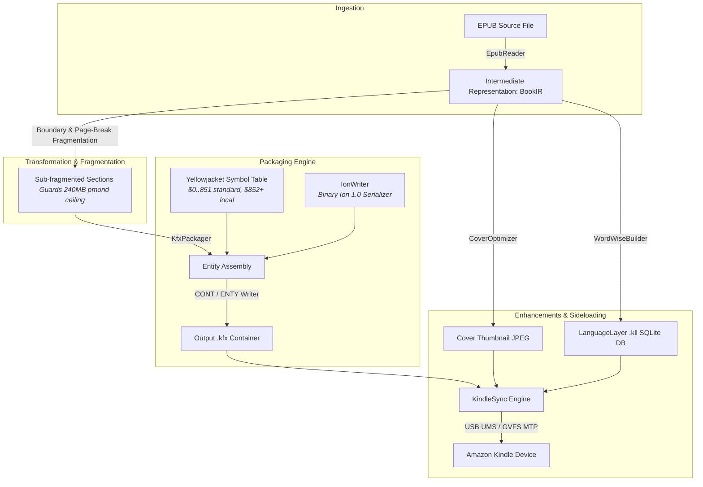

# kfx-converter

[](https://www.rust-lang.org/)
[](https://github.com/hwanjongyu/kfx_converter/actions/workflows/ci.yml)
[](LICENSE)
[]()

High-performance native EPUB to Amazon KFX (Yellowjacket / Enhanced Typesetting) e-book converter and Kindle toolchain written in Rust.

---

### Background: Bringing Word Wise to Sideloaded Books via KFX

I have always appreciated Kindle's **Word Wise** feature—it provides instant, context-aware definitions right above difficult words, significantly smoothing out the reading experience. However, while official books purchased from Amazon support Word Wise out of the box, personal collections (such as `.epub` files) do not.

To bridge this gap, I looked into converting my books into Amazon's proprietary formats. That journey led me through the evolution of Kindle formats:

* **MOBI:** The legacy format—widely compatible, but practically obsolete and lacking modern layout features.
* **AZW3 (KF8):** The standard modern format with improved CSS and typography support, yet still incapable of integrating Word Wise data.
* **KFX:** Amazon’s state-of-the-art container format, offering advanced typesetting, enhanced hyphenation, and crucially, native support for **Word Wise**.

Because of this, **adding first-class support for the KFX format became my absolute primary objective.** Without KFX, achieving a true, seamless Word Wise experience simply wasn't possible.

The major catch, however, is that producing valid KFX files typically relies on proprietary tools like Amazon Kindle Previewer, which generally require a full Windows environment to run reliably. Hitting this wall of OS-level limitations and platform dependencies made it abundantly clear: there is a pressing need for a **truly universal converter**—one capable of generating KFX files and embedding Word Wise data across any platform without the friction of OS-bound software.

---

## ⚡ Key Highlights

- **Zero Python / Calibre Runtime Dependencies**: Direct binary generation of Amazon KFX containers and Ion serialization without requiring external Python scripts, Calibre plugins, or Java/C runtimes.
- **Pure-Rust Amazon Ion Serializer**: Custom implementation of binary Amazon Ion 1.0 (Binary Version Marker `0xE0 0x01 0x00 0xEA`, 7-bit `VarUInt`/`VarInt`, and type descriptors).
- **Yellowjacket (YJ) Container Packaging**: Complete adherence to the 18-byte `CONT` header, `bcIndexTab` chunk indexing, and `ENTY` envelope wrapping.
- **Full Locator & Position Mapping**: Emits Amazon Kindle internal locator suites including `$609` (section position ID map), `$264` (position map), `$265` (position ID map), `$550` (350 chars/location map), and `$621` (`yj.location_pid_map`).
- **EPUB-to-KFX Links, Anchors & Footnote Popups**: Full two-pass internal cross-chapter/fragment hyperlink resolution and allowlisted external URIs (`http://`, `https://`, `mailto:`) emitted as `$266 anchor` entities, `$179 link_to` + `style_link` (SID `890`) across both prose and `Block::List` rich link spans, and `$617 yj.note` pop-up footnotes in `$597 auxiliary_data`.
- **Kindle OS Crash Mitigation (Section Fragmentation)**: Preserves native EPUB chapter boundaries while splitting oversized sections exceeding `1,000,000` characters or `10,000` blocks (`DEFAULT_MAX_SECTION_CHARS` / `DEFAULT_MAX_SECTION_BLOCKS` in `src/ir.rs`), plus author CSS forced page breaks (`page_break_before` / `page_break_after`), with TOC, Page-List, and internal link remapping to guard against Kindle's 240MB `pmond` memory ceiling.
- **Reading Enhancements**:
  - **Word Wise Sidecars (`.kll`)**: Enabled by default (`-w true`); automatically builds Amazon LanguageLayer SQLite databases with an expanded 52,000+ Kindle master lemma dictionary (or disables cleanly via `--word-wise false`).
  - **Cover Thumbnails**: Generates baseline JPEG thumbnails matching Kindle display requirements (`EBOK` or `PDOC` via `-c/--content-type`).
- **Universal Kindle Synchronization**: Automated device detection and sideloading supporting all Kindle generations (Paperwhite, Oasis, Voyage, Basic, Scribe, Colorsoft) across USB Mass Storage (UMS), Linux GVFS MTP (`/run/user/$UID/gvfs/mtp:*`), Windows/macOS volumes, and headless sysfs probing with `KINDLE_ROOT` overrides.
- **Automated Multi-Platform CI/CD**: GitHub Actions pipelines testing **Linux, macOS, and Windows** runners with zero-warning lint gates (`-D warnings`) and test-gated releases.
- **Dual Frontends**: Fast CLI tool (`kfx-conv`) and modern GPU-accelerated desktop UI (`kfx-studio` powered by GPUI with embedded Windows PE version metadata and GPUI UAC manifest).

---

## 🏗️ Architecture Overview



---

## 📦 Project Structure

```
kfx_converter/
├── Cargo.toml                           # Package configuration and feature flags
├── build.rs                             # OUT_DIR Linux native library locator & Windows PE resources
├── .github/workflows/
│   ├── ci.yml                           # Multi-platform (Linux, macOS, Windows) CI lint/test/coverage/docs pipeline
│   └── release.yml                      # Test-gated cross-platform release workflow
├── src/
│   ├── lib.rs                           # Core library definitions and re-exports
│   ├── main.rs                          # CLI entry point (`kfx-conv`)
│   ├── symbols.rs                       # 852-entry Yellowjacket symbol table and KfxSymbol enum
│   ├── ion.rs                           # Binary Amazon Ion serializer and ENTY wrapper
│   ├── container.rs                     # CONT header and bcIndexTab chunk reader/writer
│   ├── css.rs                           # CSS parser, font ratio, and element style cache
│   ├── epub/                            # Modular streaming EPUB ingestion subsystem
│   │   ├── mod.rs                       # EpubReader public facade and comprehensive tests
│   │   ├── archive.rs                   # Zip decompression safety limits and bomb protection
│   │   ├── css_style.rs                 # CSS declaration sanitizer and font-size buckets
│   │   ├── dropcap.rs                   # Opening quote detection and drop-cap heuristics
│   │   ├── nav.rs                       # NCX & NAV navigation, TOC and page-list separation
│   │   ├── opf.rs                       # OPF package parsing and manifest resolution
│   │   ├── ruby.rs                      # Furigana state machine (RubyState)
│   │   └── xhtml/                       # Modular Quick-XML XHTML parser & tests
│   │       ├── mod.rs                   # Public facade, link context, and re-exports
│   │       ├── helpers.rs               # Tag/footnote/style stacks & element classifiers
│   │       ├── parser.rs                # XhtmlParser state machine & event handlers
│   │       └── tests.rs                 # XHTML parser unit and regression tests
│   ├── ir.rs                            # Book intermediate representation and section fragmenter
│   ├── packager/                        # Modular Yellowjacket packaging engine
│   │   ├── mod.rs                       # Packager module exports
│   │   ├── core.rs                      # KfxPackager two-pass orchestrator and atomic file writer
│   │   ├── accumulator.rs               # TextAccumulator ($145 content 8 KiB chunking)
│   │   ├── error.rs                     # PackagerError types
│   │   ├── types.rs                     # Shared packager staging structs
│   │   ├── locators.rs                  # Locator maps ($264, $265, $550, $609, $621)
│   │   ├── metadata.rs                  # Book metadata, capabilities, and content features
│   │   ├── navigation.rs                # TOC, reading orders, and page-list nav containers
│   │   ├── resources.rs                 # External resources ($164) and raw binary payloads ($417)
│   │   ├── storylines.rs                # Sections ($260), storylines ($259), anchors ($266), yj.note ($617)
│   │   ├── styles.rs                    # Style dictionary assembly ($157, including style_link 890)
│   │   ├── symbols.rs                   # Local symbol interning and SID allocation ($852+)
│   │   └── tests/                       # Modular packager unit and regression tests
│   │       ├── mod.rs                   # Shared test helpers & core container/ID tests
│   │       ├── resources.rs             # Resource, cover, image, GIF, SVG & font tests
│   │       ├── styles_and_metadata.rs   # Styles, headings, CSS, dropcaps & $490/$585 tests
│   │       └── links_and_navigation.rs  # TOC, page-list, links, tables & footnote tests
│   ├── pipeline.rs                      # Unified ConversionPipeline orchestrator
│   ├── validator/                       # Preflight Yellowjacket entity, link, and reference validator
│   │   ├── mod.rs                       # ValidationError, ValidationReport & container checks
│   │   ├── walk.rs                      # WalkContext & recursive Ion field validators
│   │   └── tests.rs                     # Preflight validator unit and regression tests
│   ├── sync/                            # Universal Kindle sync subsystem
│   │   ├── mod.rs                       # KindleSync facade and DEVICE_SYNC_LOCK
│   │   ├── catalog.rs                   # Device library scanning and stale .sdr cleanup
│   │   ├── device.rs                    # UMS, GVFS MTP, Windows/macOS, sysfs USB & eject
│   │   ├── sanitize.rs                  # FAT32/VFAT filename, DOS name, ASIN & tag sanitization
│   │   ├── transfer.rs                  # Non-blocking MTP/UMS file transfer helpers
│   │   └── types.rs                     # KindleDeviceInfo, KindleBookFile & SyncError types
│   ├── enhancements/
│   │   ├── mod.rs
│   │   ├── cover.rs                     # Baseline JPEG thumbnail & content image optimizer
│   │   ├── dictionary.rs                # Built-in Kindle master lemma database
│   │   ├── sdr.rs                       # Unified .sdr sidecar deployment
│   │   ├── word_wise.rs                 # Kindle SQLite Word Wise sidecar generator
│   │   └── wordwise_dict.bin            # Embedded master Word Wise vocabulary blob
│   └── ui/                              # GPUI Desktop Application (`kfx-studio`)
│       ├── main.rs                      # Desktop GUI binary entry point
│       ├── state.rs                     # GUI application state and caching helpers
│       ├── theme.rs                     # UI color palettes and styling
│       └── app/                         # Modular GPUI view and controller components
│           ├── mod.rs
│           ├── actions.rs
│           ├── components.rs
│           ├── converter.rs
│           ├── dual_pane.rs
│           ├── folder_browser.rs
│           ├── header.rs
│           └── kindle_explorer.rs
└── docs/
    ├── README.md                        # Documentation hub index and navigation map
    ├── ARCHITECTURE.md                  # Technical architecture and subsystems
    ├── FORMAT_SPEC.md                   # KFX / Yellowjacket container format specification
    ├── CLI_GUIDE.md                     # Detailed CLI user guide and device sync
    ├── YELLOWJACKET.md                  # In-depth Yellowjacket rendering engine monograph
    ├── WORD_WISE.md                     # Amazon Word Wise & LanguageLayer database monograph
    ├── multi_model_review_report.md     # Multi-model consensus audit
    ├── specs/                           # Phase 1 technical specifications
    └── qa/                              # Phase 2 QA verification reports
```

---

## 🚀 Installation & Building

### Prerequisites

- [Rust](https://rustup.rs/) (2024 edition, 1.85+ recommended)
- **Linux GUI system packages** (required if compiling with `--features gui` or `--all-features`, matching `.github/workflows/ci.yml`):
  ```bash
  sudo apt-get update
  sudo apt-get install -y --no-install-recommends \
    pkg-config \
    libasound2-dev \
    libxkbcommon-dev \
    libxkbcommon-x11-dev \
    libvulkan-dev \
    libwayland-dev \
    libfontconfig1-dev
  ```

### Build the CLI (`kfx-conv`)

```bash
# Build the default CLI binary
cargo build --release --bin kfx-conv

# Output binary will be at:
# target/release/kfx-conv
```

### Build and Run the GPUI Desktop GUI (`kfx-studio`)

The desktop GUI uses the high-performance GPUI framework. Enable the `gui` feature flag:

```bash
# Build the GUI binary
cargo build --release --bin kfx-studio --features gui

# Run the pre-built release binary directly
./target/release/kfx-studio

# Or build and launch directly via Cargo
cargo run --release --bin kfx-studio --features gui
```

---

## 💻 CLI Usage (`kfx-conv`)

```
High-performance native EPUB to Amazon KFX converter

Usage: kfx-conv [OPTIONS] <INPUT>

Arguments:
  <INPUT>  Input EPUB or KFX file path

Options:
  -o, --output <OUTPUT>              Output destination path
  -i, --inspect                      Inspect / dump KFX container metadata and chunks
  -s, --sync                         Automatically synchronize converted book to connected Kindle device
  -w, --word-wise[=<WORD_WISE>]      Generate Word Wise sidecar (.kll) [default: true] [possible values: true, false]
  -c, --content-type <CONTENT_TYPE>  Kindle content definition environment type (EBOK for books/lockscreen, PDOC for personal documents) [default: EBOK] [possible values: EBOK, PDOC]
  -h, --help                         Print help
  -V, --version                      Print version
```

> **Note:** Both `--word-wise=false` and space-separated `--word-wise false` / `-w false` forms are supported (`-w` without a value keeps Word Wise enabled).

### Examples

#### 1. Basic Conversion (Word Wise Enabled by Default)
Convert an EPUB file into a native `.kfx` book with an accompanying Word Wise `.kll` sidecar:
```bash
kfx-conv book.epub -o book.kfx
```

#### 2. Conversion Without Word Wise
Disable Word Wise `.kll` generation explicitly:
```bash
kfx-conv book.epub -o book.kfx --word-wise false
# or: kfx-conv book.epub -o book.kfx --word-wise=false
```

#### 3. Convert as Personal Document (`PDOC`) & Auto-Sync to Kindle
Convert an EPUB (as `EBOK` by default, or `PDOC` with `-c PDOC`), optimize its cover thumbnail, compile Word Wise glosses, and automatically sideload directly to a connected Kindle device:
```bash
kfx-conv book.epub -s
# Or target PDOC content type explicitly:
kfx-conv book.epub -c PDOC -s
```

#### 4. Inspect an Existing KFX File
Examine the internal chunk hierarchy and symbol types of any KFX container:
```bash
kfx-conv book.kfx -i
```

Output:
```text
Valid KFX Container:
  Version: 2
  Header Length: 42 bytes
  ContainerInfo Offset: 88 bytes
  ContainerInfo Length: 124 bytes
  Total Chunks: 14
    [0] ID: 852, Type: bcContId ($409), Offset: 212, Length: 64 bytes
    [1] ID: 853, Type: book_metadata ($490), Offset: 276, Length: 512 bytes
    [2] ID: 854, Type: section ($260), Offset: 788, Length: 4096 bytes
    ...
```

---

## 🧪 Testing

Run standard unit and integration tests across the entire project:

```bash
# Run core library tests without default features
cargo test --lib --no-default-features

# Run full test suite (CLI + GUI + Integration)
cargo test --all-features
```

---

## 📄 License

This project is licensed under the [MIT License](LICENSE).
