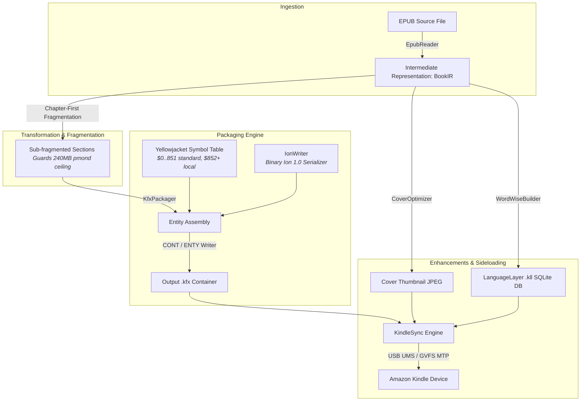

# kfx-converter

[](https://www.rust-lang.org/)
[](https://github.com/hwanjongyu/kfx_converter/actions/workflows/ci.yml)
[](LICENSE)
[]()

High-performance native EPUB to Amazon KFX (Yellowjacket / Enhanced Typesetting) e-book converter and Kindle toolchain written in Rust.

---

### Background: Bringing Word Wise to Sideloaded Books via KFX

I have always appreciated Kindle's **Word Wise** feature—it provides instant, context-aware definitions right above difficult words, significantly smoothing out the reading experience. However, while official books purchased from Amazon support Word Wise out of the box, personal collections (such as `.epub` files) do not.

To bridge this gap, I looked into converting my books into Amazon's proprietary formats. That journey led me through the evolution of Kindle formats:

* **MOBI:** The legacy format—widely compatible, but practically obsolete and lacking modern layout features.
* **AZW3 (KF8):** The standard modern format with improved CSS and typography support, yet still incapable of integrating Word Wise data.
* **KFX:** Amazon’s state-of-the-art container format, offering advanced typesetting, enhanced hyphenation, and crucially, native support for **Word Wise**.

Because of this, **adding first-class support for the KFX format became my absolute primary objective.** Without KFX, achieving a true, seamless Word Wise experience simply wasn't possible. 

The major catch, however, is that producing valid KFX files typically relies on proprietary tools like Amazon Kindle Previewer, which generally require a full Windows environment to run reliably. Hitting this wall of OS-level limitations and platform dependencies made it abundantly clear: there is a pressing need for a **truly universal converter**—one capable of generating KFX files and embedding Word Wise data across any platform without the friction of OS-bound software.

---

## ⚡ Key Highlights

- **Zero Python / Calibre Runtime Dependencies**: Direct binary generation of Amazon KFX containers and Ion serialization without requiring external Python scripts, Calibre plugins, or Java/C runtimes.
- **Pure-Rust Amazon Ion Serializer**: Custom implementation of binary Amazon Ion 1.0 (Binary Version Marker `0xE0 0x01 0x00 0xEA`, 7-bit `VarUInt`/`VarInt`, and type descriptors).
- **Yellowjacket (YJ) Container Packaging**: Complete adherence to the 18-byte `CONT` header, `bcIndexTab` chunk indexing, and `ENTY` envelope wrapping.
- **Full Locator & Position Mapping**: Emits Amazon Kindle internal locator suites including `$609` (section position ID map), `$264` (position map), `$265` (position ID map), `$550` (350 chars/location map), and `$621` (`yj.location_pid_map`).
- **Kindle OS Crash Mitigation (Chapter Fragmentation)**: Automatically splits oversized sections exceeding calibrated thresholds (3,500 characters or 15 blocks) with full TOC/Page-List remapping to prevent reader engines from hitting Kindle's 240MB `pmond` memory ceiling.
- **Reading Enhancements**:
  - **Word Wise Sidecars (`.kll`)**: Automatically builds Amazon LanguageLayer SQLite databases with a curated built-in CEFR B2–C2 academic lemma dictionary.
  - **Cover Thumbnails**: Generates baseline JPEG thumbnails matching Kindle display requirements.
- **Universal Kindle Synchronization**: Automated device detection and sideloading supporting all Kindle generations (Paperwhite, Oasis, Voyage, Basic, Scribe, Colorsoft) across USB Mass Storage (UMS), Linux GVFS MTP (`/run/user/$UID/gvfs/mtp:*`), and headless sysfs probing with `KINDLE_ROOT` overrides.
- **Automated Multi-Platform CI/CD**: Strict GitHub Actions pipeline testing Linux and macOS runners with zero-warning lint gates (`-D warnings`).
- **Dual Frontends**: Fast CLI tool (`kfx-conv`) and modern GPU-accelerated desktop UI (`kfx-studio` powered by GPUI).

---

## 🏗️ Architecture Overview



---

## 📦 Project Structure

```
converter_epub2kfx/
├── Cargo.toml                 # Package configuration and feature flags
├── build.rs                   # Build script
├── .github/workflows/ci.yml   # Multi-platform (Linux & macOS) CI/CD pipeline
├── src/
│   ├── lib.rs                 # Core library definitions and re-exports
│   ├── main.rs                # CLI entry point (`kfx-conv`)
│   ├── symbols.rs             # 852-entry Yellowjacket symbol table and enum
│   ├── ion.rs                 # Binary Amazon Ion serializer and ENTY wrapper
│   ├── container.rs           # CONT header and bcIndexTab chunk reader/writer
│   ├── css.rs                 # CSS parser, font ratio, and element style cache
│   ├── epub/                  # Modular streaming EPUB ingestion subsystem
│   │   ├── mod.rs             # EpubReader public facade and comprehensive tests
│   │   ├── archive.rs         # Zip decompression safety limits and bomb protection
│   │   ├── css_style.rs       # CSS declaration sanitizer and font-size buckets
│   │   ├── dropcap.rs         # Opening quote detection and drop-cap heuristics
│   │   ├── nav.rs             # NCX & NAV navigation, TOC and page-list separation
│   │   ├── opf.rs             # OPF package parsing and manifest resolution
│   │   ├── ruby.rs            # Furigana state machine (RubyState)
│   │   └── xhtml.rs           # Quick-XML event handler and block coordinator
│   ├── ir.rs                  # Book intermediate representation and section fragmenter
│   ├── packager/              # Modular Yellowjacket packaging engine
│   │   ├── mod.rs             # KfxPackager orchestrator and integration tests
│   │   ├── locators.rs        # Locator maps ($264, $265, $550, $609, $621)
│   │   ├── metadata.rs        # Book metadata, capabilities, and cover templates
│   │   ├── navigation.rs      # TOC, reading orders, and page-list nav containers
│   │   ├── resources.rs       # External resources and raw binary payloads ($417)
│   │   ├── storylines.rs      # Section entities, storylines, and auxiliary data
│   │   ├── styles.rs          # Style dictionary assembly ($157)
│   │   └── symbols.rs         # Local symbol interning and SID allocation
│   ├── pipeline.rs            # Unified ConversionPipeline orchestrator
│   ├── validator.rs           # Preflight Yellowjacket entity and reference validator
│   ├── sync.rs                # Universal Kindle sync (UMS, GVFS MTP, sysfs, FUSE)
│   ├── enhancements/
│   │   ├── mod.rs
│   │   ├── cover.rs           # Baseline JPEG thumbnail optimizer
│   │   ├── dictionary.rs      # Built-in CEFR B2-C2 academic lemma database
│   │   ├── sdr.rs             # Unified .sdr sidecar deployment
│   │   └── word_wise.rs       # Kindle SQLite Word Wise sidecar generator
│   └── ui/                    # GPUI Desktop Application (`kfx-studio`)
│       ├── main.rs            # Desktop GUI binary entry point
│       ├── app.rs             # GPUI views and layouts
│       ├── state.rs           # GUI application state
│       └── theme.rs           # UI color palettes and styling
└── docs/
    ├── README.md                     # Documentation hub index and navigation map
    ├── ARCHITECTURE.md               # Technical architecture and subsystems
    ├── FORMAT_SPEC.md                # KFX / Yellowjacket container format specification
    ├── CLI_GUIDE.md                  # Detailed CLI user guide and device sync
    ├── YELLOWJACKET.md               # In-depth Yellowjacket rendering engine monograph
    ├── WORD_WISE.md                  # Amazon Word Wise & LanguageLayer database monograph
    └── multi_model_review_report.md  # Multi-model consensus audit
```

---

## 🚀 Installation & Building

### Prerequisites

- [Rust](https://rustup.rs/) (2024 edition, 1.85+ recommended)
- `pkg-config` and `libssl-dev` (if compiling with optional GUI features on Linux)

### Build the CLI (`kfx-conv`)

```bash
# Build the default CLI binary
cargo build --release --bin kfx-conv

# Output binary will be at:
# target/release/kfx-conv
```

### Build and Run the GPUI Desktop GUI (`kfx-studio`)

The desktop GUI uses the high-performance GPUI framework. Enable the `gui` feature flag:

```bash
# Build the GUI binary
cargo build --release --bin kfx-studio --features gui

# Run the pre-built release binary directly
./target/release/kfx-studio

# Or build and launch directly via Cargo
cargo run --release --bin kfx-studio --features gui
```

---

## 💻 CLI Usage (`kfx-conv`)

```
High-performance native EPUB to Amazon KFX converter

Usage: kfx-conv [OPTIONS] <INPUT>

Arguments:
  <INPUT>  Input EPUB or KFX file path

Options:
  -o, --output <OUTPUT>    Output destination path [default: <INPUT>.kfx]
  -i, --inspect            Inspect / dump KFX container metadata and chunks
  -w, --word-wise          Generate Word Wise sidecar (.kll)
  -s, --sync               Automatically synchronize converted book to connected Kindle device
  -h, --help               Print help
  -V, --version            Print version
```

### Examples

#### 1. Basic Conversion
Convert an EPUB file into a native `.kfx` book:
```bash
kfx-conv book.epub -o book.kfx
```

#### 2. Conversion with Word Wise Sidecar
Generate the KFX container and an accompanying Word Wise SQLite database (`.kll`):
```bash
kfx-conv book.epub -o book.kfx -w
```

#### 3. Convert & Auto-Sync to Kindle
Convert an EPUB, optimize its cover thumbnail, compile Word Wise glosses, and automatically sideload directly to a connected Kindle device:
```bash
kfx-conv book.epub -w -s
```

#### 4. Inspect an Existing KFX File
Examine the internal chunk hierarchy and symbol types of any KFX container:
```bash
kfx-conv book.kfx -i
```

Output:
```text
Valid KFX Container:
  Version: 2
  Header Length: 42 bytes
  ContainerInfo Offset: 88 bytes
  ContainerInfo Length: 124 bytes
  Total Chunks: 14
    [0] ID: 852, Type: bcContId ($), Offset: 212, Length: 64 bytes
    [1] ID: 853, Type: book_metadata ($), Offset: 276, Length: 512 bytes
    [2] ID: 854, Type: section ($), Offset: 788, Length: 4096 bytes
    ...
```

---

## 🧪 Testing

Run standard unit tests across the container, Ion encoder, and section fragmentation modules:

```bash
cargo test
```

---

## 📄 License

This project is licensed under the [MIT License](LICENSE).
