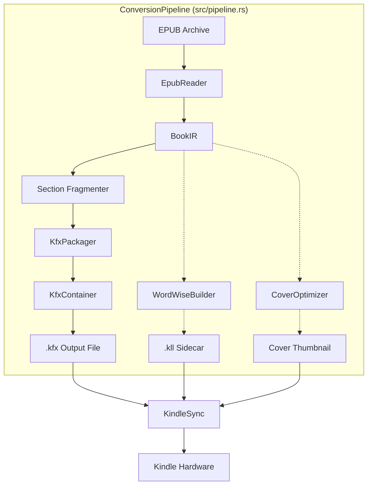

# System Architecture: `kfx-converter`

This document outlines the internal architecture, design patterns, and subsystems of `kfx-converter`, a native Rust toolchain for converting EPUB documents into Amazon KFX (Yellowjacket) container format.

---

## 1. High-Level Design Principles

- **Zero-Dependency Native Runtime**: Eliminates Python, Calibre plugins, and external C bindings. Serialization and packaging are performed in pure Rust.
- **Strict Decoupling via Intermediate Representation (`BookIR`)**: Ingestion parsers (EPUB 2 / EPUB 3) produce an intermediate model decoupled from output serialization. Future formats (CBZ, PDF, Markdown) can target `BookIR` directly.
- **Hardware & Engine Awareness**: Adheres to the memory constraints and rendering quirks of Amazon Kindle e-readers (such as the 240MB memory ceiling of the `pmond` daemon).
- **Streaming & Memory Efficiency**: Minimizes unnecessary buffer cloning during entity serialization and container indexing.

---

## 2. Pipeline Subsystems

The conversion pipeline is unified under `ConversionPipeline` (`src/pipeline.rs`) and consists of six primary subsystems:



### 2.1 Ingest Engine (`src/epub/`)
- **Subsystem Modularization**: Decomposed into domain-focused submodules:
  - `archive.rs`: Enforces zip decompression bomb guards, cumulative byte limits (1 GB ceiling), and path traversal sanitation.
  - `opf.rs`: Parses Dublin Core metadata, spine reading order, and manifest asset catalog.
  - `nav.rs`: Extracts hierarchical Table of Contents and sequential `page-list` from NCX and EPUB 3 Navigation documents.
  - `xhtml.rs`: Drives streaming `quick-xml` event processing for block and span assembly.
  - `css_style.rs`: Handles CSS declaration parsing, last-wins merging, font size scaling, and dark-mode safety filters.
  - `dropcap.rs`: Implements quote-aware dropcap extraction (`is_opening_quote`) and span borrowing.
  - `ruby.rs`: Manages East Asian Furigana annotation layout (`RubyState`).

### 2.2 Intermediate Representation & Section Fragmentation (`src/ir.rs`)
- **`BookIR` Structure**: Standardizes metadata, ordered sections, plain text spans (`TextSpan`), hyperlinks/anchors, footnotes, and raw asset buffers.
- **Native Boundary Preservation & Smart Fragmentation**: Preserves native EPUB XHTML file boundaries without artificial mid-chapter page breaks (`DEFAULT_MAX_SECTION_CHARS = 1_000_000`, `DEFAULT_MAX_SECTION_BLOCKS = 10_000`), maintaining seamless continuous reading flow while strictly respecting author-intended CSS forced page breaks (`page_break_before` / `page_break_after`). Any chapters exceeding calibrated limits are automatically partitioned into sequential sub-sections (`_p1`, `_p2`) with dynamic TOC, page list, and internal `TextSpan.href` remapping to protect low-RAM Kindle devices from hitting the 240MB `pmond` memory threshold.

### 2.3 Binary Amazon Ion Serializer (`src/ion.rs`)
- **Ion 1.0 Specification**: Generates valid binary Ion streams beginning with the Binary Version Marker (`0xE0 0x01 0x00 0xEA`).
- **Variable-Length Integers**: Encodes unsigned integers via 7-bit `VarUInt` (MSB set on the terminal byte) and signed integers via `VarInt`.
- **Ion Type Descriptors**: Directly emits nulls, booleans, integers, decimals, strings, symbols, lists, and structs with compact length headers.
- **Annotated Values**: Emits annotations (e.g., Ion Symbol 3 for `$ion_symbol_table`) for entity payloads and metadata.

### 2.4 Yellowjacket Packaging Engine (`src/packager/`)
- **Subsystem Modularization**:
  - `mod.rs`: Public module exports for the packaging subsystem (`KfxPackager`, `PackagerError`, style/symbol helpers).
  - `core.rs`: Top-level `KfxPackager` orchestrator running the two-pass entity assembly pipeline and atomic `.kfx` file emission.
  - `accumulator.rs`: `TextAccumulator` splitting `$145 content` text chunks cleanly at `MAX_CONTENT_CHUNK_BYTES = 8_192` without mid-segment overshoot.
  - `error.rs` & `types.rs`: Typed packaging errors (`PackagerError`) and shared section/anchor staging records.
  - `symbols.rs`: Manages `LocalSymbols` registry, starting document SIDs at `852` while respecting the Amazon standard range `$0..851`.
  - `metadata.rs`: Constructs `$490` (`book_metadata`), `$538` (`document_data`), `$585` (`content_features`), and `$593` (`format_capabilities`).
  - `storylines.rs`: Generates `$145` (`content`), `$259` (`storyline`), `$260` (`section`), `$266` (`anchor` for internal targets and allowlisted `http`/`https`/`mailto` URIs), `$179` (`link_to` in `$142 style_events` across paragraphs, headings, and `Block::List` items), and `$597` (`auxiliary_data` with `$617 yj.note` footnote popups).
  - `resources.rs`: Generates external resource definitions (`$164`) and couples raw asset payloads (`$417`).
  - `navigation.rs`: Assembles `$389` (`book_navigation`), `$391` (`nav_container`), TOC hierarchy, landmarks, and page lists.
  - `locators.rs`: Calibrates Kindle reading metrics, emitting `$609` (section position ID map), `$264` (position map), `$265` (PID map), `$550` (350 chars/location map), and `$621` (`yj.location_pid_map`).
  - `styles.rs`: Compiles the `$157` (`style`) entity dictionary (including `style_link` at SID `890`) and font-size cascades.

### 2.5 Container Packaging (`src/container.rs`)
- **Container Layout**:
  ```
  +--------------------------------------------------------+
  | CONT Header (18 bytes)                                 |
  |   - Magic: 'CONT' (4 bytes)                            |
  |   - Version: 2 (2 bytes LE)                            |
  |   - Header Length (4 bytes LE)                         |
  |   - ContainerInfo Offset & Length (8 bytes LE)         |
  +--------------------------------------------------------+
  | Chunk Index Table: bcIndexTab                          |
  |   - Array of 24-byte Chunk Entries:                    |
  |     (entity_id: u32, chunk_type: u32,                  |
  |      offset: u64, length: u64)                         |
  +--------------------------------------------------------+
  | Document Symbols & Format Capabilities Header Data     |
  +--------------------------------------------------------+
  | ContainerInfo Chunk                                    |
  +--------------------------------------------------------+
  | Entity Chunks (Payloads wrapped with ENTY envelope)   |
  +--------------------------------------------------------+
  ```
- **ENTY Envelope**: Wraps entity payloads with magic bytes `ENTY`, envelope version, header length, and default compression/DRM indicators (`$410: 0`, `$411: 0`).

### 2.6 Sidecar Generators & Device Sync (`src/enhancements/`, `src/sync/`)
- **Word Wise Sidecar (`.kll`)**: Compiles SQLite databases containing lemma glosses, difficulty scores, and reading positions (`word_wise.rs`, `dictionary.rs`). Uses a curated 52,000+ Kindle master lemma dictionary to ensure offline standalone operation.
- **Cover Optimization (`cover.rs`)**: Converts cover graphics into baseline non-progressive JPEG thumbnails conforming to Kindle hardware display constraints.
- **Sidecar Deployment (`sdr.rs`)**: Atomic staging and symlink-safe deployment of `.kll` databases and cover thumbnails.
- **Universal Kindle Synchronization (`src/sync/`)**:
  - `mod.rs` & `types.rs`: `KindleSync` facade, `DEVICE_SYNC_LOCK` serialization mutex, and sync domain models.
  - `device.rs`: Resolves model identity (Paperwhite, Oasis, Voyage, Basic, Scribe, Colorsoft), detects UMS mounts (`/media/*`, `/run/media/*`), desktop GVFS MTP mounts (`/run/user/$UID/gvfs/mtp:*`), Windows/macOS volumes, headless sysfs USB (`1949`), and `KINDLE_ROOT` / `KINDLE_MOUNT_PATH` overrides.
  - `catalog.rs`: Scans device `documents/` libraries and prunes stale `.bad_file` markers and orphaned `.sdr` sidecars.
  - `sanitize.rs`: FAT32/VFAT filename, DOS reserved name, ASIN, and sidecar tag sanitization.
  - `transfer.rs`: Non-blocking file transfers (`gio copy` with watchdog timers on MTP, buffered copy without USB gadget flush stalls on UMS).

### 2.7 Pre-Flight Validation & Desktop Studio (`src/validator.rs`, `src/ui/`)
- **Pre-Flight Validator (`src/validator.rs`)**: Validates `$419` container entity maps, `$266` anchors, `$179` `link_to` targets, `$617` `yj.note` popups, and `$164`/`$417` resource integrity before writing final containers.
- **GPUI Desktop Application (`src/ui/`)**: Dual-pane desktop studio (`main.rs`, `state.rs`, `theme.rs`) organized under `src/ui/app/` (`mod.rs`, `actions.rs`, `components.rs`, `converter.rs`, `dual_pane.rs`, `folder_browser.rs`, `header.rs`, `kindle_explorer.rs`).
