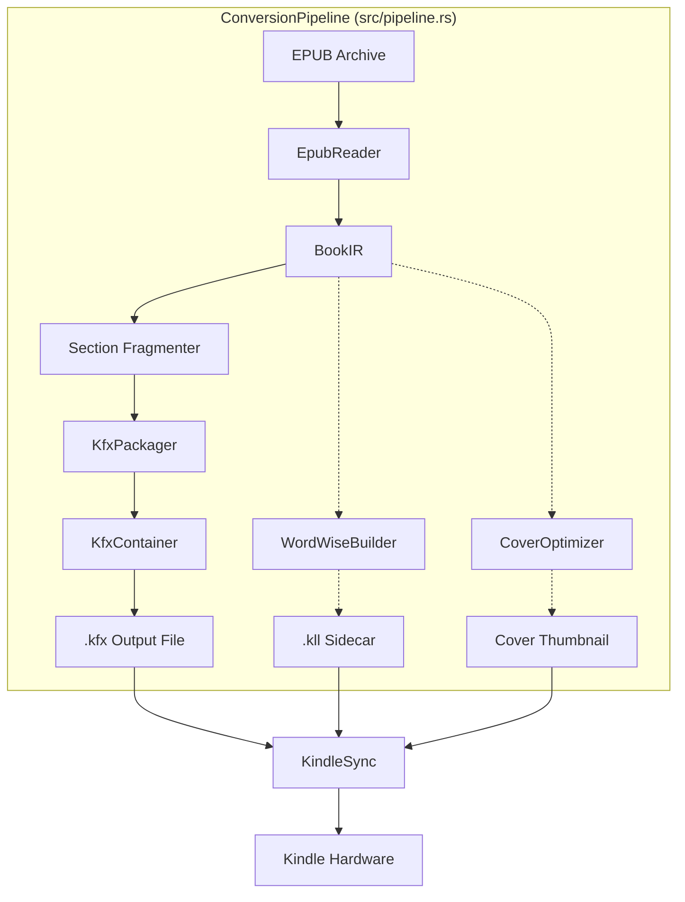

# System Architecture: `kfx-converter`

This document outlines the internal architecture, design patterns, and subsystems of `kfx-converter`, a native Rust toolchain for converting EPUB documents into Amazon KFX (Yellowjacket) container format.

---

## 1. High-Level Design Principles

- **Zero-Dependency Native Runtime**: Eliminates Python, Calibre plugins, and external C bindings. Serialization and packaging are performed in pure Rust.
- **Strict Decoupling via Intermediate Representation (`BookIR`)**: Ingestion parsers (EPUB 2 / EPUB 3) produce an intermediate model decoupled from output serialization. Future formats (CBZ, PDF, Markdown) can target `BookIR` directly.
- **Hardware & Engine Awareness**: Adheres to the memory constraints and rendering quirks of Amazon Kindle e-readers (such as the 240MB memory ceiling of the `pmond` daemon).
- **Streaming & Memory Efficiency**: Minimizes unnecessary buffer cloning during entity serialization and container indexing.

---

## 2. Pipeline Subsystems

The conversion pipeline is unified under `ConversionPipeline` (`src/pipeline.rs`) and consists of six primary subsystems:



### 2.1 Ingest Engine (`src/epub.rs`)
- **Decompression Bomb Protection**: Enforces pre-flight inspection of entry counts, uncompressed byte ceilings, and compression ratios.
- **DOM Streaming**: Utilizes `quick-xml` event parsing to process XHTML documents in a streaming fashion, extracting paragraphs, headings, lists, tables, and images.
- **OPF & Metadata Resolution**: Extracts Dublin Core metadata, spine ordering, and binary asset payloads (JPEG, PNG).

### 2.2 Intermediate Representation & Section Fragmentation (`src/ir.rs`)
- **`BookIR` Structure**: Standardizes metadata, ordered sections, plain text spans, and raw asset buffers.
- **Native Boundary Preservation & Smart Fragmentation**: Preserves native EPUB XHTML file boundaries without artificial mid-chapter page breaks (`DEFAULT_MAX_SECTION_CHARS = 1,000,000`, `DEFAULT_MAX_SECTION_BLOCKS = 10,000`), maintaining seamless continuous reading flow while strictly respecting author-intended CSS forced page breaks (`page_break_before` / `page_break_after`). Any chapters exceeding calibrated limits are automatically partitioned into sequential sub-sections (`sec_p1`, `sec_p2`) with dynamic TOC and page list remapping to protect low-RAM Kindle devices from hitting the 240MB `pmond` memory threshold.

### 2.3 Binary Amazon Ion Serializer (`src/ion.rs`)
- **Ion 1.0 Specification**: Generates valid binary Ion streams beginning with the Binary Version Marker (`0xE0 0x01 0x00 0xEA`).
- **Variable-Length Integers**: Encodes unsigned integers via 7-bit `VarUInt` (MSB set on the terminal byte) and signed integers via `VarInt`.
- **Ion Type Descriptors**: Directly emits nulls, booleans, integers, decimals, strings, symbols, lists, and structs with compact length headers.
- **Annotated Values**: Emits annotations (e.g., Ion Symbol 3 for `$ion_symbol_table`) for entity payloads and metadata.

### 2.4 Yellowjacket Packaging Engine (`src/packager.rs`)
- **Symbol Allocation Strategy**:
  - Global Yellowjacket Symbols: Reserved in the range `$0..851` matching Amazon's built-in table.
  - Document-Local Symbols: Managed dynamically by `LocalSymbols`, strictly starting at SID `852` and serialized into an embedded `$ion_symbol_table` chunk.
- **Entity Assembly**:
  - **`$145` (`content`)**: Serialized section text, inline styles, and image references.
  - **`$259` (`storyline`)**: Structural layout and block sequencing.
  - **`$260` (`section`)**: Section metadata and rendering templates.
  - **`$490` (`book_metadata`)**: Title, authors, language, identifiers, and cover links.
  - **`$538` (`document_data`)**: Global reading parameters and baseline styling.
  - **`$585` (`content_features`)**: Enabled typography and engine capabilities.
  - **`$593` (`format_capabilities`)**: Placed into the container header to instruct Kindle OS which rendering features are required.
- **Navigation & Location Calibration**:
  - Emits `$609` (`section_position_id_map`) and `$621` (`yj.location_pid_map`).
  - Emits `$550` (`location_map`) calibrated to Amazon's standard metric of 350 characters per reading location.

### 2.5 Container Packaging (`src/container.rs`)
- **Container Layout**:
  ```
  +--------------------------------------------------------+
  | CONT Header (18 bytes)                                 |
  |   - Magic: 'CONT' (4 bytes)                            |
  |   - Version: 2 (2 bytes LE)                            |
  |   - Header Length (4 bytes LE)                         |
  |   - ContainerInfo Offset & Length (8 bytes LE)         |
  +--------------------------------------------------------+
  | Chunk Index Table: bcIndexTab                          |
  |   - Array of 24-byte Chunk Entries:                    |
  |     (entity_id: u32, chunk_type: u32,                  |
  |      offset: u64, length: u64)                         |
  +--------------------------------------------------------+
  | Document Symbols & Format Capabilities Header Data     |
  +--------------------------------------------------------+
  | ContainerInfo Chunk                                    |
  +--------------------------------------------------------+
  | Entity Chunks (Payloads wrapped with ENTY envelope)   |
  +--------------------------------------------------------+
  ```
- **ENTY Envelope**: Wraps entity payloads with magic bytes `ENTY`, envelope version, header length, and default compression/DRM indicators (`$410: 0`, `$411: 0`).

### 2.6 Sidecar Generators & Device Sync (`src/enhancements/`, `src/sync.rs`)
- **Word Wise Sidecar (`.kll`)**: Compiles SQLite databases containing lemma glosses, difficulty scores, and reading positions. Uses a curated CEFR B2-C2 academic dictionary to ensure offline standalone operation.
- **Cover Optimization**: Converts cover graphics into baseline non-progressive JPEG thumbnails conforming to Kindle hardware display constraints.
- **Kindle Synchronization**:
  - Detects USB Mass Storage mount points (`/media/*`, `/run/media/*`).
  - Detects Linux GVFS MTP mount points (`/run/user/$UID/gvfs/mtp:*`) and drives non-blocking transfers via `gio copy` with watchdog timers.
  - Performs companion `.sdr` directory housekeeping, cleaning stale `.bad_file` markers and orphaned sidecars.
