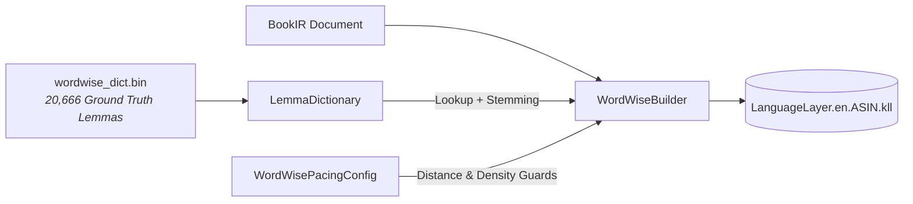

# Amazon Word Wise (LanguageLayer) Technical Monograph

This document provides a comprehensive technical overview of **Word Wise (LanguageLayer)**, Amazon's proprietary linguistic enhancement and dynamic in-line glossing engine integrated into the Kindle ecosystem (Kindle Paperwhite, Oasis, Scribe, Basic, and Kindle apps).

---

## 1. Background & Evolution

Introduced in 2014 alongside Kindle firmware 5.6.1, **Word Wise** was designed to assist English-language learners, young readers, and ESL audiences by displaying concise definitions and synonyms directly above challenging words as small, unobtrusive typographic overlays (glosses).

Historically:
- **Traditional Lookups**: Required readers to pause, highlight a word, and wait for a dictionary popup modal, disrupting reading flow and immersion.
- **Server-Side Generation**: Amazon historically pre-computed Word Wise data strictly on Amazon cloud servers for titles purchased directly from the Kindle Store, deliberately locking out personal documents (`PDOC`) and sideloaded EPUB/MOBI files.
- **Standalone Offline Execution**: On the device, Word Wise functions completely offline without internet connectivity. Definitions are rendered dynamically by combining a book-specific companion sidecar database (`.kll`) with an immutable system master dictionary (`.klld`) built into Kindle OS.

---

## 2. Word Wise Architecture & Runtime Flow

On modern Kindle e-ink devices, Word Wise operates within the **`KPPMainApp`** reader process and the **Kindle Unified Experience (KUX)** application layer through the **`WordWisePlugin`**:

```mermaid
flowchart TD
    subgraph Kindle Storage: /mnt/us/documents
        KFX_FILE["Book.kfx<br/><i>cde_content_type: 'EBOK'<br/>ASIN: 'B00XIYGCDO'<br/>asset_id: 'CR!...'</i>"]
        subgraph SDR_DIR["Book.sdr Directory"]
            KLL_FILE["LanguageLayer.en.B00XIYGCDO.kll<br/><i>glosses: start, difficulty, sense_id</i>"]
            YJF_FILE["Book.yjf / Book.yjr<br/><i>Reader Session & Annotation Cache</i>"]
        end
    end

    subgraph Kindle System Storage: /system/kll
        SYSTEM_DICT["kll.en.en.klld (SQLite)<br/><i>75,819 Lemmas & 86,384 Senses</i>"]
    end

    subgraph Kindle OS Runtime (KPPMainApp)
        PLUGIN["WordWisePlugin (KUX)"]
        SLIDER["Aa -> More -> Word Wise Slider<br/><i>Level 1 (Fewer) .. Level 5 (More)</i>"]
        LAYOUT["Yellowjacket Layout Engine<br/><i>Injects In-line Typographic Glyphs</i>"]
    end

    KFX_FILE -->|Reads ASIN & asset_id| PLUGIN
    KLL_FILE -->|Loads Position & Senses| PLUGIN
    SLIDER -->|Filters WHERE difficulty <= Slider| PLUGIN
    PLUGIN -->|Looks up short_def by sense_id| SYSTEM_DICT
    PLUGIN -->|Passes Gloss Overlays| LAYOUT
    LAYOUT -->|Renders on Screen| DISPLAY[E-Ink Display]
```

### 2.1 The Two-Tier Database Model
Unlike typical annotation formats that store raw definition strings directly within the book metadata, Amazon splits Word Wise into two decoupled components:
1. **The Book-Specific Sidecar (`.kll`)**: Contains *only* lightweight integer tuples: `(start_pid, difficulty_tier, sense_id)`. It contains **no text strings or definitions**.
2. **The Kindle System Master Dictionary (`.klld`)**: A permanent, compressed SQLite database located in `/system/kll/kll.en.en.klld` on the Kindle root filesystem, mapping `sense_id` integers to base64-encoded definitions and parts of speech.

This decoupling guarantees that a 500-page novel with 3,000 glosses requires a sidecar file of only **~60 KB**, preventing flash memory wear and preserving instant seek performance.

---

## 3. The Kindle System Master Dictionary (`kll.en.en.klld`)

Every Kindle running modern firmware maintains the pre-installed master dictionary at `/system/kll/kll.en.en.klld`.

### 3.1 Schema Anatomy
```sql
CREATE TABLE lemmas (
    id INTEGER PRIMARY KEY,
    lemma TEXT
);

CREATE TABLE senses (
    id INTEGER PRIMARY KEY,           -- sense_id referenced by .kll
    display_lemma_id INTEGER,
    term_id INTEGER,
    term_lemma_id INTEGER,            -- Foreign key to lemmas.id
    pos_type INTEGER,                 -- Part of speech enum
    source_id INTEGER,
    sense_number REAL,
    synset_id INTEGER,
    corpus_count INTEGER,             -- Usage frequency metric
    full_def TEXT,                    -- Extended definition (Base64)
    short_def TEXT,                   -- Word Wise gloss definition (Base64)
    example_sentence TEXT
);

CREATE INDEX senses_synset_id_index ON senses(synset_id);
CREATE INDEX senses_term_lemma_id_index ON senses(term_lemma_id);
```

### 3.2 Definition Encoding
The `short_def` column stores definition strings encoded in standard **Base64**:
- `YSBuYW1lIG9yIHRpdGxl` $\rightarrow$ *"a name or title"* (sense 1: `appellation`)
- `dW5hYmxlIHRvIHRoaW5rIG5vcm1hbGx5` $\rightarrow$ *"unable to think normally"* (sense 3: `deranged`)
- `dG8gc2hvdyBldmlkZW5jZSBvZg==` $\rightarrow$ *"to show evidence of"* (sense 22084: `demonstrate`)

At render time, the Kindle decoding routine unpacks the Base64 bytes directly into memory buffers to render above the target word.

---

## 4. The Companion Sidecar Database (`.kll`) Specification

The companion sidecar file resides inside the book's companion SDR directory:
$$\text{/documents/\{Author\}/\{Title\}.sdr/LanguageLayer.\{target\_lang\}.\{ASIN\}.kll}$$

### 4.1 SQLite Table Schemas

```sql
CREATE TABLE metadata (
    key TEXT,
    value TEXT
);

CREATE TABLE glosses (
    start INTEGER PRIMARY KEY,  -- Linear Position ID (PID)
    end INTEGER,                -- Optional end PID (NULL for single words)
    difficulty INTEGER,         -- Difficulty Tier: 1 to 5
    sense_id INTEGER,           -- References senses.id in kll.en.en.klld
    low_confidence BOOLEAN      -- Confidence flag (0 = high confidence)
);
```

### 4.2 Mandatory Metadata Keys

| Metadata Key | Expected Value | Purpose |
| :--- | :--- | :--- |
| **`acr`** | `CR!D6U4CNNQCY7EVD2Y3CK6URXOINP2` | **Amazon Content Reference**. Must match the KFX container's `asset_id` ($409 / $490) byte-for-byte. |
| **`targetLanguages`** | `en` | Target explanation language. |
| **`sourceLanguage`** | `en` | Source book language. |
| **`bookRevision`** | `034be348` | **8-character hexadecimal string**. Must match the book's asset revision hash. |
| **`sidecarRevision`** | `9` | Sidecar schema version (typically `7` or `9`). |
| **`sidecarFormat`** | `1.0` | Container format specification. |
| **`enDictionaryId`** | `kll.en.en` | References system dictionary identifier. |
| **`enDictionaryVersion`** | `2016-09-14` | Matches firmware dictionary version. |
| **`enDictionaryRevision`**| `57` | Matches firmware dictionary revision. |

---

## 5. Difficulty Calibration & The Inverted Pyramid Model

### 5.1 The Kindle Word Wise Slider Mechanics
The user-facing Kindle Word Wise slider offers 5 distinct levels:
- **Level 1**: *"Fewer Hints"*
- **Level 2**
- **Level 3**: Default / Medium
- **Level 4**
- **Level 5**: *"More Hints"*

Under the hood, when a reader adjusts the slider to position $K$ ($K \in [1, 5]$), the Kindle rendering engine executes:
```sql
SELECT start, end, sense_id FROM glosses 
WHERE difficulty <= ? AND start BETWEEN ? AND ?;
```

> [!IMPORTANT]
> Because the query uses `difficulty <= K`, **all difficulty 1 glosses are visible at every slider tier (1 through 5)**. 
> If a database only contains difficulty 4 and 5 entries, moving the slider to level 1, 2, or 3 will display **zero hints on the screen**.

### 5.2 Empirical Analysis of Official Amazon Books
Analysis of 53 commercial Amazon Kindle books on actual Kindle hardware (*The War of the Worlds*, *Dark Matter*, *The Book Thief*, *Olive Kitteridge*) revealed the universal distribution of Word Wise hints:

```
Difficulty Distribution (Inverted Pyramid)
Level 1 (Fewer Hints):  [===]                4.8%  (GRE / Archaic / Esoteric)
Level 2:                [======]            11.1%  (Advanced Academic / CEFR C2)
Level 3 (Default):      [============]      23.4%  (Upper-Intermediate / CEFR C1)
Level 4:                [=================] 33.2%  (Intermediate / CEFR B2)
Level 5 (More Hints):   [============== ]   27.5%  (Foundational Descriptive / CEFR B1)
```

In a full-length 300-page commercial novel:
- At **Slider 1**: ~50 total hints appear across the entire book (only the most esoteric words like *abstruse*, *chicanery*, *anachronism*).
- At **Slider 3 (Default)**: ~300 to 500 hints appear (~1 hint per page).
- At **Slider 5**: ~3,000 to 6,000 hints appear (~10–15 hints per page).

---

## 6. Positional Addressing & PID Accumulation Mechanics

For in-line glosses to render above the exact target word, the `start` integer in `glosses` must match Yellowjacket's internal linear **Position Identifier (PID)**.

### 6.1 Yellowjacket PID Formula
Yellowjacket allocates PIDs linearly across the document based on its internal structural elements:
1. Each **Section Root** consumes exactly **1 PID**.
2. Each **Block Element** (Paragraph, Heading, List Item) consumes PIDs equal to the character length of its text:
   $$\text{Block PID Length} = \max(1, \text{char\_count})$$
3. An empty block or section placeholder consumes **1 PID**.

```
+--------------------------------------------------------------------------------+
| Section 0 (PID 0..100)                                                         |
|   PID 0: Section Root Template Element                                         |
|   PID 1..50:   Block 0 Paragraph ("The opening sentence...")                   |
|   PID 51..100: Block 1 Paragraph ("Another paragraph...")                      |
+--------------------------------------------------------------------------------+
| Section 1 (PID 101..250)                                                       |
|   PID 101: Section Root Template Element                                       |
|   PID 102..250: Block 0 Paragraph ("Chapter One starts here...")               |
+--------------------------------------------------------------------------------+
```

### 6.2 Word Character Start Calculation
Within any text block starting at base `block_base_pid`:
$$\text{Word Gloss PID} = \text{section\_root\_pid} + \text{block\_offset} + \text{char\_index}$$

Where `char_index` is the 0-indexed Unicode character offset of the first letter of the word within the plain text string.

---

## 7. Firmware Guardrails & Sideloading Invariants

Amazon's Kindle firmware enforces strict security and metadata rules before loading sidecars. Violating any of these rules causes the Kindle reader to log:
`WordWisePlugin_GetDecorationsFlow_GetWordWiseDecorationsCacheMiss`
and completely suppress gloss rendering.

### 7.1 Mandatory ASIN Format (`^B[0-9A-Z]{9}$`)
Kindle OS validates book ASINs against Amazon's official regex:
$$\text{Regex: } \mathbf{\text{\textasciicircum B[0-9A-Z]\{9\}\$}}$$

- **The Problem**: If a converter populates the ASIN field with a 32-character MD5/SHA1 hash (e.g. `034BE348BEAA0CDDBF568FB246A84883`) or a UUID, the firmware's sidecar loader ignores the `.kll` file.
- **The Solution**: If the EPUB lacks a pre-existing Amazon ASIN, `kfx-converter` deterministically generates a conforming 10-character ASIN derived from the content hash:
  $$\text{ASIN} = \text{"B"} + \text{content\_id}[0..9]$$

### 7.2 Content Type Invariant (`cde_content_type = "EBOK"`)
In `book_metadata` ($490), `cde_content_type` **MUST** be set to `"EBOK"`. If marked as `"PDOC"` (Personal Document), the Kindle firmware completely disables Word Wise, X-Ray, and End Actions.

### 7.3 Book Revision Format
In `metadata`, `bookRevision` **MUST** be an 8-character lowercase hexadecimal hash (e.g. `034be348`). Passing non-hex strings (such as `"1"` or `"v1.0"`) fails revision handshake checks in modern firmware.

### 7.4 Stale Session Cache Invalidation
When testing or re-deploying books via USB, Kindle OS frequently caches previous reader sessions inside the companion SDR directory:
- `*.yjf` (Yellowjacket Journal File / Reading progress)
- `*.yjr` (Yellowjacket Reader Session & cached `annotation.cache.object`)
- `*.yjr.bad_file` (Failed validation markers)

> [!CAUTION]
> If a book was previously opened with a missing or invalid `.kll` file, the Kindle caches the failed `CacheMiss` state in `*.yjr`. 
> Subsequent updates to `.kll` will **not** display on screen until the stale `*.yjf` and `*.yjr` files are deleted from the `.sdr` directory.

---

## 8. The `kfx-converter` Implementation Architecture

`kfx-converter` incorporates a complete, zero-dependency native Word Wise engine written in pure Rust:



### 8.1 20,000+ Ground Truth Vocabulary (`wordwise_dict.bin`)
Rather than relying on small heuristic word lists, `kfx-converter` bundles **20,666 verified Amazon ground truth lemmas** extracted directly from commercial Kindle editions.
- **Embedded Size**: Stored in a compact, binary-packed format (`WWK1`) occupying only **283.8 KB**.
- **Zero Heap Allocations**: At initialization, static string slices reference read-only memory directly via `OnceLock`.

### 8.2 Morphological Stemming Engine
The `LemmaDictionary::lookup()` routine performs instant suffix stemming to recognize inflected forms:
- Plurals (`-s`, `-es`)
- Past tense / participles (`-ed`, doubled consonants like `compelled` $\rightarrow$ `compel`)
- Present participles (`-ing`, trailing `e` restoration like `ameliorating` $\rightarrow$ `ameliorate`)
- Adverbs (`-ly`)
- Possessives and smart curly apostrophes (`'s`, `’s`)

### 8.3 Anti-Cluttering Pacing Guards (`WordWisePacingConfig`)
To prevent visual clutter on e-ink screens, `WordWisePacingConfig` enforces typographic pacing:
- `min_distance`: Minimum 20 characters between adjacent glosses.
- `max_glosses_per_window`: Maximum 4 glosses per 800-character sliding window (~1 screen).
- `max_total_glosses`: 10,000 gloss ceiling per volume.
- `frontmatter_skip_chars: 0`: Immediate hint availability starting from Page 1.
