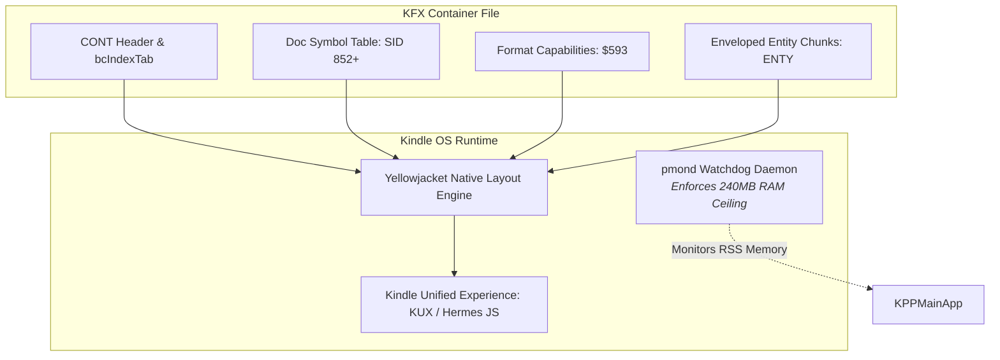
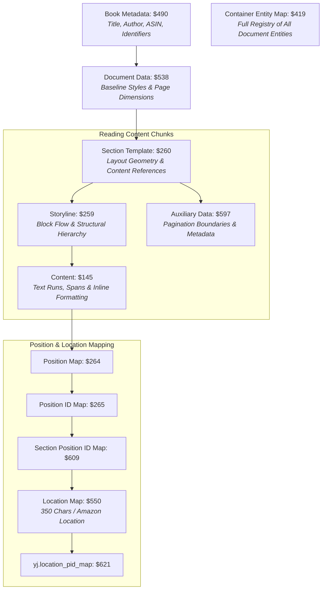

# Amazon Yellowjacket (KFX Enhanced Typesetting) Technical Monograph

This document provides a comprehensive technical overview of **Yellowjacket (YJ)**, Amazon's proprietary rendering engine, binary format, and document model powering **Enhanced Typesetting (KFX)** across modern Kindle devices and applications.

---

## 1. Background & Evolution

Before Yellowjacket, Amazon Kindle devices relied on older e-book formats:
- **MOBI / AZW (KF7)**: Based on OEBPS 1.0 with rudimentary HTML 3.2 styling, lacking hyphenation, advanced font ligature controls, and vector positioning.
- **KF8 (AZW3)**: Added partial CSS3 and HTML5 support, but still processed documents as monolithic web views rendered via outdated WebKit forks, resulting in sluggish pagination, poor battery life, and inconsistent typographic layouts.

In 2015, Amazon introduced **Enhanced Typesetting (codenamed "Yellowjacket")** alongside the Kindle Paperwhite 3. Yellowjacket fundamentally changed Kindle document delivery:
1. It abandoned raw HTML/CSS DOM parsing at read-time in favor of pre-compiled, binary-serialized layout fragments.
2. It introduced dynamic page-spread justification, drop-caps, hyphenation, kerning, and ligature rendering via custom layout heuristics.
3. It serialized reading data into binary **Amazon Ion** streams packaged within a structured binary container (**KFX / Yellowjacket Container**).

---

## 2. Yellowjacket Runtime Architecture

On modern Kindle e-ink devices (Kindle Paperwhite, Oasis, Scribe, and Basic), the Yellowjacket runtime operates within the **`KPPMainApp`** process running on the Kindle Unified Experience (KUX) application framework:



### The 240MB Memory Ceiling (`pmond`)
Kindle OS runs an internal monitoring daemon called **`pmond`**. If any reader process (`KPPMainApp` or its layout sub-engine) consumes more than **240MB of resident memory (RSS)**, `pmond` immediately sends a `SIGKILL` to prevent device lockups. 

Because Yellowjacket pre-allocates structures for loaded chapter chunks:
- Rendering an unfragmented section containing hundreds of blocks or tens of thousands of characters easily triggers a sudden spike in allocated heap memory.
- To safely operate within Yellowjacket's memory ceiling, `kfx-converter` employs **Chapter Fragmentation**, splitting oversized sections into sequential sub-sections of under 7,500 characters or 25 blocks.

---

## 3. The Yellowjacket Symbol Table (`YJ_symbols`)

Yellowjacket utilizes string interning via the Amazon Ion symbol protocol to minimize file size and avoid repetitive string comparisons in resource-constrained CPU environments.

### 3.1 Standard Shared Symbols (`$0` – `$851`)
Every Kindle e-reader running Enhanced Typesetting maintains a shared, immutable symbol dictionary named `YJ_symbols` (version `10`, with `max_id = 851`).
Standard symbols include:
- Typographical properties (`font_family`, `font_size`, `letter_spacing`, `text_color`).
- Container chunk types (`$145 content`, `$258 metadata`, `$259 storyline`, `$260 section`).
- Locators and maps (`$264 position_map`, `$550 location_map`, `$609 section_position_id_map`).

### 3.2 Document-Local Symbols (`$852+`)
Any identifier, anchor, CSS class, or section name unique to an individual book is allocated dynamically as a document-local symbol:
- Local symbols **must strictly start at SID `852`** (where `852 = max_id(851) + 1`).
- These symbols are serialized into an Ion symbol table chunk annotated with Ion Symbol `3` (`$ion_symbol_table`) and referenced by ID throughout the entity payloads.

```
+-------------------------------------------------------+
| Symbol Space Architecture                             |
+-------------------------------------------------------+
| SID 0..851:   Fixed Shared YJ_symbols (Built into OS) |
| SID 852..N:   Document-Local Symbols (Embedded)       |
+-------------------------------------------------------+
```

---

## 4. Yellowjacket Entity Taxonomy & Structural Graph

In Yellowjacket, a book is not a single linear document, but a directed acyclic graph (DAG) of independent binary Ion entities linked by symbol IDs and entity IDs:



### 4.1 Chunk Type Directory

| Chunk Type | Symbol ID | Role in Yellowjacket |
| :--- | :---: | :--- |
| **`content`** | `$145` | Leaf data chunk containing text runs, styled character arrays, and inline markup. |
| **`style`** | `$157` | Reusable typography descriptors (font sizing, weights, indents, margins). |
| **`external_resource`** | `$164` | Image, SVG, and binary asset descriptors mapped to container chunks. |
| **`metadata`** | `$258` | Publication metadata, cover entity links, and reader parameters. |
| **`storyline`** | `$259` | Hierarchical block tree defining reading sequence and nesting. |
| **`section`** | `$260` | High-level chapter container mapping storylines and auxiliary metadata. |
| **`position_map`** | `$264` | Correlates storyline offset indices with byte positions in `$145`. |
| **`position_id_map`** | `$265` | Maps internal DOM element IDs to linear position markers. |
| **`bcContId`** | `$409` | Unique Amazon container ID payload. |
| **`container_entity_map`** | `$419` | Exhaustive table listing every entity ID and its Yellowjacket type. |
| **`book_metadata`** | `$490` | Root book descriptor for library indexing, author display, and ASIN linking. |
| **`document_data`** | `$538` | Default typographic environment, baseline margins, and writing mode. |
| **`location_map`** | `$550` | Standard Kindle location calibration table (Amazon locations). |
| **`content_features`** | `$585` | Declares required rendering capabilities (e.g. drop caps, tables). |
| **`format_capabilities`**| `$593` | Critical capability payload emitted in container header. |
| **`auxiliary_data`** | `$597` | Per-section auxiliary data required for fast seek and pagination. |
| **`section_position_id_map`** | `$609` | Section-level PID index. |
| **`yj.location_pid_map`** | `$621` | High-precision position ID to location map for synchronizing whispersync. |

---

## 5. Reading Locations and Calibration Mechanics

Unlike physical books with static pages, Yellowjacket books reflow across varying font sizes, margins, and screen dimensions. Yellowjacket provides two distinct positioning mechanisms:

### 5.1 Kindle Locations (`$550` & `$621`)
- **Metric**: Standard Amazon locations are calibrated to **350 raw characters per location**.
- **Calculation**: During packaging, `kfx-converter` scans all text spans across all sections, recording character offsets. Every 350 characters, a new location milestone is emitted into `$550` (`location_map`) and mapped to the corresponding position identifier (PID) in `$621` (`yj.location_pid_map`).
- **Function**: Enables progress percentage calculation ("72% read"), time-to-read estimates, and cross-device Whispersync alignment.

### 5.2 Position IDs (`$264`, `$265`, `$609`)
- Each structural block (paragraph, heading, list item) receives an internal Position Identifier (PID).
- When a user highlights text, Yellowjacket records the range using PIDs and relative offsets rather than fragile DOM paths.

---

## 6. How `kfx-converter` Implements Yellowjacket Native Generation

`kfx-converter` builds Yellowjacket-compliant KFX files from scratch via the following sequence:

1. **Symbol Segregation**: Reserves `$0..851` and automatically delegates any custom book identifiers to `$852+` via `LocalSymbols`.
2. **Ion Envelope Packaging**: Envelopes each payload in a 21-byte `ENTY` header containing uncompressed, DRM-free Ion markers (`$410: 0`, `$411: 0`).
3. **Format Capabilities Placement**: Unlike standard entities listed in `bcIndexTab`, the Yellowjacket specification requires `$593 format_capabilities` to be stored in the container header prior to `ContainerInfo`. Emitting it inside `bcIndexTab` causes reader crashes on real Kindle devices.
4. **Sidecar Generation**:
   - Compiles Word Wise glosses into SQLite `.kll` databases keyed to the deterministic `ContentID`.
   - Normalizes cover images to non-progressive baseline JPEGs keyed to `thumbnail_<ContentID>_EBOK_portrait.jpg`.
