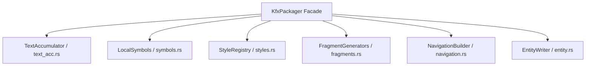
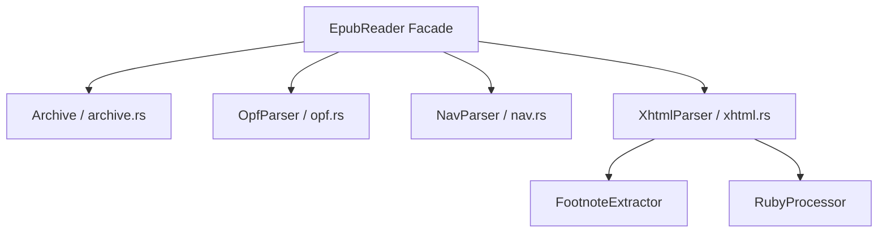

# Architecture Blueprint: Modularization & Strongly-Typed IR

## 1. Executive Summary

As identified during the multi-model consensus audit ([`docs/multi_model_review_report.md`](file:///home/drew/github/hwanjongyu/kfx_converter/docs/multi_model_review_report.md)), the `kfx_converter` codebase currently contains two monolithic god-files:
- [`src/packager.rs`](file:///home/drew/github/hwanjongyu/kfx_converter/src/packager.rs) (~3.8K lines): Manages symbol interning, style dictionary creation, fragment generation, storyline navigation, entity serialization, and container packaging.
- [`src/epub.rs`](file:///home/drew/github/hwanjongyu/kfx_converter/src/epub.rs) (~3.2K lines): Manages zip archive decompression, OPF manifest reading, NCX/NAV navigation parsing, XML/HTML DOM parsing, footnote extraction, and ruby typesetting.

In addition, `TextSpan.style: Option<String>` and `Block.style: Option<String>` in [`src/ir.rs`](file:///home/drew/github/hwanjongyu/kfx_converter/src/ir.rs) use space-delimited string tokens (`"align_center bold italic p_first"`), which bypass compile-time correctness guarantees and require string matching (`.contains("bold")`).

This document provides the canonical refactoring blueprint for decomposing these modules into clean domain-driven submodules and transitioning to strongly-typed IR styles.

---

## 2. Packager Decomposition Blueprint (`src/packager/`)



### Module Responsibilities:
1. `src/packager/mod.rs`:
   - Public `KfxPackager` struct providing high-level API (`new`, `package`, `package_to_file`).
   - High-level orchestration of packaging stages.
2. `src/packager/symbols.rs`:
   - `LocalSymbols` management, SID tracking, and Yellowjacket symbol table import boundary validation ($SID \ge 852$).
3. `src/packager/styles.rs`:
   - `PackagerStyles`, style entity generation ($388), font-size cascade resolution, and default typography dictionaries.
4. `src/packager/accumulator.rs`:
   - `TextAccumulator` handling 8KB text chunking, `chunk_num`, `chunk_idx`, and boundary alignment.
5. `src/packager/fragments.rs`:
   - `StorylineGenerator`, content chunk creation, footnote popup note entities ($603), and image block entities.
6. `src/packager/navigation.rs`:
   - Navigation entities ($389), TOC hierarchy, page-list mapping, reading orders, and section PID offset mapping.

---

## 3. EPUB Ingestion Decomposition Blueprint (`src/epub/`)



### Module Responsibilities:
1. `src/epub/mod.rs`:
   - `EpubReader` facade (`read_from_file`, `read_from_reader`).
2. `src/epub/archive.rs`:
   - Safe zip container handling, path traversal protection (`resolve_zip_path`), and decompression bomb mitigations.
3. `src/epub/opf.rs`:
   - Metadata extraction, multi-title precedence, manifest item mapping, spine order, and guide/landmarks.
4. `src/epub/nav.rs`:
   - NCX (`toc.ncx`) and EPUB 3 Navigation Document (`nav.xhtml`) parsing, separating hierarchical TOC from sequential `page-list`.
5. `src/epub/xhtml.rs`:
   - Streaming Quick-XML event loop, block extraction, CSS style cache queries, drop-cap detection, ruby furigana, and footnote popup anchors.

---

## 4. Strongly-Typed IR Styles Architecture

### 4.1 Target Types (`src/ir/styles.rs`)

```rust
use bitflags::bitflags;

bitflags! {
    #[derive(Debug, Clone, Copy, PartialEq, Eq, Default)]
    pub struct TextFormatFlags: u32 {
        const BOLD          = 1 << 0;
        const ITALIC        = 1 << 1;
        const UNDERLINE     = 1 << 2;
        const STRIKETHROUGH = 1 << 3;
        const CODE          = 1 << 4;
        const SUPERSCRIPT   = 1 << 5;
        const SUBSCRIPT     = 1 << 6;
        const SMALL_CAPS    = 1 << 7;
        const NOTEREF       = 1 << 8;
    }
}

#[derive(Debug, Clone, Copy, PartialEq, Eq, Default)]
pub enum DropCapStyle {
    #[default]
    None,
    StandardSingleChar,
    StandardTwoChar,
    Line2SingleChar,
    Line2TwoChar,
}

#[derive(Debug, Clone, Copy, PartialEq, Eq, Default)]
pub enum TextAlignment {
    #[default]
    Left,
    Center,
    Right,
    Justify,
}

#[derive(Debug, Clone, Copy, PartialEq, Eq, Default)]
pub enum FontSizeBucket {
    #[default]
    Normal,
    ExtraSmall, // 0.67em
    Small,      // 0.75em
    Large,      // 1.08em
    ExtraLarge, // 1.5em
    ExtraExtraLarge, // 2.2em
}

#[derive(Debug, Clone, Default, PartialEq, Eq)]
pub struct SpanStyles {
    pub format: TextFormatFlags,
    pub font_size: FontSizeBucket,
    pub dropcap: DropCapStyle,
    pub custom_classes: Vec<String>,
}

#[derive(Debug, Clone, Default, PartialEq, Eq)]
pub struct BlockStyle {
    pub alignment: TextAlignment,
    pub is_first_paragraph: bool,
    pub is_hanging_indent: bool,
    pub is_blockquote: bool,
    pub page_break_before: bool,
    pub custom_classes: Vec<String>,
}
```

### 4.2 Migration Strategy:
1. Introduce `SpanStyles` and `BlockStyle` alongside helper methods `from_tokens(&str)` and `to_tokens() -> String`.
2. Progressively migrate internal pattern matches from `.contains("bold")` to `.format.contains(TextFormatFlags::BOLD)`.
3. Provide zero-cost conversion traits `FromStr` and `Display` to maintain backward compatibility during the transition.
