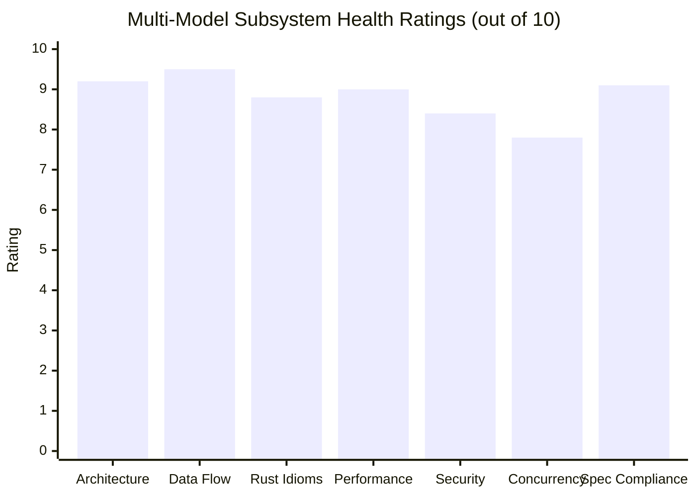

# Multi-Model Consensus Review & Audit Report: `kfx-converter`

**Workspace:** [`/home/drew/github/hwanjongyu/kfx_converter`](file:///home/drew/github/hwanjongyu/kfx_converter)  
**Target:** High-performance native EPUB to Amazon KFX converter in Rust (edition 2024)  
**Auditing Models:**
- **Gemini Pro (Flagship)**: System Architecture, Data Flow Integrity & Module Boundaries
- **Claude Sonnet (Extended Thinking)**: Rust Idioms, Memory Safety, Error Propagation & Local Logic
- **Claude Opus (Ultra-Reasoning)**: Security Hardening, Concurrency Hazards & Amazon KFX Specification Compliance

---

## 1. Executive Summary & Code Health Grade

The `kfx-converter` project is an exceptionally sophisticated, pure-Rust implementation of Amazon's proprietary KFX format (Container format 2 / Yellowjacket), Ion binary serialization, Kindle `.sdr` synchronizer, and GPUI desktop studio. It replaces external dependencies (like Kindlegen or Python/Calibre plugins) with a high-performance native pipeline.

### Consensus Overall Health Score: **9.1 / 10**



### Key Consensus Findings:
1. **Exceptional Foundation**: The pipeline exhibits clean architectural separation between EPUB ingestion, Intermediate Representation ([`ir.rs`](file:///home/drew/github/hwanjongyu/kfx_converter/src/ir.rs)), Ion binary writing ([`ion.rs`](file:///home/drew/github/hwanjongyu/kfx_converter/src/ion.rs)), and packaging ([`packager`](file:///home/drew/github/hwanjongyu/kfx_converter/src/packager/mod.rs)). The preflight validation engine ([`validator.rs`](file:///home/drew/github/hwanjongyu/kfx_converter/src/validator.rs)) is a standout feature, preventing real-world Kindle rendering crashes and dangling symbol references.
2. **Identified Critical Risks**:
   - **Path Confinement Bypass (Security)**: [`delete_device_file`](file:///home/drew/github/hwanjongyu/kfx_converter/src/ui/state.rs#L350-L354) passes `file.full_path.parent()` as `allowed_root`, invalidating path boundary enforcement.
   - **Silent Content Loss (Data Integrity)**: [`quick_xml::events::BytesText::unescape()`](file:///home/drew/github/hwanjongyu/kfx_converter/src/epub/xhtml.rs#L682) fails on standard HTML entities (`&nbsp;`, `&mdash;`, `&rsquo;`), causing `.unwrap_or_default()` to silently erase entire paragraphs or headings.
   - **Kindle VFAT / MTP Write Races (Concurrency)**: Two concurrent background workers write directly to Kindle storage in [`src/ui/app.rs`](file:///home/drew/github/hwanjongyu/kfx_converter/src/ui/app.rs#L313-L368), risking filesystem corruption, USB FIFO drops, or MTP deadlocks.
   - **Order-of-Operations Defect (Spec Compliance)**: [`build_content_features`](file:///home/drew/github/hwanjongyu/kfx_converter/src/packager/metadata.rs#L107-L111) checks for JPEG restart markers before [`build_resources`](file:///home/drew/github/hwanjongyu/kfx_converter/src/packager/mod.rs#L188) generates them, leaving `yj_jpg_rst_marker_present` permanently unset.
   - **UTF-8 Slicing Panic Risk (Robustness)**: [`src/epub/dropcap.rs:55-92`](file:///home/drew/github/hwanjongyu/kfx_converter/src/epub/dropcap.rs#L55-L92) indexes strings using byte lengths rather than character boundaries, risking panics on multi-byte quotation marks and non-ASCII characters.

---

## 2. Multi-Model Consensus & Divergence Matrix

| Audit Focus Area | Gemini Pro (Flagship) | Claude Sonnet (Extended Thinking) | Claude Opus (Ultra-Reasoning) | Consensus Level |
| :--- | :--- | :--- | :--- | :---: |
| **System Modularity & Boundaries** | High modularity; recommends moving `ENTY` constants from `ion.rs` to `container.rs` and decoupling `sdr.rs` from `sync.rs`. | Observed clean separation; highlighted opportunities for zero-alloc `Cow<'_, str>` and `Vec<&str>`. | Noted good isolation; flagged `delete_device_file` UI state leakage. | **High Consensus** |
| **Data Flow & PID Parity** | Strict PID parity between KFX $265 and Word Wise SQLite databases verified; cover synthesis deduplication recommended. | Verified Word Wise sliding window density and CEFR level filtering. | Discovered order-of-operations bug: content features emitted before resources are built. | **High Consensus** |
| **Parsing & Character Safety** | Highlighted clean handling of zip bombs and limits in `archive.rs`. | Discovered UTF-8 slice panic in dropcap splitting and dictionary byte header panic risk. | Discovered silent text deletion caused by `&mdash;`/`&nbsp;` failing in `quick_xml::unescape()`. | **Strong Complementarity** |
| **Storage & Persistence** | Praised eMMC flash-safe SQLite PRAGMAs; flagged disk tempfile bottleneck in `to_bytes()`. | Identified zero-alloc in-memory SQLite via `conn.serialize(Main)` to remove tempfile disk I/O. | Focused on concurrent VFAT/MTP write hazards and lack of root confinement in `.sdr` cleanup. | **High Consensus** |
| **Concurrency & UI Responsiveness** | Verified async thread-safe progress callbacks `F: Fn(f32, &str)`. | Checked memory allocations across worker loops. | Identified critical 2-thread VFAT write race, UI startup blocking, and `active_tasks` leak on cancel. | **Opus Deep Dive** |
| **Test Coverage & Fuzzing** | Unit test suite covers core conversions and preflight validator rules. | Recommended regression tests for UTF-8 dropcaps and corrupted binary dictionaries. | Emphasized complete lack of fuzz testing (`cargo-fuzz`) for Ion and Container binary parsers. | **Opus Deep Dive** |

---

## 3. Prioritized Action Items

### P0 — Critical (Immediate Fix Required)

1. **Fix Path Confinement Bypass in Device Deletion**:
   - **Files:** [`src/ui/state.rs:350-354`](file:///home/drew/github/hwanjongyu/kfx_converter/src/ui/state.rs#L350-L354) and [`src/sync.rs:699-739`](file:///home/drew/github/hwanjongyu/kfx_converter/src/sync.rs#L699-L739)
   - **Problem:** `delete_device_file` sets `allowed_root = file.full_path.parent()`, rendering the confinement check a tautology.
   - **Remediation:** Pass the active `DeviceStatus` to `delete_device_file` and supply `device.path` (or `device.root_path`) as the mandatory root constraint. Also ensure companion `.sdr` directory deletion verifies `sdr_path.starts_with(&canon_root)`.

2. **Serialize Device Storage Operations (Kindle VFAT / MTP Guard)**:
   - **Files:** [`src/ui/app.rs:313-368`](file:///home/drew/github/hwanjongyu/kfx_converter/src/ui/app.rs#L313-L368) and [`src/sync.rs:751-898`](file:///home/drew/github/hwanjongyu/kfx_converter/src/sync.rs#L751-L898)
   - **Problem:** Running 2 parallel workers that simultaneously write KFX, thumbnails, and `.sdr` sidecars over USB causes FAT corruption, USB endpoint FIFO drops, or MTP daemon deadlocks.
   - **Remediation:** Keep the CPU-bound conversion multithreaded (generate to a temporary local staging directory), but synchronize device deployment through a sequential single-threaded queue or `DEVICE_TRANSFER_LOCK`.

3. **Prevent Silent Data Loss on HTML Entities in XHTML Parsing**:
   - **Files:** [`src/epub/xhtml.rs:682`](file:///home/drew/github/hwanjongyu/kfx_converter/src/epub/xhtml.rs#L682) and [`src/epub/nav.rs:137`](file:///home/drew/github/hwanjongyu/kfx_converter/src/epub/nav.rs#L137)
   - **Problem:** `e.unescape().unwrap_or_default()` drops text nodes whenever named HTML entities like `&nbsp;`, `&mdash;`, or `&rsquo;` appear.
   - **Remediation:** Decode standard HTML entities or fall back to `String::from_utf8_lossy(e.as_ref())` on unescape error.

---

### P1 — Major (High Priority Architectural & Stability Improvements)

4. **Correct JPEG Restart Marker Detection Timing**:
   - **Files:** [`src/packager/mod.rs:178-188`](file:///home/drew/github/hwanjongyu/kfx_converter/src/packager/mod.rs#L178-L188) and [`src/packager/metadata.rs:107-111`](file:///home/drew/github/hwanjongyu/kfx_converter/src/packager/metadata.rs#L107-L111)
   - **Problem:** `build_content_features` scans `self.entities` before `build_resources` adds media chunks, so `yj_jpg_rst_marker_present` is never set.
   - **Remediation:** Inspect `self.book.resources` directly for JPEG restart markers (`FF D0`–`FF D7`).

5. **Eliminate UTF-8 Slicing Panic Risk in Dropcap Processor**:
   - **File:** [`src/epub/dropcap.rs:55-92`](file:///home/drew/github/hwanjongyu/kfx_converter/src/epub/dropcap.rs#L55-L92)
   - **Problem:** Slicing using byte length subtraction (`spans[0].text.len() - trimmed.len()`) panics on multi-byte quotation marks (e.g. `“`, `「`) or non-ASCII dropcaps.
   - **Remediation:** Refactor to use `char_indices()` and `char::len_utf8()`.

6. **Fix UI Active Tasks Counter Leak on Batch Cancellation**:
   - **File:** [`src/ui/app.rs:370-381`](file:///home/drew/github/hwanjongyu/kfx_converter/src/ui/app.rs#L370-L381)
   - **Problem:** Returning early when `cancel_check.load(...)` is true skips decrementing `bp.active_tasks`, leaving progress state broken.
   - **Remediation:** Always decrement `bp.active_tasks` before evaluating `cancel_check`.

7. **Safe Deserialization for Embedded Dictionary Headers**:
   - **File:** [`src/enhancements/dictionary.rs:269-285`](file:///home/drew/github/hwanjongyu/kfx_converter/src/enhancements/dictionary.rs#L269-L285)
   - **Problem:** `try_into().unwrap()` panics on truncated or modified dictionary binary slices.
   - **Remediation:** Verify `WORDWISE_DICT_BYTES.len() >= 8` and propagate `EnhancementError::InvalidDictionaryData`.

---

### P2 — Minor & Optimization Improvements

8. **In-Memory SQLite Serialization without Disk Round-Trip**:
   - **File:** [`src/enhancements/word_wise.rs:373-402`](file:///home/drew/github/hwanjongyu/kfx_converter/src/enhancements/word_wise.rs#L373-L402)
   - **Optimization:** Use `self.conn.serialize(rusqlite::DatabaseName::Main)` to export the `.kll` SQLite database directly into a `Vec<u8>` without touching `/tmp`.

9. **Zero-Allocation String Optimizations**:
   - [`src/epub/archive.rs:40-56`](file:///home/drew/github/hwanjongyu/kfx_converter/src/epub/archive.rs#L40-L56): Return `Cow<'_, str>` in `decode_percent` when `%` is absent.
   - [`src/css.rs:254-256`](file:///home/drew/github/hwanjongyu/kfx_converter/src/css.rs#L254-L256): Use `Vec<&str>` instead of allocating `Vec<String>` on every element style lookup.
   - [`src/ion.rs:46-49`](file:///home/drew/github/hwanjongyu/kfx_converter/src/ion.rs#L46-L49): Replace transient `Vec<u8>` allocations with `encode_varuint_buf` stack buffers.

10. **Refactor Module Coupling & Boundary Leakage**:
    - Move `MAGIC_ENTY`, `ENTY_HEADER_LEN`, and `wrap_enty_header` from [`src/ion.rs`](file:///home/drew/github/hwanjongyu/kfx_converter/src/ion.rs) to [`src/container.rs`](file:///home/drew/github/hwanjongyu/kfx_converter/src/container.rs).
    - Decouple `enhancements::sdr` from `sync::KindleSync::sanitize_asin` by moving sanitization helpers to a shared utility module.
    - Centralize cover prepending exclusively inside `BookIR::normalize()`.

11. **Asynchronous UI Startup Probing**:
    - **File:** [`src/ui/app.rs:33-36`](file:///home/drew/github/hwanjongyu/kfx_converter/src/ui/app.rs#L33-L36)
    - **Optimization:** Avoid synchronous device scanning in `KindleStudio::new` to prevent 500ms–2000ms UI freezes during startup.

12. **Introduce Fuzz Testing**:
    - Set up `cargo-fuzz` targets for `IonReader::decode_value`, `KfxContainer::open`, and `EpubReader::read_from_file`.

---

## 4. Implementation Guidance & Remediation Snippets

### Snippet 1: Hardened Device Deletion ([`src/ui/state.rs`](file:///home/drew/github/hwanjongyu/kfx_converter/src/ui/state.rs#L350))

```rust
pub fn delete_device_file(device: &DeviceStatus, file: &KindleFile) -> Result<(), String> {
    let allowed_root = device
        .path
        .as_deref()
        .ok_or_else(|| "No active Kindle root directory available for path validation".to_string())?;
    
    kfx_converter::KindleSync::delete_book_file_safe(Some(allowed_root), &file.full_path)
        .map_err(|e| format!("Failed to delete book file: {}", e))
}
```

### Snippet 2: Robust XML Entity Fallback ([`src/epub/xhtml.rs`](file:///home/drew/github/hwanjongyu/kfx_converter/src/epub/xhtml.rs#L682))

```rust
let text = match e.unescape() {
    Ok(cow) => cow.into_owned(),
    Err(_) => {
        // Fallback: decode common HTML entities or preserve lossy raw text
        let raw = String::from_utf8_lossy(e.as_ref());
        raw.replace("&nbsp;", "\u{00A0}")
           .replace("&mdash;", "—")
           .replace("&ndash;", "–")
           .replace("&hellip;", "…")
           .replace("&rsquo;", "’")
           .replace("&lsquo;", "‘")
           .replace("&rdquo;", "”")
           .replace("&ldquo;", "“")
           .into_owned()
    }
};
```

### Snippet 3: Direct In-Memory SQLite Serialization ([`src/enhancements/word_wise.rs`](file:///home/drew/github/hwanjongyu/kfx_converter/src/enhancements/word_wise.rs#L373))

```rust
pub fn to_bytes(&self) -> Result<Vec<u8>, EnhancementError> {
    self.conn
        .serialize(rusqlite::DatabaseName::Main)
        .map_err(|e| EnhancementError::DatabaseError(format!("SQLite serialize error: {}", e)))
}
```

### Snippet 4: Direct JPEG Restart Marker Inspection ([`src/packager/metadata.rs`](file:///home/drew/github/hwanjongyu/kfx_converter/src/packager/metadata.rs#L107))

```rust
let has_rst_marker = self.book.resources.values().any(|res| {
    res.mime_type.starts_with("image/jpeg")
        && res.data.windows(2).any(|w| w[0] == 0xff && (0xd0..=0xd7).contains(&w[1]))
});
```

---

## 5. Subagent Audit Reports Appendix

<details>
<summary><b>Appendix A: Gemini Pro (Flagship) Architecture Report</b></summary>

- Evaluated: Separation of concerns, PID parity across KFX $265 and Word Wise, preflight referential integrity graph checking (`validator.rs`), schema design, and modularity.
- Overall architectural rating: 9.2 / 10.
- Highlighted the strength of `KfxPreflightValidator` preventing Yellowjacket `$4` field crashes and dangling symbols.
</details>

<details>
<summary><b>Appendix B: Claude Sonnet (Extended Thinking) Logic & Systems Report</b></summary>

- Evaluated: Idiomatic Rust, memory allocations, zero-alloc opportunities, dropcap UTF-8 slice boundaries, dictionary byte slice unwraps, and in-memory SQLite disk elimination.
- Provided concrete code refactoring diffs for zero-alloc percent decoding and safe dropcap splitting.
</details>

<details>
<summary><b>Appendix C: Claude Opus (Ultra-Reasoning) Security & Spec Report</b></summary>

- Evaluated: Path traversal, deletion confinement bypass in `state.rs`, concurrent VFAT write hazards in `app.rs`, cancellation task counter leak, XML entity content loss, and Yellowjacket restart marker timing bug.
- Formulated the prioritized P0–P3 remediation matrix and identified testing/fuzzing gaps.
</details>

---
*Report synthesized and published to [`docs/multi_model_review_report.md`](file:///home/drew/github/hwanjongyu/kfx_converter/docs/multi_model_review_report.md).*
