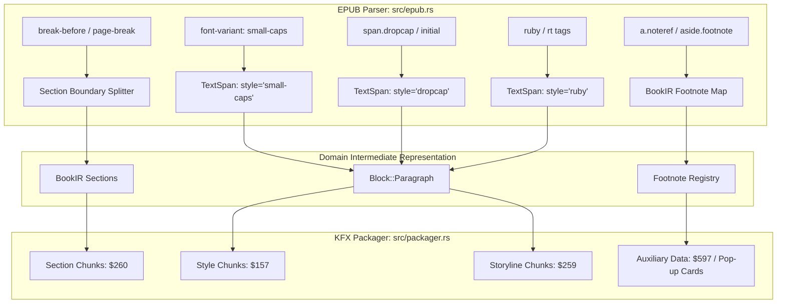

# Specification & Implementation Plan: Advanced Typesetting Enhancements

## 1. Overview & Objective

Following the initial implementation of baseline typography (bold, italic, underline, strikethrough, superscript, subscript, monospace code, dark mode color neutralization, and paragraph alignment), this plan defines the implementation for the remaining typesetting features shared between **EPUB 3** and **Amazon KFX (Yellowjacket)**:

1. **Forced Page Breaks (`page-break-before: always` / `break-before: page`)**:
   - Clean scene/part boundaries by splitting into distinct Yellowjacket section entities.
2. **Small Caps (`font-variant: small-caps`) & Text Transform**:
   - Headers, acronyms, and era indicators (e.g. BC/AD) mapped to Yellowjacket `$14 font_variant`.
3. **Drop Caps (Initial Capitals)**:
   - First-letter chapter ornamentation (`span.dropcap` or `class="initial"`) rendered with relative font scaling and baseline alignment.
4. **Kindle Pop-up Footnotes & Note References (`epub:type="noteref"` / `"footnote"`)**:
   - Mapping EPUB3 footnote links and `<aside epub:type="footnote">` to native Kindle pop-up reading cards without full-page navigation.
5. **CJK Ruby / Furigana Annotations (`<ruby>` / `<rt>`)**:
   - Support for phonetic reading annotations mapped to Yellowjacket `$765 ruby_text_align` and `$766 ruby_base_align`.



---

## 2. Key Architecture & Feature Details

### Feature 1: Forced Page Breaks (`page-break-before: always`)
- **Mechanism**:
  - In EPUB, publishers use `<div style="page-break-before: always">`, `<hr class="pagebreak"/>`, or heading CSS.
  - In Yellowjacket, page breaks between blocks are enforced by starting a new `$260 section`.
  - In `EpubReader`, when a block has `page_break_before`, it signals the section packager to finalize the current section and start a new section partition cleanly.
- **Benefits**:
  - Prevents mid-chapter act/scene breaks from flowing continuously onto the same screen.

### Feature 2: Small Caps (`font-variant: small-caps`)
- **Mechanism**:
  - `EpubReader::sanitize_css_style()` parses `font-variant: small-caps` and extracts token `"small_caps"`.
  - `build_styles()` in `KfxPackager` defines:
    ```ion
    $157 /* style */: {
        $4 /* name */: $style_small_caps,
        $14 /* font_variant */: $small_caps
    }
    ```
  - Storyline `style_events` applies `styles.small_caps` across the character span.

### Feature 3: Drop Caps (Initial Capitals)
- **Mechanism**:
  - EPUB novels frequently start with `<span class="dropcap">I</span>t was the best of times...`.
  - Detected via class names matching `dropcap`, `drop-cap`, `initial`, `first-letter`.
  - Packaged with relative scale:
    ```ion
    $157 /* style */: {
        $4 /* name */: $style_dropcap,
        $16 /* font_size */: { $307: "3.0", $306: $308 /* 3.0em */ },
        $13 /* font_weight */: $361 /* bold */,
        $42 /* line_height */: { $307: "0.9", $306: $308 /* 0.9em */ },
        $50 /* margin_right */: { $307: "0.15", $306: $308 /* 0.15em */ }
    }
    ```

### Feature 4: Kindle Pop-up Footnotes (`epub:type="noteref"`)
- **Mechanism**:
  - EPUB 3 footnote links are marked with `<a epub:type="noteref" href="#fn1">1</a>` and the note text is stored in `<aside epub:type="footnote" id="fn1">...`.
  - In traditional MOBI/KF8, tapping a footnote jumped to the end of the book, forcing the reader to press the "Back" button.
  - In Yellowjacket, footnotes can be registered with anchor targets; when recognized, the Kindle OS opens an in-page modal dialog displaying the note text.
  - `BookIR` will capture footnote bodies and associate note reference links so Kindle's auxiliary popup card metadata ($597) can bind them.

### Feature 5: Ruby / Furigana (`<ruby>` / `<rt>`)
- **Mechanism**:
  - EPUB uses `<ruby>漢字<rt>かんじ</rt></ruby>`.
  - Yellowjacket symbol table includes native ruby symbols:
    - `$765 ruby_text_align`
    - `$766 ruby_base_align`
    - `$770 ruby_base_edge_align`
  - Inline span parser preserves ruby associations for East Asian literary works.

---

## 3. Phased Implementation Roadmap

| Phase | Milestone | Primary Deliverable |
| :--- | :--- | :--- |
| **Phase 1** | **Forced Page Breaks & Small Caps** | Support `page-break-before` section splitting & `font-variant: small-caps` style events |
| **Phase 2** | **Drop Caps & Stylistic Classes** | Support `span.dropcap` with 3.0em relative sizing and negative margin compensation |
| **Phase 3** | **Pop-up Footnotes & Notes** | Extract `aside[epub:type="footnote"]` into auxiliary note records for in-page popup modal display |
| **Phase 4** | **Ruby Text (CJK)** | Parse `<ruby>` and `<rt>` tags into Yellowjacket ruby alignment structures |

---

## 4. Verification & Testing Strategy

1. **Unit Tests**:
   - `test_css_small_caps_and_dropcap_parsing`: Verifies CSS extraction for small-caps and dropcap classes.
   - `test_forced_page_break_section_partition`: Verifies that `break-before: page` partitions sections into distinct `$260` chunks.
   - `test_footnote_popup_mapping`: Verifies footnote link binding.
2. **Regression Suite**:
   - Ensure all existing 56 tests pass without regression (`cargo test --features gui`).
3. **Documentation**:
   - Update `docs/FORMAT_SPEC.md` and `docs/YELLOWJACKET.md` with new symbol IDs and footnote structures.
