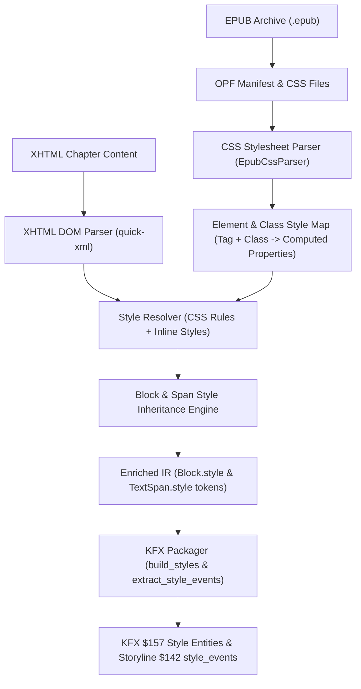

# Architectural Specification: EPUB CSS Style Resolution & Typography Fidelity

## 1. Overview & Problem Statement

When converting EPUB documents (such as Adam Grant's *Originals*) to Amazon Yellowjacket KFX format, critical styling and typographic formatting are missing:
- **Italics** (e.g., subtitles, epigraph attributions, book titles).
- **Text Alignment** (e.g., centered chapter numbers, titles, subtitles, epigraphs).
- **Relative Font Sizing** (e.g., larger chapter titles `1.5em`, smaller epigraph body `0.75em`, citation sources `0.667em`).
- **Drop Caps** (e.g., Adobe InDesign generated dropcap classes `._idGenDropcap-1`).

### Target Case: Review of Chapter 1 of *Originals* by Adam Grant

**File in EPUB**: `OEBPS/xhtml/08_1_Creative_Destruction_The_Risky_Business_of_Going_Against_the_Grain_.xhtml`  
**Stylesheet**: `OEBPS/css/idGeneratedStyles.css`

| Document Element | XHTML Markup | CSS Rule in `idGeneratedStyles.css` | Current Converter Behavior | Expected KFX Behavior |
| :--- | :--- | :--- | :--- | :--- |
| **Chapter Number** | `<h1 class="x03-Chapter-Number">1</h1>` | `font-size: 1.083em; text-align: center; font-weight: bold; margin: 10% 0 0 0;` | Rendered with default `style_h1` (left-aligned, 1.6em font size). | Centered, bold, scaled to 1.1em font size. |
| **Chapter Title** | `
Creative Destruction
` | `font-size: 1.5em; text-align: center; margin: 0.39em 0 0 0;` | Underline parsed, but rendered as body text (left/justified, 1.0em). | Centered, 1.5em font size, underlined. |
| **Chapter Subtitle** | `
The Risky Business of Going Against the Grain
` | `font-size: 1.083em; font-style: italic; text-align: center;` | Rendered as unstyled body paragraph `style_p` (plain text, left/justified). | Centered, **italic**, 1.1em font size. |
| **Epigraph Quote** | `
“The reasonable man adapts himself to the world...”
` | `font-size: 0.75em; text-align: center; margin: 0 10%;` | Rendered as unstyled body paragraph `style_p` (1.0em, indented/justified). | Centered, **0.75em relative font size**, unindented. |
| **Epigraph Attribution** | `
George Bernard Shaw
` | `font-size: 0.667em; font-style: italic; text-align: center;` | Rendered as unstyled body paragraph `style_p` (plain text, left/justified). | Centered, **italic**, **0.67em relative font size**. |
| **First Body Paragraph Dropcap** | `
On a cool fall evening...
` | `float: left; font-size: 3.058em; line-height: 1.5em;` | Class `_idGenDropcap-1` ignored because parser required exact match `cls == "dropcap"`. | Initial capital "O" styled with `style_dropcap` ($16: 3.0em, $125: 3 lines). |

---

## 2. Root Cause Analysis

### 2.1 Absence of EPUB CSS Stylesheet Parsing (`src/epub.rs`)
`EpubReader` currently only inspects inline `style="..."` attributes and a very small set of hardcoded class strings (such as `cls == "dropcap"` or `cls.contains("pagebreak")`). Modern publishing EPUBs place nearly 100% of their styling rules inside external `.css` files (referenced by `<link rel="stylesheet">` or `<style>` tags). Because CSS files are completely bypassed, all class-based styles are lost during ingestion.

### 2.2 Incomplete CSS Declaration Sanitization
`EpubReader::sanitize_css_style`:
- Lacks support for `font-style: italic` / `oblique`.
- Lacks support for `font-weight: bold` / `>= 600`.
- Lacks support for relative and absolute `font-size` declarations (`em`, `%`, `pt`, `small`, `smaller`, `large`, `larger`, `x-large`, `xx-large`).
- Does not recognize InDesign/Calibre dropcap class patterns (`*dropcap*`, `float: left` with large font size).

### 2.3 Style Inheritance & Multi-Attribute Synthesis (`src/packager.rs`)
- In Yellowjacket KFX, paragraph blocks (`Block::Paragraph`) currently select only a single mutually exclusive `base_style` (`styles.align_center`, `styles.align_right`, `styles.align_justify`, `styles.blockquote`, `styles.p_first`, or `styles.p`).
- If a paragraph is both centered AND italic (or has a custom font size), the paragraph's `align_center` style lacks `font_style: italic` and `font_size`.
- Furthermore, paragraph-level inline styles (`italic`, `bold`, `font_size_*`) are not cascaded down to the paragraph's child spans, so `extract_style_events` emits no style events for text spans that lack explicit inner `<i>`/`<em>` tags.

---

## 3. Architecture & Implementation Plan

### 3.1 CSS Parser & Resolver (`src/epub.rs` / `src/epub/css.rs`)
1. **Lightweight CSS Rule Ingestion**:
   - Read all `.css` files discovered in the EPUB manifest or linked in `<head>` via `<link rel="stylesheet">`.
   - Parse selector rules: class selectors (`.x03-Chapter-Title`), type+class selectors (`p.x03-Chapter-Subtitle`, `h1.x03-Chapter-Number`), and generic tag selectors (`p`, `h1`).
   - Extract relevant typographic properties:
     - `text-align`: `center`, `right`, `justify`, `left`
     - `font-style`: `italic`, `oblique`
     - `font-weight`: `bold`, `700`, `800`, `900`
     - `font-size`: Normalize relative sizes into standard buckets (`size_xs`: ~0.65-0.7em, `size_sm`: ~0.75-0.85em, `size_md`: 1.0em, `size_lg`: ~1.1-1.3em, `size_xl`: ~1.4-1.7em, `size_xxl`: >=1.8em)
     - `text-decoration`: `underline`, `line-through`
     - `font-variant`: `small-caps`
     - Dropcap indicators: `float: left` combined with `font-size > 1.5em`, or any class name containing `dropcap`, `initial`, or `_idgendropcap`.
2. **Computed Style Resolution**:
   - For every element encountered in XHTML, match its tag name and `class` attributes against the CSS rules.
   - Merge with any inline `style="..."` attributes (inline takes highest precedence).
   - Generate normalized style tokens: e.g. `align_center`, `italic`, `bold`, `font_size_xl`, `font_size_xs`, `underline`, `dropcap`.

### 3.2 Block-to-Span Style Cascade
1. When a paragraph or heading has typographic properties that affect its text content (`italic`, `bold`, `font_size_*`, `small_caps`):
   - Propagate these tokens to each of its child `TextSpan`s.
   - Example: `
The Risky Business...
` has paragraph tokens `["align_center", "italic", "font_size_lg"]`.
   - The paragraph block gets `style: Some("align_center")`.
   - The child `TextSpan` receives `style: Some("italic font_size_lg")`.
2. This ensures that `extract_style_events` in `packager.rs` will emit the appropriate inline styling ranges for all text spans inside the paragraph.

### 3.3 Yellowjacket KFX Font Size Styles (`src/packager.rs`)
1. Extend `StyleSymMap` and `build_styles`:
   - Register standardized font size style entities ($157) using relative `$308 em` units:
     - `style_font_size_xs`: `$16 font_size`: `0.67em` (attributions, footnotes, fine print)
     - `style_font_size_sm`: `$16 font_size`: `0.75em` (epigraphs, sub-captions)
     - `style_font_size_lg`: `$16 font_size`: `1.15em` (subtitles, callouts)
     - `style_font_size_xl`: `$16 font_size`: `1.5em` (chapter titles, section headings)
     - `style_font_size_xxl`: `$16 font_size`: `2.0em` (display headings)
2. Extend `extract_style_events`:
   - When a span style token contains `font_size_xs`, `font_size_sm`, `font_size_lg`, `font_size_xl`, or `font_size_xxl`, emit a style event referencing the respective font size style entity.
   - Combine seamlessly with `italic`, `bold`, `underline`, and `small_caps`.
3. Support Heading Alignment:
   - For `Block::Heading`, inspect `heading_style`: if `align_center` is present, emit a centered heading or apply an aligned style entity so chapter numbers and centered headings honor the EPUB stylesheet.

---

## 4. Verification & QA Plan

1. **Unit Tests**:
   - `test_css_parser_extracts_rules_and_properties`: Test CSS declaration parsing, shorthand handling, and unit normalization.
   - `test_element_style_resolution`: Verify `
` resolves to `align_center`, `italic`, `font_size_lg`.
   - `test_dropcap_detection`: Verify `_idGenDropcap-1` and `float: left` dropcaps are accurately tagged as `dropcap`.
   - `test_packager_emits_relative_font_sizes`: Verify KFX container contains `$157` entities for relative font sizes and storyline `$142 style_events` cover the styled text ranges.
2. **Regression & Real Book Validation**:
   - Validate Chapter 1 of *Originals - Adam Grant.epub*:
     - Verify Chapter Number `1` is centered.
     - Verify Chapter Title `Creative Destruction` is centered and scaled (1.5em).
     - Verify Subtitle `The Risky Business of Going Against the Grain` is centered and italicized.
     - Verify Epigraph `“The reasonable man adapts himself...”` is centered and scaled (0.75em).
     - Verify Epigraph Attribution `George Bernard Shaw` is centered, italicized, and scaled (0.67em).
     - Verify Dropcap `O` in `On a cool fall evening in 2008` is emitted with `style_dropcap`.
   - Run complete test suite (`cargo test`) to ensure zero regressions across all 85 existing tests.
