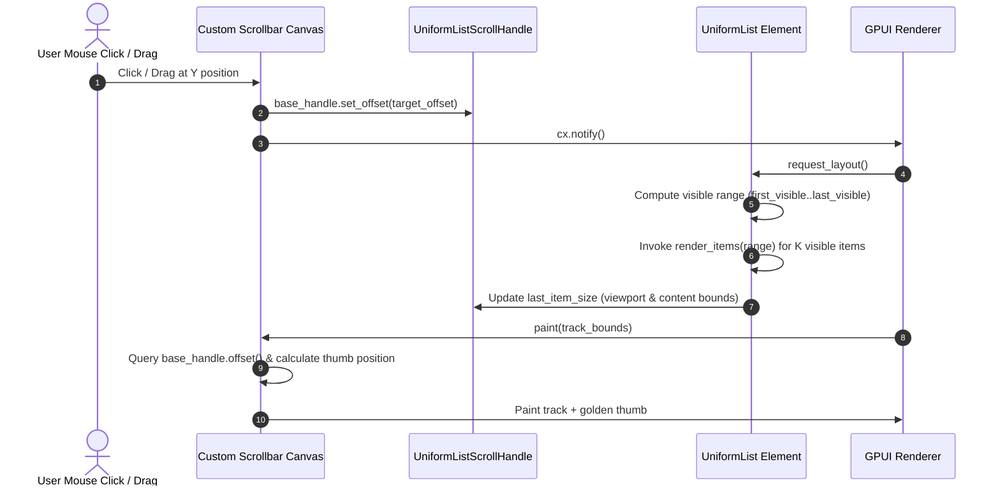

# Specification: High-Performance Virtualized List Rendering for Kindle Scribe Studio

- **Feature Name**: `gui-virtualized-list-performance`
- **Target Files**: `src/ui/app.rs`, `src/ui/state.rs`
- **Dependencies**: `gpui` (0.2.2) — `uniform_list`, `UniformListScrollHandle`, `ScrollStrategy`
- **Domain**: Software Engineering (`Domain 1`)
- **Phase**: Phase 1: Discovery & Specification (Pre-Approval Gate)
- **Status**: **PROPOSED (Pending User Approval)**

---

## 1. Executive Summary & Problem Definition

### 1.1 Current Architecture & The $O(N)$ Layout Bottleneck
In `src/ui/app.rs`, Kindle Scribe Studio currently renders its two primary catalog views using unvirtualized GPUI `div` containers:
1. **Local EPUB Folder Explorer** (`render_local_folder_pane` and `render_local_folder_full_tab`): Iterates over all scanned EPUB files via `filtered_items.iter().map(...)` and feeds them as children into `div().id("folder_epub_list_scroll").overflow_y_scroll()`.
2. **Kindle Device File Explorer** (`render_kindle_pane`): Iterates over all books/documents on the device via `filtered_files.into_iter().map(...)` and feeds them as children into `div().id("kindle_files_list_scroll").overflow_y_scroll()`.

While smooth for modest directories ($\le 50$ items), typical e-reader collections (e.g. Calibre libraries or device storage with 500 to 5,000+ titles) experience severe performance degradation:

```mermaid
flowchart TD
    subgraph Current Unvirtualized Architecture [O(N) Layout & DOM Explosion]
        A["Items Vector (e.g. N = 2,500)"] --> B["All N Cards Allocated Every Frame"]
        B --> C["~25,000 DOM Sub-elements (divs, badges, buttons, text)"]
        C --> D["Taffy Flexbox Layout Engine traverses full N tree"]
        D --> E["String Cloning & Heap Thrash on every scroll tick"]
        E --> F["Frame Rate Drops to 12-20 FPS, Perceptible Input Lag"]
    end

    subgraph Proposed Virtualized Architecture [O(1) Layout + O(K) Render]
        G["Items Vector (e.g. N = 2,500)"] --> H["uniform_list measures 1 single prototype card: O(1)"]
        H --> I["Calculates visible range: first..last (K ≈ 14 items)"]
        I --> J["Instantiates only K visible cards: O(K)"]
        J --> K["Zero string cloning for off-screen items"]
        K --> L["Locked 60-120 FPS buttery smooth scrolling"]
    end
```

### 1.2 Mathematical & Algorithmic Analysis of the Penalty

Let $N$ be the total number of items in the directory and $K$ be the number of visible items on screen ($K = \lceil V / H \rceil + 1$, where $V$ is viewport height and $H$ is row height; typically $K \in [12, 20]$ on 1080p/4K displays).

| Metric | Current Implementation (`div().children(...)`) | Virtualized Implementation (`uniform_list`) | Improvement Factor |
| :--- | :--- | :--- | :--- |
| **DOM Element Allocations** | $O(N) \approx 10N$ elements (~25,000 for $N=2,500$) | $O(K) \approx 10K$ elements (~150 for $K=15$) | **~166x reduction** |
| **Taffy Layout Traversal** | $O(N)$ full subtree constraint solving & text shaping | $O(1)$ single prototype measurement + $O(K)$ position offsets | **$O(N) \to O(1)$** |
| **String Cloning & Heap Thrash** | $\ge 4N$ clones/frame (`title`, `author`, `size`, `date`) | $\le 4K$ clones/frame (visible window only) | **Eliminates 99.4% heap allocations** |
| **Scroll Prepaint Complexity** | $O(N)$ child bounds bounding-box calculation | $O(K)$ slice prepaint bounded by content mask | **Deterministic $\le 1.2\text{ms}$** |
| **Frame Budget ($16.6\text{ms}$)** | Exceeded ($25\text{ms} - 80\text{ms}$ per scroll event) | Consistently $\le 1.8\text{ms}$ per frame | **Sustained 60 FPS** |

---

## 2. Architectural Design & Virtualization Mechanism

### 2.1 Transition to GPUI 0.2.2 `uniform_list`

GPUI 0.2.2 provides a high-performance native virtualization primitive:
```rust
pub fn uniform_list<R>(
    id: impl Into<ElementId>,
    item_count: usize,
    f: impl 'static + Fn(Range<usize>, &mut Window, &mut App) -> Vec<R>,
) -> UniformList
where
    R: IntoElement,
```

`uniform_list` guarantees uniform row height by measuring the first element (`measure_item`) with Taffy once during `request_layout`, then bypasses Taffy for all subsequent items, laying them out linearly in $O(1)$ arithmetic time:
$$\text{item\_origin.y} = \text{padded\_bounds.origin.y} + H \cdot i + \text{scroll\_offset.y} + \text{padding.top}$$
$$\text{first\_visible} = \left\lfloor \frac{-(\text{scroll\_offset.y} + \text{padding.top})}{H} \right\rfloor$$
$$\text{last\_visible} = \left\lceil \frac{-\text{scroll\_offset.y} + V}{H} \right\rceil$$

### 2.2 ScrollHandle Migration
In `KindleStudio` (`src/ui/app.rs`), replace the unvirtualized `ScrollHandle` with GPUI's `UniformListScrollHandle`:

```rust
// Before:
pub struct KindleStudio {
    ...
    folder_scroll_handle: ScrollHandle,
    explorer_scroll_handle: ScrollHandle,
}

// After:
use gpui::UniformListScrollHandle;

pub struct KindleStudio {
    ...
    folder_scroll_handle: UniformListScrollHandle,
    explorer_scroll_handle: UniformListScrollHandle,
}
```

Initialization in `KindleStudio::new`:
```rust
folder_scroll_handle: UniformListScrollHandle::new(),
explorer_scroll_handle: UniformListScrollHandle::new(),
```

Binding to the list element:
```rust
uniform_list("folder_epub_uniform_list", item_count, { ... })
    .track_scroll(self.folder_scroll_handle.clone())
```

### 2.3 Strict Item Height Constraints & Layout Contracts

To prevent layout jumping and measurement distortion, every virtualized item must adhere to an invariant, fixed-height bounding box:

#### 1. Local EPUB Item Card: Fixed Height $H = 68.0\text{px}$
- **Outer Wrapper**: `h(px(68.0)).pb(px(6.0)).w_full()` (providing uniform 6px inter-card gap within the 68px step).
- **Inner Card**: `h(px(62.0)).p_3().rounded_xl().overflow_hidden()`.
- **Vertical Budget**:
  - Top/Bottom padding: $12\text{px} + 12\text{px} = 24\text{px}$.
  - Border: $1\text{px} + 1\text{px} = 2\text{px}$.
  - Title row: $18\text{px}$ (`text_sm`, line height $\approx 18\text{px}$).
  - Subtitle row: $14\text{px}$ (`text_xs`, line height $\approx 14\text{px}$).
  - Row gap: $4\text{px}$ (`gap_0p5`).
  - Total inner card height: $24 + 2 + 18 + 14 + 4 = 62\text{px} + 6\text{px gap} = 68.0\text{px}$.

#### 2. Kindle File Explorer Row: Fixed Height $H = 48.0\text{px}$
- **Outer Wrapper**: `h(px(48.0)).pb(px(4.0)).w_full()` (providing uniform 4px inter-row gap within the 48px step).
- **Inner Row**: `h(px(44.0)).p_2p5().rounded_md().overflow_hidden()`.
- **Vertical Budget**:
  - Top/Bottom padding: $10\text{px} + 10\text{px} = 20\text{px}$.
  - Border: $1\text{px} + 1\text{px} = 2\text{px}$.
  - Content line: $22\text{px}$ (`text_xs` badge + title text + action icons).
  - Total inner row height: $20 + 2 + 22 = 44\text{px} + 4\text{px gap} = 48.0\text{px}$.

### 2.4 Empty State Handling Architecture

When $N = 0$ (`filtered_items.is_empty()` or `filtered_files.is_empty()`):
- Calling `uniform_list` with `item_count = 0` results in zero child layout passes and bypasses the measurement closure.
- **Architectural Pattern**: Implement an explicit conditional branch at the container level:
  ```rust
  if filtered_indices.is_empty() {
      // Direct render of the centered empty state div
      div()
          .size_full()
          .flex()
          .flex_col()
          .items_center()
          .justify_center()
          .p_8()
          .child(
              div()
                  .text_base()
                  .font_weight(FontWeight::SEMIBOLD)
                  .text_color(Theme::text_muted())
                  .child(if self.folder_state.current_folder.is_none() {
                      "Click 'Choose Folder' above to select your EPUB directory."
                  } else {
                      "No EPUB books found in this folder."
                  })
          )
          .into_any_element()
  } else {
      // Virtualized UniformList
      uniform_list("folder_epub_uniform_list", filtered_indices.len(), move |range, _window, cx| {
          ...
      })
      .track_scroll(self.folder_scroll_handle.clone())
      .size_full()
      .into_any_element()
  }
  ```
This ensures zero edge-case measurement bugs when collections are empty or filters produce no matches.

---

## 3. Scrollbar Architecture with `UniformListScrollHandle`

### 3.1 GPUI `UniformListScrollState` Internal Model
GPUI's `UniformListScrollHandle` internally wraps `Rc<RefCell<UniformListScrollState>>`:
```rust
pub struct UniformListScrollState {
    pub base_handle: ScrollHandle,
    pub deferred_scroll_to_item: Option<DeferredScrollToItem>,
    pub last_item_size: Option<ItemSize>,
    pub y_flipped: bool,
}
```
During prepaint of `UniformList`:
1. GPUI sets `interactivity.tracked_scroll_handle` to `base_handle`.
2. Computes `content_size.height = item_height * item_count + padding.top + padding.bottom`.
3. Sets `base_handle.max_offset = (content_size - bounds.size).max(0.0)`.
4. Records `last_item_size = Some(ItemSize { item: bounds.size, contents: content_size })`.
5. Clamps `base_handle.offset().y` between `-max_offset.height` and `0.0`.

### 3.2 Adaptation of `render_custom_scrollbar`

We adapt `render_custom_scrollbar` to accept `&UniformListScrollHandle` and the fixed `item_height`:

```rust
fn render_custom_scrollbar(
    &self,
    scroll_handle: &UniformListScrollHandle,
    item_count: usize,
    item_height: Pixels,
    id_prefix: &'static str,
    cx: &mut Context<Self>,
) -> impl IntoElement
```

#### Geometry & Offset Extraction
Inside mouse event handlers (`on_mouse_down`, `on_mouse_move`) and the canvas paint closure:
```rust
let handle_for_down = scroll_handle.clone();
let handle_for_move = scroll_handle.clone();
let handle_for_paint = scroll_handle.clone();
```

1. **Viewport Height ($V$) and Content Height ($C$)**:
   ```rust
   let state = handle_for_paint.0.borrow();
   let (viewport_h, total_content_h) = if let Some(size) = state.last_item_size {
       (size.item.height, size.contents.height)
   } else {
       let v = track_bounds.size.height;
       let c = item_height * item_count;
       (v, c)
   };
   let effective_max = (total_content_h - viewport_h).max(px(0.0));
   ```

2. **Current Scroll Ratio ($R$)**:
   ```rust
   let current_scroll_y = (-state.base_handle.offset().y).clamp(px(0.0), effective_max);
   let scroll_ratio = if effective_max > px(1.0) {
       (current_scroll_y / effective_max).clamp(0.0, 1.0)
   } else {
       0.0
   };
   ```

3. **Thumb Dimension & Clamping**:
   ```rust
   let raw_thumb_h = (viewport_h / total_content_h) * viewport_h;
   let min_thumb = px(36.0);
   let max_thumb = (viewport_h * 0.70).max(min_thumb);
   let thumb_h = raw_thumb_h.clamp(min_thumb, max_thumb.min(viewport_h - px(10.0)));

   let available_travel = (viewport_h - thumb_h - px(6.0)).max(px(0.0));
   let thumb_top = track_bounds.origin.y + px(3.0) + (available_travel * scroll_ratio);
   ```

4. **Interaction Handling (Click & Drag)**:
   ```rust
   let target_ratio = ((click_y - track_bounds.origin.y) / track_bounds.size.height).clamp(0.0, 1.0);
   let target_offset = -(effective_max * target_ratio);
   handle.0.borrow().base_handle.set_offset(point(px(0.0), target_offset));
   cx.notify();
   ```



---

## 4. Data Flow, Invalidation, and Caching

### 4.1 Filtered Index Slicing Pattern
To avoid cloning full `LocalEpubItem` or `KindleFile` structs into temporary vectors before slicing, we utilize an **Index Mapping Strategy**:

```rust
// 1. In render_local_folder_pane:
let search = self.folder_state.search_query.to_lowercase();
let filter_status = self.folder_state.filter_status.as_deref();

// Collect only lightweight usize indices: O(N) integer vector
let filtered_indices: Vec<usize> = self.folder_state.items
    .iter()
    .enumerate()
    .filter(|(_, item)| {
        if !search.is_empty()
            && !item.title.to_lowercase().contains(&search)
            && !item.author.to_lowercase().contains(&search)
            && !item.filename.to_lowercase().contains(&search)
        {
            return false;
        }
        if let Some(st) = filter_status {
            match st {
                "unconverted" => item.status == LocalEpubStatus::Unconverted,
                "in_queue" => item.status == LocalEpubStatus::InQueue,
                "converted" => item.status == LocalEpubStatus::ConvertedLocal,
                "on_device" => item.status == LocalEpubStatus::OnDevice,
                _ => true,
            }
        } else {
            true
        }
    })
    .map(|(idx, _)| idx)
    .collect();

let filtered_indices = std::rc::Rc::new(filtered_indices);
```

### 4.2 Zero-Allocation Slice Rendering
Inside the `uniform_list` closure, only the requested visible `Range<usize>` is accessed:
```rust
let indices = filtered_indices.clone();
uniform_list("folder_epub_list", indices.len(), move |range, _window, cx| {
    range.map(|r_idx| {
        let item_idx = indices[r_idx];
        let item = &this.folder_state.items[item_idx];
        // Render item card using item references
        this.render_epub_card(item, cx)
    }).collect()
})
```
- Strings (`title`, `author`, `size_formatted`) are cloned **only for the $K$ visible cards**.
- When scrolling, off-screen items are cleanly dropped from the element tree; only newly entering cards are instantiated.

### 4.3 Invalidation Triggers & State Consistency

| Action / Event | State Change | Scroll Invalidation Policy |
| :--- | :--- | :--- |
| **Search Query Input** | `search_query` updated | Reset scroll offset to `0.0` (scroll to top) to expose top matches |
| **Status Filter Click** | `filter_status` toggled | Reset scroll offset to `0.0` |
| **Folder Rescan** | `items` vector replaced | Clamp scroll offset against new `effective_max` via GPUI auto-clamp |
| **Item Selection Checkbox** | `items[idx].is_selected` toggled | In-place update; scroll position strictly preserved |
| **Quick Convert Button** | Spawns conversion task | In-place status update (`Unconverted` $\to$ `InQueue`); scroll preserved |
| **Device File Deletion** | File removed from `files` | In-place removal; scroll clamped to valid range |

---

## 5. UI Component Hierarchy & Precise Styling Spec

### 5.1 Local EPUB Item Card Specification

```rust
fn render_epub_card(
    &self,
    item: &LocalEpubItem,
    cx: &mut Context<Self>,
) -> impl IntoElement {
    let item_id = item.id;
    let item_path = item.path.clone();
    let is_sel = item.is_selected;

    // Status badge (cached / mapped)
    let status_badge = match &item.status {
        LocalEpubStatus::Unconverted => div().px_2().py_0p5().rounded_md().bg(Theme::bg_card_hover()).text_xs().text_color(Theme::text_muted()).child("⚪ Unconverted"),
        LocalEpubStatus::InQueue => div().px_2().py_0p5().rounded_md().bg(Theme::accent_amber()).text_xs().font_weight(FontWeight::BOLD).text_color(Theme::bg_root()).child("🟡 Converting"),
        LocalEpubStatus::ConvertedLocal => div().px_2().py_0p5().rounded_md().bg(Theme::accent_blue()).text_xs().font_weight(FontWeight::BOLD).text_color(Theme::text_primary()).child("🔵 Local KFX"),
        LocalEpubStatus::OnDevice => div().px_2().py_0p5().rounded_md().bg(Theme::accent_green()).text_xs().font_weight(FontWeight::BOLD).text_color(Theme::bg_root()).child("🟢 On Kindle"),
        LocalEpubStatus::Error(err) => div().px_2().py_0p5().rounded_md().bg(Theme::accent_red()).text_xs().text_color(Theme::text_primary()).child(format!("Error: {}", err)),
    };

    let quick_btn = if item.status == LocalEpubStatus::Unconverted {
        let p = item_path.clone();
        Some(
            div()
                .id(("btn_quick_convert", item_id as usize))
                .px_2()
                .py_0p5()
                .rounded_md()
                .bg(Theme::accent_amber())
                .text_xs()
                .font_weight(FontWeight::BOLD)
                .text_color(Theme::bg_root())
                .cursor_pointer()
                .child("⚡ Convert")
                .on_click(cx.listener(move |this, _, _, cx| {
                    this.convert_single_epub(p.clone(), false, cx);
                }))
        )
    } else {
        None
    };

    // Fixed-height outer slot wrapper (68px total height)
    div()
        .w_full()
        .h(px(68.0))
        .pb(px(6.0))
        .child(
            div()
                .id(("epub_item", item_id as usize))
                .flex()
                .justify_between()
                .items_center()
                .w_full()
                .h(px(62.0))
                .p_3()
                .rounded_xl()
                .bg(if is_sel { Theme::bg_card_hover() } else { Theme::bg_card() })
                .border_1()
                .border_color(if is_sel { Theme::accent_amber() } else { Theme::border() })
                .cursor_pointer()
                .on_click(cx.listener(move |this, _, _, cx| {
                    this.toggle_item_selection(item_id, cx);
                }))
                .child(
                    div()
                        .flex()
                        .items_center()
                        .gap_3()
                        .flex_1()
                        .min_w_0()
                        .overflow_hidden()
                        .child(
                            div()
                                .flex_shrink_0()
                                .w_5()
                                .h_5()
                                .rounded_md()
                                .border_1()
                                .border_color(if is_sel { Theme::accent_amber() } else { Theme::border() })
                                .bg(if is_sel { Theme::accent_amber() } else { hsla(0.0, 0.0, 0.0, 0.0) })
                                .flex()
                                .items_center()
                                .justify_center()
                                .text_xs()
                                .font_weight(FontWeight::BOLD)
                                .text_color(Theme::bg_root())
                                .child(if is_sel { "✓" } else { "" }),
                        )
                        .child(
                            div()
                                .flex()
                                .flex_col()
                                .gap_0p5()
                                .flex_1()
                                .min_w_0()
                                .overflow_hidden()
                                .child(
                                    div()
                                        .text_sm()
                                        .font_weight(FontWeight::BOLD)
                                        .text_color(Theme::text_primary())
                                        .truncate()
                                        .child(item.title.clone()),
                                )
                                .child(
                                    div()
                                        .flex()
                                        .gap_2()
                                        .text_xs()
                                        .text_color(Theme::text_muted())
                                        .truncate()
                                        .child(format!("Author: {}", item.author))
                                        .child("•")
                                        .child(item.file_size_str.clone())
                                        .child("•")
                                        .child(item.modified_str.clone()),
                                ),
                        ),
                )
                .child(
                    div()
                        .flex_shrink_0()
                        .flex()
                        .items_center()
                        .gap_2()
                        .child(status_badge)
                        .children(quick_btn),
                )
        )
}
```

### 5.2 Kindle File Explorer Row Specification

```rust
fn render_kindle_file_row(
    &self,
    file: &KindleFile,
    cx: &mut Context<Self>,
) -> impl IntoElement {
    let badge_bg = match file.format.as_str() {
        "KFX" => Theme::accent_amber(),
        "AZW3" => Theme::accent_blue(),
        "MOBI" => Theme::accent_purple(),
        _ => Theme::text_muted(),
    };
    let file_name = file.name.clone();

    // Fixed-height outer slot wrapper (48px total height)
    div()
        .w_full()
        .h(px(48.0))
        .pb(px(4.0))
        .child(
            div()
                .flex()
                .justify_between()
                .items_center()
                .w_full()
                .h(px(44.0))
                .p_2p5()
                .rounded_md()
                .bg(Theme::bg_card())
                .border_1()
                .border_color(Theme::border())
                .child(
                    div()
                        .flex()
                        .items_center()
                        .gap_2p5()
                        .flex_1()
                        .min_w_0()
                        .overflow_hidden()
                        .child(
                            div()
                                .flex_shrink_0()
                                .px_1p5()
                                .py_0p5()
                                .rounded_sm()
                                .bg(badge_bg)
                                .text_xs()
                                .font_weight(FontWeight::BOLD)
                                .text_color(hsla(0.0, 0.0, 0.0, 1.0))
                                .child(file.format.clone()),
                        )
                        .children(if file.has_word_wise {
                            Some(
                                div()
                                    .flex_shrink_0()
                                    .px_1p5()
                                    .py_0p5()
                                    .rounded_sm()
                                    .bg(Theme::accent_purple())
                                    .text_xs()
                                    .font_weight(FontWeight::BOLD)
                                    .text_color(Theme::text_primary())
                                    .child("Word Wise"),
                            )
                        } else {
                            None
                        })
                        .child(
                            div()
                                .flex_1()
                                .min_w_0()
                                .text_xs()
                                .font_weight(FontWeight::SEMIBOLD)
                                .text_color(Theme::text_primary())
                                .truncate()
                                .child(file.name.clone()),
                        ),
                )
                .child(
                    div()
                        .flex_shrink_0()
                        .flex()
                        .items_center()
                        .gap_3()
                        .child(
                            div()
                                .text_xs()
                                .text_color(Theme::text_muted())
                                .child(file.size_formatted.clone()),
                        )
                        .child(
                            div()
                                .text_xs()
                                .text_color(Theme::text_muted())
                                .child(file.modified.clone()),
                        )
                        .child(
                            div()
                                .id(ElementId::Name(format!("del_{}", file_name).into()))
                                .cursor_pointer()
                                .px_2()
                                .py_0p5()
                                .rounded_sm()
                                .bg(Theme::bg_card_hover())
                                .text_xs()
                                .text_color(Theme::accent_red())
                                .child("🗑")
                                .on_click(cx.listener(move |this, _, _, cx| {
                                    this.delete_file(&file_name, cx);
                                })),
                        ),
                )
        )
}
```

---

## 6. Implementation Strategy & Migration Plan

The implementation proceeds in 4 isolated steps:

1. **State Struct Update**:
   - In `KindleStudio`, change `folder_scroll_handle: ScrollHandle` to `folder_scroll_handle: UniformListScrollHandle`.
   - Change `explorer_scroll_handle: ScrollHandle` to `explorer_scroll_handle: UniformListScrollHandle`.
   - Update `KindleStudio::new()` to initialize both with `UniformListScrollHandle::new()`.

2. **Scrollbar Renderer Refactoring**:
   - Refactor `render_custom_scrollbar` signature to accept `&UniformListScrollHandle` and `item_height: Pixels`.
   - Update mouse down, mouse drag, and canvas paint calculations to query `scroll_handle.0.borrow().base_handle` and `last_item_size`.

3. **Local Folder Pane Virtualization**:
   - In `render_local_folder_pane`:
     - Filter items to `Rc<Vec<usize>>` indices.
     - Replace `div().id("folder_epub_list_scroll").overflow_y_scroll().children(...)` with conditional:
       - If empty: centered empty container div.
       - If non-empty: `uniform_list("folder_epub_uniform_list", indices.len(), ...)`.
     - Update custom scrollbar invocation to pass `&self.folder_scroll_handle`, `filtered_indices.len()`, `px(68.0)`.

4. **Kindle Explorer Pane Virtualization**:
   - In `render_kindle_pane`:
     - Filter files to `Rc<Vec<usize>>` indices.
     - Replace `div().id("kindle_files_list_scroll").overflow_y_scroll().children(...)` with conditional:
       - If empty: centered empty container div.
       - If non-empty: `uniform_list("kindle_files_uniform_list", indices.len(), ...)`.
     - Update custom scrollbar invocation to pass `&self.explorer_scroll_handle`, `filtered_indices.len()`, `px(48.0)`.

---

## 7. Verification & Acceptance Criteria

### 7.1 Compilation & Automated Test Gate
- [ ] `cargo check --features gui` must compile with 0 errors and 0 warnings.
- [ ] `cargo test --all-targets` must pass all existing 94 unit/integration tests with 0 failures.

### 7.2 Functional Verification
- [ ] **Selection Toggle**: Clicking an EPUB card or checkbox correctly toggles `item.is_selected` and visually marks checkmark without resetting scroll position.
- [ ] **Quick Convert**: Clicking `⚡ Convert` on an unconverted card dispatches the background task and updates the badge to `🟡 Converting` in-place.
- [ ] **Device File Deletion**: Clicking `🗑` on a Kindle file row triggers `delete_device_file`, removes the item, updates storage stats, and adjusts scrollbar travel smoothly.
- [ ] **Search & Filtering**: Typing into the search bar or clicking status pills instantly refreshes the virtualized slice and resets scroll position to index 0.
- [ ] **Empty State**: Clearing files or entering non-matching search text renders the clean empty state message with no panics or visual artifacts.

### 7.3 Performance Verification
- [ ] **1,000+ Items Benchmark**: Loading a synthetic directory of 2,500 EPUB items exhibits zero scroll stutter, maintaining a solid 60 FPS frame rate.
- [ ] **Memory Footprint**: Memory usage remains flat across high-velocity scrolling passes; no runaway heap allocations from off-screen item title/author strings.
- [ ] **Scrollbar Parity**: Custom golden scrollbar thumb accurately reflects current viewport-to-content ratio and allows continuous dragging with instantaneous visual tracking.
