# NEXUS Specification: Permanent Guardrails for USB Sync & KFX Image Mapping

**Document ID:** `docs/spec-permanent-guards-image-usb.md`  
**Status:** Phase 1 (Proposed Architecture & Verification Plan)  
**Target:** `/home/drew/github/hwanjongyu/kfx_converter`  

---

## 1. Problem Statement: Why `cargo test` Failed to Catch Regressions

| Issue | Why it happened repeatedly | Why `cargo test` failed to catch it |
| :--- | :--- | :--- |
| **Image Displacement & Swapping** | Yellowjacket symbol import `max_id` was toggled between 851 and 842. Modifying it shifted all local SIDs by 9, mapping Chapter 6 images to the Cover image. | Unit tests tested *whatever value the code emitted* (updating `assert_eq!(import.max_id, 842)`), rather than validating against **Amazon KFX ground truth** and asserting that **storyline image references actually resolve to their intended resource SIDs** across multi-chapter EPUBs. |
| **USB Disconnect (`sdb 0B` / `No medium found`)** | Calling `sync_data()` / `sync_all()` on VFAT file handles triggered SCSI `SYNCHRONIZE CACHE (10)` commands. The Kindle's sluggish eMMC stalled, causing the USB gadget driver (`fsg`) watchdog to eject the storage LUN. | `cargo test` runs on high-speed Linux NVMe SSDs (`ext4` / `tmpfs`). NVMe `fdatasync` finishes in 0.0001ms without USB SCSI timeouts or gadget disconnects, giving a false sense of security. |

---

## 2. Three-Tier Permanent Guardrail Architecture

```mermaid
flowchart TD
    subgraph Tier1["Tier 1: Ground-Truth Compile & End-to-End Image Tests"]
        A["Hardcoded Amazon Spec Constant<br/>AMAZON_YJ_SYMBOLS_MAX_ID = 851"] --> B["Multi-Image E2E Test<br/>Cover + 3 Content Images"]
        B --> C["Validator: Symbol Resolution Audit<br/>No content section can resolve to Cover SID"]
    end

    subgraph Tier2["Tier 2: USB I/O Contract & VFAT Safety Enforcement"]
        D["Static Lint / CI Audit<br/>Ban sync_data() / sync_all() on file handles"] --> E["Throttled Chunked Streaming<br/>64KB chunks + 200ms settle pauses"]
        E --> F["Safe Ejection Model<br/>Global sync only on explicit Eject"]
    end

    subgraph Tier3["Tier 3: Runtime Pre-Flight & Self-Healing Diagnostics"]
        G["Kindle Mount Health Check<br/>Detect dirty VFAT flags before sync"] --> H["USB Hub Latency Warning"]
        H --> I["Atomic SDR Cleanup<br/>Preserve reader bookmarks (.mbp1/.pdr)"]
    end
```



---

## 3. Concrete Implementation Steps

### Tier 1: Image Symbol Table & Multi-Image Invariant Tests
1. **Immutable Constant Enforcement**:
   - In `src/packager.rs`, define:
     ```rust
     pub const AMAZON_YJ_SYMBOLS_MAX_ID: u32 = 851;
     ```
   - Add a test that strictly asserts `import.max_id == 851` and asserts that any value other than 851 fails validation.
2. **End-to-End Multi-Image Resolution Test**:
   - Construct a test EPUB containing:
     - 1 Cover image (`cover.jpg`)
     - 2 Distinct chapter images (`fig1.png`, `fig2.png`)
   - Package to KFX and parse the resulting Ion chunks:
     - Assert `cover.jpg` resource entity maps to SID 852.
     - Assert `fig1.png` maps to SID 853.
     - Assert `fig2.png` maps to SID 854.
     - **Inspect Storyline Section Chunks:** Assert Section 1 references SID 853 and Section 2 references SID 854. Strictly assert Section 1/2 **NEVER** reference SID 852 (Cover).
3. **Validator Enforcement** in `src/validator.rs`:
   - Add rule: `validate_image_symbol_integrity`: Verify that all image references in storyline sections resolve to unique image resources and that no content section erroneously inherits the cover image SID.

### Tier 2: USB Transfer Safety & Regression Guard
1. **Automated Code Pattern Audit**:
   - Add an automated unit test `test_no_direct_file_sync_in_sync_engine` that scans `src/sync.rs` for `sync_data()`, `sync_all()`, or `fdatasync()` calls on individual file descriptors and fails the build if reintroduced.
2. **Chunked Throttled I/O Streaming**:
   - Instead of unbounded `std::io::copy` (which can buffer up to 8MB in kernel memory and overwhelm Kindle USB buffers), implement a throttled 64KB chunk copier with cooperative yield.
3. **Preserve User Annotations in `.sdr`**:
   - Refactor `clean_stale_sdr_files` to strictly target only known corrupted artifacts (`.bad_file`, orphaned `.kll` with mismatched ASIN). Never delete `.mbp1`, `.pdr`, or directory trees that may trigger filesystem lock contention.

### Tier 3: Real Device Pre-Flight & Health Checks
1. **Pre-flight Device Health Diagnostic**:
   - Before syncing, check `/proc/mounts` and storage stats to verify the device is mounted `rw` and not in an error state.
   - If dirty unmount is detected in system log, warn the user to safely eject and replug before writing new books.

---

## 4. Verification & Acceptance Criteria
- [ ] `cargo test --features gui` passes 100% including the new immutable symbol contract tests.
- [ ] End-to-end multi-image EPUB packaging test verifies distinct symbol IDs and verifies that chapter images never swap with the cover image.
- [ ] Code audit test verifies that `sync.rs` contains zero hardware cache stall calls (`sync_data`/`sync_all`).
- [ ] Real device transfer of multi-chapter illustrated books completes cleanly without USB drops.
