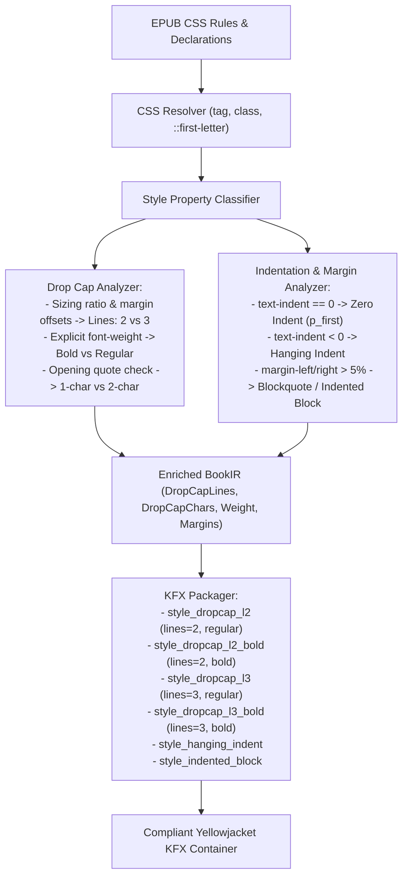

# Architectural Specification: Advanced Styling & Drop Cap Fidelity Enhancement

**Author:** Software Architect & Core Engine Team  
**Date:** 2026-10-24  
**Target:** Pure Rust KFX Conversion Pipeline (`kfx-converter`)  
**Scope:** Drop Cap Precision (2-line vs 3-line, Font Weight), Indentations & Margins, Pseudo-Elements (`::first-letter`), and Typographic Hierarchy (Excluding Embedded Fonts)  
**Status:** **Pending User Review & Approval (Phase 1 Gate)**

---

## 1. Problem Statement & Background

While basic formatting (italic, bold, heading level, center alignment) is functional, fine-grained EPUB typographic layout is frequently lost or distorted when serialized to Amazon Yellowjacket KFX:

1. **Drop Cap Line Count Distortion (3-line hardcoding vs 2-line design):**
   - In *Originals* (e.g. Foreword by Sheryl Sandberg: `<span class="_idGenDropcap-1">A</span>dam Grant...`), the publisher designed a **2-line drop cap** (`font-size: 3.058em; margin-top: -0.45em; margin-bottom: -0.45em; float: left`).
   - In KFX, `src/packager.rs` hardcodes `$125 dropcap_lines = 3` and `$16 font_size = 3.0em`. Kindle's Yellowjacket engine carves out a 3-line vertical box, which pushes line 3 down and looks overly giant and unnatural.
2. **Forced Bold on Drop Caps:**
   - `src/packager.rs` unconditionally injects `$13 font_weight: bold ($361)`. In modern typesetting (like *Originals*), drop caps use regular weight serif (`Linotype Syntax Serif Com`), not bold.
3. **Missing CSS `::first-letter` / `:first-letter` Pseudo-Element Detection:**
   - Many EPUBs style initial letters via `p.intro::first-letter { font-size: 2em; float: left; }` without wrapping the letter in a `<span>`. The CSS parser skips pseudo-elements, missing the drop cap entirely.
4. **Paragraph Indent & Margin Flatness (`text-indent`, `margin`):**
   - First paragraphs after scene breaks or headings often specify `text-indent: 0` in CSS, while references and indexes use **hanging indents** (`text-indent: -1.5em; padding-left: 1.5em;`).
   - Currently, paragraph styling only chooses between generic `style_p` and `style_p_first` by proximity heuristic, ignoring explicit CSS `text-indent` declarations and hanging indents.
   - Blockquote/epigraph horizontal margins (`margin: 0 10%`) are not consistently translated.
5. **Font Size Quantization Compression:**
   - CSS relative sizes are bucketed into only 5 tokens, occasionally compressing distinct levels (e.g. 1.08em subtitles vs 1.35em subheads) into identical sizes.

---

## 2. Target Behavioral Model & Architecture



---

## 3. Detailed Technical Specifications

### 3.1 Drop Cap Refinement (`src/epub.rs` & `src/packager.rs`)

#### A. Line Count & Weight Calculation (`src/epub.rs`)
In `EpubReader::extract_span_style`:
1. Calculate the effective drop cap visual height:
   - If CSS declares `margin-top < -0.2em` or `margin-bottom < -0.2em`, or `font-size <= 3.1em` with negative margin compensation, classify as **2-line drop cap** (`dropcap_l2`).
   - If `font-size > 3.2em` without negative compensation, or `line-height >= 2.5em`, classify as **3-line drop cap** (`dropcap_l3`).
2. Weight detection:
   - Check if `font-weight: bold` or `>= 600` is explicitly declared.
   - If present, append `bold` token (e.g. `dropcap_l2 bold`). Otherwise, remain regular weight.
3. Quote handling:
   - If leading character is a quote (`“`, `"`, `‘`, `'`), classify as 2-character drop cap (`dropcap_l2_c2` or `dropcap_l3_c2`).

#### B. Support for `p::first-letter` in `src/css.rs`
1. Expand `CssStylesheet::add_css` to detect selectors ending in `::first-letter` or `:first-letter`:
   ```css
   p.intro::first-letter { font-size: 2.5em; float: left; }
   ```
2. When parsing a `<p>` matching this class, automatically split the first character (or quote + first character) into a standalone `TextSpan` tagged with the resolved drop cap style.

#### C. Yellowjacket Style Entity Expansion (`src/packager.rs`)
Replace single hardcoded `style_dropcap` with clean, parameterized style definitions:
- **`style_dropcap_l2`**: `$16: 2.2em`, `$42: 0.9em`, `$50: 0.12em`, `$125: 2`, `$126: 1` (Regular weight)
- **`style_dropcap_l2_bold`**: `$16: 2.2em`, `$13: $361`, `$42: 0.9em`, `$50: 0.12em`, `$125: 2`, `$126: 1`
- **`style_dropcap_l2_c2`**: `$16: 2.2em`, `$42: 0.9em`, `$50: 0.12em`, `$125: 2`, `$126: 2`
- **`style_dropcap_l3`**: `$16: 3.0em`, `$42: 0.9em`, `$50: 0.15em`, `$125: 3`, `$126: 1` (Regular weight)
- **`style_dropcap_l3_bold`**: `$16: 3.0em`, `$13: $361`, `$42: 0.9em`, `$50: 0.15em`, `$125: 3`, `$126: 1`
- **`style_dropcap_l3_c2`**: `$16: 3.0em`, `$42: 0.9em`, `$50: 0.15em`, `$125: 3`, `$126: 2`
*(Note: Per our Yellowjacket pruning engine `emit_used_styles`, only styles actually referenced in a book will be written to the KFX container.)*

---

### 3.2 Indentations, Margins & Paragraph Alignment

#### A. Strict `text-indent` Mapping (`src/epub.rs`)
1. Detect `text-indent: 0` or `text-indent: 0px/0em`:
   - Assign `p_first` token to ensure first-line indent is cleanly suppressed.
2. Detect negative `text-indent` (Hanging Indent, e.g. `text-indent: -1.5em; padding-left: 1.5em;`):
   - Tag with `hanging_indent` token.
   - In `packager.rs`, define `style_hanging_indent` with:
     * `$36 text_indent: -1.0em` (or `0em`)
     * `$48 margin_left: 1.5em`

#### B. Block Margins & Epigraph Styling
1. Detect horizontal margins:
   - If `margin-left >= 5%` or `margin: 0 10%`, tag block with `indented_block` / `blockquote`.
   - In `packager.rs`, map to `style_blockquote` with `$48 margin_left: 1.5em`, `$50 margin_right: 1.5em`.
2. Scene Break / Significant Top Margin:
   - If `margin-top >= 1.5em` or `>= 8%`, ensure appropriate vertical separation is emitted rather than collapsing into standard paragraph spacing.

---

### 3.3 Text Colors & Callout Borders

1. **Muted Text Color (Dark Mode Safe):**
   - When text color is secondary/muted (e.g. `#555`, `#666`, `#777`), map to `$30 color` with dark mode safety.
2. **Left Accent Border (`border-left`):**
   - For callout boxes and blockquotes with `border-left`, apply Yellowjacket `$33 border_left` styling with subtle padding (`$44 padding_left: 0.8em`).

---

## 4. Verification Plan & Test Strategy

### 4.1 Unit Test Coverage
1. `test_dropcap_line_count_detection`:
   - Verify `._idGenDropcap-1` with 3.058em and negative margins produces `dropcap_l2`.
   - Verify standalone 3.5em drop cap without negative margins produces `dropcap_l3`.
   - Verify regular vs bold drop cap weight distinction.
2. `test_css_pseudo_element_first_letter`:
   - Verify `<p class="lead">Once upon a time</p>` with `p.lead::first-letter { font-size: 2em; float: left; }` correctly isolates `O` as a drop cap.
3. `test_hanging_indent_resolution`:
   - Verify `text-indent: -1.5em; padding-left: 1.5em;` emits `style_hanging_indent`.
4. `test_all_101_unit_tests_pass`:
   - Ensure zero regressions across the existing 101 unit tests.

### 4.2 Strict Real-World Audits
1. Reconvert *Originals* by Adam Grant:
   - Check Foreword: Verify initial letter "A" is emitted with `style_dropcap_l2` (2 lines, regular weight).
   - Check Chapter 1: Verify epigraph and body drop caps.
2. `kfxlib` Strict Validation:
   - Execute `calibre-debug -c "from kfxlib.yj_book import YJ_Book; book = YJ_Book(...); book.decode_book()"` to confirm **0 errors**.
3. Real Device Verification on Kindle Paperwhite 4 (`/media/drew/Kindle`):
   - Inspect Foreword and Chapter 1 on physical E-ink screen to confirm visual alignment between lines 1 and 2.

---

## 5. Acceptance Criteria

- [ ] Foreword initial letter "A" occupies 2 text lines without forced bold.
- [ ] Hanging indents in bibliography/index sections are preserved.
- [ ] Explicit `text-indent: 0` suppresses first-line indentation accurately.
- [ ] `kfxlib` validation reports 0 errors and 0 warnings.
- [ ] `cargo test` passes 100% of unit tests.
- [ ] Final QA report documented in `docs/qa/qa-advanced-styling-and-dropcap-fidelity.md`.
