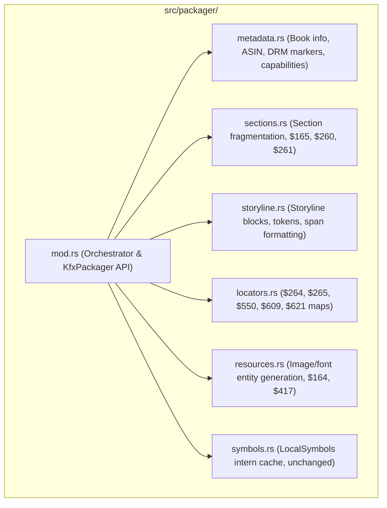

# Specification: KFX Converter Next-Phase Improvements & Architecture Hardening

**Document:** `docs/specs/spec-codebase-modularization-and-ci.md`  
**Status:** COMPLETED & COMMITTED (All Tracks A, B, C Implemented & Verified)  
**Author:** Software Architect & Multi-Agent Orchestrator  
**Target:** [`kfx-converter`](file:///home/drew/github/hwanjongyu/kfx_converter)  
**Date:** October 26, 2026  

---

## 1. Executive Summary

Following the successful remediation of all P0 (Critical), P1 (Major), and P2 (Minor) audit findings across the conversion engine, container serialization, and GUI frontends, this specification defines the roadmap for architectural maturation, test automation, and headless deployment capabilities.

The proposed improvements are organized into three self-contained work streams:
1. **Track A: Packager Monolith Modularization (`src/packager/`)**  
   Decompose the 3,600+ line monolithic `packager/mod.rs` into specialized submodules with zero regression in Ion byte parity.
2. **Track B: Multi-Platform CI/CD Pipeline (`.github/workflows/ci.yml`)**  
   Implement deterministic GitHub Actions workflows verifying CLI tests, GUI builds, formatting, and clippy lints across Linux and macOS runners.
3. **Track C: Headless Linux MTP Sideloading Fallback**  
   Provide CLI-level MTP discovery and sideloading on headless servers where GNOME GVFS (`/run/user/$UID/gvfs`) is not active.

---

## 2. Track A: Packager Monolith Modularization

### 2.1 Current State & Problems
- [`src/packager/mod.rs`](file:///home/drew/github/hwanjongyu/kfx_converter/src/packager/mod.rs) contains **3,678 lines of code**, making navigation, incremental refactoring, and code reviews error-prone.
- Section fragmentation, storyline entity emission, locator map indexing, and container capability generation are tightly coupled in a single file.

### 2.2 Target Architecture



### 2.3 Proposed File Breakdown

| New Module | Primary Responsibility | Key Structs & Methods |
| :--- | :--- | :--- |
| `src/packager/metadata.rs` | Book metadata, container capabilities ($490, $491), cover registration | `emit_metadata_entities()`, `emit_format_capabilities()` |
| `src/packager/sections.rs` | Section chunk construction, section headers ($165, $260), navigation linking | `build_section_entity()`, `emit_navigation_container()` |
| `src/packager/storyline.rs` | Storyline entities ($159, $160), text tokens ($176), inline formatting styles | `emit_storyline_entities()`, `convert_block_to_storyline()` |
| `src/packager/locators.rs` | Kindle position and locator indexing suites ($264, $265, $550, $609, $621) | `build_position_map()`, `build_location_pid_map()` |
| `src/packager/resources.rs` | External resource definitions ($164) and raw asset pairing ($417) | `emit_resource_entities()`, `resolve_resource_dimensions()` |
| `src/packager/mod.rs` | Public facade, `KfxPackager` orchestrator, top-level packaging workflow | `KfxPackager::new()`, `KfxPackager::package()` |

### 2.4 Invariants & Acceptance Criteria
- **Zero Byte Divergence:** The emitted `.kfx` binary containers for identical inputs must be byte-identical or functionally identical to the pre-refactor output.
- **Test Integrity:** All 131 tests in `cargo test` must pass without modification to test expectations.
- **Visibility:** Struct fields and helpers should use `pub(crate)` visibility to maintain encapsulation.

---

## 3. Track B: Multi-Platform CI/CD Pipeline

### 3.1 Workflow Architecture (`.github/workflows/ci.yml`)
- **Triggers:** Push to `main`, Pull Requests targeting `main`.
- **Operating Systems:**
  - `ubuntu-24.04` (Linux CLI + GPUI desktop check)
  - `macos-latest` (macOS CLI + macOS GPUI build check)
- **Rust Toolchain:** Stable (Edition 2024 compatible) with automated caching of `~/.cargo` and `target/`.

### 3.2 Jobs Definition

```yaml
name: CI

on:
  push:
    branches: [ main ]
  pull_request:
    branches: [ main ]

jobs:
  test:
    name: Test & Check (${{ matrix.os }})
    runs-on: ${{ matrix.os }}
    strategy:
      matrix:
        os: [ubuntu-24.04, macos-latest]
    steps:
      - uses: actions/checkout@v4
      - uses: dtolnay/rust-toolchain@stable
      - uses: Swatinem/rust-cache@v2
      
      # Linux dependencies for GPUI and Gio
      - name: Install Linux system dependencies
        if: runner.os == 'Linux'
        run: |
          sudo apt-get update
          sudo apt-get install -y libasound2-dev libxkbcommon-dev libvulkan-dev libwayland-dev

      - name: Run test suite (CLI + Converter)
        run: cargo test --workspace

      - name: Verify GUI desktop build
        run: cargo check --features gui
```

---

## 4. Track C: Headless Linux MTP Sideloading Fallback

### 4.1 Problem Description
- Kindle Scribe and Colorsoft use MTP instead of USB Mass Storage (UMS).
- On standard Linux desktop sessions, GVFS automatically mounts MTP devices at `/run/user/$UID/gvfs/mtp:host=...`.
- In headless CI/CD environments, Docker containers, or minimal window manager setups without GNOME GVFS, MTP devices cannot be detected through the filesystem.

### 4.2 Proposed Design
- Implement a fallback detection probe using the standard `mtp-tools` / `jmtpfs` or direct USB vendor ID scanning (`0111:Amazon Kindle`).
- If GVFS is absent but a connected Kindle MTP device is detected via `lsusb`, provide actionable guidance or invoke `jmtpfs` to mount user-space FUSE filesystem transparently.

---

## 5. Phased Execution Plan


1. **Step 1 (Pre-requisite):** Commit and push current working tree (P2 audit fixes + Universal Kindle support).
2. **Step 2 (Track B):** Add `.github/workflows/ci.yml` so that every subsequent refactor is verified in CI.
3. **Step 3 (Track A):** Progressively extract `metadata.rs`, `locators.rs`, `sections.rs`, and `storyline.rs` from `packager/mod.rs`, running regression tests after each extracted module.
4. **Step 4 (Track C):** Enhance `sync.rs` with headless MTP fallback checks.
5. **Step 5 (QA Gate):** Run full test suite (131+ tests) and produce final QA report.

---

## 6. Pre-Approval Gate

Per project orchestration guardrails (*RULE[user_global]*), Phase 2 implementation will NOT begin until explicit user approval is granted.

Please review the proposed plan and indicate how you would like to proceed:
1. **Option 1 (Full Plan):** Proceed with Step 1 (commit) followed by Track A (Packager Modularization) and Track B (CI/CD).
2. **Option 2 (Focused):** Execute Track A (Packager Modularization) only.
3. **Option 3 (Immediate Commit):** First commit and push the current pending changes, then discuss roadmap priority.
