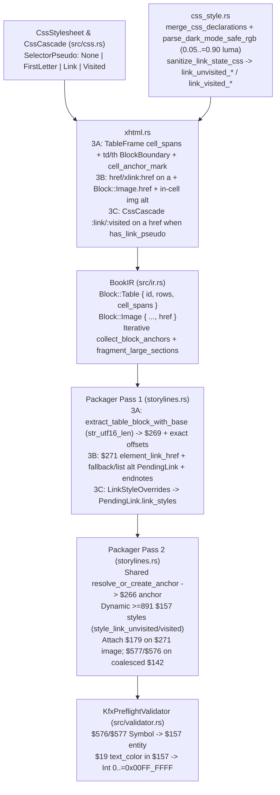

# Technical Specification: EPUB-to-KFX Links Stage 3 — Table Links, Image Links & Visited/Unvisited Link Styles (`kfx-converter`)

- **Document ID:** `docs/specs/spec-epub-kfx-links-stage3.md`
- **Target Crate / Workspace:** `kfx-converter` (`Cargo.toml` — Rust `edition = "2024"`, `[profile.release] panic = "abort"`, binaries `kfx-conv` [`cli`] and `kfx-studio` [`gui`])
- **Baseline Commit:** `04bdaa39abf5502586b777356e6afac7d6ac0130` (`04bdaa3`)
- **Related Specification:** [spec-epub-kfx-links.md](spec-epub-kfx-links.md) (Stages 1 & 2 core links, list links, and `$617 yj.note` footnote popups)
- **Scope:**
  - **Stage 3A — `Block::Table` Rich Links, Inline Spans & `<td id>` Anchor Containment**
  - **Stage 3B — `<a></a>` Image Links**
  - **Stage 3C — Visited & Unvisited Link Style Tokens (`$576`, `$577`)**
- **Status:** Approved & Implemented (QA verified in [`qa-epub-kfx-links-stage3.md`](../qa/qa-epub-kfx-links-stage3.md))

---

## 1. Executive Summary & Cross-Cutting Invariants

Stages 1 and 2 established two-pass spine/anchor link resolution, `$266 anchor` emission, `$179 link_to`, `$142 style_events` coalescing, `Block::List` link/anchor offsets, `$617 yj.note` popups, UTF-16 PID parity (`crate::ir::str_utf16_len`), `CssCascade` layered CSS resolution, and depth-bounded `TableFrame` / `BoundedTagStack` XHTML parsing. Three EPUB link capabilities remain unimplemented on `04bdaa3`:

1. **Table Cells Lose Inline Formatting, Hyperlinks, and Anchor Containment (`src/ir.rs`, `src/epub/xhtml.rs`, `src/packager/storylines.rs`):** `Block::Table` ([src/ir.rs](../../src/ir.rs#L393-L396)) only stores `rows: Vec<Vec<String>>`. During XHTML ingestion ([src/epub/xhtml.rs](../../src/epub/xhtml.rs#L31-L38), [L992-L1054](../../src/epub/xhtml.rs#L992-L1054), [L1536-L1648](../../src/epub/xhtml.rs#L1536-L1648), [L2432-L2488](../../src/epub/xhtml.rs#L2432-L2488)), text inside `<td>`/`<th>` is buffered into a flat `TableFrame.current_cell: String`, discarding inline `<a href>`, `<b>`, `<i>`, `<ruby>`, and `` attributes; while `is_anchor_target_tag` ([src/epub/xhtml.rs](../../src/epub/xhtml.rs#L127-L153)) already recognizes `table`, `tr`, `td`, and `th`, `finalize_table_frame` ([src/epub/xhtml.rs:1009](../../src/epub/xhtml.rs#L1009)) truncates `pending_anchors` at `frame.anchor_mark` and discards `<td id>`/`<th id>`/`<tr id>` rather than attaching them to cell spans; and `storylines.rs` ([src/packager/storylines.rs](../../src/packager/storylines.rs#L437-L455), [L568-L594](../../src/packager/storylines.rs#L568-L594), [L1197-L1226](../../src/packager/storylines.rs#L1197-L1226)) emits zero `$142 style_events`, cell anchors, or links for tables.
2. **Wrapped `<a></a>` Image Hyperlinks Are Dropped (`src/ir.rs`, `src/epub/xhtml.rs`, `src/packager/storylines.rs`):** `Block::Image` ([src/ir.rs](../../src/ir.rs#L385-L391)) lacks an `href` field, `parse_image_block` ([src/epub/xhtml.rs](../../src/epub/xhtml.rs#L1056-L1110)) and `Event::Empty(b"img" | b"image")` ([src/epub/xhtml.rs](../../src/epub/xhtml.rs#L1354-L1469)) do not capture active `<a href>` / `<a xlink:href>` or `<a id>` on `style_stack`, and `stage_image_block` ([src/packager/storylines.rs](../../src/packager/storylines.rs#L753-L867)) cannot attach `$179 link_to` to `$271 image` storyline structs or missing-resource alt-text fallbacks.
3. **CSS `:link` and `:visited` Link-State Styles Are Skipped (`src/css.rs`, `src/epub/css_style.rs`, `src/epub/xhtml.rs`, `src/packager/storylines.rs`, `src/validator.rs`):** `CssStylesheet` / `CssCascade` ([src/css.rs](../../src/css.rs#L207-L604)) only distinguish `is_first_letter: bool` and reject `:link` and `:visited` selectors, `css_style.rs` ([src/epub/css_style.rs](../../src/epub/css_style.rs#L11-L239)) only performs literal pure-black checks rather than ITU-R BT.601 perceptual luma filtering for custom link colors, and `storylines.rs` never binds `$577 link_unvisited_style` / `$576 link_visited_style` ([src/symbols.rs](../../src/symbols.rs#L1505-L1506)) to dynamic `$157 style` entities.

All Stage 3 changes **MUST** strictly preserve the following six cross-cutting invariants:

1. **5-Field `TextSpan` Struct Preserved:** `TextSpan` ([src/ir.rs](../../src/ir.rs#L97-L104)) retains its exact 5 fields (`text`, `style`, `anchor_id`, `href`, `ruby`). No new fields may be added to `TextSpan`, preserving all struct literals and `dropcap.rs` / `ruby.rs` / `xhtml.rs` contracts.
2. **Hardcoded Style SIDs `852..=890` & Dynamic Pass 2 Interning (`>= 891`):** `KfxPackager::build_styles(&mut symbols)` ([src/packager/styles.rs](../../src/packager/styles.rs#L69-L579)) **MUST** remain the first symbol-interning step in `KfxPackager::package` ([src/packager/core.rs](../../src/packager/core.rs#L156-L157)), keeping all 39 static styles in exact order at SIDs `852..=890` (`style_ruby = 872` at [styles.rs:117](../../src/packager/styles.rs#L117), `hanging_indent = 889` at [styles.rs:134](../../src/packager/styles.rs#L134), `style_link = 890` at [styles.rs:135](../../src/packager/styles.rs#L135) with `$23 underline: true` and omitting `$19 text_color` at [styles.rs:489-492](../../src/packager/styles.rs#L489-L492)). Dynamic Stage 3C `$157 style` entities (`style_link_unvisited_{n}`, `style_link_visited_{n}`) **MUST** be interned strictly in Pass 2 (`build_links_and_finalize_storylines`, after Pass 1 sections/content/anchors, guaranteeing SIDs `>= 891`) and emitted **only** when `:link` / `:visited` CSS actually applies to resolved hyperlinks.
3. **Option 3A-1 (Additive `cell_spans`) for `Block::Table`:** `Block::Table` keeps `rows: Vec<Vec<String>>` and adds `cell_spans: Vec<Vec<Vec<TextSpan>>>`. Tables continue emitting as `$269 text` storyline elements—**never** native `$278 table` / `$279 table_row`—so `build_content_features` ([src/packager/metadata.rs](../../src/packager/metadata.rs#L193-L258)) never emits `yj_table` or `yj_table_viewer` in `$585 content_features`, `full_text == block.plain_text()` ([src/ir.rs](../../src/ir.rs#L502-L550)) holds 1:1, `WordWiseBuilder::generate_from_book` ([src/enhancements/word_wise.rs](../../src/enhancements/word_wise.rs#L309-L390)) maintains exact UTF-16 PID parity, and `rows[0] == vec!["Header 1", "Header 2"]` ([src/epub/mod.rs](../../src/epub/mod.rs#L1291-L1297)) remains intact.
4. **`Block::Image` PID Advance, `$550` Clamp & `is_cover` Parity:** `Block::Image` PID advance follows `Block::yellowjacket_pid_len(has_resolved_resource)` ([src/ir.rs](../../src/ir.rs#L580-L593)): resolved `$271 image` elements occupy exactly `1` PID (`$584 alt_text` is metadata, never flow text), while unresolved `$269 text` image fallbacks occupy `str_utf16_len(Block::image_fallback_text(alt.as_deref())).max(1)` UTF-16 code units across [src/packager/storylines.rs](../../src/packager/storylines.rs) and [src/enhancements/word_wise.rs](../../src/enhancements/word_wise.rs). Every `$142 style_events` offset/length and `$266 anchor` position **MUST** use `crate::ir::str_utf16_len(...)` (never `.chars().count()`), preserving 1:1 UTF-16 PID parity with `WordWiseBuilder`. `$550 location_map` retains the defense-in-depth `0` offset clamp via `image_block_eids` ([src/packager/locators.rs](../../src/packager/locators.rs)), and `is_cover` detection remains unchanged.
5. **Zero-Link & No-Pseudo-CSS Stability:** Books with zero links emit zero `$266 anchor` entities, omit `style_link` (`890`) and any `>= 891` styles, omit `$255 optional_dependencies` in `$419`, and keep identical EIDs/PIDs. Books with links but no `:link`/`:visited` CSS rules emit only `style_link` (`890`), zero dynamic `>= 891` styles, and zero `$576`/`$577` fields on `$142` link events.
6. **$O(1)$ Call-Stack Iterative Traversals:** Every traversal over `Block` / `Block::List` (`Drop for Block`, `Clone for Block`, `Block::plain_text`, `Block::contains_image`, `Block::char_count`, `collect_block_anchors`, `BookIR::fragment_large_sections`, `extract_list_block`, `extract_list_segments`, and `collect_img_res`) **MUST** remain strictly iterative using explicit heap-allocated stacks, preserving 10,000+ level nesting safety.

### Stage 3 End-to-End Architecture



---

## 2. Stage 3A — `Block::Table` Rich Links, Inline Spans & `<td id>` Anchor Containment

### 2.1 IR Extensions & Iterative Traversal (`src/ir.rs`)

1. **Extend `Block::Table` ([src/ir.rs](../../src/ir.rs#L393-L396)):**
   Add `cell_spans` as an additive field alongside `rows`:
   ```rust
   Table {
       id: String,
       rows: Vec<Vec<String>>,
       cell_spans: Vec<Vec<Vec<TextSpan>>>,
   },
   ```
   - `Block::plain_text` ([src/ir.rs](../../src/ir.rs#L502-L550)) and `Block::char_count` ([src/ir.rs](../../src/ir.rs#L597-L631)) continue reading `rows` directly (`Block::Table { rows, .. }`), guaranteeing backward compatibility for synthetic `BookIR` instances constructed with `cell_spans: Vec::new()` and exact PID parity with `WordWiseBuilder`.
2. **Update `Clone for Block` ([src/ir.rs](../../src/ir.rs#L679-L771)):**
   At [src/ir.rs:714-717](../../src/ir.rs#L714-L717):
   ```rust
   Block::Table { id, rows, cell_spans } => Some(Block::Table {
       id: id.clone(),
       rows: rows.clone(),
       cell_spans: cell_spans.clone(),
   }),
   ```
3. **Update `collect_block_anchors` ([src/ir.rs](../../src/ir.rs#L1346-L1383)):**
   Split `Block::Table` out of the combined `Block::Image | Block::Table` arm ([src/ir.rs:1374](../../src/ir.rs#L1374)) so that in addition to capturing non-empty `id` when `include_block_ids == true`, it iterates all `cell_spans` and pushes every trimmed, `#`-stripped non-empty `span.anchor_id`:
   ```rust
   Block::Table { id, cell_spans, .. } => {
       if include_block_ids && !id.is_empty() {
           anchors.push(id.clone());
       }
       for row in cell_spans {
           for cell in row {
               for s in cell {
                   if let Some(ref anchor) = s.anchor_id {
                       let clean = anchor.trim().trim_start_matches('#');
                       if !clean.is_empty() {
                           anchors.push(clean.to_string());
                       }
                   }
               }
           }
       }
   }
   ```
   Because `extract_anchors_from_block` ([src/ir.rs:1386](../../src/ir.rs#L1386)) delegates to `collect_block_anchors(block, false)`, both `fragment_large_sections` and unit anchor extraction automatically index `<td id>`, `<th id>`, `<tr id>`, `<a id>`, and `<span id>` inside tables.
4. **Update `BookIR::fragment_large_sections` ([src/ir.rs](../../src/ir.rs#L845-L1030)):**
   In the iterative `while let Some(block) = stack.pop()` loop (splitting `Block::Table` out of [src/ir.rs:1025](../../src/ir.rs#L1025)), walk `cell_spans` and rewrite every internal `span.href` via `remap_internal_href`:
   ```rust
   Block::Table { cell_spans, .. } => {
       for row in cell_spans {
           for cell in row {
               for span in cell {
                   let Some(ref raw_href) = span.href else {
                       continue;
                   };
                   if let Some(rewritten) = remap_internal_href(
                       raw_href,
                       &current_sec_id,
                       orig_id,
                       &anchor_part_map,
                       &section_first_part_map,
                   ) {
                       span.href = Some(rewritten);
                   }
               }
           }
       }
   }
   ```
   Because `Block::List` pushes children onto the explicit `Vec<&mut Block>` `stack`, both top-level tables and tables nested arbitrarily deep inside `Block::List` are remapped in $O(1)$ call-stack space.
5. **Update All Existing `Block::Table` Struct Literals & Exhaustive Matches (`cell_spans: Vec::new()` for synthetic fixtures, populated cells in `xhtml.rs`):**
   - Constructions (5 sites):
     - [src/ir.rs:714](../../src/ir.rs#L714) (`Clone for Block` — clones `cell_spans`)
     - [src/ir.rs:1755](../../src/ir.rs#L1755) (`test_block_plain_text_and_char_count_and_page_break_after`)
     - [src/epub/xhtml.rs:1041](../../src/epub/xhtml.rs#L1041) (`finalize_table_frame` — populated `cell_spans: frame.row_spans`)
     - [src/packager/tests.rs:3939](../../src/packager/tests.rs#L3939) & [L3949](../../src/packager/tests.rs#L3949) (`test_packager_flattened_table_omits_yj_table_content_features`)
   - Exhaustive pattern matches updated with `..` or `cell_spans`:
     - [src/ir.rs:714](../../src/ir.rs#L714) (`Clone for Block`), [src/epub/xhtml.rs:3488](../../src/epub/xhtml.rs#L3488) & [L3533](../../src/epub/xhtml.rs#L3533) (`test_p2_15_nested_tables_list_routing_anchor_containment_and_eof_flush`), [src/packager/storylines.rs:437](../../src/packager/storylines.rs#L437) (`extract_list_block`) & [L568](../../src/packager/storylines.rs#L568) (`extract_list_segments`). (Sites using `{ .. }` such as [src/ir.rs:518, 605, 1025, 1374](../../src/ir.rs#L518), [src/epub/mod.rs:1291](../../src/epub/mod.rs#L1291), [src/epub/xhtml.rs:3520](../../src/epub/xhtml.rs#L3520), and [src/packager/storylines.rs:1197](../../src/packager/storylines.rs#L1197) remain valid or are updated where Stage 3A handles `cell_spans`.)

---

### 2.2 XHTML Table Parsing, Formatting Isolation & Anchor Containment (`src/epub/xhtml.rs`)

1. **`is_anchor_target_tag` ([src/epub/xhtml.rs](../../src/epub/xhtml.rs#L127-L153)):**
   Already includes `b"td" | b"th" | b"table" | b"tr"` ([L146-L149](../../src/epub/xhtml.rs#L146-L149)), so `<table id>`, `<tr id>`, `<td id>`, and `<th id>` are captured into `element_anchor_id` ([L1528-L1532](../../src/epub/xhtml.rs#L1528-L1532)).

2. **Extend `TableFrame` ([src/epub/xhtml.rs](../../src/epub/xhtml.rs#L31-L38)):**
   Preserve `table_stack: Vec<TableFrame>` (`MAX_TABLE_DEPTH = 32`, `table_overflow_depth`) and `in_table_cell` ([L788-L790](../../src/epub/xhtml.rs#L788-L790)), replacing flat `current_cell: String` with span-aware fields:
   ```rust
   struct TableFrame {
       id: Option<String>,
       anchor_mark: usize,
       row_anchor_mark: Option<usize>,
       cell_anchor_mark: Option<usize>,
       rows: Vec<Vec<String>>,
       row_spans: Vec<Vec<Vec<TextSpan>>>,
       current_row: Vec<String>,
       current_row_spans: Vec<Vec<TextSpan>>,
       current_cell_text: String,
       current_cell_spans: Vec<TextSpan>,
       in_cell: bool,
   }
   ```

3. **`trim_cell_spans(spans: &mut Vec<TextSpan>)` Helper:**
   Trims whitespace cleanly across leading/trailing cell spans while preserving empty-text anchor markers:
   - **Leading trim:** Iterate indices `0..spans.len()`. Skip spans that are already empty-text anchor markers (`spans[i].text.is_empty()`). For the first span with non-empty `text`, apply `trim_start()`:
     - If trimmed text becomes empty and `anchor_id.is_none()`, clear `text` and continue trimming the next span.
     - If trimmed text becomes empty and `anchor_id.is_some()`, set `text.clear()`, clear `href = None` and `style = None` (keeping `anchor_id` intact), and continue trimming leading whitespace on the subsequent span.
     - Otherwise update `spans[i].text = trimmed.to_string()` and stop leading trim.
   - **Trailing trim:** Iterate indices `(0..spans.len()).rev()`. Skip empty spans (`spans[i].text.is_empty()`). Apply `trim_end()` analogously: if `text` becomes empty and `anchor_id.is_some()`, preserve `anchor_id` (clearing `href`/`style`) and continue backward; otherwise stop once a non-whitespace character remains.
   - **Prune non-anchor empties:** `spans.retain(|s| !s.text.is_empty() || s.anchor_id.is_some());`

4. **`finish_open_cell` Helper / Closure (Mirroring `AnchorScope` / `drain_block_anchors_for_scope` at [L865-L889](../../src/epub/xhtml.rs#L865-L889)):**
   Called on `</td>`, `</th>`, unclosed cell transitions (`<tr>`, `<td>`/`<th>`, `<td/>`/`<th/>` while `top.in_cell`), `</table>` (`finalize_table_frame`), and EOF (`while !table_stack.is_empty()`):
   1. Flush active span text into `frame.current_cell_spans` via `flush_current_span(&mut frame.current_cell_text, &mut frame.current_cell_spans, style_stack, pending_anchors)`.
   2. Drain cell-scoped trailing/empty anchors using `frame.cell_anchor_mark` (matching the `drain_block_anchors_for_scope` pattern at [L865-L889](../../src/epub/xhtml.rs#L865-L889)):
      ```rust
      if let Some(mark) = frame.cell_anchor_mark.take()
          && pending_anchors.len() > mark
      {
          let mut rest = pending_anchors.split_off(mark);
          while let Some(pa) = rest.pop_front() {
              frame.current_cell_spans.push(TextSpan {
                  text: String::new(),
                  style: None,
                  anchor_id: Some(pa),
                  href: None,
                  ruby: None,
              });
          }
      }
      ```
   3. Pop `style_stack` back to the innermost `StyleFrameKind::BlockBoundary` whose tag is `b"td"` or `b"th"` (`rposition(|f| matches!(f, StyleFrameKind::BlockBoundary { tag } if tag.as_slice() == b"td" || tag.as_slice() == b"th"))`), truncating `style_stack` at that index and resetting `*style_overflow_depth = 0`, so unclosed `<b>`, `<i>`, `<a href>`, or `<span>` tags inside one cell **cannot** bleed into the next cell or post-table paragraphs.
   4. Call `trim_cell_spans(&mut frame.current_cell_spans)`.
   5. Build `cell_plain` **directly** from trimmed `frame.current_cell_spans`:
      ```rust
      let cell_plain: String = frame.current_cell_spans.iter().map(|s| s.text.as_str()).collect();
      frame.current_row.push(cell_plain);
      frame.current_row_spans.push(std::mem::take(&mut frame.current_cell_spans));
      ```
      This guarantees `rows[r][c]` and `cell_spans[r][c]` match character-for-character (`1:1`).
   6. Clear `frame.current_cell_text`, set `frame.in_cell = false`, `frame.cell_anchor_mark = None`.

5. **Depth-Bounded `table_stack` Lifecycle (`MAX_TABLE_DEPTH = 32`) & `finalize_table_frame` ([L992-L1054](../../src/epub/xhtml.rs#L992-L1054)):**
   - **On `Event::Start(b"table")` ([L1536-L1598](../../src/epub/xhtml.rs#L1536-L1598)):**
     - If `table_stack.is_empty()`: flush open paragraph (`flush_open_paragraph`), open heading (`flush_open_heading`), and (if `in_li`) any pending inline `current_spans` into `current_list_item_blocks`.
     - If `table_stack.len() >= MAX_TABLE_DEPTH`: increment `table_overflow_depth += 1`.
     - Else: push a fresh `TableFrame` onto `table_stack` with `id: element_anchor_id`, `anchor_mark: pending_anchors.len()`, `row_anchor_mark: None`, `cell_anchor_mark: None`, empty `rows` / `row_spans` / `current_row` / `current_row_spans` / `current_cell_text` / `current_cell_spans`, `in_cell: false`.
     - Note: `TableFrame.id` is stored in `Block::Table.id` (falling back to `format!("table_{}", blocks.len() + 1)` if `None`), and if the top-level table has empty `rows`, `frame.id` is discarded rather than leaked into post-table `pending_anchors`.
   - **On `Event::Start(b"tr")` ([L1599-L1613](../../src/epub/xhtml.rs#L1599-L1613)):**
     - When `table_overflow_depth == 0` and `let Some(top) = table_stack.last_mut()`:
       - If `top.in_cell`: call `finish_open_cell(top, ...)`.
       - If `!top.current_row.is_empty()`: push `std::mem::take(&mut top.current_row)` to `top.rows` and `std::mem::take(&mut top.current_row_spans)` to `top.row_spans`.
       - `top.row_anchor_mark = Some(pending_anchors.len());`
       - `push_pending_anchor(&mut pending_anchors, element_anchor_id);`
   - **On `Event::Start(b"th" | b"td")` ([L1614-L1626](../../src/epub/xhtml.rs#L1614-L1626)):**
     - When `table_overflow_depth == 0` and `let Some(top) = table_stack.last_mut()`:
       - If `top.in_cell`: call `finish_open_cell(top, ...)`.
       - Push `StyleFrameKind::BlockBoundary { tag: local_bytes.to_vec() }` onto `style_stack`.
       - Inherit `top.row_anchor_mark.take()` on the first cell of a row (`top.cell_anchor_mark = Some(rm.min(pending_anchors.len()))`) or `Some(pending_anchors.len())` so `<tr id="...">` attaches to cell `(r, 0)` even if that cell is empty!
       - `push_pending_anchor(&mut pending_anchors, element_anchor_id);`
       - `top.in_cell = true; top.current_cell_text.clear(); top.current_cell_spans.clear();`
   - **On `Event::Empty(b"td" | b"th")` ([L1227-L1238](../../src/epub/xhtml.rs#L1227-L1238)):**
     - When `table_overflow_depth == 0` and `let Some(top) = table_stack.last_mut()`:
       - If `top.in_cell`: call `finish_open_cell(top, ...)`.
       - Compute `cell_mark = top.row_anchor_mark.take().map(|rm| rm.min(pending_anchors.len())).unwrap_or(pending_anchors.len());`.
       - `push_pending_anchor(&mut pending_anchors, extract_id_attr(e));`
       - Drain `pending_anchors.split_off(cell_mark)` into `empty_cell_spans` as empty-text anchor `TextSpan`s (`text: String::new(), style: None, anchor_id: Some(pa), href: None, ruby: None`), push `String::new()` to `top.current_row`, and push `empty_cell_spans` to `top.current_row_spans` so self-closing `<td id="c1"/>` stays aligned and contained.
   - **On `Event::End(b"th" | b"td")` ([L2432-L2441](../../src/epub/xhtml.rs#L2432-L2441)):**
     - When `table_overflow_depth == 0` and `let Some(top) = table_stack.last_mut()` and `top.in_cell`: call `finish_open_cell(top, ...)`.
   - **On `Event::End(b"tr")` ([L2442-L2455](../../src/epub/xhtml.rs#L2442-L2455)):**
     - When `table_overflow_depth == 0` and `let Some(top) = table_stack.last_mut()`:
       - If `top.in_cell`: call `finish_open_cell(top, ...)`.
       - If `!top.current_row.is_empty()`:
         - `top.rows.push(std::mem::take(&mut top.current_row));`
         - `top.row_spans.push(std::mem::take(&mut top.current_row_spans));`
   - **On `Event::End(b"table")` ([L2456-L2468](../../src/epub/xhtml.rs#L2456-L2468)) & `finalize_table_frame` ([L992-L1054](../../src/epub/xhtml.rs#L992-L1054)):**
     - If `table_overflow_depth > 0`: `table_overflow_depth -= 1;`.
     - Else call `finalize_table_frame(&mut table_stack, &mut style_stack, &mut style_overflow_depth, &mut pending_anchors, in_li, &mut current_list_item_blocks, &mut blocks)`:
       1. Pop `mut frame` from `table_stack`.
       2. If `frame.in_cell`: call `finish_open_cell(&mut frame, ...)`.
       3. If `!frame.current_row.is_empty()`: push `std::mem::take(&mut frame.current_row)` to `frame.rows` and `std::mem::take(&mut frame.current_row_spans)` to `frame.row_spans`.
       4. Drain any remaining `pending_anchors` above `frame.anchor_mark` (`let mark = frame.anchor_mark.min(pending_anchors.len());` -> `let mut rest = pending_anchors.split_off(mark);`):
          - If `frame.row_spans.last_mut().and_then(|r| r.last_mut())` exists, append `rest` as empty-text anchor `TextSpan`s onto that last cell; otherwise discard `rest` (empty table). Clear `frame.row_anchor_mark = None` and truncate `pending_anchors.truncate(mark)`.
       5. If `let Some(parent) = table_stack.last_mut()`:
          - **If `parent.in_cell`:** flush `parent.current_cell_text` into `parent.current_cell_spans` via `flush_current_span`, then flatten `frame.row_spans` cleanly into `parent.current_cell_spans` (preserving `TextSpan` styles, `href`s, `ruby`, and `anchor_id`s from child cells, plus child `frame.id` if `Some` as an empty-text anchor span!). Insert a single `' '` separator span (or space on `parent.current_cell_text`) between non-empty cells in a row, `'\n'` between non-empty rows, and leading/trailing `' '` separators around non-empty child content when adjacent parent cell text does not end in whitespace, so `parent.current_cell_spans` preserves all inline formatting, links, and nested `<td id>` anchors while matching existing flattened whitespace (`"OuterA Inner1 Inner2 OuterB Icon"`).
          - **If `!parent.in_cell`:** `parent.rows.extend(frame.rows); parent.row_spans.extend(frame.row_spans);`
       6. **Else (`table_stack` is now empty):**
          - If `!frame.rows.is_empty()`: construct `Block::Table { id: frame.id.unwrap_or_else(|| format!("table_{}", blocks.len() + 1)), rows: frame.rows, cell_spans: frame.row_spans }` and push to `current_list_item_blocks` if `in_li`, else `blocks`.

6. **Handling Block & Inline Tags Inside Table Cells (`in_table_cell(&table_stack) == true`):**
   - **Precedence Note in `Event::Start` and `Event::End`:** Currently `_ if inside_cell =>` ([L1627-L1648](../../src/epub/xhtml.rs#L1627-L1648)) and `_ if in_table_cell(&table_stack) =>` ([L2469-L2488](../../src/epub/xhtml.rs#L2469-L2488)) appear *above* inline/ruby arms. Reorder or dispatch so inline formatting tags (`b`, `strong`, `i`, `em`, `u`, `del`, `s`, `strike`, `sup`, `sub`, `code`, `tt`, `kbd`, `samp`, `pre`, `span`, `abbr`, `acronym`, `a`) and `ruby`/`rb`/`rt`/`rtc`/`rp` execute for **both** `!inside_cell` and `inside_cell` (when `table_overflow_depth == 0`) using `(target_text, target_spans)` routed to `(&mut top.current_cell_text, &mut top.current_cell_spans)` when `in_table_cell(&table_stack)` is true, otherwise `(&mut current_span_text, &mut current_spans)`.
   - **Text & Ruby Events:**
     - `handle_text_chunk` ([L1162-L1211](../../src/epub/xhtml.rs#L1162-L1211)) already routes text to `top.current_cell_text.push_str(text)` when `top.in_cell`.
     - `Event::Start(b"ruby")` ([L1649-L1657](../../src/epub/xhtml.rs#L1649-L1657)) and `Event::End(b"ruby")` ([L2492-L2506](../../src/epub/xhtml.rs#L2492-L2506)): route flush/emit to `(target_text, target_spans)` so `<ruby>` inside `<td>` emits `TextSpan.ruby` spans into `top.current_cell_spans`.
   - **Block tags inside `<td>`/`<th>` (`p`, `div`, `section`, `article`, `main`, `aside`, `figure`, `figcaption`, `blockquote`, `center`, `h1`..`h6`, `ul`, `ol`, `li`):**
     - On `Event::Start` when `inside_cell`: flush `top.current_cell_text` into `top.current_cell_spans` via `flush_current_span`, insert `' '` separator if `top.current_cell_spans` has non-empty trailing text not ending in whitespace (for `p | div | li | h1..=h6`), capture `element_anchor_id` into `pending_anchors`, and push `StyleFrameKind::BlockBoundary { tag: local_bytes.to_vec() }` (never mutate `in_p`, `in_heading`, `blockquote_stack`, `center_stack`, `list_stack`, `in_li`, or `blocks`).
     - On `Event::End` when `in_table_cell(&table_stack)`: flush `top.current_cell_text` into `top.current_cell_spans` via `flush_current_span`, insert `' '` separator if needed (for `p | div | li | h1..=h6`), and call `pop_block_boundary(&mut style_stack, &mut style_overflow_depth, local_bytes)`—never call `flush_open_paragraph`, `flush_open_heading`, `list_stack.pop()`, or push top-level blocks out of order.
   - **Void & Inline Empty Tags Inside `<td>`/`<th>`:**
     - `Event::Empty(b"hr")` ([L1239-L1299](../../src/epub/xhtml.rs#L1239-L1299)) when `inside_cell` and `table_overflow_depth == 0`: flush `top.current_cell_text` into `top.current_cell_spans` and append `"---"` to `top.current_cell_text` (never emit a separate `Block::HorizontalRule`).
     - `Event::Empty(b"br")` ([L1300-L1316](../../src/epub/xhtml.rs#L1300-L1316)) when `top.in_cell`: push `'\n'` to `top.current_cell_text`.
     - `Event::Empty(b"a")` ([L1317-L1353](../../src/epub/xhtml.rs#L1317-L1353)): remove the `!inside_cell` guard and route `(target_text, target_spans)` to `(&mut top.current_cell_text, &mut top.current_cell_spans)` when `inside_cell && table_overflow_depth == 0`, supporting `<a id/>` and `<a href/xlink:href>`.
     - `Event::Empty(b"img" | b"image")` ([L1354-L1469](../../src/epub/xhtml.rs#L1354-L1469)) when `inside_cell`: see Section 3.2 below.

7. **EOF Unwinding (`Event::Eof | Err(_)` at [src/epub/xhtml.rs:2758-2860](../../src/epub/xhtml.rs#L2758-L2860)):**
   At [L2798-L2806](../../src/epub/xhtml.rs#L2798-L2806) (immediately before `if !pending_anchors.is_empty()` at `L2807` and `list_stack` unwinding at `L2829`), the existing `while !table_stack.is_empty()` loop invokes the updated `finalize_table_frame(...)` cleanly, unwinding any unclosed nested tables, open cells, `cell_spans`, and table-scoped anchors at EOF without leaking anchors into `pending_anchors`.

---

### 2.3 Packager Table Storyline & Link Extraction (`src/packager/storylines.rs`)

1. **Zero-Allocation `spans_equal_str` Helper:**
   ```rust
   fn spans_equal_str(spans: &[TextSpan], expected: &str) -> bool {
       let mut rest = expected;
       for span in spans {
           let Some(next) = rest.strip_prefix(span.text.as_str()) else {
               return false;
           };
           rest = next;
       }
       rest.is_empty()
   }
   ```
   Verifies in $O(\text{bytes})$ with zero heap allocation whether `cell_spans[r][c]` matches `rows[r][c]` character-for-character (including empty cells with empty-text anchor spans).
2. **Shared `extract_table_block_with_base` Helper (`str_utf16_len` Parity):**
   ```rust
   fn extract_table_block_with_base(
       id: &str,
       rows: &[Vec<String>],
       cell_spans: &[Vec<Vec<TextSpan>>],
       base_offset: usize,
       styles: &StyleSymMap,
       syms: &StorylineSymIds,
   ) -> ExtractedBlockRuns
   ```
   - Registers `(id.to_string(), base_offset)` in `anchors` if `!id.is_empty()`.
   - Walks `rows`: inserts `'\n'` between rows and `'\t'` between cells, advancing `char_offset` by `1` UTF-16 code unit per separator.
   - For each `(r_idx, c_idx, cell)`:
     - If `cell_spans.get(r_idx).and_then(|row| row.get(c_idx))` is `Some(spans)` and `spans_equal_str(spans, cell)` is `true`, calls `extract_style_events_with_base(spans, "", char_offset, styles, syms)`, appends `extracted.full_text`, advances `char_offset += crate::ir::str_utf16_len(&extracted.full_text)`, and extends `style_events`, `anchors`, and `pending_links`.
     - Otherwise (e.g., synthetic `BookIR` constructed with `cell_spans: Vec::new()`), pushes `cell` directly onto `full_text` and advances `char_offset += crate::ir::str_utf16_len(cell)`.
3. **Unified Call Sites in `extract_list_block`, `extract_list_segments` & `process_section_pass1`:**
   - In `extract_list_block` ([src/packager/storylines.rs:437-455](../../src/packager/storylines.rs#L437-L455)): replace the manual `Block::Table { id, rows }` loop with `extract_table_block_with_base(id, rows, cell_spans, char_offset, styles, syms)`, extending `full_text`, `style_events`, `anchors`, and `pending_links`, and advancing `char_offset += crate::ir::str_utf16_len(&extracted.full_text)`.
   - In `extract_list_segments` ([src/packager/storylines.rs:568-594](../../src/packager/storylines.rs#L568-L594)): update `Block::Table { id, rows, cell_spans }` so `need_sep` (when `!current.plain_text().is_empty()` or `!extracted.full_text.is_empty()`) appends `'\n'` and advances `char_offset += 1` before calling `extract_table_block_with_base(id, rows, cell_spans, char_offset, styles, syms)`, extending `full_text`, `style_events`, `anchors`, and `pending_links`, advancing `char_offset += crate::ir::str_utf16_len(&extracted.full_text)`, and setting `need_sep = true` when `!extracted.full_text.is_empty()`.
   - In `process_section_pass1` ([src/packager/storylines.rs:1197-1226](../../src/packager/storylines.rs#L1197-L1226)): split `Block::Table { .. } | Block::HorizontalRule` into separate arms:
     - `Block::Table { id, rows, cell_spans }`: call `extract_table_block_with_base(id, rows, cell_spans, 0, styles, syms)`, `debug_assert_eq!(extracted.full_text, block.plain_text())`, register every `(anc, anc_off)` in `self.anchor_targets` / `self.global_anchor_targets` as `(block_eid, block_start_pid + anc_off, anc_off)`, and pass `extracted.full_text`, `extracted.style_events`, and `extracted.pending_links` to `Self::stage_text_element`.
     - `Block::HorizontalRule`: retain plain `"---"` `Self::stage_text_element`.
   - Result: Table links emit `$142 style_events` + `$266 anchor` + `$617 yj.note` popups, `<td id>`/`<tr id>`/`<a id>` inside cells resolve to exact non-zero UTF-16 offsets `(block_eid, block_start_pid + anc_off, anc_off)`, and `$585 content_features` still omits `yj_table` / `yj_table_viewer`.

---

## 3. Stage 3B — `<a></a>` Image Links

### 3.1 IR Extensions & Literal Inventory (`src/ir.rs` & Workspace)

1. **Extend `Block::Image` ([src/ir.rs](../../src/ir.rs#L385-L391)):**
   ```rust
   Image {
       id: String,
       resource_id: String,
       alt: Option<String>,
       width: Option<u32>,
       height: Option<u32>,
       href: Option<String>,
   },
   ```
2. **Update `Clone for Block` ([src/ir.rs](../../src/ir.rs#L700-L712)):** Destructure `href` and clone `href: href.clone()`.
3. **Update `BookIR::fragment_large_sections` ([src/ir.rs](../../src/ir.rs#L1025)):**
   In the iterative `while let Some(block) = stack.pop()` loop (splitting `Block::Image` out of [L1025](../../src/ir.rs#L1025)), add:
   ```rust
   Block::Image {
       href: Some(raw_href), ..
   } => {
       if let Some(rewritten) = remap_internal_href(
           raw_href,
           &current_sec_id,
           orig_id,
           &anchor_part_map,
           &section_first_part_map,
       ) {
           *raw_href = rewritten;
       }
   }
   Block::Image { href: None, .. } | Block::HorizontalRule => {}
   ```
   Handles both top-level and `Block::List`-nested `Block::Image` links in $O(1)$ call-stack space.
4. **Complete `Block::Image` Literal & Pattern Inventory Across Workspace (`href: None` unless cloned/parsed):**
   - **Struct Constructions (36 sites):**
     - [src/ir.rs](../../src/ir.rs): 6 sites (`L706` `Clone for Block` — clones `href`, `L1171` `sections_with_cover`, `L1214` `ensure_cover_section`, `L1741`, `L1874`, `L2609` tests)
     - [src/epub/xhtml.rs](../../src/epub/xhtml.rs): 1 site (`L1100` `parse_image_block` — populated from active `href`)
     - [src/packager/locators.rs](../../src/packager/locators.rs): 3 sites (`L345`, `L368`, `L376` in `test_collect_img_res_deeply_nested_list_no_stack_overflow`)
     - [src/enhancements/word_wise.rs](../../src/enhancements/word_wise.rs): 7 sites (`L1061`, `L1073`, `L1080`, `L1087`, `L1094`, `L1209`, `L1247` in tests)
     - [src/packager/tests.rs](../../src/packager/tests.rs): 19 sites (`L201`, `L819`, `L844`, `L1047`, `L1179`, `L1612`, `L1682`, `L1689`, `L1753`, `L2175`, `L2415`, `L2422`, `L2479`, `L4086`, `L4093`, `L4100`, `L4220`, `L4564`, `L4707`)
   - **Pattern Match Sites (`{ .. }` / Stage 3B `href` binding):**
     - [src/ir.rs](../../src/ir.rs): `L416`, `L418`, `L540`, `L558`, `L582`, `L624`, `L700` (exhaustive in `Clone`), `L1025` (`fragment_large_sections`), `L1075`, `L1160`, `L1204`, `L1374`
     - [src/epub/xhtml.rs](../../src/epub/xhtml.rs): `L1457`, `L3396`, `L3420`, `L3446`
     - [src/epub/mod.rs](../../src/epub/mod.rs): `L1271`, `L1603`, `L3019`
     - [src/packager/storylines.rs](../../src/packager/storylines.rs): `L424` (`extract_list_block` — updated to bind `href`), `L507` (`extract_list_segments`), `L773` (`stage_image_block` — updated to bind `href`), `L1062` (`process_section_pass1`)
     - [src/packager/locators.rs](../../src/packager/locators.rs): `L213`
     - [src/enhancements/word_wise.rs](../../src/enhancements/word_wise.rs): `L332`, `L349`

---

### 3.2 XHTML `<a></a>` & SVG `<a xlink:href><image/></a>` Parsing (`src/epub/xhtml.rs`)

1. **Capture `href` and `xlink:href` on `<a>`:**
   In both `Event::Empty(b"a")` ([src/epub/xhtml.rs:1317-1353](../../src/epub/xhtml.rs#L1317-L1353)) and `Event::Start(b"a")` ([src/epub/xhtml.rs:2106-2168](../../src/epub/xhtml.rs#L2106-L2168)), extract both `b"href"` and `b"xlink:href"` (preferring `b"href"` when both are present) and normalize via `normalize_span_href(&v, link_ctx)`. This ensures HTML `<a href="..."></a>` and SVG `<a xlink:href="..."><image xlink:href="..."/></a>` both produce normalized `href`.
2. **Update `parse_image_block` ([L1056-L1110](../../src/epub/xhtml.rs#L1056-L1110)) & `Event::Empty(b"img" | b"image")` ([L1354-L1469](../../src/epub/xhtml.rs#L1354-L1469)):**
   When `local_bytes` is `b"img" | b"image"` and `!inside_cell`:
   - Flush any preceding inline spans (`flush_current_span`, flushing `current_spans` as `Block::Heading` if `in_heading` or `Block::Paragraph` if `in_p || in_li`, mirroring [L1378-L1424](../../src/epub/xhtml.rs#L1378-L1424)).
   - Resolve active attributes on `style_stack`: `let attrs = resolve_active_span_attrs(&style_stack);`.
   - Determine image `id` ([L1426-L1432](../../src/epub/xhtml.rs#L1426-L1432)):
     1. Use `img_own_id` (`extract_id_attr(e)` on `` / `<image>`) if `Some`.
     2. Else, search `style_stack.iter_mut().rev()` for the innermost `StyleFrameKind::Inline { tag, anchor, emitted_span, .. }` with `tag.as_slice() == b"a"`; if `anchor.is_some()` and `!*emitted_span`, adopt `anchor.clone()` as `resolved_img_id` and set `*emitted_span = true` (preventing `</a>` at [L2642-L2657](../../src/epub/xhtml.rs#L2642-L2657) from emitting an extra trailing empty anchor span after the image block).
     3. Else pop `pending_anchors.pop_back()` (e.g., `<figure id="fig1"></figure>`).
     4. Else fall back to `format!("img_{}", blocks.len() + 1)`.
   - Set `href: attrs.href` on `Block::Image` ([L1100-L1106](../../src/epub/xhtml.rs#L1100-L1106) or patched onto `img_block` at [L1457](../../src/epub/xhtml.rs#L1457)).
3. **In-Cell `` / `<image>` Handling (`inside_cell == true`, [L1355-L1375](../../src/epub/xhtml.rs#L1355-L1375)):**
   When `inside_cell == true` on `b"img" | b"image"` and `table_overflow_depth == 0`:
   - Do **not** call `parse_image_block` to break the table into an external `Block::Image`.
   - Flush `top.current_cell_text` into `top.current_cell_spans` via `flush_current_span`.
   - Extract `alt` attribute (trimmed) and `img_id = extract_id_attr(e)` from `` / `<image>`.
   - Resolve `attrs = resolve_active_span_attrs(&style_stack)`.
   - If `let Some(alt_text) = alt` and `!alt_text.is_empty()`:
     - Insert a leading `' '` separator span (or prefix `' '`) if `top.current_cell_spans` has non-empty trailing text not ending in whitespace (preserving existing `"OuterA Inner1 Inner2 OuterB Icon"` spacing at [L3492](../../src/epub/xhtml.rs#L3492)).
     - If `attrs.anchor.is_some()`, mark `emitted_span = true` on the active `<a>` frame in `style_stack`.
     - If `let Some(img_id) = img_id`, push to `pending_anchors`.
     - Drain `pending_anchors` (mirroring `flush_current_span`: if `attrs.anchor.is_some()` drain all leading pending anchors as empty-text marker spans and use `attrs.anchor`, else drain `while pending_anchors.len() > 1` and pop the front pending anchor) and push `TextSpan { text: alt_text, style: attrs.style, anchor_id, href: attrs.href, ruby: None }` into `top.current_cell_spans`.
   - Else if `let Some(img_id) = img_id`: push `img_id` into `pending_anchors` so `cell_anchor_mark` retains it inside `top.current_cell_spans`.

---

### 3.3 Packager `$271 image` Links, Fallbacks & List-Nested Images (`src/packager/storylines.rs`)

1. **Extend `PendingStoryElement` ([src/packager/storylines.rs:26-32](../../src/packager/storylines.rs#L26-L32)):**
   Add `pub(crate) element_link_href: Option<String>`. (All `stage_text_element` and fallback sites initialize `element_link_href: None`.)
2. **Pass 1 Handling (`stage_image_block`, `extract_list_block`, `process_section_pass1`, and Orphan Endnotes):**
   - **Resolved `Block::Image` (`stage_image_block`, [src/packager/storylines.rs:753-847](../../src/packager/storylines.rs#L753-L847)):**
     Keep existing `$271 image` `elem_fields`, `pid_len = block.yellowjacket_pid_len(true)` (`1` PID), and `self.image_block_eids.insert(block_eid)` (`$550` offset `0` clamp). Stage `element_link_href: href.clone()` on `PendingStoryElement`.
     - Because **both** top-level `Block::Image` ([L1062-L1082](../../src/packager/storylines.rs#L1062-L1082)) and `ListSegment::Image` inside `extract_list_segments` ([L480-L611](../../src/packager/storylines.rs#L480-L611), [L1157-L1181](../../src/packager/storylines.rs#L1157-L1181)) route through `self.stage_image_block(...)`, **both** automatically receive `$179 link_to` (or missing-resource fallback `$142` links)!
   - **Missing-Resource Alt-Text Fallback (`stage_image_block`, [src/packager/storylines.rs:848-866](../../src/packager/storylines.rs#L848-L866)):**
     When `self.resolve_resource_key(resource_id)` returns `None`, `fallback_text` is non-empty (`alt` trimmed or `"[Image]"`). When `let Some(raw_href) = href`, pass `vec![PendingLink { char_offset: 0, char_len: crate::ir::str_utf16_len(fallback_text), raw_href: raw_href.clone(), is_noteref: false, link_styles: None }]` into `Self::stage_text_element` (and `element_link_href: None`).
   - **Direct `extract_list_block` `Block::Image` Arm ([src/packager/storylines.rs:424-432](../../src/packager/storylines.rs#L424-L432)):**
     Note: Lists containing any `Block::Image` take `extract_list_segments` in `process_section_pass1` ([L1111](../../src/packager/storylines.rs#L1111)) because `Block::contains_image()` returns `true` regardless of resource resolution. To keep `extract_list_block` self-consistent if invoked directly, match `Block::Image { id, alt, href, .. }`: if `href` is `Some(raw_href)` and `alt` is `Some(a)` with `let alt_len = crate::ir::str_utf16_len(a); alt_len > 0`, push `PendingLink { char_offset, char_len: alt_len, raw_href: raw_href.clone(), is_noteref: false, link_styles: None }` before advancing `char_offset += alt_len`. (Skip when `alt` is `None` or empty so zero-length link events are never emitted.)
   - **Orphan Footnote Endnote Synthesis ([src/packager/storylines.rs:1353-1384](../../src/packager/storylines.rs#L1353-L1384)):**
     Iterate both `&elem.pending_links` and `elem.element_link_href.as_deref()` (with `is_noteref = false`) so an image linking to an orphan `BookIR.footnotes` key also synthesizes an appended endnote target block.
3. **Pass 2 Shared Helper `resolve_or_create_anchor` & `$271` `$179 link_to` Attachment ([L1460-L1611](../../src/packager/storylines.rs#L1460-L1611)):**
   - Extract the `$266 anchor` resolution, `lookup_footnote_popup` recording, and `AnchorTargetKey` deduplication logic ([src/packager/storylines.rs:1485-1562](../../src/packager/storylines.rs#L1485-L1562)) into a shared helper `resolve_or_create_anchor(...) -> Option<u32>`.
   - Used identically by:
     1. Each `PendingLink` in `elem.pending_links` (paragraph, heading, table cell, list item, missing-resource image fallback).
     2. `if let Some(raw_href) = elem.element_link_href.as_deref()`: calls `resolve_or_create_anchor(..., raw_href, false, ...)`:
        - On `Some(anchor_sym)`: appends `(syms.link_to, IonValue::Symbol(anchor_sym))` directly onto the `$271 image` `elem_fields` struct and records `anchor_sym` in `outbound_anchors` (emitting `$419 $255 optional_dependencies` even if the image is the only link in that section).
        - On `None` (broken internal target or blocked URI scheme): degrades cleanly to an unlinked `$271 image` element without emitting dangling `$266` or `$179` fields.
   - `KfxPreflightValidator::walk_value` ([src/validator.rs:1815-1843](../../src/validator.rs#L1815-L1843)) already validates `$179 link_to` on any struct in `$259 storyline`, covering `$271 image` elements automatically.

---

## 4. Stage 3C — Visited & Unvisited Link Style Tokens (`$576`, `$577`)

### 4.1 CSS `:link` & `:visited` Selector Parsing (`src/css.rs`)

1. **Replace `is_first_letter: bool` with `SelectorPseudo` ([src/css.rs](../../src/css.rs#L207-L236)):**
   ```rust
   #[derive(Debug, Clone, Copy, PartialEq, Eq)]
   enum SelectorPseudo {
       None,
       FirstLetter,
       Link,
       Visited,
   }
   ```
   - Update `CssRule.is_first_letter: bool` ([src/css.rs:218](../../src/css.rs#L218)) to `pseudo: SelectorPseudo`.
   - Keep `has_first_letter: bool` on `CssStylesheet` ([src/css.rs:231](../../src/css.rs#L231), validated via `first_letter_declarations_for` at [src/css.rs:1169-1170](../../src/css.rs#L1169-L1170)) and add `has_link_pseudo: bool`.
2. **Parse `:link` & `:visited` Suffixes in `add_cleaned_css_with_depth` ([src/css.rs:323-452](../../src/css.rs#L323-L452)):**
   For each comma-separated trimmed selector `s` ([L414-L450](../../src/css.rs#L414-L450)):
   - Check trailing pseudo suffix (ASCII case-insensitive for `:link` / `:visited`, preserving `::first-letter` / `:first-letter`):
     - Ends with `::first-letter` or `:first-letter` -> `(SelectorPseudo::FirstLetter, prefix.trim())`
     - Ends with `:link` (`s.len() >= 5 && s[s.len() - 5..].eq_ignore_ascii_case(":link")`) -> `(SelectorPseudo::Link, s[..s.len() - 5].trim())`
     - Ends with `:visited` (`s.len() >= 8 && s[s.len() - 8..].eq_ignore_ascii_case(":visited")`) -> `(SelectorPseudo::Visited, s[..s.len() - 8].trim())`
     - Otherwise -> `(SelectorPseudo::None, s)`
   - **Bare `:link` / `:visited` handling:** If `matches!(pseudo, SelectorPseudo::Link | SelectorPseudo::Visited)` and `target_sel.is_empty()`, parse as `(Some("a".to_string()), Vec::new())` (targeting `<a>`). Otherwise invoke `parse_simple_selector(target_sel)` ([src/css.rs:907-927](../../src/css.rs#L907-L927)).
   - Because `parse_simple_selector` rejects any selector containing `':'`, unsupported pseudo-classes (`:hover`, `:active`, `:focus`, `:focus-visible`, `a:link:hover`, `a:hover:link`, `a::link`) continue to be cleanly skipped.
   - Set `self.has_first_letter = true` for `SelectorPseudo::FirstLetter` and `self.has_link_pseudo = true` for `SelectorPseudo::Link | SelectorPseudo::Visited`.
3. **Update `collect_matching_rules`, `resolve_declarations`, `CssCascade::resolve_layered` & Public Accessors:**
   - Update `collect_matching_rules` ([L454-L514](../../src/css.rs#L454-L514)), `resolve_declarations` ([L516-L523](../../src/css.rs#L516-L523)), and **`CssCascade::resolve_layered`** ([L550-L593](../../src/css.rs#L550-L593)) to accept `pseudo: SelectorPseudo` instead of `first_letter: bool`:
     - Fast-path emptiness checks in both `collect_matching_rules` and `CssCascade::resolve_layered`:
       `(pseudo == SelectorPseudo::FirstLetter && !sheet.has_first_letter)` and `(matches!(pseudo, SelectorPseudo::Link | SelectorPseudo::Visited) && !sheet.has_link_pseudo)`.
     - Filter rules by `r.pseudo == pseudo`, preserving `(specificity(), tier, order)` sorting across `base` and `overlay` tiers.
   - Expose on **both** `CssStylesheet` and `CssCascade`:
     - `pub fn has_link_pseudo(&self) -> bool` (on `CssCascade`: `self.base.has_link_pseudo || self.overlay.is_some_and(|ov| ov.has_link_pseudo)`)
     - `pub fn link_unvisited_declarations_for(&self, tag: &str, class_attr: Option<&str>) -> String`
     - `pub fn link_visited_declarations_for(&self, tag: &str, class_attr: Option<&str>) -> String`
   - Existing `declarations_for` (`SelectorPseudo::None`) and `first_letter_declarations_for` (`SelectorPseudo::FirstLetter`) on both `CssStylesheet` and `CssCascade` retain their exact signatures and behavior.

---

### 4.2 Perceptual Dark-Mode RGB Filtering & Link-State CSS Sanitization (`src/epub/css_style.rs`)

1. **Extract Shared `merge_css_declarations(style_str: &str)` Helper:**
   Extract the last-wins property merge loop ([src/epub/css_style.rs:13-37](../../src/epub/css_style.rs#L13-L37) using `crate::css::split_declarations_quote_aware`, `crate::css::intern_css_property`, and `crate::css::strip_css_important`) into a shared helper `merge_css_declarations(style_str: &str) -> Vec<(Cow<'static, str>, String)>` used by both `sanitize_css_style` and `sanitize_link_state_css`. Keep `sanitize_css_style` ([src/epub/css_style.rs:11-239](../../src/epub/css_style.rs#L11-L239)) backward-compatible (retaining existing `color__003366` formatting and pure-black filtering tested in `xhtml.rs` and `epub/mod.rs`).
2. **Add `pub fn parse_dark_mode_safe_rgb(raw: &str) -> Option<(u8, u8, u8)>`:**
   - Parses lowercase/trimmed CSS color values:
     - Hex: `#rgb`, `#rgba` (nibble expansion `n * 17`), `#rrggbb`, `#rrggbbaa` (returning `None` if alpha byte `== 0`).
     - Functional: `rgb(...)` / `rgba(...)` supporting integer `0..=255` and percentage `0%..=100%` components (returning `None` if `rgba` alpha `<= 0.0`).
     - Common CSS named colors (`black`, `white`, `navy`, `darkblue`, `blue`, `mediumblue`, `royalblue`, `steelblue`, `dodgerblue`, `teal`, `green`, `darkgreen`, `purple`, `indigo`, `rebeccapurple`, `violet`, `magenta`, `fuchsia`, `maroon`, `darkred`, `crimson`, `red`, `brown`, `gray`/`grey`, `silver`, `dimgray`/`dimgrey`, `darkgray`/`darkgrey`, `lightgray`/`lightgrey`, `orange`, `yellow`, `cyan`/`aqua`); returns `None` for `transparent`, `inherit`, `currentcolor`, `initial`, or unparseable values.
   - **Perceptual Luma Safety Filter (ITU-R BT.601):**
     $$L = \frac{0.299 \cdot R + 0.587 \cdot G + 0.114 \cdot B}{255.0}$$
     - Neutralizes (returns `None`) near-black values with $L < 0.05$ (e.g., `#000000`, `#0a0a0a`) and near-white values with $L > 0.90$ (e.g., `#ffffff`, `#f5f5f5`, `#eeeeee`), preventing black-on-black or white-on-white illegibility across Kindle Light, Dark, and Sepia themes while preserving readable link colors such as `navy` (`#000080`, $L \approx 0.057$), `blue` (`#0000FF`, $L \approx 0.114$), and `purple` (`#800080`, $L \approx 0.207$).
3. **Add `pub fn sanitize_link_state_css(decls: &str, prefix: &str) -> Vec<String>`:**
   Calls `merge_css_declarations(decls)` and emits `{prefix}{suffix}` tokens (where `prefix` is `"link_unvisited_"` or `"link_visited_"`):
   - `"text-decoration"` | `"text-decoration-line"`:
     - If `v.split_whitespace().any(|w| w == "none")` -> `{prefix}underline_none`
     - If `v.contains("line-through")` -> `{prefix}strike`
     - If `v.contains("underline")` -> `{prefix}underline`
   - `"font-weight"`:
     - If `v.contains("bold")` or numeric weight `>= 600` -> `{prefix}bold`
     - Else if `v == "normal"` or `v == "lighter"` or numeric weight `< 600` -> `{prefix}weight_normal`
   - `"font-style"`:
     - If `v.contains("italic")` or `v.contains("oblique")` -> `{prefix}italic`
     - Else if `v == "normal"` -> `{prefix}style_normal`
   - `"color"`:
     - If `let Some((r, g, b)) = parse_dark_mode_safe_rgb(v)` -> `format!("{}color_{:02X}{:02X}{:02X}", prefix, r, g, b)`

---

### 4.3 XHTML Link-State Resolution & Last-Wins Cleanup (`src/epub/xhtml.rs`)

1. **Resolve `:link` / `:visited` via `CssCascade` on `Event::Start(b"a")` ([src/epub/xhtml.rs:2106-2168](../../src/epub/xhtml.rs#L2106-L2168)):**
   - Extract optional `class_attr` alongside `href` (`b"href"` or `b"xlink:href"`), `anchor`, `is_noteref`, and `is_backlink_a`.
   - Start with `let mut css_tokens = element_style_tokens(local_bytes, e);`.
   - Only when `href.is_some() && css.has_link_pseudo()` (`css` is `CssCascade` at [L679](../../src/epub/xhtml.rs#L679)):
     - `let unvisited = css.link_unvisited_declarations_for("a", class_attr.as_deref());`
     - If `!unvisited.is_empty()`: `push_unique_tokens(&mut css_tokens, sanitize_link_state_css(&unvisited, "link_unvisited_"));`
     - `let visited = css.link_visited_declarations_for("a", class_attr.as_deref());`
     - If `!visited.is_empty()`: `push_unique_tokens(&mut css_tokens, sanitize_link_state_css(&visited, "link_visited_"));`
   - Anchors without a valid resolved `href` (e.g., `<a id="sec1">` or blocked `javascript:`) never emit `:link` or `:visited` tokens.
2. **Last-Wins Override Cleanup (`resolve_active_span_attrs` at [L297-L444](../../src/epub/xhtml.rs#L297-L444) & `push_unique_tokens` at [L446-L461](../../src/epub/xhtml.rs#L446-L461)):**
   For both `"link_unvisited_"` and `"link_visited_"` prefixes, enforce last-wins mutual exclusion across state-specific properties in both `push_unique_tokens` and the `extra_tokens` arm of `resolve_active_span_attrs` so conflicting overrides never stack:
   - `{p}underline` $\leftrightarrow$ `{p}underline_none`
   - `{p}bold` $\leftrightarrow$ `{p}weight_normal`
   - `{p}italic` $\leftrightarrow$ `{p}style_normal`
   - `{p}color_*` replaces any prior `{p}color_*`
   Because these tokens are prefixed (`link_unvisited_*` / `link_visited_*`), they flow through `SpanStyles::custom_classes` ([src/ir.rs:167-230](../../src/ir.rs#L167-L230)) and `finish_paragraph_dropcaps` ([src/epub/dropcap.rs:116-140](../../src/epub/dropcap.rs#L116-L140)), while `inherited_text_tokens` ([src/packager/styles.rs:53-66](../../src/packager/styles.rs#L53-L66)) never leaks them from block elements to non-link spans.

---

### 4.4 Packager Dynamic `$157` Emission & `$576`/`$577` Binding (`src/packager/storylines.rs`)

1. **Extend `StorylineSymIds` ([src/packager/storylines.rs:63-123](../../src/packager/storylines.rs#L63-L123)):**
   Add:
   - `link_visited_style`: `KfxSymbol::LinkVisitedStyle as u32` (`576`)
   - `link_unvisited_style`: `KfxSymbol::LinkUnvisitedStyle as u32` (`577`)
   - `style_name`: `KfxSymbol::StyleName as u32` (`173`)
   - `text_color`: `KfxSymbol::TextColor as u32` (`19`)
   - `underline`: `KfxSymbol::Underline as u32` (`23`)
   - `strikethrough`: `KfxSymbol::Strikethrough as u32` (`27`)
   - `font_weight`: `KfxSymbol::FontWeight as u32` (`13`)
   - `font_style`: `KfxSymbol::FontStyle as u32` (`12`)
   - `bold`: `KfxSymbol::Bold as u32` (`361`)
   - `normal`: `KfxSymbol::Normal as u32` (`350`)
   - `italic`: `KfxSymbol::Italic as u32` (`382`)
2. **`LinkStateStyleSpec` & `PendingLink.link_styles`:**
   ```rust
   #[derive(Debug, Clone, PartialEq, Eq, Hash, Default)]
   pub(crate) struct LinkStateStyleSpec {
       pub(crate) underline: Option<bool>,
       pub(crate) strikethrough: bool,
       pub(crate) bold: Option<bool>,
       pub(crate) italic: Option<bool>,
       pub(crate) text_color: Option<u32>,
   }

   #[derive(Debug, Clone, PartialEq, Eq, Hash, Default)]
   pub(crate) struct LinkStyleOverrides {
       pub(crate) unvisited: Option<LinkStateStyleSpec>,
       pub(crate) visited: Option<LinkStateStyleSpec>,
   }
   ```
   - `LinkStateStyleSpec::from_tokens(tokens: &str, prefix: &str) -> Option<Self>` parses `{prefix}underline`, `{prefix}underline_none`, `{prefix}strike`, `{prefix}bold`, `{prefix}weight_normal`, `{prefix}italic`, `{prefix}style_normal`, and `{prefix}color_RRGGBB` (`u32::from_str_radix(hex, 16)` when `hex.len() == 6`, ensuring `0..=0x00FF_FFFF`), returning `None` if no fields were set.
   - Add `pub(crate) link_styles: Option<LinkStyleOverrides>` to `PendingLink` ([src/packager/storylines.rs:18-23](../../src/packager/storylines.rs#L18-L23)), populated in `extract_style_events_with_base` ([src/packager/storylines.rs:339-347](../../src/packager/storylines.rs#L339-L347)) from `span_st`.
3. **Pass 2 Deduplicated `$157 style` Emission (`>= 891`), Coalescing & `$577`/`$576` Attachment:**
   - Maintain book-wide Pass 2 maps:
     - `unvisited_style_dedup: HashMap<LinkStateStyleSpec, u32>` with counter `unvisited_style_idx: usize = 1` (`"style_link_unvisited_{n}"`)
     - `visited_style_dedup: HashMap<LinkStateStyleSpec, u32>` with counter `visited_style_idx: usize = 1` (`"style_link_visited_{n}"`)
   - **Strict Resolution Ordering:** First resolve the link via `resolve_or_create_anchor`. Only if `Some(anchor_sym)` is returned, intern/emit any `LinkStateStyleSpec` via `get_or_emit_link_state_style(...)`:
     - Uses `allocate_unique_symbol(symbols, prefix_name, counter)` strictly in Pass 2 (`build_links_and_finalize_storylines`), guaranteeing local SID `>= 891` and keeping `852..=890` frozen.
     - Builds the `$157 style` Ion struct using **`$173 style_name`** (`syms.style_name`, **never** `$4 name`), plus any active properties (`$23 underline`, `$27 strikethrough`, `$13 font_weight: $361|$350`, `$12 font_style: $382|$350`, `$19 text_color: IonValue::Int(i64::from(rgb))`).
     - Pushes `KfxEntity { entity_id: style_sym, chunk_type: SYM_STYLE, data }` directly to `self.entities`. In `KfxPackager::package` ([src/packager/core.rs:166-232](../../src/packager/core.rs#L166-L232)), `emit_used_styles` runs at step 5 ([L169](../../src/packager/core.rs#L169)) after `build_storylines_and_sections` ([L166](../../src/packager/core.rs#L166)), so keeping dynamic link-state styles out of `style_list` prevents duplication, and `fragment_type_order` ([src/packager/core.rs:204-232](../../src/packager/core.rs#L204-L232)) sorts all `$157` entities together at rank 9 by `entity_id`.
   - **Coalescing Key:** Stage resolved runs as `(char_offset, char_len, anchor_sym, unvisited_sym, visited_sym)` and coalesce adjacent runs iff:
     `prev.0 + prev.1 == off && prev.2 == anchor_sym && prev.3 == unvisited_sym && prev.4 == visited_sym`.
     Adjacent links sharing a target anchor but carrying distinct `:link`/`:visited` CSS classes stay separate.
   - **Attaching `$577` / `$576` on `$142` Link `style_events`:**
     ```rust
     let mut ev_fields = vec![
         (syms.offset, IonValue::Int(off as i64)),
         (syms.length, IonValue::Int(len as i64)),
         (syms.style, IonValue::Symbol(styles.link)),
         (syms.link_to, IonValue::Symbol(anchor_sym)),
     ];
     if let Some(u_sym) = unvisited_sym {
         ev_fields.push((syms.link_unvisited_style, IonValue::Symbol(u_sym)));
     }
     if let Some(v_sym) = visited_sym {
         ev_fields.push((syms.link_visited_style, IonValue::Symbol(v_sym)));
     }
     elem.style_events.push(IonValue::Struct(ev_fields));
     ```

---

### 4.5 Preflight Validator Extensions (`src/validator.rs`)

Extend `KfxPreflightValidator::walk_value` ([src/validator.rs:1102-1895](../../src/validator.rs#L1102-L1895)):

1. **Validate `$576` (`link_visited_style`) and `$577` (`link_unvisited_style`):**
   ```rust
   576 | 577 => {
       let fname = if *fid == 576 {
           "link_visited_style"
       } else {
           "link_unvisited_style"
       };
       match fval {
           IonValue::Symbol(target_sym) => {
               if *target_sym == 0 || !entity_map.contains_key(&(SYM_STYLE, *target_sym)) {
                   return Err(ValidationError::MissingFragment {
                       referrer_chunk: referrer.chunk_type,
                       referrer_eid: referrer.entity_id,
                       field_id: *fid,
                       field_name: fname.to_string(),
                       target_sym: *target_sym,
                       target_name: self.resolve_symbol_name(*target_sym),
                       expected_chunk: SYM_STYLE,
                   });
               }
           }
           other => {
               return Err(ValidationError::IllegalField {
                   chunk_type: referrer.chunk_type,
                   eid: referrer.entity_id,
                   field_id: *fid,
                   field_name: fname.to_string(),
                   reason: format!(
                       "Field '{}' (${}) must be a Symbol referencing a style ($157), found {:?}",
                       fname, fid, other
                   ),
               });
           }
       }
   }
   ```
2. **Validate `$19` (`text_color`) inside `$157 style` Entities:**
   ```rust
   19 if referrer.chunk_type == SYM_STYLE => match fval {
       IonValue::Int(rgb) if (0..=0x00FF_FFFF).contains(rgb) => {}
       other => {
           return Err(ValidationError::IllegalField {
               chunk_type: SYM_STYLE,
               eid: referrer.entity_id,
               field_id: 19,
               field_name: "text_color".to_string(),
               reason: format!(
                   "Style 'text_color' ($19) must be an Int in 0..=0x00FF_FFFF, found {:?}",
                   other
               ),
           });
       }
   },
   ```
   Note: Existing `$4 name` prohibition in `$157` ([src/validator.rs:1158-1173](../../src/validator.rs#L1158-L1173)) and `$142` link offset/length validation (`validate_all_style_events` at [src/validator.rs:928-999](../../src/validator.rs#L928-L999), invoked at [L1846-L1865](../../src/validator.rs#L1846-L1865)) remain active and enforce integrity on dynamic link-state styles automatically.

---

## 5. Verification & Regression Test Plan

### 5.1 New Unit & Integration Tests

- **Stage 3A — Table Links, Formatting & Anchor Containment (`src/ir.rs`, `src/epub/xhtml.rs`, `src/packager/tests.rs`, `tests/pipeline_tests.rs`):**
  - XHTML `<table>` with `id` on `<table>`, `<tr>`, `<td>`, `<th>`, nested inline `<b>`, `<i>`, `<a href="...">`, `<ruby>`, `<p>`/`<div>`/`<hr>` inside cells, `<td id="empty_td"/>`, unclosed formatting (`<td><b>unclosed</td><td>next</td>`), nested `<table>` inside `<td>` (preserving child spans/links/anchors), and unclosed `<table>` at EOF:
    - Verify `rows[r][c]` matches `cell_spans[r][c]` plain text 1:1 and `trim_cell_spans` preserves empty-text anchor markers.
    - Verify `<td id>` / `<tr id>` / `<table id>` never leak into post-table `<p>` blocks, and inner `<p>`/`<div>` inside `<td>` never flush out-of-order top-level blocks.
  - `BookIR::fragment_large_sections` remaps internal `span.href` and collects `anchor_id` inside `Block::Table.cell_spans` (both top-level and inside `Block::List`).
  - Packager & pipeline test packaging top-level and list-nested `Block::Table` (both image-free lists via `extract_list_block` and image-containing lists via `extract_list_segments`) with links, `<td id>` anchors, non-BMP UTF-16 characters, and footnote `noteref`s:
    - Verify `$142 style_events` (`style_link = 890`, `bold`, `italic`, `$179 link_to`), exact non-zero UTF-16 `anchor_targets` offsets, `$617 yj.note` popups, `WordWiseBuilder` PID parity, `KfxPreflightValidator::validate_container()`, and absence of `yj_table` / `yj_table_viewer` in `$585 content_features`.
    - Verify synthetic `Block::Table` with `cell_spans: Vec::new()` continues packaging identically.
- **Stage 3B — Image Links (`src/ir.rs`, `src/epub/xhtml.rs`, `src/packager/tests.rs`, `tests/pipeline_tests.rs`):**
  - XHTML `<a href="#t"></a>`, `<a id="a_img" href="ch2.xhtml#fig"></a>`, SVG `<a xlink:href="#t"><image xlink:href="fig.png"/></a>`, broken/blocked `<a href="javascript:alert(1)"></a>`, and `<a href="#t"></a>` inside `<td>`:
    - Verify `Block::Image.href`, fallback `<a id>` adoption (`emitted_span = true`, no dangling span), and in-cell `` emitting `alt` as a linked `TextSpan` inside `top.current_cell_spans`.
  - `BookIR::fragment_large_sections` remaps `Block::Image.href` across `_p1`/`_p2` (top-level and inside `Block::List`).
  - Packager & pipeline test covering:
    - Valid resource `$271 image` (both top-level and `ListSegment::Image` inside `Block::List`) with direct `$179 link_to` -> `$266 anchor`, `$419 $255 optional_dependencies`, preserved `Block::Image` PID advance and `$550` offset `0` clamp, and `is_cover` preserved.
    - Missing-resource alt-text fallback emitting `$142` link run `[0, str_utf16_len(fallback_text))` (verified with non-BMP emoji alt text).
    - Direct `extract_list_block` `Block::Image` `alt` link run with `str_utf16_len(a)`.
    - Image linking to orphan `BookIR.footnotes` entry synthesizing an appended endnote target.
    - Broken/blocked image link degrading cleanly to an unlinked `$271 image`.
- **Stage 3C — Visited & Unvisited Link Style Tokens (`src/css.rs`, `src/epub/css_style.rs`, `src/epub/xhtml.rs`, `src/packager/tests.rs`, `src/validator.rs`, `tests/pipeline_tests.rs`):**
  - `CssStylesheet` & `CssCascade` parse `a:link`, `A:VISITED`, `.ext:link`, `a.btn:visited`, bare `:link` / `:visited` (targeting `a`, not `p`), including chapter-local `<style>` overlay precedence over external CSS, while still rejecting `:hover`, `:active`, `:focus`, `a:link:hover`, and `::link`.
  - `parse_dark_mode_safe_rgb` accepts `#369`, `#0044AA`, `rgb(0, 68, 170)`, `rgba(128, 0, 128, 0.9)`, `navy`, `purple`, while neutralizing near-black (`#000000`, `#0a0a0a`, $L < 0.05$) and near-white (`#ffffff`, `#f5f5f5`, $L > 0.90$) and `transparent`, while `sanitize_css_style` backward-compatibility tests stay green.
  - `sanitize_link_state_css`, `push_unique_tokens`, and `resolve_active_span_attrs` enforce last-wins override cleanup (`underline`/`underline_none`, `bold`/`weight_normal`, `italic`/`style_normal`, `color_RRGGBB`).
  - Packager & pipeline tests verify:
    - Hardcoded style SIDs `852..=890` remain unchanged; dynamic `style_link_unvisited_{n}` / `style_link_visited_{n}` entities have SIDs `>= 891`, use `$173 style_name` (never `$4 name`), encode 24-bit `IonValue::Int` `$19 text_color`, and deduplicate identical specs.
    - Coalescing merges identical `(anchor_sym, unvisited_sym, visited_sym)` runs and keeps differing class-styled adjacent links distinct.
    - Broken links with `:link`/`:visited` CSS do not emit orphaned `>= 891` style entities; books without `:link`/`:visited` CSS emit zero `>= 891` styles and zero `$576`/`$577` fields.
  - Validator negative tests reject non-Symbol `$576`/`$577`, dangling `$576`/`$577` pointing to nonexistent `$157`, non-Int `$19 text_color`, and out-of-range `$19 text_color` (`-1`, `0x0100_0000`) inside `$157`.

### 5.2 Mandatory Full-Workspace Verification Gates (Before Phase 3 `reality-checker`)

```bash
cargo fmt -- --check
cargo clippy --workspace --all-targets -- -D warnings
cargo clippy --no-default-features -- -D warnings
cargo clippy --all-features --all-targets -- -D warnings
cargo test --lib --no-default-features
cargo test --workspace --all-targets
cargo test --all-features
RUSTDOCFLAGS="-D warnings" cargo doc --no-deps --all-features
cargo build --release --all-features
```
