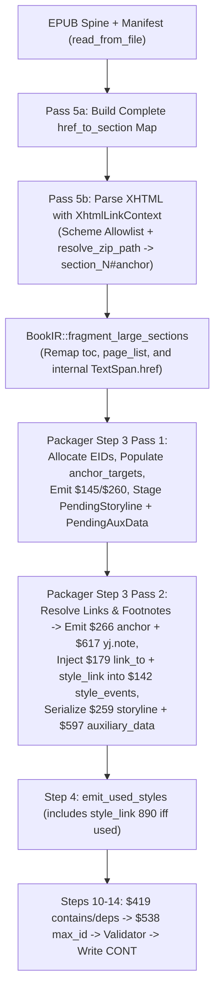

# Technical Specification: EPUB-to-KFX Link, Anchor & Footnote Popup Conversion (`kfx-converter`)

- **Document ID:** `docs/specs/spec-epub-kfx-links.md`
- **Target Crate / Workspace:** `kfx-converter` (`Cargo.toml` — Rust `edition = "2024"`, `[profile.release] panic = "abort"`, binaries `kfx-conv` [`cli`] and `kfx-studio` [`gui`])
- **Baseline Commit:** `877ce3d56835e2e5ad9249a43e13c7a57bf170df` (post-P0 + post-P1 remediation)
- **Scope:**
  - **Stage 1 — Core Text Links (Internal & External)** `[In Scope by Default]`
  - **Stage 2 — List Links (`Block::List`) & Footnote Popups (`$617 yj.note`)** `[In Scope by Default]`
  - **Stage 3 — Optional Extensions (`3A` Table Links, `3B` Image Links, `3C` Visited/Unvisited Link Styles)** `[Explicit User Scope Decision Required]`
- **Status:** Phase 1 Specification (Pending Approval)

---

## 1. Executive Summary & Cross-Cutting Invariants

Currently, `EpubReader` extracts `<a href="...">` targets onto `TextSpan.href` (`src/epub/xhtml.rs:1438-1498`), and `EpubReader::read_from_file` extracts footnote strings into `BookIR.footnotes` (`src/epub/mod.rs:583-591`), **but** three architectural gaps prevent hyperlinks and popup footnotes from functioning in packaged `.kfx` files:

1. **Unresolved Chapter-Relative Hrefs & Single-Pass Spine Parsing (`src/epub/mod.rs`, `src/ir.rs`):** `EpubReader::read_from_file` (`src/epub/mod.rs:546-617`) invokes `Self::parse_xhtml_with_css(&xhtml, &href_to_id, &book_css)` inside the same spine loop that populates `href_to_section`, without passing the current chapter directory, `sec_id`, or `href_to_section`. Consequently, relative links (`../Text/ch2.xhtml#sec1`), forward chapter links, and same-chapter fragments (`#sec1`) stay raw, dangerous schemes (`javascript:`, `data:`) are not filtered, and `BookIR::fragment_large_sections` (`src/ir.rs:499-637`) never remaps `TextSpan.href` when sections split into `_p1`, `_p2`, ...
2. **Dropped `span.href`, Missing `$266 anchor` & Missing `$617 yj.note` in `KfxPackager` (`src/packager/*`):** `build_storylines_and_sections` (`src/packager/storylines.rs:38-810`) serializes `$259 storyline` and `$597 auxiliary_data` in a single forward pass, ignoring `span.href` and `book.footnotes`. Forward links cannot be resolved until all sections' `block_eid`s and `anchor_targets` are assigned. Furthermore, `Block::List` is flattened via `block.plain_text()` with zero `$142 style_events` and registers all nested `anchor_id`s at offset `0`.
3. **Unvalidated Link & Anchor Entities (`src/validator.rs`):** `KfxPreflightValidator::walk_value` (`src/validator.rs:394-931`) does not check `$179 link_to`, `$266 anchor` (`$180 anchor_name`, `$183 position`, `$186 uri`), or `$617 yj.note`.

All stages **MUST** preserve the following six non-negotiable cross-cutting invariants:

1. **Preserve P0 + P1 Fixes Intact:** All committed P0 and P1 invariants (ZIP bomb budgets, tolerant XHTML/CSS/OPF/NCX parsing, strict Ion decoding, container bounds, Word Wise `max_difficulty_level` scale, USB gadget guard, etc.) remain strictly intact.
2. **`build_styles` Ordering & Hardcoded Style SIDs `852..=889`:** `KfxPackager::build_styles(&mut symbols)` (`src/packager/styles.rs:68-569`) **MUST** remain the first symbol-interning step in `KfxPackager::package()` (`src/packager/core.rs:197`), and the existing 38 styles (`style_h1` through `style_hanging_indent`, `styles.rs:96-133`) **MUST** remain in exact order at SIDs `852..=889` (`align_center = 857`, `underline = 863`, `style_ruby = 872`, `font_size_sm = 879`, `font_size_xl = 881`, `dropcap_l2 = 883`, `dropcap_l2_c2 = 885`, `hanging_indent = 889`) asserted by `src/packager/tests.rs:559, 1368, 1488-1499, 1558`. Any new style (`style_link`) **MUST** be interned strictly **after** `hanging_indent_sym` (SID `890`, offset `852 + 38`) and emitted by `emit_used_styles` **only** when referenced.
3. **`Block::Image` PID Alignment & `$550` Clamp:** `Block::Image` PID length remains `alt_text.chars().count().max(1)` (`src/packager/storylines.rs:531`, `src/enhancements/word_wise.rs:329-371`), and `$550 location_map` clamps `Block::Image` offsets to `0` (`src/packager/locators.rs:141`).
4. **Word Wise PID Alignment (`Block::List` Parity):** `WordWiseBuilder::generate_from_book` (`src/enhancements/word_wise.rs:328-372`) advances `pid` by `block.plain_text().chars().count().max(1)` across all sections (including `Block::List` `\n` separators). `KfxPackager` text accumulation for `Block::List` **MUST** remain byte-for-byte identical to `Block::plain_text()` (`src/ir.rs:360-408`), and any synthetic fallback endnotes section (Section 3.2) **MUST** be appended strictly after all real sections so real-section PIDs never shift.
5. **5-Field `TextSpan` Struct & Standalone XHTML Test Compatibility:** `TextSpan` (`src/ir.rs:18-25`) retains its exact 5 fields (`text, style, anchor_id, href, ruby`) across all 82 struct literals in the crate. Existing standalone XHTML wrappers (`parse_xhtml_blocks`, `parse_xhtml_blocks_with_manifest`, `parse_xhtml_with_manifest`, `parse_xhtml_with_css`) retain their exact public signatures and return `href = Some("#fn1")` for `test_parse_xhtml_footnotes_and_noteref` (`src/epub/mod.rs:1513, 1517`).
6. **Preflight Validator Integrity:** Every emitted `$266 anchor` (`entity_id >= 852`, listed in `$419 $181 contains`), `$179 link_to`, `$142 style_events` link entry, and `$617 yj.note` must satisfy `KfxPreflightValidator::validate_container()` (`src/validator.rs:363-391`). Broken EPUB links degrade gracefully to unlinked text instead of emitting dangling references.

### End-to-End 2-Pass Link Architecture



---

## 2. Stage 1 — Core Text Links (Internal & External) `[In Scope by Default]`

### 2.1 IR & EPUB Link Resolution (`src/ir.rs`, `src/epub/mod.rs`, `src/epub/xhtml.rs`, `src/epub/dropcap.rs`)

#### Decision: Canonical `TextSpan.href` Convention vs. Adding a New Field
- **Decision:** Preserve `TextSpan` (`src/ir.rs:18-25`) unchanged with its 5 fields (`text, style, anchor_id, href, ruby`), and enforce a canonical scheme/target contract on `TextSpan.href: Option<String>`.
- **Justification:** Codebase inspection confirms **82** `TextSpan { ... }` literals across `src/` and `tests/` that explicitly construct all 5 fields without `..Default::default()`, and `src/epub/mod.rs:1513, 1517` explicitly asserts `fn1_span.href.as_deref() == Some("#fn1")` from `parse_xhtml_with_manifest`. Keeping `TextSpan` at 5 fields avoids breaking external/internal literal construction and preserves all existing unit tests while cleanly distinguishing internal targets from external URIs by URI scheme.

#### Canonical `TextSpan.href` Contract (`normalize_span_href`)
Implement a shared `pub(crate) fn normalize_span_href(raw_href: &str, link_ctx: Option<&XhtmlLinkContext<'_>>) -> Option<String>` in `src/epub/xhtml.rs` (using `crate::epub::archive::{decode_percent, resolve_zip_path}`):

1. **Sanitization & Control-Character Rejection:**
   - Trim leading/trailing whitespace and strip ASCII control characters (`ch.is_ascii_control()` — e.g. `\n`, `\r`, `\t`, `\0` injected inside obfuscated URIs like `java\nscript:`). If empty after trimming, return `None`.
2. **External URI Scheme Allowlist (Checked BEFORE Relative Path Handling):**
   - Detect scheme prefix via RFC 3986 rule: if a `:` appears before the first `/`, `?`, or `#`, extract `scheme = &trimmed[..colon_idx]`.
   - **Allowlisted external schemes** (ASCII case-insensitive):
     - `"http"` (must start with `http://` and have non-empty host after `://`)
     - `"https"` (must start with `https://` and have non-empty host after `://`)
     - `"mailto"` (must have non-empty recipient/query after `mailto:`)
   - Normalize only the scheme prefix to lowercase (`HTTP://Example.com/A?x=1%202` -> `http://Example.com/A?x=1%202`). **Do NOT percent-decode** external URIs so query parameters and encoded reserved characters remain valid.
   - **Explicitly blocked/dropped (`None`):** `"javascript:"`, `"data:"`, `"vbscript:"`, `"file:"`, `"about:"`, `"blob:"`, `"ftp:"`, protocol-relative `"//..."`, and any unrecognized `scheme:` prefix. (The anchor's inner text and formatting spans remain intact; only `href` becomes `None`.)
3. **Internal EPUB Link Normalization:**
   - Split at the first `'#'` into `(raw_path, raw_frag)`:
     - Decode percent-encoding on `raw_frag` (`decode_percent(frag).trim().to_string()`), yielding `frag_opt: Option<String>` (`None` if empty).
     - Strip any `?query` suffix from `raw_path` before archive path matching.
   - **Case 3A — Same-Document Fragment (`raw_path.trim().is_empty()`):**
     - If `link_ctx == None` (standalone `parse_xhtml_*` calls):
       - If `Some(frag) = frag_opt`, return `Some(format!("#{}", frag))` (preserving `test_parse_xhtml_footnotes_and_noteref`).
       - Otherwise return `None`.
     - If `link_ctx == Some(ctx)` (`EpubReader::read_from_file` chapter context):
       - If `Some(frag) = frag_opt`, return `Some(format!("{}#{}", ctx.current_section_id, frag))`.
       - If bare `"#"`, return `Some(ctx.current_section_id.to_string())` (top of current section).
   - **Case 3B — Cross-Chapter or Relative Archive Path (`!raw_path.trim().is_empty()`):**
     - If `link_ctx == None`: preserve decoded/normalized path + optional `#frag` (`if let Some(frag) = frag_opt { format!("{}#{}", norm_path, frag) } else { norm_path }`) so standalone callers retain relative href fidelity.
     - If `link_ctx == Some(ctx)`:
       - Decode percent-encoding on `path_part` and resolve against `ctx.current_chapter_dir` via `resolve_zip_path(ctx.current_chapter_dir, &decoded_path)`.
       - Look up the resolved path in `ctx.href_to_section` (exact resolved ZIP path first -> lowercase resolved ZIP path -> `item_href` / `file_name` fallback).
       - If matched to `target_sec_id`:
         - Return `Some(format!("{}#{}", target_sec_id, frag))` when `frag_opt = Some(frag)`, or `Some(target_sec_id)` when `frag_opt = None`.
       - If **NOT** matched to any spine section (e.g., broken link `missing.xhtml#foo` or link to a non-spine asset `cover.jpg` / `style.css`):
         - Return `None` so broken internal links never emit dangling KFX anchors.

#### Two-Pass Spine Resolution in `EpubReader::read_from_file` (`src/epub/mod.rs:541-617`)
- **Verified Root Cause:** `src/epub/mod.rs:546-617` currently populates `href_to_section` lazily inside the same `for (idx, item_id)` loop that calls `parse_xhtml_with_css` (`line 582`). Forward links (e.g., Chapter 1 linking to `ch3.xhtml#sec2`) fail because `ch3.xhtml` is not yet in `href_to_section`. Additionally, `href_to_section.insert(file_name, ...)` (`lines 567-568`) overwrites colliding filenames across different directories (`Part1/intro.xhtml` vs `Part2/intro.xhtml`).
- **Specification:**
  1. **Pass 5a (Build Complete Section Map Before Parsing XHTML):** Iterate `spine.iter().enumerate()` to construct:
     - `spine_entries: Vec<(String, String, &ManifestItem, String)>` storing `(sec_id, full_path, manifest_item, file_name)`.
     - `href_to_section: HashMap<String, String>` keyed cleanly with full paths (`full_path`, `decoded_full_path`, `item.href`, `decoded_href`, `clean_href`, `decoded_clean_href`) and case-insensitive lowercase full paths in a companion `href_lc_to_section: HashMap<String, String>`. Insert bare `file_name` / `decoded_file_name` via `.entry(...).or_insert(sec_id)` (or in a separate fallback map) so colliding filenames never overwrite exact directory-qualified full paths.
  2. **Pass 5b (Parse Chapters With `XhtmlLinkContext`):**
     - Define `pub struct XhtmlLinkContext<'a>` (e.g. in `src/epub/xhtml.rs`) with:
       ```rust
       pub struct XhtmlLinkContext<'a> {
           pub current_section_id: &'a str,
           pub current_chapter_dir: &'a str,
           pub href_to_section: &'a HashMap<String, String>,
           pub href_lc_to_section: Option<&'a HashMap<String, String>>,
       }
       ```
     - Add `pub fn parse_xhtml_with_css_and_context(xhtml: &str, href_to_id: &HashMap<String, String>, book_css: &CssStylesheet, link_ctx: Option<&XhtmlLinkContext<'_>>) -> (Vec<Block>, HashMap<String, String>)` in `src/epub/xhtml.rs` (with thin `EpubReader::parse_xhtml_with_css_and_context` delegation if needed, while existing `parse_xhtml_with_css` calls `parse_xhtml_with_css_and_context(..., None)`).
     - Compute `chapter_dir = Path::new(&full_path).parent().map(|p| p.to_string_lossy().replace('\\', "/")).unwrap_or_default();` and invoke `parse_xhtml_with_css_and_context` from `read_from_file`.

#### Verified `xhtml.rs` & `dropcap.rs` Edge-Case Fixes
Inspection of `src/epub/xhtml.rs` and `src/epub/dropcap.rs` revealed three subtle edge cases that **MUST** be fixed alongside Stage 1:
1. **Self-Closing `<a href="..."/>` Without `anchor_id` (`src/epub/xhtml.rs:893-907`):**
   Currently `Event::Empty(b"a")` checks `if anchor.is_some() || href.is_some()`, emitting a zero-text `TextSpan` carrying `href` even when `anchor` is `None`. Change to `if anchor.is_some()` (and pass `href` through `normalize_span_href`), matching `Event::End(b"a")` (`lines 1951-1966`) so empty `<a href="..."/>` tags never create zero-length link spans.
2. **Multiple `pending_anchors` Ordering (`src/epub/xhtml.rs:534-580`):**
   Currently, when `attrs.anchor.is_none()` and `pending_anchors` contains `[a_0, a_1, ...]` (e.g. `<section id="footnotes"><ol><li id="fn1"><p>First note</p>`), `flush_current_span` (`lines 562-578`) attaches `a_0` (`"footnotes"`) to the text span and emits `a_1` (`"fn1"`) as an empty-text span **after** the text span—placing `"fn1"` at the **end** of the paragraph instead of offset `0`!
   - **Fix:** Whenever `attrs.anchor.is_none()` and `pending_anchors` has more than 1 entry, pop all leading entries `while pending_anchors.len() > 1` as empty-text anchor spans **before** pushing the text span with the last pending anchor (mirroring the `attrs.anchor.is_some()` branch at `lines 545-553`). `finish_paragraph_dropcaps` (`src/epub/dropcap.rs:58`) already skips leading empty-text anchor spans (`!s.text.trim().is_empty()`), so drop caps and offset-`0` anchors both align cleanly.
3. **Drop Cap Split Preserving `href` (`src/epub/dropcap.rs:116-140`):**
   When `<p class="has-dropcap"><a href="#target">Once upon</a></p>` splits the initial letter `"O"` from `"nce upon"`, `spans.insert(first_idx + 1, TextSpan { ..., href: None, ... })` currently drops `href` on the remainder `"nce upon"`. Clone `let orig_href = spans[first_idx].href.clone();` before mutating and attach `href: orig_href` to the remainder `TextSpan` (keeping `anchor_id: None` on the remainder so the anchor stays at character offset `0`).

#### `BookIR::fragment_large_sections` Link Target Remapping (`src/ir.rs:499-637`, `761-784`)
1. **Extend `extract_anchors_from_block` (`src/ir.rs:761-784`):**
   - Continue iterative $O(1)$-stack traversal over `Block::List`, and additionally capture non-empty block `id` fields on `Block::Paragraph`, `Block::Heading`, `Block::Image`, `Block::List`, and `Block::Table` (consistent with `storylines.rs`). Use `.entry((orig_id.clone(), anchor)).or_insert(...)` when building `anchor_part_map` so the first occurrence wins if synthetic IDs repeat.
2. **Remap `TextSpan.href` Iteratively After Fragmentation (`src/ir.rs:595-637`):**
   - Track each produced section's original section ID `orig_id` alongside its new `Section.id` (e.g., `sec_orig_ids: Vec<(String, String)>` mapping `(new_sec_id, orig_id)`).
   - If `!anchor_part_map.is_empty() || !section_first_part_map.is_empty()`, iteratively walk `self.sections` (using an explicit `Vec<&mut Block>` stack over `Block::List` items—**never** recursion, preserving the 10,000-level nesting guarantee in `test_ir_deeply_nested_list_iterative_ops_and_drop` at `src/ir.rs:1180-1276`) and rewrite each internal `span.href`:
     - Skip external URIs (`http://`, `https://`, `mailto:`, ASCII case-insensitive).
     - **Same-section fragment (`#anchor`):** Look up `anchor_part_map.get(&(orig_id, anchor))`; if mapped to `part_id` and `part_id != current_new_sec_id`, rewrite `href` to `format!("{}#{}", part_id, anchor)`. (If in the same part, keep `#anchor`.)
     - **Section + fragment (`target_sec#anchor`):** Look up `anchor_part_map.get(&(target_sec, anchor))` -> rewrite to `format!("{}#{}", part_id, anchor)`; else look up `section_first_part_map.get(&target_sec)` -> rewrite to `format!("{}#{}", first_part, anchor)`.
     - **Bare section (`target_sec`):** Look up `section_first_part_map.get(&target_sec)` -> rewrite to `first_part`.
   - Because rewritten `target_sec` IDs (`sec_1_p2`) are not keys in `section_first_part_map` (`"sec_1"` -> `"sec_1_p1"`), calling `BookIR::normalize()` multiple times remains 100% idempotent (`test_ir_normalize_idempotent`, `src/ir.rs:824-859`).

---

### 2.2 Packager 2-Pass Link & `$266 anchor` Emission (`src/packager/{core,styles,storylines,navigation,locators}.rs`)

#### Style Interning (`src/packager/styles.rs`)
- Extend `StyleSymMap` (`src/packager/styles.rs:9-48`) with `pub link: u32`.
- In `build_styles(&mut symbols)` (`src/packager/styles.rs:133`), intern `link_sym` strictly **after** `hanging_indent_sym` (`889`):
  ```rust
  let link_sym = symbols.intern("style_link"); // SID 890 (852 + 38)
  ```
- Define `link_val` (`$157 style`) with:
  - `(sym_style_name, IonValue::Symbol(link_sym))`
  - `(sym_underline, IonValue::Bool(true))`
  - *Dark Mode Safety:* Intentionally omit `$19 text_color` so Kindle's Light/Dark/Sepia palette engine automatically adapts link ink color while `$23 underline: true` provides an unmistakable visual affordance on monochrome E-ink displays.
- Append `(link_sym, link_val)` to the end of `style_list` (`styles.rs:525`). Because `emit_used_styles` (`styles.rs:571-589`) emits only symbols present in `used_styles`, books with zero resolved links emit **zero** `style_link` entities.

#### Shared Target Resolution (`src/packager/navigation.rs` / `src/packager/core.rs`)
Extract `resolve_target_internal` from `resolve_nav_target` (`src/packager/navigation.rs:9-122`) parameterized by `TargetResolveMode`:

```rust
pub(crate) enum TargetResolveMode<'a> {
    /// Existing TOC / page-list behavior: fall back to section 0 if target section is missing.
    NavigationFallbackFirstSection,
    /// Strict hyperlink resolution: when section part is empty (`#anchor`), resolve against
    /// `source_raw_id` (and its sibling `_p*` parts) before `global_anchor_targets`; never fall back to Cover.
    HyperlinkStrict { source_raw_id: &'a str },
}
```

Resolution rules for `(raw_target: &str, raw_anchor: Option<&str>, mode: TargetResolveMode<'_>) -> Option<(u32, usize, usize)>`:
1. Split `raw_target` on first `'#'` into `(sec_part, embedded_anchor)` when `raw_anchor` is `None`.
2. Percent-decode `eff_anchor` (`decode_percent`), strip leading `'#'`, and trim.
3. **When `sec_part.is_empty()` (`#anchor`):**
   - Under `HyperlinkStrict { source_raw_id }`:
     1. Look up `(source_raw_id, anchor)` in `self.anchor_targets`.
     2. If `source_raw_id` ends with `_p<digits>` (`base_sec`), check all `sec` in `section_data` where `sec.raw_id.starts_with(&format!("{}_p", base_sec))` in `self.anchor_targets` (covers un-remapped same-chapter anchors across fragmentation).
     3. Check `self.global_anchor_targets.get(anchor)`.
     4. Return `None` if not found (never jump to Cover!).
   - Under `NavigationFallbackFirstSection`: preserve existing `resolve_nav_target` behavior verbatim.
4. **When `!sec_part.is_empty()`:**
   - Match `matched_sec` in `section_data` by exact `raw_id` / `name` / `normalize_ir_path`, then `_p` fragmented prefix, then case-insensitive filename fallback.
   - If `eff_anchor = Some(anchor)`:
     - Check `(sec.raw_id, anchor)`, `(sec.name, anchor)`, `(norm_sec, anchor)` on `matched_sec`.
     - Check `(sec_part, anchor)` / `(norm_sec, anchor)` and all sibling `_p` parts matching `sec_part` / `norm_sec`.
     - Under `NavigationFallbackFirstSection`, retain `global_anchor_targets` fallback; under `HyperlinkStrict`, do **NOT** jump to an unrelated chapter in `global_anchor_targets` when `matched_sec` exists—instead fall back to `matched_sec`'s top (`first_block_eid` at offset `0`).
   - If `matched_sec` is `Some(sec)` (and anchor was `None` or missing in `sec`), return `(first_block_eid, sec_start_pid + 1, 0)` (or `(sec.sec_eid, sec_start_pid, 0)` if `block_info` empty).
   - If `matched_sec` is `None`:
     - Under `HyperlinkStrict`: return `None` (drop broken link cleanly).
     - Under `NavigationFallbackFirstSection`: keep fallback to `section_data.first()`.

#### 2-Pass Pipeline Ordering (`src/packager/core.rs`, `src/packager/storylines.rs`)

Because forward chapter links (Section 1 -> Section 3) require Section 3's `block_eid`s and `anchor_targets` to exist before `$266 anchor` symbols can be allocated and `$259 storyline` bytes can be serialized, **and** `emit_used_styles` (Step 4), `build_container_entity_map` (Step 10), `build_document_data` (Step 11), and `to_ion_symbol_table` (Step 12) all depend on entities and symbols emitted during Step 3, `KfxPackager::package` (`src/packager/core.rs:196-228`) splits Step 3 into two sub-passes executed **before Step 4**:

1. **Step 3 — Pass 1 (`build_storylines_and_sections_pass1`):**
   - Runs across all sections identically to today:
     - Interns `sec_sym_id`, `story_sym_id`, `ad_sym_id`, `content_N` symbols and allocates `section_eid` and `block_eid` in exact existing sequence.
     - Populates `self.section_pid_starts`, `self.image_block_eids`, `self.anchor_targets`, and `self.global_anchor_targets` for **all** sections.
     - Pushes text to `TextAccumulator`, serializes `$260 section` entities immediately into `self.entities`, and drains `text_acc.drain_chunks()` into `$145 content` chunks **at the end of Pass 1** (after any optional synthetic fallback endnotes section from Section 3.2 is appended to `sections` and processed through Pass 1, keeping `self.sections`, `section_data`, and `$145` synchronized).
     - Instead of immediately serializing `$259 storyline` and `$597 auxiliary_data`, stages:
       ```rust
       pub(crate) struct PendingLink {
           pub(crate) char_offset: usize,
           pub(crate) char_len: usize,
           pub(crate) raw_href: String,
           pub(crate) is_noteref: bool,
       }

       pub(crate) struct PendingStoryElement {
           pub(crate) block_eid: u32,
           pub(crate) elem_fields: Vec<(u32, IonValue)>, // id, type, style, content/resource_name, alt_text
           pub(crate) style_events: Vec<IonValue>,
           pub(crate) pending_links: Vec<PendingLink>,
       }

       pub(crate) struct PendingStoryline {
           pub(crate) raw_id: String,
           pub(crate) sec_sym_id: u32,
           pub(crate) story_sym_id: u32,
           pub(crate) ad_sym_id: u32,
           pub(crate) elements: Vec<PendingStoryElement>,
       }
       ```
     - Note: `PendingLink` is ONLY pushed when `span_len > 0` and `span.href.is_some()`.
2. **Step 3 — Pass 2 (`build_links_and_finalize_storylines`, invoked immediately after Pass 1 and before Step 4 `emit_used_styles`):**
   - Maintain a container-wide deduplication map `anchor_dedup: HashMap<AnchorTargetKey, u32>` where:
     ```rust
     #[derive(Debug, Clone, PartialEq, Eq, Hash)]
     enum AnchorTargetKey {
         Position { eid: u32, offset: usize },
         Uri(String),
     }
     ```
   - Maintain a deterministic counter `anchor_idx: usize = 1` for allocating `$266` local symbol names `a_{n}` (looping past any collision via `symbols.get_id(&cand).is_some()`).
   - For each `PendingStoryline`:
     - Track `outbound_anchors: Vec<u32>` for this section.
     - For each `PendingStoryElement`:
       - Resolve each `PendingLink` (`classify_external_uri` vs `resolve_target_internal(..., HyperlinkStrict { source_raw_id })`):
         - If unresolvable (`None`), skip cleanly (do not emit `$266`, `$179`, or `style_link`).
         - Look up or create `(anchor_sym)` in `anchor_dedup`:
           - If new: intern `anchor_sym`, emit `$266 anchor` entity (`entity_id: anchor_sym`, `chunk_type: SYM_ANCHOR (266)`) into `self.entities`:
             - **Internal `$266`:**
               ```ion
               {
                   $180 /* anchor_name */: $anchor_sym,
                   $183 /* position */: {
                       $155 /* id */: target_eid,
                       $143 /* offset */: target_off
                   }
               }
               ```
             - **External `$266`:**
               ```ion
               {
                   $180 /* anchor_name */: $anchor_sym,
                   $186 /* uri */: "https://example.com"
               }
               ```
         - Record `anchor_sym` in `outbound_anchors` (deduplicated) and stage resolved `(char_offset, char_len, anchor_sym)` run.
         - If footnote popup applies (Stage 2 Section 3.2), record popup metadata for this section's `$597 auxiliary_data`.
       - **Coalesce contiguous identical link runs:** Within a single `PendingStoryElement`, if two adjacent resolved link runs satisfy `prev.char_offset + prev.char_len == cur.char_offset && prev.anchor_sym == cur.anchor_sym`, merge into `(prev.char_offset, prev.char_len + cur.char_len, prev.anchor_sym)` (e.g., `<a href="#t">click <b>here</b></a>` produces one unified link tap target across `"click here"`, while `bold` stays its own style event on `"here"`).
       - For each coalesced `(offset, length, anchor_sym)`:
         - Mark `used_styles.insert(styles.link)`.
         - Push into `elem.style_events`:
           ```rust
           IonValue::Struct(vec![
               (sym_offset, IonValue::Int(offset as i64)),
               (sym_length, IonValue::Int(length as i64)),
               (sym_style, IonValue::Symbol(styles.link)),
               (sym_link_to, IonValue::Symbol(anchor_sym)),
           ])
           ```
       - Assemble `elem_fields` (+ `(sym_style_events, IonValue::List(elem.style_events))` if non-empty).
     - Serialize `$259 storyline` into `self.entities` (`entity_id: story_sym_id`, `chunk_type: SYM_STORYLINE`).
     - Serialize `$597 auxiliary_data` into `self.entities` (`entity_id: ad_sym_id`, `chunk_type: SYM_AUXILIARY_DATA`), including `$617 yj.note` if present (Section 3.2).
     - Store `outbound_anchors` on `SectionPackData.outbound_anchors` (`src/packager/types.rs`).
3. **Why This Order Is Required:**
   - **Before Step 4 (`emit_used_styles`):** `used_styles` now knows whether `styles.link` (`890`) was used so `emit_used_styles` emits it iff needed.
   - **Before Step 10 (`build_container_entity_map`):** Every `$266 anchor` entity is already in `self.entities`, so `$419 $181 contains` automatically lists all `$266` entity IDs.
   - **Before Step 11 (`build_document_data`) & Step 12 (`to_ion_symbol_table`):** Every `a_{n}`, `note_{n}`, and `style_link` symbol is already interned in `symbols` and `self.next_eid`, so `$538 $8 max_id` and `$ion_symbol_table` cover 100% of link/anchor symbols.
   - **Zero-Link Books Stay Identical:** When a book has zero links, `emit_used_styles` does not emit `style_link`, zero `$266` entities are created, and all section/storyline/content EIDs and `$419` dependencies remain unchanged.

#### `fragment_type_order` & `$419 entity_dependencies` (`src/packager/core.rs`, `src/packager/locators.rs`)
1. **`fragment_type_order` (`src/packager/core.rs:238-262`):**
   Add explicit rank for `266` (`anchor`) before position maps (preserving relative order of all existing types):
   ```rust
   391 => 10, // nav_container
   393 => 11, // nav_unit
   266 => 12, // anchor
   264 => 13, // position_map
   ...
   ```
2. **`$419 entity_dependencies` (`src/packager/locators.rs:229-278`):**
   Add `pub outbound_anchors: Vec<u32>` to `SectionPackData` (`src/packager/types.rs:5-12`). In `build_container_entity_map`, when `!sec_pack.outbound_anchors.is_empty()`, attach `(sym_optional_dependencies /* 255 */, IonValue::List(anchor_syms))` alongside any `$254 mandatory_dependencies` for `sec_pack.sec_sym_id` (emitting an entry with `$155 sec_sym_id` + `$255` even if the section had no images). Keeping `$254` strictly for images preserves `test_collect_img_res_deeply_nested_list_no_stack_overflow` (`src/packager/locators.rs:313-413`) and zero-link `$419` output verbatim.

---

### 2.3 Preflight Validator Extensions (`src/validator.rs`)

Extend `KfxPreflightValidator` (`src/validator.rs:162-931`) as follows:

1. **Non-Singleton Rules for `$266 anchor`:**
   - `is_singleton_chunk_type` (`validator.rs:128-133`) remains unchanged (excludes `266`), so `validate()` automatically enforces `entity_id >= 852` (`line 185`), `entity_id != SINGLETON_ID` (`line 209`), and presence in `$419 $181 contains` (`line 813`).
2. **Validate `$266 anchor` Entity Payloads (in `validate()` Step 3):**
   - Root value of `ent.chunk_type == 266` must be a `Struct` (or `Annotated(_, Struct)`).
   - Must contain `$180` (`anchor_name`) equal to `IonValue::Symbol(ent.entity_id)` (else `ValidationError::IllegalField { chunk_type: 266, eid: ent.entity_id, field_id: 180, field_name: "anchor_name".into(), ... }`).
   - Target exclusivity: must contain **exactly one** of `$183` (`position`) or `$186` (`uri`) (neither or both returns `IllegalField`).
   - If `$183` (`position`) is present:
     - Must be `IonValue::Struct(pos_fields)` containing `$155` (`id`) as `IonValue::Int(target_eid)` where `target_eid >= i64::from(FIRST_LOCAL_SYMBOL_ID)` and `(internal_eids.contains(&target_eid) || u32::try_from(target_eid).ok().is_some_and(|e| defined_eids.contains(&e)))` (else `IllegalField`).
     - `$143` (`offset`), if present, must be `IonValue::Int(off)` with `off >= 0` (else `IllegalField`).
   - If `$186` (`uri`) is present:
     - Must be `IonValue::String(u)` that is non-empty and matches an allowlisted external scheme (`http://`, `https://`, `mailto:`, ASCII case-insensitive, non-empty host/recipient), rejecting `javascript:`, `data:`, `file:`, empty strings, etc. with `IllegalField`.
3. **Validate `$179 link_to` and `$142 style_events` in `walk_value` (`src/validator.rs:460-912`):**
   - **Field `179` (`link_to`):**
     - Require `IonValue::Symbol(target_sym)` (else `IllegalField { field_id: 179, field_name: "link_to".into(), ... }`).
     - Require `*target_sym != 0 && entity_map.contains_key(&(266, *target_sym))` (else `ValidationError::MissingFragment { expected_chunk: 266, ... }`).
   - **Field `142` (`style_events`):**
     - For each `IonValue::Struct(ev_fields)` inside `$142` list that contains field `179` (`link_to`):
       - Validate `$143` (`offset`) is `IonValue::Int(off)` with `off >= 0`.
       - Validate `$144` (`length`) is `IonValue::Int(len)` with `len > 0` (zero-length or negative-length link events fail with `IllegalField`).
4. **Validate Stage 2 `$617 yj.note` in `$597 auxiliary_data` (in `walk_value` for field `617` when `referrer.chunk_type == 597`):**
   - Require `IonValue::List(notes)` where every entry is an `IonValue::Struct` containing non-empty `$492 key` (`String`), `$159 type == IonValue::Symbol(281)`, `$440 popup` (`Bool`), and non-empty `$444 popup_text` (`String`) whenever `$440 == Bool(true)` (else `IllegalField`).

---

## 3. Stage 2 — List Links (`Block::List`) & Footnote Popups `[In Scope by Default]`

### 3.1 List `style_events` & Exact Non-Zero Anchor/Link Offsets (`src/packager/storylines.rs`)

#### Verified Root Cause
`src/packager/storylines.rs:597-674` currently:
- Flattens `Block::List` via `block.plain_text()` without emitting any `$142 style_events` (stripping all `<a href="...">` links, `<b>`, `<i>`, `<code>`, `<ruby>`, etc. inside `<ul>`/`<ol>`).
- Registers every descendant `TextSpan.anchor_id` inside `Block::List` at `(block_eid, block_start_pid, 0)`, forcing `#fn2`, `#item3`, etc. to jump to the start of item 1 at offset `0`.

#### Specification
Replace the flat `Block::List` arm in `build_storylines_and_sections_pass1` (`src/packager/storylines.rs:597-674`) with an iterative `Frame`-based list extractor matching `Block::plain_text()` (`src/ir.rs:361-406`) identically in $O(1)$ call-stack space:

1. **Iterative Pre-Order Traversal Parity:**
   ```rust
   enum ListWalkFrame<'b> {
       Block(&'b Block),
       Sep,
   }
   ```
   - Push `ListWalkFrame::Block(block)` onto `stack`.
   - Maintain `full_text = String::new()`, `char_offset: usize = 0`, `style_events: Vec<IonValue>`, `pending_links: Vec<PendingLink>`, and `anchors: Vec<(String, usize)>`.
   - On `ListWalkFrame::Sep`: `full_text.push('\n'); char_offset += 1;`.
   - On `ListWalkFrame::Block(current)`:
     - `Block::List { id, items, .. }`:
       - If `!id.is_empty()`, push `(id.clone(), char_offset)`.
       - Collect `children: Vec<&Block> = items.iter().flat_map(|it| it.iter()).collect();` and push in reverse order interleaved with `ListWalkFrame::Sep` (`for i in (0..children.len()).rev() { stack.push(ListWalkFrame::Block(children[i])); if i > 0 { stack.push(ListWalkFrame::Sep); } }`) — **identical** to `Block::plain_text()` (`src/ir.rs:389-397`).
     - `Block::Paragraph { id, spans, style } | Block::Heading { id, spans, style }`:
       - Compute `inherited = inherited_text_tokens(style.as_deref(), matches!(current, Block::Paragraph { .. }))`.
       - Run `extract_style_events_with_base(spans, &inherited, char_offset)` returning `(chunk_text, child_events, child_anchors, child_links)`.
       - If `!id.is_empty()` (for non-empty custom IDs; `.or_insert` handles any repeating synthetic `li_N`), register `(id.clone(), char_offset)`.
       - Append `chunk_text` to `full_text`, advance `char_offset += chunk_text.chars().count()`, and extend `style_events`, `anchors`, and `pending_links` (each already offset by `char_offset`).
     - `Block::Image { id, alt, .. }`:
       - If `!id.is_empty()`, register `(id.clone(), char_offset)`.
       - If `Some(a) = alt`, push `a` to `full_text` and advance `char_offset += a.chars().count()`, matching `Block::plain_text()` (`src/ir.rs:398-402`).
     - `Block::HorizontalRule`:
       - Push `"---"` to `full_text`, advance `char_offset += 3`, matching `Block::plain_text()` (`src/ir.rs:403`).
     - `Block::Table { id, rows }`:
       - If `!id.is_empty()`, register `(id.clone(), char_offset)`.
       - Push exact `'\n'`/`'\t'`-joined text matching `Block::plain_text()` (`src/ir.rs:376-388`) and advance `char_offset` by its `.chars().count()`.
2. **Invariants Guaranteed:**
   - `debug_assert_eq!(full_text, block.plain_text());`
   - `pid_len = full_text.chars().count().max(1)` matches `WordWiseBuilder::generate_from_book` **100%**.
   - Every `anchor_id` inside item $k$ (such as `<li id="fn2">`) registers `(block_eid, block_start_pid + exact_char_offset, exact_char_offset)` with exact non-zero offset.
   - Every `<a href="...">` and inline formatting span inside list items populates `$142 style_events` and `PendingLink`s, resolved in Pass 2 identically to paragraph links.

---

### 3.2 Footnote `noteref` Links & Kindle Popup Behavior (`$617 yj.note`, `$597 auxiliary_data`)

#### Verified `xhtml.rs` Behavior
Inspection of `src/epub/xhtml.rs:93-197, 765-792, 966-1008, 1704-1755, 1791-1813` confirms:
1. Singular footnote elements (`<aside epub:type="footnote" id="fn1">`, `<div class="footnote" id="fn2">`, or `<li id="fn1">` inside a plural `<section epub:type="footnotes">`) push onto `footnote_stack` **without suppressing** normal block/span emission into `blocks`.
2. Consequently, in `BookIR` built by `EpubReader`:
   - Footnote text (excluding backlink text inside `backlink_stack` and trailing `↩`/`⮐`/`↵`/`^`/`↑` glyphs) is stored in `BookIR.footnotes` (`src/epub/mod.rs:583-591`, keyed by `{item.href}#{fn_id}`, `{file_name}#{fn_id}`, `{sec_id}#{fn_id}`, and `fn_id`).
   - Footnote blocks **also** remain in-flow inside `BookIR.sections` with `anchor_id = Some(fn_id)` (either as `Block::Paragraph` or inside `Block::List`), and backlink `<a href="#fnref1" role="doc-backlink">` anchors remain valid hyperlinks in-flow (`is_noteref == false`).

#### Specification
1. **Footnote Popup Lookup (`lookup_footnote_popup` on `KfxPackager`):**
   Given `(source_raw_id: &str, raw_href: &str, is_noteref: bool)`:
   - Skip external URIs (`http://`, `https://`, `mailto:`).
   - Parse `(sec_part, frag_opt)` from `raw_href` (percent-decoded `frag`). If `frag_opt` is `None`, return `None`.
   - Helper `strip_part_suffix(s: &str) -> &str`: strips trailing `_p\d+` added by `BookIR::fragment_large_sections` (`section_5_p2` -> `section_5`).
   - Search `self.book.footnotes` in priority order:
     1. Exact `raw_href` (e.g., `"section_2#fn1"`, `"notes.xhtml#fn1"`).
     2. If `!sec_part.is_empty()`: `"{sec_part}#{frag}"`, `"{strip_part_suffix(sec_part)}#{frag}"`, `"{file_name(sec_part)}#{frag}"`.
     3. If `sec_part.is_empty()`: `"{source_raw_id}#{frag}"`, `"{strip_part_suffix(source_raw_id)}#{frag}"`.
     4. Bare `frag` (always allowed when `is_noteref == true` OR when `self.book.footnotes.contains_key(&frag)` — note `xhtml.rs:178-186` excludes `fnref*` from `footnotes`, so backlinks never match).
   - Return `Some((clean_fn_key, popup_text))` if found and `!popup_text.trim().is_empty()`.
2. **Fallback Endnotes Section for Orphan Footnotes (Compatibility with Synthetic `BookIR`s):**
   - In `test_packager_emits_yj_note_popup_footnotes` (`src/packager/tests.rs:1263-1317`), `book.footnotes` contains `"fn1"` and paragraph 0 has `<a href="#fn1" style="noteref">`, **but** `book.sections` contains no block with `anchor_id = "fn1"`.
   - During Pass 1 (immediately after scanning all real sections and **before** `text_acc.drain_chunks()` and restoring `self.sections = sections`): inspect all staged `PendingLink`s; for any link where `lookup_footnote_popup` returns `Some((fn_key, popup_text))` **and** `resolve_target_internal(..., HyperlinkStrict)` returns `None`, synthesize a single appended `"endnotes"` `Section` (strictly **after** all real sections, so existing sections' PIDs and `WordWiseBuilder` offsets never shift!) containing one `Block::Paragraph` per missing `(fn_key, popup_text)` with `anchor_id: Some(fn_key)` and text `popup_text`. Run Pass 1 emission on that appended section before `text_acc.drain_chunks()` so every footnote has a concrete `(target_eid, 0)` target in `$259`/`$260`/`$145`/`$609`/`$264`/`$265`/`$550`/`$621`.
   - Real EPUBs parsed by `xhtml.rs` already contain footnote blocks in `BookIR.sections`, so this fallback triggers **zero** extra sections for real EPUBs.
3. **Emitting `$617 yj.note` in Citing Section's `$597 auxiliary_data`:**
   - Whenever a link in `PendingStoryline` matches `lookup_footnote_popup` -> `Some((fn_key, popup_text))`, record a `PendingNote` for that citing section's `$597 auxiliary_data` (deduplicated per section by `(fn_key, popup_text)`).
   - In Pass 2, when serializing the citing section's `$597` entity:
     - Keep `$598 kfx_id: Symbol(ad_sym_id)` and `$258 metadata: [ { $492: "IS_TARGET_SECTION", $307: true } ]`.
     - If `!pending_notes.is_empty()`, append `(SYM_YJ_NOTE /* 617 */, IonValue::List(note_structs))` where each entry follows `docs/FORMAT_SPEC.md:314-322`:
       ```ion
       {
           $155 /* id */: $note_sym,        // interned unique local symbol "note_{counter}"
           $492 /* key */: "fn1",           // clean footnote key string
           $159 /* type */: $281,           // SYM_FOOTNOTE (281)
           $440 /* popup */: true,          // SYM_POPUP (440)
           $444 /* popup_text */: "..."     // SYM_POPUP_TEXT (444)
       }
       ```
   - The citing span still receives `(offset, length, style: styles.link, link_to: anchor_sym)` in `$259 storyline` pointing to `$266 anchor` (`$183 position: { $155: target_eid, $143: target_off }`), giving both Kindle popup overlay (`$617 yj.note`) **and** valid "Go to Footnote" / fallback jump navigation (`$266 anchor`).

---

## 4. Stage 3 — Optional Extensions `[Explicit User Scope Decision Required]`

The following three extensions introduce IR schema changes, KFX layout trade-offs, or CSS parser extensions beyond core links and footnote popups. Each requires an explicit user go/no-go decision before Phase 2 implementation.

### 4.1 Stage 3A — `Block::Table` Rich Links & Inline Spans (`src/ir.rs`, `src/epub/xhtml.rs`, `src/packager/storylines.rs`)

- **Current State (Verified):**
  - `Block::Table` (`src/ir.rs:282-285`) stores `rows: Vec<Vec<String>>`.
  - `xhtml.rs:1602-1606, 1717-1718, 1970-1987` buffers cell text into `current_cell: String`, discarding inline `<a href="...">`, `<b>`, `<i>`, and capturing `<td id="...">` into `pending_anchors` (which leaks onto the post-table block).
  - `src/packager/metadata.rs:158-197` emits `yj_table` (v7.0) and `yj_table_viewer` (v2.0) in `$585 content_features`, while `storylines.rs:640-673` flattens `Block::Table` as a `$269 text` element using `block.plain_text()` (`'\t'`/`'\n'`).
  - **Existing Footprint:** 9 sites across `src/` (`src/epub/mod.rs:1061-1065` directly asserts `assert_eq!(rows[0], vec!["Header 1", "Header 2"]);`).
- **Design Options:**
  - **Option 3A-1 (Minimal Compatibility — Additive `cell_spans`):** Keep `rows: Vec<Vec<String>>` untouched and add `cell_spans: Vec<Vec<Vec<TextSpan>>>` (populated by `xhtml.rs` when `in_cell == true` using the active `style_stack`, drained per cell so `<td id>` anchors attach inside the cell instead of leaking out of `</table>`). Emit `$142 style_events` on the flattened `$269 text` storyline element at exact `'\t'`/`'\n'` offsets matching `block.plain_text()`.
    - *Pros:* Preserves `src/epub/mod.rs:1061-1065` (`rows[0] == vec!["Header 1", "Header 2"]`) and `WordWiseBuilder` PID offsets 100%; requires updating only 2 construction sites (`src/ir.rs:1151`, `src/epub/xhtml.rs:1982`).
    - *Cons:* Tables remain tab/newline-delimited `$269 text` blocks rather than native KFX grid tables (`$278 table`, `$279 table_row`).
  - **Option 3A-2 (Full Schema Migration — `TableCell` + Native `$278`/`$279`):** Replace `rows` with `Vec<Vec<TableCell>>` (`{ id, is_header, spans }`) and emit native `$278 table` / `$279 table_row` elements in `storylines.rs`.
    - *Pros:* Full native Kindle Table Viewer layout + per-cell hyperlinks and formatting.
    - *Cons:* Breaks `src/epub/mod.rs:1061-1065` assertion, changes PID tree counting (`WordWiseBuilder::generate_from_book` must be updated to mirror `$278`/`$279` structural PIDs), and requires validator extensions for `$278`/`$279`.

### 4.2 Stage 3B — `<a></a>` Image Links (`src/ir.rs`, `src/epub/xhtml.rs`, `src/packager/storylines.rs`)

- **Current State (Verified):**
  - `Block::Image` (`src/ir.rs:274-280`) has 5 fields (`id, resource_id, alt, width, height`) constructed across **24** struct literal sites (`src/ir.rs` x2, `word_wise.rs` x1, `core.rs` x1, `locators.rs` x3, `xhtml.rs` x1, `packager/tests.rs` x16).
  - In `src/epub/xhtml.rs:909-945`, `<a href="..."></a>` flushes open paragraph spans and emits `Block::Image` without capturing `resolve_active_span_attrs(&style_stack).href`.
- **Design Options & Tradeoffs:**
  - Add `pub href: Option<String>` to `Block::Image` (updating the 24 struct literals in `src/`, normalized via `normalize_span_href` in `xhtml.rs` and remapped in `BookIR::fragment_large_sections`).
  - In `storylines.rs` Pass 1/Pass 2:
    - For a valid resolved resource (`$271 image` element): attach `(sym_link_to, IonValue::Symbol(anchor_sym))` directly onto the `$271 image` storyline struct (validated automatically by `validator.rs:walk_value` field `179`).
    - For a missing resource falling back to alt-text (`storylines.rs:567-594`): attach `$142 style_events` with `$179 link_to` + `style_link` over `[0, fallback_text.chars().count())`.
  - **Invariants & Hardware Caveat:** Preserves `Block::Image` PID advance (`alt.chars().count().max(1)`) and `$550` offset `0`. Note that attaching `$179 link_to` directly on a `$271 image` block (as opposed to wrapping inside a clickable container) should be smoke-tested on target Kindle firmware (`KPPMainApp`).

### 4.3 Stage 3C — Visited & Unvisited Link Style Tokens (`$576`, `$577`)

- **Current State (Verified):**
  - `src/symbols.rs:578-579` defines `576` (`"link_visited_style"`) and `577` (`"link_unvisited_style"`).
  - `src/css.rs:8-10` explicitly skips pseudo-classes (`a:link`, `a:visited`).
- **Evaluation & Tradeoffs:**
  - Supporting `$576` / `$577` requires extending `src/css.rs` selector matching for `:link` / `:visited`, interning additional `$157` styles strictly after SID `890`, adding validator checks (`576 | 577 => check entity_map.contains_key(&(157, target_sym))`), and carefully enforcing Dark Mode contrast neutralization (`src/epub/css_style.rs:171-184`).
  - On monochrome E-ink Kindle screens, distinct visited colors (`purple` / `magenta`) degrade grayscale contrast compared to clean `style_link` (`$23 underline: true`). Recommended **Deferred / Out of Scope** unless publisher CSS styling parity for Fire/Colorsoft tablets is explicitly requested.

---

## 5. Compatibility Boundaries & Preserved Invariants

| Component / File | Preserved Contract / Guarantee |
| --- | --- |
| `src/ir.rs` (`TextSpan`) | Retains exact 5 fields (`text, style, anchor_id, href, ruby`); all 82 struct literals compile unmodified. |
| `src/epub/xhtml.rs` & `src/epub/mod.rs` | `parse_xhtml_blocks`, `parse_xhtml_blocks_with_manifest`, `parse_xhtml_with_manifest`, and `parse_xhtml_with_css` signatures remain unchanged (`link_ctx = None`); `test_parse_xhtml_footnotes_and_noteref` (`href == Some("#fn1")`) passes verbatim. |
| `src/packager/styles.rs` | Existing 38 styles keep SIDs `852..=889` (`style_ruby = 872`, `hanging_indent = 889`); `style_link` is interned at SID `890` and emitted only when used. |
| `src/packager/locators.rs` | `Block::Image` `$550` offset stays clamped to `0`; `$419 $254 mandatory_dependencies` for images stays untouched (`test_collect_img_res_deeply_nested_list_no_stack_overflow` unchanged); link dependencies use `$255 optional_dependencies` only when outbound links exist. |
| `src/enhancements/word_wise.rs` | `Block::List` storyline text matches `Block::plain_text()` 1:1; `Block::Image` PID remains `alt.chars().count().max(1)`; fallback endnotes section (if any) appends after all real sections. |
| `src/packager/tests.rs` | All existing tests—including hardcoded style SIDs (`559, 1368, 1488-1499, 1558`), `test_packager_emits_yj_note_popup_footnotes` (`1263-1317`), and `test_packager_nested_toc_anchors_and_continuous_350_pid_calibration` (`1841-2046`)—remain green without assertion relaxation. |

---

## 6. Verification & Regression Test Plan

### New Unit & Integration Tests (Stages 1 & 2)

- **EPUB Ingestion & IR (`src/epub/mod.rs`, `src/epub/xhtml.rs`, `src/ir.rs`):**
  - Cross-chapter forward and backward relative links (`../Text/ch2.xhtml#sec1`, `ch3.xhtml`), percent-encoded paths/fragments (`ch%202.xhtml#sec%201`), and colliding filenames in distinct directories (`Part1/intro.xhtml` vs `Part2/intro.xhtml`) resolve accurately via `EpubReader::read_from_file`.
  - Allowlisted external URIs (`http://`, `https://`, `mailto:`) normalize scheme and preserve query strings; dangerous schemes (`javascript:`, `java\nscript:`, `data:`, `vbscript:`, `file:`, `//evil.test`) drop `href` to `None` while keeping inner text.
  - Self-closing `<a href="#x"/>` emits no zero-length `href` span; nested `<section id="footnotes"><ol><li id="fn1"><p>...</p>` places `"fn1"` at offset `0` (not end of span); `has-dropcap` split preserves `href` on trailing span.
  - `BookIR::fragment_large_sections` remaps `#anchor`, `sec#anchor`, and `sec` across fragmented `_p1`/`_p2` sections (including inside 10,000-level nested `Block::List`), leaves external URIs untouched, and remains idempotent across double `normalize()`.
- **Packager & List/Footnote Links (`src/packager/tests.rs`, `tests/pipeline_tests.rs`):**
  - Internal same-section, cross-section (forward & backward), and fragmented-section hyperlinks emit `$266 anchor` (`$180 anchor_name`, `$183 position: { $155, $143 }`), `$179 link_to`, and `style_link` (`890`) in `$142 style_events` with contiguous link coalescing across `<a>a <b>b</b></a>`, and pass `KfxPreflightValidator::validate_container()` + `KfxContainer::open`.
  - External links emit `$266 anchor` with `$186 uri` and deduplicate shared target URIs / `(eid, offset)` positions into a single `$266` entity.
  - Broken internal links (`missing.xhtml#foo`, `#nonexistent_anchor`) degrade to unlinked text without emitting dangling `$266` entities or jumping to Cover.
  - `Block::List` links & nested anchors (`<ul>`, `<ol>`, nested lists, multi-block `<li>`) emit exact non-zero character offsets in `anchor_targets` and `$142 style_events`, while keeping `full_text == block.plain_text()` and Word Wise PID parity.
  - End-to-end EPUB with `<a epub:type="noteref" href="#fn1">1</a>` and `<aside epub:type="footnote" id="fn1">` (plus `<ol class="endnotes"><li id="fn2">` and backlinks) emits both `$266 anchor` + `$179 link_to` and `$597` `$617 yj.note` (`$281`, `$440: true`, `$444: popup_text`), and orphan `BookIR.footnotes` (`test_packager_emits_yj_note_popup_footnotes`) synthesizes a valid fallback target passing `validate_container()`.
- **Preflight Validator Negative Tests (`src/validator.rs`):**
  - Reject dangling `$179 link_to`, `$179` with non-Symbol value, zero-length `$142` link `style_events`, `$266` missing/mismatched `$180 anchor_name`, `$266` with both/neither `$183` & `$186`, `$266` `$183` pointing to nonexistent `$155` or negative `$143`, `$266` `$186` with `javascript:`/`data:` URI, `$266` missing from `$419 $181 contains`, and malformed `$617 yj.note` entries.

### Mandatory Full-Workspace Verification Gates (After Implementation / Before Phase 3 `reality-checker`)

```bash
cargo fmt -- --check
cargo clippy --all-targets --all-features -- -D warnings
cargo test --lib --no-default-features
cargo test --all-features
RUSTDOCFLAGS="-D warnings" cargo doc --no-deps --all-features
```
