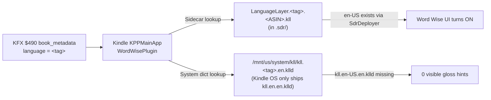

# Specification: Collapse English Regional Subtags to `"en"` in KFX `$490 book_metadata`

**Status:** Approved & Implemented  
**Target Package:** `kfx-converter`  
**Primary Scope:** `src/packager/metadata.rs`, `src/packager/tests.rs`  
**Reviewed Scope (No Code Change):** `src/packager/{core,navigation,resources,storylines,locators,styles}.rs`, `src/container.rs`, `src/pipeline.rs`, `src/enhancements/sdr.rs`, `src/enhancements/word_wise.rs`  
**Regression Origin:** Commit `877ce3d` (11/22 P1 Wave C: replaced English collapse in `build_book_metadata` with `Self::normalize_bcp47_tag`)  
**Related Spec:** [`spec-fix-word-wise-kll-header.md`](file:///home/drew/github/hwanjongyu/kfx_converter/docs/specs/spec-fix-word-wise-kll-header.md)

---

## 1. Context & Root Cause Analysis

### 1.1 Observed Symptom

Even after fixing the zeroed SQLite 100-byte `.kll` header fields in [`spec-fix-word-wise-kll-header.md`](file:///home/drew/github/hwanjongyu/kfx_converter/docs/specs/spec-fix-word-wise-kll-header.md), `Originals - Adam Grant.kfx` (`dc:language = en-US`) activates the **Word Wise** UI toggle on hardware Kindle yet displays **zero** inline gloss hints.

### 1.2 Hardware Kindle Log Proof (`KPPMainApp` / `WordWisePlugin`)

Hardware device logs in [`logs/all_system_logs_as_of_Mon_Oct_26_22.53.08_ADT_2026.txt`](file:///home/drew/github/hwanjongyu/kfx_converter/logs/all_system_logs_as_of_Mon_Oct_26_22.53.08_ADT_2026.txt#L253915-L253927) (and repeated at [`L243645`](file:///home/drew/github/hwanjongyu/kfx_converter/logs/all_system_logs_as_of_Mon_Oct_26_22.53.08_ADT_2026.txt#L243645), [`L253927`](file:///home/drew/github/hwanjongyu/kfx_converter/logs/all_system_logs_as_of_Mon_Oct_26_22.53.08_ADT_2026.txt#L253927), and [`L260679`](file:///home/drew/github/hwanjongyu/kfx_converter/logs/all_system_logs_as_of_Mon_Oct_26_22.53.08_ADT_2026.txt#L260679)) establish how Kindle OS resolves Word Wise databases from KFX `$490 book_metadata`:

```text
261026:224708 KPPMainApp: [16088] [WordWisePlugin:ERROR] Database /mnt/us/documents/Theo of Golden.sdr/LanguageLayer.EN-CA.F2C6BEB11809E1DF799F86E3D893512C.kll does not exist
...
261026:224709 KPPMainApp: [16088] [WordWisePlugin:INFO] Setting download status {"locString":"Word Wise","status":1} 
261026:224709 KPPMainApp: [16088] [WordWisePlugin:ERROR] Database /mnt/us/system/kll/kll.EN-CA.en.klld does not exist
```

`KPPMainApp` constructs **both** database paths using the `"language"` value stored inside KFX entity `$490 book_metadata` (`kindle_title_metadata`):

1. **Per-book sidecar `.kll` lookup:** `LanguageLayer.<$490 language>.<ASIN>.kll`
2. **Kindle OS system definition dictionary lookup:** `/mnt/us/system/kll/kll.<$490 language>.en.klld`



### 1.3 Git Regression Origin

1. **Pre-`877ce3d` (Commit `b2f56a4`, working 10/19 `Originals` build):**  
   `build_book_metadata` explicitly collapsed English tags to `"en"`:
   ```rust
   let lang = if self.book.metadata.language.starts_with("en")
       || self.book.metadata.language.is_empty()
   {
       "en".to_string()
   } else {
       self.book.metadata.language.clone()
   };
   ```
2. **Commit `877ce3d` (11/22 P1 Wave C):**  
   [`KfxPackager::build_book_metadata`](file:///home/drew/github/hwanjongyu/kfx_converter/src/packager/metadata.rs#L366) replaced the English-collapse branch with:
   ```rust
   let lang = Self::normalize_bcp47_tag(&self.book.metadata.language);
   ```
3. **Failure Mechanism for `Originals - Adam Grant` (`dc:language = en-US`):**
   - `$490 book_metadata` emitted `"language": "en-US"` instead of `"en"`.
   - [`SdrDeployer::collect_language_tags`](file:///home/drew/github/hwanjongyu/kfx_converter/src/enhancements/sdr.rs#L113-L141) emitted both `LanguageLayer.en.<ID>.kll` and `LanguageLayer.en-US.<ID>.kll`, so Kindle found the sidecar and enabled the Word Wise UI toggle.
   - `KPPMainApp` then attempted to open `/mnt/us/system/kll/kll.en-US.en.klld`, which does **not** exist on Kindle OS (Kindle OS only ships `/mnt/us/system/kll/kll.en.en.klld`), causing Word Wise to render **0 visible glosses**.

---

## 2. Design Decision & Trade-off Analysis (ADR)

### ADR-A: Add `KfxPackager::kindle_metadata_language` While Keeping `normalize_bcp47_tag` Pure

#### Options Considered

1. **Option 1 (Selected): Keep `normalize_bcp47_tag` as a pure RFC 5646/BCP-47 normalizer and introduce `KfxPackager::kindle_metadata_language(raw: &str) -> String`**
   - Leave [`KfxPackager::normalize_bcp47_tag`](file:///home/drew/github/hwanjongyu/kfx_converter/src/packager/metadata.rs#L286-L326) untouched so strict BCP-47 formatting remains available and independently tested.
   - Add `pub(crate) fn kindle_metadata_language(raw: &str) -> String` in [`src/packager/metadata.rs`](file:///home/drew/github/hwanjongyu/kfx_converter/src/packager/metadata.rs#L326) immediately below `normalize_bcp47_tag`:
     ```rust
     pub(crate) fn kindle_metadata_language(raw: &str) -> String {
         let bcp47 = Self::normalize_bcp47_tag(raw);
         let primary = bcp47.split('-').next().unwrap_or("");
         if matches!(primary, "en" | "eng") {
             "en".to_string()
         } else {
             bcp47
         }
     }
     ```
   - Update [`KfxPackager::build_book_metadata`](file:///home/drew/github/hwanjongyu/kfx_converter/src/packager/metadata.rs#L366) to call:
     ```rust
     let lang = Self::kindle_metadata_language(&self.book.metadata.language);
     ```
2. **Option 2 (Rejected): Modify `normalize_bcp47_tag` directly to collapse `"en"`/`"eng"` tags**
   - Conflates general BCP-47 canonicalization (e.g., `"en_us"` -> `"en-US"`) with Kindle-specific `$490` dictionary lookup requirements, making the function name misleading and breaking pure BCP-47 semantics.
3. **Option 3 (Rejected): Restore the pre-`877ce3d` `starts_with("en")` check inline in `build_book_metadata`**
   - Misses case-insensitive tags such as `"EN-US"`, `"EN-CA"`, or `"ENG-US"` (since `"EN-CA".starts_with("en")` is `false`), and also loses BCP-47 normalization for non-English tags (e.g., `"pt_br"` -> `"pt-BR"`, `"zh_hans_cn"` -> `"zh-Hans-CN"`). Furthermore, `starts_with("en")` would erroneously match hypothetical non-English prefixes if not bounded at subtag boundaries (`split('-')`).

#### Rationale & Edge-Case Behavior

Because [`normalize_bcp47_tag`](file:///home/drew/github/hwanjongyu/kfx_converter/src/packager/metadata.rs#L286-L326) trims whitespace, defaults empty/whitespace-only inputs to `"en"`, splits on both `'-'` and `'_'`, and lowercases `parts[0]`, splitting `bcp47` on `'-'` guarantees `primary` is an exact, lowercased primary language subtag.

| Input `raw` | `normalize_bcp47_tag(raw)` | `kindle_metadata_language(raw)` | Rationale |
| :--- | :--- | :--- | :--- |
| `""`, `"   "` | `"en"` | `"en"` | Empty metadata defaults to `"en"` |
| `"en"`, `"EN"` | `"en"` | `"en"` | Primary subtag `"en"` -> `"en"` |
| `"en-US"`, `"en_us"`, `"EN-CA"`, `"en-GB"`, `"en-AU"` | `"en-US"`, `"en-CA"`, `"en-GB"`, `"en-AU"` | `"en"` | English regional subtags collapse so Kindle opens `kll.en.en.klld` |
| `"en-Latn-US"` | `"en-Latn-US"` | `"en"` | English script/region subtags collapse to `"en"` |
| `"eng"`, `"ENG-US"` | `"eng"`, `"eng-US"` | `"en"` | ISO 639-2/T bibliographic `"eng"` collapses to `"en"` (matches [`is_english_language_tag`](file:///home/drew/github/hwanjongyu/kfx_converter/src/pipeline.rs#L275-L286)) |
| `"zh-Hans-CN"` | `"zh-Hans-CN"` | `"zh-Hans-CN"` | Non-English BCP-47 script/region preserved |
| `"pt-BR"`, `"pt_br"` | `"pt-BR"` | `"pt-BR"` | Non-English BCP-47 region preserved |
| `"fr-CA"`, `"ko"`, `"ja"` | `"fr-CA"`, `"ko"`, `"ja"` | `"fr-CA"`, `"ko"`, `"ja"` | Non-English tags preserved verbatim after normalization |

---

### ADR-B: Dependency Boundary & Cross-Module Verification

A codebase-wide trace across `src/packager/`, `src/container.rs`, `src/pipeline.rs`, and `src/enhancements/` confirms no other component emits or conflicts with the `$490` language tag:

1. **Packager & Container Scope (`src/packager/*`, `src/container.rs`):**
   - [`src/packager/metadata.rs`](file:///home/drew/github/hwanjongyu/kfx_converter/src/packager/metadata.rs#L366-L395) (`build_book_metadata`) is the **sole** production code path emitting a language tag into any KFX entity (`$490 book_metadata`).
   - [`src/packager/core.rs`](file:///home/drew/github/hwanjongyu/kfx_converter/src/packager/core.rs#L257), [`navigation.rs`](file:///home/drew/github/hwanjongyu/kfx_converter/src/packager/navigation.rs), [`resources.rs`](file:///home/drew/github/hwanjongyu/kfx_converter/src/packager/resources.rs), [`storylines.rs`](file:///home/drew/github/hwanjongyu/kfx_converter/src/packager/storylines.rs), [`locators.rs`](file:///home/drew/github/hwanjongyu/kfx_converter/src/packager/locators.rs), [`styles.rs`](file:///home/drew/github/hwanjongyu/kfx_converter/src/packager/styles.rs), and [`src/container.rs`](file:///home/drew/github/hwanjongyu/kfx_converter/src/container.rs) emit no language metadata (the occurrences at [`src/packager/core.rs#L257`](file:///home/drew/github/hwanjongyu/kfx_converter/src/packager/core.rs#L257) and [`#L326`](file:///home/drew/github/hwanjongyu/kfx_converter/src/packager/core.rs#L326) are inside `#[cfg(test)]` fixtures).
2. **Word Wise Builder (`src/pipeline.rs`, `src/enhancements/word_wise.rs`):**
   - [`ConversionPipeline::run`](file:///home/drew/github/hwanjongyu/kfx_converter/src/pipeline.rs#L525-L526) instantiates `WordWiseBuilder::new(&asin, &container_id, "en", "en", &book_revision)`.
   - [`WordWiseBuilder::populate_connection`](file:///home/drew/github/hwanjongyu/kfx_converter/src/enhancements/word_wise.rs#L519-L532) sets `targetLanguages = "en"`, `sourceLanguage = "en"`, and `enDictionaryId = "kll.en.en"` — aligning identically with `$490 language == "en"`.
3. **Sidecar Deployment (`src/enhancements/sdr.rs`):**
   - [`SdrDeployer::collect_language_tags`](file:///home/drew/github/hwanjongyu/kfx_converter/src/enhancements/sdr.rs#L113-L141) unconditionally initializes `lang_tags = vec!["en".to_string(), "EN".to_string()]` first.
   - Therefore, `LanguageLayer.en.<id>.kll` is always deployed first on both case-sensitive (Linux ext4) and case-insensitive (FAT32/MTP/macOS/Windows) filesystems, guaranteeing an exact match for `$490 language == "en"` while retaining backward-compatible regional aliases.

---

## 3. Deterministic Test & Verification Plan (Phase 2 QA)

### 3.1 Unit & Integration Tests (`src/packager/tests.rs`)

1. **Update [`test_packager_metadata_completeness_and_no_cover_omits_cover_landmark`](file:///home/drew/github/hwanjongyu/kfx_converter/src/packager/tests.rs#L1797-L1863):**
   - Update line 1839 (where `book.metadata.language = "en_us".to_string()`) from checking raw bytes `b"en-US"` to decoding `$490 book_metadata` (or asserting Ion kv pairs) so that:
     - `kindle_title_metadata` contains `("language", IonValue::String("en"))`.
     - `$490` does **not** contain `"en-US"`.
     - `KfxPackager::normalize_bcp47_tag("en_us") == "en-US"` remains explicitly verified.
2. **Add `test_kindle_metadata_language_collapses_english_and_preserves_non_english`:**
   - Assert `KfxPackager::kindle_metadata_language` returns `"en"` for `""`, `"  "`, `"en"`, `"EN"`, `"en-US"`, `"en_US"`, `"EN-CA"`, `"en-GB"`, `"en-AU"`, `"en-Latn-US"`, `"eng"`, and `"ENG-US"`.
   - Assert `KfxPackager::kindle_metadata_language` preserves `"zh-Hans-CN"`, `"pt-BR"`, `"fr-CA"`, `"ko"`, and `"ja"` (including `"pt_br"` -> `"pt-BR"` and `"zh_hans_cn"` -> `"zh-Hans-CN"`).
   - Run `$490` `IonReader` roundtrip checks packaging full `BookIR` instances with `language = "en-US"`, `"EN-CA"`, and `"pt_br"`, verifying `$490` emits `"en"`, `"en"`, and `"pt-BR"` respectively.

### 3.2 Workspace Build, Lint & Feature Matrix Gates

Execute and verify all checks pass with zero warnings or failures:

- `cargo test --workspace --all-targets`
- `cargo test --no-default-features`
- `cargo test --features gui`
- `cargo clippy --workspace --all-targets -- -D warnings`
- `cargo clippy --all-features --all-targets -- -D warnings`
- `cargo build --release --all-features`

### 3.3 Isolated End-to-End Verification (`Originals - Adam Grant.epub`)

Run `./target/release/kfx-conv` against `Originals - Adam Grant.epub` into an isolated temporary directory, then inspect and clean up the temporary directory:

1. Decode `$490 book_metadata` from the generated `.kfx` container and assert `language == "en"`.
2. Inspect the generated `.kll` sidecar SQLite database and verify:
   - Header fields: `change_counter = 1` (`cc=1`), `version_valid_for = 1` (`vvf=1`), `sqlite_version = 3048000` (`ver=3048000`)
   - Payload: `glosses = 1539`
   - `PRAGMA integrity_check` returns `ok`
3. Remove the temporary directory after verification.
