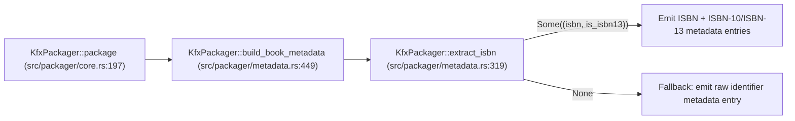
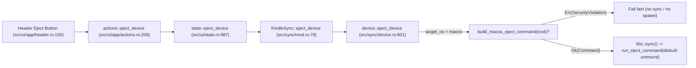

# Specification: Remediation of Nov 24 Audit P0 Critical Issues

**Document:** [`docs/specs/spec-fix-p0-nov24-audit.md`](file:///home/drew/github/hwanjongyu/kfx_converter/docs/specs/spec-fix-p0-nov24-audit.md)  
**Status:** PROPOSED (Phase 1 — Pre-Approval Gate)  
**Date:** 2026-11-24  
**Baseline Commit:** `e560d12` (`main`)  
**Source Audit:** [`docs/multi_model_review_report.md`](file:///home/drew/github/hwanjongyu/kfx_converter/docs/multi_model_review_report.md)  
**Target Workspace:** [`kfx_converter`](file:///home/drew/github/hwanjongyu/kfx_converter)

---

## 1. Context, Scope & Non-Goals

### 1.1 Context
The 2026-11-24 multi-model consensus audit ([`docs/multi_model_review_report.md`](file:///home/drew/github/hwanjongyu/kfx_converter/docs/multi_model_review_report.md)) identified two verified **P0 Critical** defects on `HEAD e560d12`:

1. **P0-1 — UTF-8 Non-Char-Boundary Slice Panic in `KfxPackager::extract_isbn` (Process Abort):**  
   In [`src/packager/metadata.rs#L319-L349`](file:///home/drew/github/hwanjongyu/kfx_converter/src/packager/metadata.rs#L319-L349), `extract_isbn` checks `compact.len() == 10` (UTF-8 byte length) and then slices the `&str` at byte offset `9` (`compact[..9]`). Any EPUB whose `<dc:identifier>` compacts to 10 UTF-8 bytes with a multi-byte UTF-8 character straddling byte index `9` (e.g., `"12345678é"`, `"1234567한"`, `"123456😀"`, `"urn:isbn:1234-5678-é"`) panics at runtime (`byte index 9 is not a char boundary`). Because [`Cargo.toml#L48`](file:///home/drew/github/hwanjongyu/kfx_converter/Cargo.toml#L48) sets `panic = "abort"` in `[profile.release]`, a malformed or localized `<dc:identifier>` immediately aborts `kfx-conv` and `kfx-studio`.

2. **P0-2 — Unconditional macOS Device Eject Failure (`diskutil unmount --`):**  
   In [`src/sync/device.rs#L888-L898`](file:///home/drew/github/hwanjongyu/kfx_converter/src/sync/device.rs#L888-L898), `eject_device` invokes `Command::new("diskutil")` with `.args(["unmount", "--"]).arg(root)` on `#[cfg(target_os = "macos")]`. Apple's `diskutil` does not support POSIX `"--"` option termination and interprets `"--"` as the target disk/mountpoint, failing unconditionally with `Unable to find disk for --`. No unit test currently inspects the constructed `diskutil` argv across CI platforms.

### 1.2 Scope (Strict Boundary)
This specification covers **exclusively P0-1 and P0-2** and their deterministic unit/regression tests:
- [`src/packager/metadata.rs`](file:///home/drew/github/hwanjongyu/kfx_converter/src/packager/metadata.rs) — byte-safe ISBN validation in `KfxPackager::extract_isbn`.
- [`src/packager/tests.rs`](file:///home/drew/github/hwanjongyu/kfx_converter/src/packager/tests.rs) — direct `extract_isbn` unit tests and end-to-end packaging regression test with multi-byte 10-byte identifiers.
- [`src/sync/device.rs`](file:///home/drew/github/hwanjongyu/kfx_converter/src/sync/device.rs) — macOS `diskutil` command builder helper (`build_macos_eject_command`), updated macOS branch in `eject_device`, and cross-platform deterministic argv unit tests.

### 1.3 Explicit Non-Goals (Out of Scope)
To keep this P0 patch minimal, low-risk, and cleanly reversible, the following audit items are explicitly **excluded** and deferred to separate P1/P2 specs:
- Symlink / TOCTOU hardening across `transfer.rs`, `sdr.rs`, `pipeline.rs`, and `packager/core.rs` (Audit P1 #3).
- Subprocess timeout watchdogs under `DEVICE_SYNC_LOCK`, `udisksctl --`, `syncfs` `EINVAL`/`ENOTSUP` handling, and `statvfs` overflow hardening (Audit P1 #12).
- Linux `gio`/`umount` and non-Linux/non-macOS Unix `umount` branches in `eject_device`.
- ISBN-10 / ISBN-13 mathematical check-digit verification (the existing contract intentionally accepts syntactically well-formed ASCII ISBN-10/ISBN-13 strings without checksum rejection, preserving compatibility with existing fixtures such as `urn:isbn:978-0-12-345678-9`).
- Public API signature changes (`KfxPackager` public surface, `KindleSync::eject_device`, and `SyncError` enum variants remain unchanged).

---

## 2. Architecture & Design Analysis

### 2.1 P0-1: Byte-Safe `KfxPackager::extract_isbn`

#### Call Path & Impact Boundary


Line 334 is the only `&str` byte-slicing expression in [`src/packager/metadata.rs`](file:///home/drew/github/hwanjongyu/kfx_converter/src/packager/metadata.rs). `extract_isbn` currently has no direct callers outside `build_book_metadata`.

#### Design Options & Trade-Offs

| Option | Approach | Pros | Cons | Verdict |
| :--- | :--- | :--- | :--- | :---: |
| **Option 1A** | Validate `let bytes = compact.as_bytes();` with byte-slice checks (`bytes.len() == 10 && bytes[..9].iter().all(u8::is_ascii_digit) && ...` and `bytes.len() == 13 && ...`) | Zero `&str` slicing; 100% panic-free (`bytes.len() == 10` bounds-guarantees `bytes[..9]` and `bytes[9]`); minimal ~10-line diff; preserves exact existing prefix, whitespace/hyphen stripping, and ASCII case-folding semantics; matches audit consensus | Retains one small `String` allocation for `compact` on non-ISBN identifiers (called once per book) | **CHOSEN** |
| **Option 1B** | Collect into `Vec<char>` and validate char slice, allocating `String` only on match | Panic-free; skips `String` allocation on non-ISBNs | Allocates 4× wider `Vec<char>` buffer on every call anyway; more code with zero safety advantage over 1A | Rejected |
| **Option 1C** | Single-pass stack buffer `[u8; 13]` with early return on non-ASCII or length > 13 | Zero heap allocation on non-ISBN identifiers; panic-free | Slightly higher code complexity for a once-per-book metadata call; unnecessary churn vs 1A | Rejected |

#### Chosen Design & Rationale (Option 1A)
Every valid byte in an ISBN-10 (`b'0'..=b'9'`, trailing `b'X'`) and ISBN-13 (`b'0'..=b'9'`) is strictly 7-bit ASCII (`< 0x80`). Because every multi-byte UTF-8 sequence consists exclusively of bytes `>= 0x80`, validating `compact.as_bytes()` against exact byte length (`10` or `13`) and ASCII byte predicates (`u8::is_ascii_digit`, `b'X'`, `b"978"`, `b"979"`) is mathematically equivalent to character-level ASCII validation while completely eliminating UTF-8 boundary slicing panics.

Visibility will be widened strictly from private `fn` to `pub(crate) fn` — matching the sibling helper [`pub(crate) fn normalize_bcp47_tag`](file:///home/drew/github/hwanjongyu/kfx_converter/src/packager/metadata.rs#L277) immediately above it — so [`src/packager/tests.rs`](file:///home/drew/github/hwanjongyu/kfx_converter/src/packager/tests.rs) can test `extract_isbn` directly without exposing any new public library symbol.

---

### 2.2 P0-2: Safe, Cross-Platform-Testable macOS `diskutil unmount`

#### Call Path & Impact Boundary


#### Why `"--"` Broke macOS & How Safety Is Preserved
On macOS, `diskutil unmount [force] MountPoint|DiskIdentifier|DeviceNode` does not parse POSIX `"--"` option termination. Passing `["unmount", "--", "/Volumes/Kindle"]` causes `diskutil` to treat `"--"` as the target volume identifier and exit non-zero (`Unable to find disk for --`).

The original intent of `"--"` was preventing argument injection (CWE-88) if `root` began with `'-'` (e.g., `"-rf"`, `"--help"`) or matched a `diskutil` subcommand keyword (e.g., `"force"`). Removing `"--"` without path anchoring would re-open option/keyword injection.

#### Design Options & Trade-Offs

| Option | Approach | Pros | Cons | Verdict |
| :--- | :--- | :--- | :--- | :---: |
| **Option 2A** | Pure lexical POSIX path validator + `Command` builder `#[cfg(any(target_os = "macos", test))] fn build_macos_eject_command(root: &Path) -> Result<Command, SyncError>` using `OsStr::as_encoded_bytes()` | Zero filesystem I/O in helper; deterministic argv unit tests run identically on Linux, macOS, **and Windows** CI (avoids Windows `Path::is_absolute()` returning `false` for `"/Volumes/Kindle"`); zero drift between tested `Command` and executed `Command`; fails fast before `libc::sync()` on invalid paths; zero dead code on non-macOS release builds | Does not dereference symlinks via `realpath` (deferred to P1 #3 symlink hardening) | **CHOSEN** |
| **Option 2B** | Call `std::fs::canonicalize(root)` inside the helper before building `Command` | Resolves symlinks and relative paths on live macOS | Fails in pure unit tests when `/Volumes/Kindle` does not exist on host; can fail on stalled/unresponsive mounts before `diskutil` runs; silently canonicalizing relative/untrusted paths or following symlinks to system disks is less safe than fail-closed rejection | Rejected |
| **Option 2C** | Return only `Vec<OsString>` args helper; keep `Command::new("diskutil")` inline in `eject_device` | Simple return type | Splits program/arg assembly across two places; unit test cannot directly verify `Command::get_program()` and `Command::get_args()` on the exact `Command` passed to `run_eject_command` | Rejected |

#### Critical Cross-Platform CI Subtlety (Windows `Path::is_absolute`)
The repository CI matrix ([`.github/workflows/ci.yml#L68`](file:///home/drew/github/hwanjongyu/kfx_converter/.github/workflows/ci.yml#L68)) executes `cargo test --all-features` and `cargo test --lib --no-default-features` on `ubuntu-24.04`, `macos-latest`, **and** `windows-latest`.

On Windows, `Path::new("/Volumes/Kindle").is_absolute()` evaluates to **`false`** because Windows requires a drive/UNC prefix (`C:\...`) for `is_absolute()`. Relying on `Path::is_absolute()` inside a cross-platform unit-tested macOS helper would fail on `windows-latest`!

Instead, Option 2A validates macOS POSIX-root anchoring using `root.as_os_str().as_encoded_bytes()` (stable since Rust 1.74; workspace uses Rust 2024 edition):
1. **Non-empty:** `!raw_bytes.is_empty()` — rejects `""`.
2. **NUL-free:** `!raw_bytes.contains(&b'\0')` — rejects embedded NUL bytes.
3. **POSIX absolute anchor:** `raw_bytes.starts_with(b"/")` — guarantees the argument starts with ASCII `'/'` on Linux, macOS, and Windows alike. Consequently, the target argument can **never** start with `'-'` (`-rf`, `--`, `--help`, `-f`) and can **never** equal a `diskutil` keyword (`force`, `readOnly`) or relative path (`Volumes/Kindle`, `./Kindle`). Non-UTF-8 Unix `OsStr` sequences are preserved without lossy conversion.
4. **No parent traversal (`..`):** `!root.components().any(|c| matches!(c, Component::ParentDir))` — rejects `/Volumes/Kindle/../Other`.
5. **Not POSIX root `/`:** `root.components().any(|c| matches!(c, Component::Normal(_)))` — rejects `/`, `///`, and `/.` (prevents accidentally attempting to unmount the root filesystem).
6. **Preserves valid dash-prefixed basenames:** Paths such as `"/Volumes/-rf"` or `temp.path().join("-rf")` (`/var/folders/.../-rf`) start with `'/'`, contain normal components, have no `..`, and are accepted cleanly — preserving full compatibility with [`test_eject_device_propagates_failure_for_unmounted_and_dash_paths`](file:///home/drew/github/hwanjongyu/kfx_converter/src/sync/device.rs#L1272-L1284).

#### Fail-Fast Ordering & Error Semantics
- In `eject_device` (`#[cfg(target_os = "macos")]`), `let macos_eject_cmd = build_macos_eject_command(root)?;` runs **before** `unsafe { libc::sync() };` so rejected paths fail fast with `SyncError::SecurityViolation(...)` without triggering an unnecessary host-wide `sync()` or spawning `diskutil`.
- When `build_macos_eject_command` succeeds, `run_eject_command("diskutil unmount", macos_eject_cmd)` executes `diskutil unmount <root>` and maps any non-zero exit / spawn error to `SyncError::GioFailed(...)`, preserving existing caller error handling.
- Gating the helper with `#[cfg(any(target_os = "macos", test))]` ensures zero dead-code warnings under `cargo clippy --all-targets --all-features -- -D warnings` and excludes unused macOS helper code from non-macOS release binaries.

---

## 3. Exact File-by-File Change Specification

### 3.1 [`src/packager/metadata.rs`](file:///home/drew/github/hwanjongyu/kfx_converter/src/packager/metadata.rs)

Replace `fn extract_isbn` at lines `319–349` with:

```rust
    pub(crate) fn extract_isbn(identifier: &str) -> Option<(String, bool)> {
        let trimmed = identifier.trim();
        let stripped = trimmed
            .strip_prefix("urn:isbn:")
            .or_else(|| trimmed.strip_prefix("URN:ISBN:"))
            .or_else(|| trimmed.strip_prefix("isbn:"))
            .or_else(|| trimmed.strip_prefix("ISBN:"))
            .unwrap_or(trimmed)
            .trim();
        let compact: String = stripped
            .chars()
            .filter(|c| !matches!(c, '-' | ' '))
            .map(|c| c.to_ascii_uppercase())
            .collect();
        let bytes = compact.as_bytes();
        if bytes.len() == 10
            && bytes[..9].iter().all(u8::is_ascii_digit)
            && (bytes[9].is_ascii_digit() || bytes[9] == b'X')
        {
            return Some((compact, false));
        }
        if bytes.len() == 13
            && (bytes.starts_with(b"978") || bytes.starts_with(b"979"))
            && bytes.iter().all(u8::is_ascii_digit)
        {
            return Some((compact, true));
        }
        None
    }
```

**Invariants verified:**
- Zero `&str` slicing anywhere in `src/packager/metadata.rs`.
- `bytes.len() == 10` strictly dominates `bytes[..9]` and `bytes[9]` (no out-of-bounds panic possible).
- Exact return type `Option<(String, bool)>` and caller contract at [`src/packager/metadata.rs#L449`](file:///home/drew/github/hwanjongyu/kfx_converter/src/packager/metadata.rs#L449) unchanged.

---

### 3.2 [`src/sync/device.rs`](file:///home/drew/github/hwanjongyu/kfx_converter/src/sync/device.rs)

#### A. Add macOS `diskutil` Command Builder Helper
Place immediately after `run_eject_command` (around line `76`):

```rust
/// Validates a macOS mount-point path and constructs the `diskutil unmount` command.
///
/// Apple's `diskutil` does not accept POSIX `--` option termination (`diskutil unmount -- <path>`
/// fails unconditionally with `Unable to find disk for --`). Instead, argument-injection safety
/// is enforced by requiring `root` to be a non-empty, NUL-free, POSIX-absolute path starting with
/// `'/'` that contains at least one normal component and no `..` traversal segments, ensuring
/// `diskutil` can never interpret the target argument as a flag (`-...`) or keyword (`force`).
#[cfg(any(target_os = "macos", test))]
fn build_macos_eject_command(root: &Path) -> Result<Command, SyncError> {
    use std::path::Component;

    let raw_bytes = root.as_os_str().as_encoded_bytes();
    if raw_bytes.is_empty() {
        return Err(SyncError::SecurityViolation(
            "Refusing to eject empty macOS mount path".to_string(),
        ));
    }
    if raw_bytes.contains(&b'\0') {
        return Err(SyncError::SecurityViolation(format!(
            "Refusing to eject macOS mount path containing NUL byte: {:?}",
            root
        )));
    }
    if !raw_bytes.starts_with(b"/") {
        return Err(SyncError::SecurityViolation(format!(
            "Refusing to eject non-absolute macOS mount path: {:?}",
            root
        )));
    }
    if root
        .components()
        .any(|c| matches!(c, Component::ParentDir))
    {
        return Err(SyncError::SecurityViolation(format!(
            "Refusing to eject macOS mount path containing parent traversal ('..'): {:?}",
            root
        )));
    }
    if !root.components().any(|c| matches!(c, Component::Normal(_))) {
        return Err(SyncError::SecurityViolation(format!(
            "Refusing to eject POSIX root path: {:?}",
            root
        )));
    }

    let mut cmd = Command::new("diskutil");
    cmd.arg("unmount").arg(root);
    Ok(cmd)
}
```

#### B. Update `eject_device` macOS Path ([`src/sync/device.rs#L809-L898`](file:///home/drew/github/hwanjongyu/kfx_converter/src/sync/device.rs#L809-L898))
1. Inside `#[cfg(not(windows))]` before `libc::sync()` (right after `let _ = root;`):
   ```rust
   #[cfg(target_os = "macos")]
   let macos_eject_cmd = build_macos_eject_command(root)?;
   ```
2. Replace lines `888–898`:
   ```rust
   #[cfg(target_os = "macos")]
   {
       run_eject_command("diskutil unmount", macos_eject_cmd).map_err(|err| {
           SyncError::GioFailed(format!(
               "Failed to unmount Kindle device at {:?}: {}",
               root, err
           ))
       })?;
   }
   ```

**Invariants verified:**
- `"--"` is completely removed from `diskutil unmount`.
- Constructed argv is strictly `["unmount", <root>]` on program `"diskutil"`.
- Invalid paths fail fast with `SyncError::SecurityViolation` before `libc::sync()` or subprocess spawn.
- Linux, non-Linux/non-macOS Unix, and Windows branches are untouched.

---

### 3.3 Unit & Regression Tests

#### A. [`src/packager/tests.rs`](file:///home/drew/github/hwanjongyu/kfx_converter/src/packager/tests.rs)
Add two deterministic tests alongside `test_packager_metadata_completeness_and_no_cover_omits_cover_landmark`:
1. `test_extract_isbn_valid_ascii_and_multibyte_non_ascii_safety` — exercises all cases in the P0-1 Edge-Case Matrix below directly via `KfxPackager::extract_isbn(...)`.
2. `test_packager_handles_ten_byte_multibyte_identifier_without_panic` — packages a `BookIR` with `book.metadata.identifier = "12345678é".to_string()` (and `"1234567한"`), asserting `packager.package(...)` succeeds (`Ok(())`) and emits the fallback `"identifier"` entry rather than panicking or emitting `"ISBN"`.

#### B. [`src/sync/device.rs`](file:///home/drew/github/hwanjongyu/kfx_converter/src/sync/device.rs) (`mod tests`)
Add deterministic cross-platform tests (no `#[cfg(unix)]` or `#[cfg(target_os = "macos")]` restriction so they execute on Linux, macOS, and Windows CI without invoking live `diskutil`):
1. `test_build_macos_eject_command_constructs_valid_diskutil_argv_without_double_dash` — inspects `cmd.get_program()` (`"diskutil"`) and `cmd.get_args().collect::<Vec<_>>()` (`["unmount", <root>]`) across standard, space-containing, trailing-slash, and dash-prefixed-basename absolute paths, explicitly asserting `"--"` is NOT present in argv.
2. `test_build_macos_eject_command_rejects_unsafe_paths` — verifies `Err(SyncError::SecurityViolation(_))` for empty, dash-prefixed, `"--"`, `"force"`, relative, POSIX root (`"/"`, `"///"`, `"/."`), parent-traversal (`"/Volumes/Kindle/../Other"`), and NUL-containing paths.

---

## 4. Edge-Case Matrix

### 4.1 P0-1 (`KfxPackager::extract_isbn`)

| # | Input `identifier` | Byte Len (Compact) | Expected Result | Notes |
| :---: | :--- | :---: | :--- | :--- |
| 1 | `"12345678é"` | 10 (8 + 2) | `None` | Previously panicked at byte index 9 (`'é'` bytes `8..10`) |
| 2 | `"1234567한"` | 10 (7 + 3) | `None` | Previously panicked at byte index 9 (`'한'` bytes `7..10`) |
| 3 | `"123456😀"` | 10 (6 + 4) | `None` | Previously panicked at byte index 9 (`'😀'` bytes `6..10`) |
| 4 | `"urn:isbn:1234-5678-é"` | 10 | `None` | Prefix + hyphen stripping yielding 10-byte non-ASCII |
| 5 | `"é12345678"` | 10 (2 + 8) | `None` | Non-ASCII at start, 10 bytes total |
| 6 | `"123456789é"` | 11 (9 + 2) | `None` | Multi-byte trailing char |
| 7 | `"97812345678é"` | 13 (11 + 2) | `None` | 13-byte non-ASCII with `978` prefix |
| 8 | `"0-306-40615-2"` | 10 | `Some(("0306406152", false))` | Valid hyphenated ISBN-10 |
| 9 | `"isbn: 030640615x "` | 10 | `Some(("030640615X", false))` | Valid ISBN-10 with lowercase `x` check digit & whitespace |
| 10 | `"URN:ISBN: 0 306 40615 X"` | 10 | `Some(("030640615X", false))` | Uppercase prefix + spaces |
| 11 | `"urn:isbn:978-0-12-345678-9"` | 13 | `Some(("9780123456789", true))` | Valid ISBN-13 (`978` prefix) |
| 12 | `"ISBN:979-10-90636-07-1"` | 13 | `Some(("9791090636071", true))` | Valid ISBN-13 (`979` prefix) |
| 13 | `"9771234567890"` | 13 | `None` | Invalid ISBN-13 prefix (`977`) |
| 14 | `"030640615X1"` / `"123456789"` / `""` | 11 / 9 / 0 | `None` | Invalid lengths |
| 15 | `"urn:uuid:550e8400-e29b-41d4-a716-446655440000"` | 41 | `None` | Standard non-ISBN EPUB UUID |

### 4.2 P0-2 (`build_macos_eject_command`)

| # | Input `root` | Expected Result | Expected Program & Argv / Error Variant |
| :---: | :--- | :--- | :--- |
| 1 | `"/Volumes/Kindle"` | `Ok(cmd)` | program `"diskutil"`, args `["unmount", "/Volumes/Kindle"]` (no `"--"`) |
| 2 | `"/Volumes/Kindle Paperwhite"` | `Ok(cmd)` | program `"diskutil"`, args `["unmount", "/Volumes/Kindle Paperwhite"]` |
| 3 | `"/Volumes/Kindle/"` | `Ok(cmd)` | program `"diskutil"`, args `["unmount", "/Volumes/Kindle/"]` |
| 4 | `"/Volumes/-rf"` | `Ok(cmd)` | program `"diskutil"`, args `["unmount", "/Volumes/-rf"]` (anchored by `'/'`) |
| 5 | `"/var/folders/ab/cd/-rf"` | `Ok(cmd)` | program `"diskutil"`, args `["unmount", "/var/folders/ab/cd/-rf"]` (matches existing Unix eject test pattern) |
| 6 | `""` | `Err` | `SyncError::SecurityViolation` (empty path) |
| 7 | `"-rf"` | `Err` | `SyncError::SecurityViolation` (option-prefixed / non-absolute) |
| 8 | `"--"` / `"--help"` | `Err` | `SyncError::SecurityViolation` (option-prefixed / non-absolute) |
| 9 | `"force"` | `Err` | `SyncError::SecurityViolation` (`diskutil` keyword / non-absolute) |
| 10 | `"Volumes/Kindle"` / `"./Kindle"` | `Err` | `SyncError::SecurityViolation` (relative path) |
| 11 | `"/"` / `"///"` / `"/."` | `Err` | `SyncError::SecurityViolation` (POSIX root without normal component) |
| 12 | `"/Volumes/Kindle/../Other"` | `Err` | `SyncError::SecurityViolation` (parent directory traversal) |
| 13 | `"/Volumes/Kindle\0evil"` | `Err` | `SyncError::SecurityViolation` (embedded NUL byte) |

---

## 5. Verification & Acceptance Criteria

Implementation is complete and passes QA only when **all** of the following checks succeed with zero failures and zero warnings:

1. **Deterministic Unit & Integration Tests (All Feature Matrices):**
   - `cargo test --lib --no-default-features` — all existing 239 tests + all newly added P0-1 and P0-2 unit tests pass (`0 failed`, `0 ignored`).
   - `cargo test` (default `cli` feature) — all tests pass (`0 failed`).
   - `cargo test --all-features` (`cli` + `gui`) — all tests pass (`0 failed`).
2. **Static Analysis & Formatting:**
   - `cargo clippy --all-targets --all-features -- -D warnings` — **0 warnings**, **0 errors**.
   - `cargo fmt -- --check` — clean formatting.
3. **Behavioral & Regression Guarantees:**
   - Zero `&str` byte-slicing expressions remain in [`src/packager/metadata.rs`](file:///home/drew/github/hwanjongyu/kfx_converter/src/packager/metadata.rs).
   - `"--"` does not appear in any `diskutil` invocation in [`src/sync/device.rs`](file:///home/drew/github/hwanjongyu/kfx_converter/src/sync/device.rs).
   - Existing Unix test [`test_eject_device_propagates_failure_for_unmounted_and_dash_paths`](file:///home/drew/github/hwanjongyu/kfx_converter/src/sync/device.rs#L1272-L1284) continues to pass without modification.
   - All new tests are strictly deterministic (no sleeps, no live `diskutil` invocation, no OS-only skips on macOS argv construction tests).
