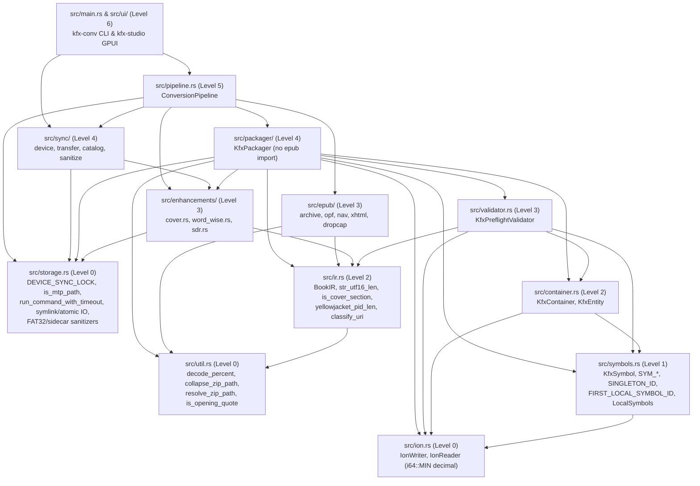

# Technical Specification: Remediation of All 12 `P1 Major` Audit Findings (#3–#14) (`kfx-converter`)

- **Document ID:** `docs/specs/spec-fix-p1-nov24-audit.md`
- **Target Crate / Workspace:** `kfx-converter` (`Cargo.toml` — Rust `edition = "2024"`, `[profile.release] panic = "abort"`, binaries `kfx-conv` [`cli`] and `kfx-studio` [`gui`])
- **Source Audit:** [`docs/multi_model_review_report.md`](../multi_model_review_report.md) (`P1 Major` items `#3`–`#14`, dated 2026-11-24)
- **Prerequisite Baseline:** `P0 Critical` items `#1` (`extract_isbn` UTF-8 slice panic) and `#2` (macOS `diskutil unmount --`) already remediated on current working tree.
- **Status:** Phase 1 Specification (Pending Approval)

---

## 1. Executive Summary & Cross-Cutting Invariants

The 2026-11-24 multi-model audit identified **12 `P1 Major` defects (`#3`–`#14`)** spanning local filesystem symlink/TOCTOU safety, silent Kindle device sync, KFX resource/symbol/UTF-16 invariants, Ion decimal roundtrip fidelity, URI scheme sanitization, navigation/storyline ordering, preflight validation blind spots, OS subprocess/MTP robustness, GPUI worker concurrency, and bidirectional module dependency cycles.

This specification provides a cohesive, backwards-compatible, reversible, and **conflict-free parallelizable** remediation plan for all 12 items organized into a **2-Wave execution model** (Wave 1 foundational decoupling + Level-0 shared primitives; Wave 2 four strictly disjoint parallel streams).

### Non-Negotiable Cross-Cutting Invariants

1. **Zero Public API Regressions:** Every existing public function/type re-export in `src/lib.rs`, `src/packager/`, `src/epub/`, `src/sync/`, and `src/enhancements/` MUST remain callable at its existing path (via re-exports where moved to lower layers). Additive struct fields (`ConversionReport.sdr_error`, `ConversionResult.{total_bytes, synced_device_path, sdr_error}`, `SectionPackData.used_resources`) are explicitly documented alongside all call-site updates.
2. **Static Style SID Freeze (`852..=890`):** `KfxPackager::build_styles(&mut symbols)` MUST remain the first symbol-interning step in `KfxPackager::package()`, keeping all 39 static styles at fixed SIDs `852..=890` (`style_link == 890`).
3. **Preserve Non-Colliding Resource Symbol Names:** Existing tests assert exact names (`resource/fig_1`, `cover_asset_id`, `resource/spoofed.jpg`, `res_first`, `res_deep`, `res_last`) for non-colliding OPF IDs. Clean non-colliding OPF `<item id>`s MUST retain their original symbol names; only reserved or colliding IDs are remapped deterministically (`res_1`, `res_2`, ...).
4. **Preserve USB Gadget No-Fsync Guardrail:** `test_no_direct_file_sync_in_sync_engine` (`src/sync/transfer.rs:530-570`) statically scans `src/sync/transfer.rs` between `fn copy_file(`..`fn execute_gio_copy` and `fn write_bytes(`..`#[cfg(test)]` and forbids `.sync_data()` / `.sync_all()`. Neither `transfer.rs` nor `storage.rs` may call `.sync_data()` or `.sync_all()` on USB/device file handles.
5. **macOS System-Symlink Safety (`/var` -> `/private/var`, `/tmp` -> `/private/tmp`):** Symlink-rejection helpers MUST NEVER reject OS root symlinks above a caller-supplied root or above `tempfile::tempdir()`. Rooted checks walk strictly relative components below the trusted root (`strip_prefix`); unrooted checks inspect the target leaf, its immediate parent, and newly created subdirectories downward.
6. **$O(1)$ Call-Stack Iterative Traversals:** All `Block` / `Block::List` traversals (`plain_text`, `char_count`, `yellowjacket_pid_len`, `extract_list_block`, `collect_img_res`, and Word Wise list-image segmentation) MUST remain strictly iterative using explicit heap stacks.
7. **Zero New Crate Dependencies:** All 12 fixes (including GIF header dimension parsing and bounded subprocess timeouts) use existing dependencies (`std`, `libc`, `tempfile`, `image`, `rusqlite`, `gpui`, etc.).

### Target Acyclic Module Dependency Architecture (Post-P1-#14)



**All three bidirectional/inverted cycles are eliminated:**
- `packager <-> validator` broken via `src/symbols.rs` (`validator` no longer imports `packager`).
- `packager -> epub` broken via `src/util.rs` (`packager` no longer imports `epub`).
- `enhancements <-> sync` broken via `src/storage.rs` (`enhancements/sdr.rs` imports only `storage`; `sync` depends unidirectionally on `enhancements` and `storage`).

---

## 2. Detailed Technical Design (P1-#3 through P1-#14)

### 2.1 P1-#14 — Architectural Decoupling & Build Hygiene (Foundational — Wave 1)

#### 2.1.1 Break `packager <-> validator` Cycle & `container.rs` Magic Numbers
- **`src/symbols.rs`:**
  - Move `pub const SINGLETON_ID: u32 = 348;`, `pub const AMAZON_YJ_SYMBOLS_MAX_ID: u32 = 851;`, `pub const FIRST_LOCAL_SYMBOL_ID: u32 = AMAZON_YJ_SYMBOLS_MAX_ID + 1;`, and `pub struct LocalSymbols` (including `new`, `get_id`, `intern`, `to_ion_symbol_table`, `Default`) from `src/packager/symbols.rs` into `src/symbols.rs`.
  - Add `use crate::ion::{IonValue, IonWriter};` and `use std::collections::HashMap;` in `src/symbols.rs` (`src/ion.rs` has zero dependency on `src/symbols.rs`, so `symbols -> ion` is acyclic).
- **`src/packager/symbols.rs`:**
  - Re-export `pub use crate::symbols::{AMAZON_YJ_SYMBOLS_MAX_ID, FIRST_LOCAL_SYMBOL_ID, LocalSymbols, SINGLETON_ID};` so `crate::packager::*` public exports remain 100% unchanged.
  - Keep SHA-1 ID generators (`generate_container_id`, `generate_content_id`, `generate_book_id`) in `src/packager/symbols.rs`.
- **`src/container.rs` (`L435`):**
  - Replace hardcoded `348` and `852` with `crate::symbols::{SINGLETON_ID, FIRST_LOCAL_SYMBOL_ID}`.
- **`src/validator.rs` (`L11`, `L1250`):**
  - Replace `use crate::packager::{FIRST_LOCAL_SYMBOL_ID, LocalSymbols, SINGLETON_ID};` with `use crate::symbols::{FIRST_LOCAL_SYMBOL_ID, LocalSymbols, SINGLETON_ID};`.

#### 2.1.2 Break `packager -> epub` Layer Inversion (`src/util.rs`)
- **New file `src/util.rs` (registered as `pub(crate) mod util;` in `src/lib.rs`):**
  - Move pure stdlib helpers:
    - `pub fn decode_percent(input: &str) -> String` (from `src/epub/archive.rs`)
    - `pub fn collapse_zip_path(path: &str) -> String` (from `src/epub/archive.rs`)
    - `pub fn resolve_zip_path(base_dir: &str, relative: &str) -> String` (from `src/epub/archive.rs`)
    - `pub fn is_opening_quote(c: char) -> bool` (from `src/epub/dropcap.rs`)
  - Re-export in `src/epub/archive.rs` (`pub use crate::util::{collapse_zip_path, decode_percent, resolve_zip_path};`) and `src/epub/dropcap.rs` (`pub use crate::util::is_opening_quote;`).
  - Update `src/packager/{core,navigation,storylines}.rs` to import from `crate::util::*` instead of `crate::epub::*`.

#### 2.1.3 Break `enhancements <-> sync` Cycle (`src/storage.rs`)
- **Trade-off Analysis:**
  - *Option A (Selected — New Level-0 `src/storage.rs`):* Centralizes `DEVICE_SYNC_LOCK`, `is_mtp_path`, `run_command_with_timeout`, symlink/TOCTOU/atomic-write helpers, `gio mkdir`/`gio copy` helpers, and FAT32/sidecar sanitizers in a single `pub(crate) mod storage;` depending only on `std`, `libc`, `tempfile`. Eliminates the cycle, eliminates 3× duplicated read-only clearing (`sdr.rs`, `word_wise.rs`, `transfer.rs`), and unifies P1-#3 and P1-#12 primitives.
  - *Option B (Move `SdrDeployer` into `sync/` and re-export from `enhancements`):* Leaves `enhancements` importing `sync` (just flips the cycle direction unless `enhancements` stops exporting `SdrDeployer`, which would break `crate::enhancements::SdrDeployer`). Rejected.
- **New file `src/storage.rs` (registered as `pub(crate) mod storage;` in `src/lib.rs`):**
  - Exports (all `pub(crate)`):
    1. `pub(crate) static DEVICE_SYNC_LOCK: std::sync::Mutex<()>` (re-exported in `src/sync/mod.rs` as `pub(crate) use crate::storage::DEVICE_SYNC_LOCK;`).
    2. `pub(crate) fn is_mtp_path(path: &Path) -> bool`:
       ```rust
       pub(crate) fn is_mtp_path(path: &Path) -> bool {
           let s = path.to_string_lossy();
           s.contains("/gvfs/mtp:") || s.starts_with("mtp://") || s.starts_with("gio://")
       }
       ```
    3. `pub(crate) fn run_command_with_timeout(label: &str, cmd: &mut std::process::Command, timeout: Duration) -> Result<std::process::Output, String>` (full spec in §2.10).
    4. Symlink / atomic-write / read-only helpers (full spec in §2.2):
       - `reject_symlink_path(path: &Path) -> std::io::Result<()>`
       - `reject_symlink_ancestors_under(root: &Path, target: &Path) -> std::io::Result<()>`
       - `ensure_non_symlink_dir(dir: &Path) -> std::io::Result<()>`
       - `prepare_writable_non_symlink(path: &Path) -> std::io::Result<()>`
       - `set_readonly_non_symlink(path: &Path, readonly: bool) -> std::io::Result<()>`
       - `run_gio_mkdir_with_timeout(dir: &Path, timeout: Duration) -> std::io::Result<()>`
       - `execute_gio_copy_with_timeout_io(src: &Path, dst: &Path, timeout: Duration) -> std::io::Result<()>`
       - `ensure_dir_exists_safe(dir: &Path) -> std::io::Result<()>`
       - `write_bytes_local_safe(dst: &Path, data: &[u8]) -> std::io::Result<()>` (**NO `.sync_data()`/`.sync_all()`!**)
       - `write_bytes_with_mtp(dst: &Path, data: &[u8], lock_mtp: bool) -> std::io::Result<()>`
    5. FAT32/sidecar sanitizers moved from `src/sync/sanitize.rs` (`sanitize_filename`, `sanitize_sidecar_stem`, `sanitize_asin`, `sanitize_cde_content_type`, `collect_sidecar_stems`, `collect_thumbnail_stems`) and **re-exported verbatim** from `src/sync/sanitize.rs` (`pub use crate::storage::{...};`).

#### 2.1.4 Gate `build.rs` on `CARGO_FEATURE_GUI`
- **`build.rs`:**
  - Add `println!("cargo:rerun-if-env-changed=CARGO_FEATURE_GUI");` right after `CARGO_CFG_TARGET_ARCH`.
  - Compute `let gui_enabled = std::env::var_os("CARGO_FEATURE_GUI").is_some();`.
  - Under `"linux"`: wrap the entire `libxkbcommon-x11.so` symlink staging & `cargo:rustc-link-search` block in `if gui_enabled { ... }` so headless CLI-only (`kfx-conv` / `--lib`) builds emit zero X11 link paths or symlinks.
  - Under `"windows"`: keep `winres` metadata for both CLI and GUI, setting `"FileDescription"` to `"Native EPUB to Amazon KFX Converter & Kindle Studio"` when `gui_enabled` and `"Native EPUB to Amazon KFX Converter CLI"` otherwise.

#### 2.1.5 Explicit Deferral of God-File & Inline-Test Relocation
- Splitting the 2,662-line `src/epub/xhtml.rs` state machine into `XhtmlParser` submodules and relocating 8,000+ LOC of inline `#[cfg(test)]` modules into `tests/` are **explicitly deferred to a dedicated pure-refactoring PR** with zero behavioral changes. Mixing large mechanical code motion into a 12-item security/correctness PR obscures review diffs, risks merge conflicts with Stage 3 (`spec-epub-kfx-links-stage3.md`), and violates minimal-reversible-change discipline.

---

### 2.2 P1-#3 — Symlink / TOCTOU & Shared-Temp Log-Clobbering Hazards

#### 2.2.1 Shared Filesystem Primitives (`src/storage.rs`)
1. **`reject_symlink_path(path: &Path) -> std::io::Result<()>`:**
   - Calls `std::fs::symlink_metadata(path)`:
     - `Ok(m) if m.file_type().is_symlink()` -> `Err(ErrorKind::PermissionDenied, format!("Refusing symlink path: {:?}", path))`
     - `Ok(_)` | `Err(NotFound)` -> `Ok(())`
     - `Err(e)` -> `Err(e)`
2. **`reject_symlink_ancestors_under(root: &Path, target: &Path) -> std::io::Result<()>`:**
   - Requires `let rel = target.strip_prefix(root)` (else `Err(ErrorKind::PermissionDenied)`).
   - Rejects any `Component::ParentDir` in `rel`.
   - Iterates normal components of `rel`, accumulating `cur = root.join(...)` and checking `symlink_metadata(&cur)`: if `Ok(m)` and `m.file_type().is_symlink()`, returns `Err(ErrorKind::PermissionDenied)`. Does **NOT** inspect OS components above `root` (safe on macOS `/var` -> `/private/var`).
3. **`ensure_non_symlink_dir(dir: &Path) -> std::io::Result<()>`:**
   - Handles empty/`.` path cleanly (`Ok(())`).
   - Checks `symlink_metadata(dir)`:
     - `Ok(m)` -> if `m.file_type().is_symlink()` return `PermissionDenied`; if `!m.file_type().is_dir()` return `AlreadyExists` / `Other("Path exists and is not a directory")`; else `Ok(())`.
     - `Err(NotFound)` -> walks upward via `.parent()` to find the deepest existing ancestor `base`, collecting missing child component names into `missing: Vec<OsString>`.
       - Verifies `base` (when non-empty and not a root prefix): `symlink_metadata(base)` must NOT be a symlink (except OS root prefixes like `/` or `C:\`) and MUST be a directory. Wait: what if `base` is `/tmp` on macOS where `/tmp` itself is a symlink to `/private/tmp`? If `base` is an existing ancestor *above* the target leaf, check `symlink_metadata` on the **immediate parent of the target leaf** if `missing.len() <= 1`, OR canonicalize `base` via `base.canonicalize()?` (which resolves macOS `/tmp` -> `/private/tmp` safely when `base` is an already-existing parent passed by caller, unless `missing.is_empty()` where `dir` itself was checked above!) — wait: what if caller passed `symlink_parent/new_child` where `symlink_parent` is an attacker-planted symlink?
       - **Exact rule (safe on both Linux & macOS):**
         - Check `symlink_metadata(dir)` first (rejects symlink target).
         - Check `dir.parent()` via `symlink_metadata`: if `dir.parent()` exists and `is_symlink()` AND `dir.parent()` is NOT equal to `std::env::temp_dir()` (nor a root like `/var` or `/tmp`), reject with `PermissionDenied`! Better yet: **only check `symlink_metadata` on every component we create PLUS `dir` itself AND `dir.parent()` when `dir` is a leaf inside a known parent**; and when a trusted root (`device_root`, `allowed_root`) is available, ALWAYS call `reject_symlink_ancestors_under(root, dir)`!
         - Create each missing component one-by-one with `std::fs::create_dir(&cur)` (handling `AlreadyExists` race by immediately re-checking `symlink_metadata(&cur)` is a real non-symlink dir).
4. **`prepare_writable_non_symlink(path: &Path)` & `set_readonly_non_symlink(path: &Path, readonly: bool)`:**
   - On Unix (`#[cfg(unix)]`): open `path` with `OpenOptions::new().read(true).custom_flags(libc::O_NOFOLLOW).open(path)` and call `file.set_permissions(perms)` on the **open file descriptor** (`fchmod`), eliminating the path-based `symlink_metadata` -> `set_permissions` TOCTOU window!
   - On non-Unix: check `symlink_metadata(path)` (`!is_symlink()`), then `std::fs::set_permissions(path, perms)`.
5. **`write_bytes_local_safe(dst: &Path, data: &[u8]) -> std::io::Result<()>`:**
   - Reject symlink `dst` (`reject_symlink_path(dst)?`) and symlink `parent` (`reject_symlink_path(parent)?`, skipping only if `parent == Path::new(".")` or root).
   - Stage with `tempfile::Builder::new().prefix(".kfx_tmp.").suffix(".part").tempfile_in(parent)?`, `write_all`, `flush` (**strictly NO `.sync_data()` / `.sync_all()`**).
   - Call `prepare_writable_non_symlink(dst)`.
   - Re-check `reject_symlink_path(dst)?` immediately before `tmp.persist(dst)`.

#### 2.2.2 `src/pipeline.rs` — Hardened `conversion.log` Path, Rotation & Append
- **`conversion_log_path()` (`L16-L41`):**
  - Preserve `LOCALAPPDATA` (Windows), `XDG_DATA_HOME` (`tests/cli_tests.rs:205` expects `XDG_DATA_HOME/kfx-converter/conversion.log`), and `HOME/.local/share` branches unchanged.
  - Fallback when none are set:
    - `#[cfg(unix)]`: `std::env::temp_dir().join(format!("kfx-converter-{}", unsafe { libc::geteuid() })).join("conversion.log")` (with `// SAFETY: libc::geteuid() takes no arguments and is always safe to call`).
    - `#[cfg(not(unix))]`: `std::env::temp_dir().join("kfx-converter").join("conversion.log")`.
- **Private `0700` dir verification & creation in `append_conversion_log_at(path, message)` (`L74-L92`):**
  - If `parent` exists: `symlink_metadata(parent)` MUST be a non-symlink directory; if `parent` is inside `std::env::temp_dir()` on Unix, additionally verify `meta.uid() == geteuid()` (via `std::os::unix::fs::MetadataExt`) and tighten mode to `0o700` (`fchmod` / `set_permissions`) — if owned by another UID or a symlink, abort logging silently (non-fatal).
  - If `parent` does not exist: create via `DirBuilder` with `#[cfg(unix)] mode(0o700)` for the leaf directory (after creating missing parents non-symlink-safely), then re-verify `symlink_metadata(parent)` is a non-symlink directory.
- **`rotate_log_if_needed(path, max_bytes)` (`L45-L71`):**
  - Use `std::fs::symlink_metadata(path)` (NOT `std::fs::metadata`). If `meta.file_type().is_symlink() || !meta.file_type().is_file()`, return `Err(())` so `append_conversion_log_at` refuses to touch `path`.
  - If `meta.len() <= max_bytes`, return `Ok(())`.
  - Check `backup_path = path.with_extension("log.old")` via `symlink_metadata(&backup_path)`:
    - If `Ok(bm)` and `bm.file_type().is_symlink()`: refuse to follow/overwrite symlink target; attempt `remove_file(&backup_path)` (removes the symlink entry itself, never the target) — if removal fails, abort rotation without writing to `backup_path`!
    - If `Ok(bm)` and `bm.file_type().is_file()`: best-effort `remove_file(&backup_path)`.
    - If `Ok(bm)` and `bm.file_type().is_dir()`: leave directory untouched (so `test_conversion_log_rotation_fallback_truncates_when_rename_fails` at `pipeline.rs:614` triggers the truncation fallback cleanly!).
  - Try `std::fs::rename(path, &backup_path)`.
  - On `rename` failure (e.g., `backup_path` is a blocking dir or cross-FS):
    - Only attempt backup copy if `backup_path` is NOT a directory and NOT a symlink: open source `path` with `O_NOFOLLOW` and open `backup_path` with `create(true).write(true).truncate(true)` + `O_NOFOLLOW`, copying via `std::io::copy`.
    - Truncate `path` using `OpenOptions::new().write(true).truncate(true)` + `#[cfg(unix)] custom_flags(libc::O_NOFOLLOW)` (falling back to `remove_file(path)` only after confirming `symlink_metadata(path)` is not a symlink).
- **Append open in `append_conversion_log_at`:**
  - Open `path` with `OpenOptions::new().create(true).append(true)` + `#[cfg(unix)] custom_flags(libc::O_NOFOLLOW)` (plus `mode(0o600)` on Unix).

#### 2.2.3 `src/packager/core.rs` (`package_to_file`, `L171-L184`)
- Before creating `tempfile_in(parent)`: call `crate::storage::reject_symlink_path(parent)?` (unless `parent == Path::new(".")`) and `crate::storage::reject_symlink_path(path)?`.
- Immediately before `tmp_file.persist(path)`: re-call `crate::storage::reject_symlink_path(path)?`.

#### 2.2.4 `src/enhancements/sdr.rs` (`ensure_dir_exists`, `write_file_with_mtp`)
- `SdrDeployer::ensure_dir_exists(dir)` delegates directly to `crate::storage::ensure_dir_exists_safe(dir)`.
- `SdrDeployer::write_file_with_mtp(path, bytes, lock_mtp)` delegates directly to `crate::storage::write_bytes_with_mtp(path, bytes, lock_mtp)`.
- Remove duplicated `is_mtp_path`, `prepare_for_overwrite`, `run_gio_mkdir`, and local tempfile boilerplate from `sdr.rs`.

#### 2.2.5 `src/sync/transfer.rs` (`sync_to_device`, `copy_file_unlocked`, `write_bytes_unlocked`)
- In `sync_to_device`:
  - Check `docs_dir` with `std::fs::symlink_metadata(&docs_dir)`: reject if `NotFound` (`DeviceNotFound`), reject if `is_symlink()` (`SecurityViolation`), reject if `!is_dir()` (`DeviceNotFound`), and check `metadata.permissions().readonly()` on that non-symlink metadata!
  - Check `device_root.join(".system")` and `device_root.join("system")` via `symlink_metadata` (`!is_symlink() && is_dir()`).
  - Before writing into each `thumb_dir` and `sdr_dir`: call `crate::storage::reject_symlink_ancestors_under(device_root, &dir)` (when not an MTP path) and `crate::storage::ensure_dir_exists_safe(&dir)`.
  - For read-only thumbnail locking (`L118-L124`): replace path-based `std::fs::set_permissions` with `crate::storage::set_readonly_non_symlink(&path, true)`.
- In `copy_file_unlocked` & `write_bytes_unlocked`:
  - Use `crate::storage::is_mtp_path(dst)` instead of `dst_str.contains("/gvfs/mtp:")`.
  - Reject symlink `parent` and `dst`, use `crate::storage::prepare_writable_non_symlink(dst)`, re-check `reject_symlink_destination(dst)?` right before `tmp.persist(dst)`.
  - **CRITICAL:** Keep `pub fn copy_file(`, `pub fn execute_gio_copy_with_timeout(`, and `pub fn write_bytes(` in their exact relative order in `src/sync/transfer.rs` with ZERO `.sync_data()` / `.sync_all()` tokens so `test_no_direct_file_sync_in_sync_engine` passes unconditionally!

#### 2.2.6 `src/sync/catalog.rs` (`delete_book_file_safe`, `L216-L278`)
- When `allowed_root.is_none()` (line `276-278`):
  - Inspect `std::fs::symlink_metadata(raw_parent)?`:
    - If `meta.file_type().is_symlink()` -> return `Err(ErrorKind::PermissionDenied, format!("Refusing to delete inside symlinked parent directory {:?}", raw_parent))`.
    - If `!meta.file_type().is_dir()` -> return `Err(ErrorKind::InvalidInput, format!("Parent path {:?} is not a directory", raw_parent))`.
  - Re-verify `raw_parent` is not a symlink before deleting companion `.part` and `.sdr`.

---

### 2.3 P1-#4 — `ConversionPipeline` `auto_deploy: false` Silent Sync, `sdr_error` & `synced_kfx_path`

#### 2.3.1 Gate Ancestor Kindle-Root Discovery on `options.auto_deploy` (`src/pipeline.rs:352-384`)
- **Precedence contract:**
  1. Explicit `options.device_root.clone()` -> **Always honored** when caller explicitly provides a target root.
  2. Otherwise, **ONLY when `options.auto_deploy == true`**:
     a. Ancestor heuristic on `output_path`: walk ancestors looking for a directory containing non-symlink `documents/` AND non-symlink (`system/` OR `.system/`).
     b. Fallback to `KindleSync::detect_kindle_root()`.
  3. When `options.device_root.is_none() && !options.auto_deploy`: `target_root = None` (never syncs!).
- **Existing test update (`src/pipeline.rs:677-727` — `test_pipeline_relative_output_path_discovers_ancestor_kindle_root`):**
  - Case 1 (`auto_deploy: false, device_root: None` inside `mock_kindle/documents/`): assert `!report.synced_to_device`, `report.synced_device_path.is_none()`, `rel_book_nosync.kfx` & `rel_book_nosync.sdr` exist locally, and `mock_kindle/amazon-cover-bug` was NOT created.
  - Case 2 (`auto_deploy: true, device_root: None` inside `mock_kindle/documents/`): assert `report.synced_to_device`, `report.synced_device_path.is_some()`, and synced files exist.

#### 2.3.2 Separate `pub sdr_error: Option<String>` on `ConversionReport`
- **`src/pipeline.rs` (`L146-L161`, `L321-L345`, `L436-L451`):**
  - Add `pub sdr_error: Option<String>` to `ConversionReport`.
  - Initialize `let mut sdr_error = None;` before step 4b.
  - On `SdrDeployer::deploy(...)` `Err(e)`:
    ```rust
    let msg = format!("SDR sidecar deploy failed ({}): {}", sdr_path.display(), e);
    log_pipeline_event(log_path, &format!("ERROR {}", msg));
    sdr_error = Some(msg);
    ```
    Do **NOT** touch `word_wise_error`!
- **`src/main.rs` (`L187-L195`):**
  ```rust
  if let Some(err) = &report.word_wise_error {
      eprintln!("Warning: Word Wise generation failed: {err}");
  }
  if let Some(err) = &report.sdr_error {
      eprintln!("Warning: Companion .sdr sidecar deployment failed: {err}");
  }
  if report.word_wise_error.is_none()
      && report.sdr_error.is_none()
      && let Some(gloss_count) = report.word_wise_glosses
  {
      println!(
          "  [ENHANCEMENT] Word Wise sidecar generated ({} glosses)",
          gloss_count
      );
  }
  ```
- **`tests/cli_tests.rs` (`L427-L459`):**
  - Update `test_cli_word_wise_error_emits_stderr_warning_and_no_success_line` (which blocks `.sdr` directory creation with a regular file) to assert:
    - `stderr.contains("Warning: Companion .sdr sidecar deployment failed:")`
    - `!stderr.contains("Warning: Word Wise generation failed:")`
    - `!stdout.contains("Word Wise sidecar generated")`
  - Add companion test `test_cli_sdr_error_with_word_wise_disabled_reports_sdr_not_word_wise` running with `-w false` and blocked `.sdr`, asserting `stderr` contains the SDR warning and NOT `"Word Wise"`.

#### 2.3.3 Rename `sdr_path` -> `synced_kfx_path` (`src/pipeline.rs:400-411`)
- Rename the `Ok(sdr_path)` binding to `Ok(synced_kfx_path)` and update the log line from `"SYNC ok sdr_path=\"{}\" has_kll={}"` to `"SYNC ok synced_kfx_path=\"{}\" has_kll={}"`.

---

### 2.4 P1-#5 — 0-Byte Assets, Embedded Fonts, SVGs & GIFs

#### 2.4.1 Raster Asset Predicate (`src/ir.rs`)
- Add method on `ResourceAsset`:
  ```rust
  impl ResourceAsset {
      /// Returns `true` iff this asset is a supported raster image MIME type
      /// (`image/*` excluding vector `image/svg+xml`). Excludes `font/*` and other non-raster assets.
      pub fn is_supported_raster_image(&self) -> bool {
          let mime = self
              .mime_type
              .split(';')
              .next()
              .unwrap_or("")
              .trim()
              .to_ascii_lowercase();
          mime.starts_with("image/") && !mime.contains("svg")
      }
  }
  ```
- Update `BookIR::resolve_cover_resource_id` (`src/ir.rs:849-902`) and `KfxPackager::has_cover_resource` (`src/packager/metadata.rs:269-275`) to require `res.is_supported_raster_image()` instead of `res.mime_type.starts_with("image/")`.
- Update `BookIR::resolve_resource_key` (moved from `KfxPackager` in §2.6) to filter candidates strictly by `res.is_supported_raster_image()`.
  - Consequence: `font/*` and `image/svg+xml` are NEVER selected as covers, NEVER resolved by `Block::Image` (which safely falls back to alt/`[Image]` text), NEVER emitted as mislabeled `$285 jpg` / `$417 bcRawMedia`, and NEVER added to `$419` dependencies!

#### 2.4.2 GIF Header Dimensions & Fast-Path Limit Enforcement (`src/enhancements/cover.rs`)
- Add `pub fn has_known_raster_magic(data: &[u8]) -> bool`:
  ```rust
  pub fn has_known_raster_magic(data: &[u8]) -> bool {
      data.starts_with(b"\xFF\xD8\xFF")
          || data.starts_with(b"\x89PNG\r\n\x1A\n")
          || data.starts_with(b"GIF87a")
          || data.starts_with(b"GIF89a")
  }
  ```
- Update `CoverOptimizer::get_image_dimensions(data: &[u8]) -> Option<(u32, u32)>` (`L207-L216`):
  - Before `image::ImageReader`, parse GIF87a/GIF89a Logical Screen Descriptor bytes `6..10`:
    ```rust
    if data.len() >= 10 && (data.starts_with(b"GIF87a") || data.starts_with(b"GIF89a")) {
        let w = u16::from_le_bytes([data[6], data[7]]) as u32;
        let h = u16::from_le_bytes([data[8], data[9]]) as u32;
        return if w > 0 && h > 0 { Some((w, h)) } else { None };
    }
    ```
- Update `CoverOptimizer::optimize_content_image` (`L132-L140`) fast-path:
  - Always enforce `MAX_SAFE_IMAGE_DIMENSION` and `MAX_SAFE_IMAGE_PIXELS` even if caller passes `max_dim > 5477`:
    ```rust
    if let Some((w, h)) = Self::get_image_dimensions(data) {
        if w > MAX_SAFE_IMAGE_DIMENSION
            || h > MAX_SAFE_IMAGE_DIMENSION
            || (w as u64) * (h as u64) > MAX_SAFE_IMAGE_PIXELS
        {
            return Err(CoverError::ImageTooLarge(w, h));
        }
        if w <= max_dim && h <= max_dim && !is_progressive_jpeg {
            return Ok(data.to_vec());
        }
    }
    ```

#### 2.4.3 Placeholder Substitution & Synthetic Test Compatibility (`src/packager/resources.rs`)
- In `build_resources`:
  - Iterate ONLY resources present in `self.resource_symbols` (already filtered to `asset.is_supported_raster_image()` and cover-prioritized in §2.5).
  - Error handling for both cover (`optimize_cover_image`) and content (`optimize_content_image`):
    - `Err(CoverError::EmptyData)` | `Err(CoverError::ImageTooLarge(..))` | `Err(CoverError::LimitExceeded(..))`:
      Log warning and substitute `(FALLBACK_PLACEHOLDER_JPEG.to_vec(), sym_jpg, "image/jpeg".to_string(), Some((1, 1)))`.
    - `Err(CoverError::Decode(_))` | `Err(CoverError::Io(_))`:
      - If `crate::enhancements::has_known_raster_magic(&asset.data)`: preserve `asset.data.clone()` with `detect_image_format(&asset.data, ext_hint)` (preserves valid GIFs exceeding `max_dim` or un-decodable by `jpeg`/`png`-only `image`, AND preserves all 5 existing short-mock JPEG/PNG tests in `src/packager/tests.rs` at `L75, L165, L195, L1173, L1606`!).
      - Otherwise (empty, unknown magic, raw XML/HTML/corrupt bytes): log warning and substitute `(FALLBACK_PLACEHOLDER_JPEG.to_vec(), sym_jpg, "image/jpeg".to_string(), Some((1, 1)))`!

---

### 2.5 P1-#6 — Collision-Free Local Symbol Allocation Across Packager

#### 2.5.1 Struct & Symbol Allocation Phase (`src/packager/core.rs`, `src/packager/resources.rs`)
- Add struct in `src/packager/types.rs` (or `core.rs`):
  ```rust
  #[derive(Debug, Clone)]
  pub(crate) struct AllocatedResourceSym {
      pub res_sym_id: u32,
      pub res_sym_name: String,
      pub raw_sym_id: u32,
      pub raw_path: String,
  }
  ```
- Add field `pub(crate) resource_symbols: HashMap<String, AllocatedResourceSym>` to `KfxPackager<'a>` (cleared at start of `package()`).
- Define reserved-namespace predicate `is_reserved_packager_symbol(id: &str) -> bool`:
  - Returns `true` if `id.is_empty()` OR `matches!(id, "toc_nav" | "landmarks_nav" | "page_list_nav")` OR `id.starts_with("style_")` OR `id.starts_with("c_")` OR `id.starts_with("story_")` OR `id.starts_with("resource/")` OR `id.strip_prefix("content_").is_some_and(|r| !r.is_empty() && r.bytes().all(|b| b.is_ascii_digit()))` OR `id.strip_prefix("a_").is_some_and(|r| !r.is_empty() && r.bytes().all(|b| b.is_ascii_digit()))` OR `id.strip_prefix("note_").is_some_and(|r| !r.is_empty() && r.bytes().all(|b| b.is_ascii_digit()))`.
- **Packaging Pipeline Step Order in `KfxPackager::package()` (`src/packager/core.rs:195-238`):**
  1. `let (styles, style_list) = self.build_styles(&mut symbols);` (**MUST stay #1 — freezes SIDs `852..=890`!**)
  2. `self.allocate_resource_symbols(&mut symbols);` (NEW — runs BEFORE `build_book_metadata` and `build_storylines_and_sections`!)
     - Iterates supported raster resources sorted with cover first, then alphabetical `res_id`.
     - For each `res_id`:
       - Candidate `raw_cand = format!("resource/{}", res_id)`.
       - If `!is_reserved_packager_symbol(res_id) && symbols.get_id(res_id).is_none() && symbols.get_id(&raw_cand).is_none()`:
         - Preserve clean name: `res_sym_name = res_id.clone()`, `raw_path = raw_cand`.
       - Else (colliding/reserved OPF ID like `style_p`, `content_1`, `c_section_1`, `toc_nav`, `a_1`, `note_1`):
         - Allocate unique `res_sym_name = format!("res_{}", counter)` (advancing `counter` until both `res_sym_name` AND `format!("resource/{}", res_sym_name)` are absent from `symbols`).
         - `raw_path = format!("resource/{}", res_sym_name)`.
       - Intern both `res_sym_id = symbols.intern(&res_sym_name)` and `raw_sym_id = symbols.intern(&raw_path)`.
       - Insert into `self.resource_symbols`.
  3. `self.build_book_metadata();`
     - For `$490` `"cover_image"`: look up `self.resolve_cover_resource_id()` in `self.resource_symbols` and emit `alloc.res_sym_name.clone()` (falls back to raw `cover_id` only if `build_book_metadata` is ever called standalone without `allocate_resource_symbols`).
  4. `let (section_data, used_styles) = self.build_storylines_and_sections(&mut symbols, &styles);`
     - Section names (`c_{raw_name}`), storylines (`story_{sec_name}`), and auxiliary data (`{sec_name}-ad`) already check `symbols.get_id(...).is_some()`, which now sees every pre-allocated resource symbol!
     - **Content chunks (`content_*`):** Track `content_chunk_syms: HashMap<usize, u32>` allocated via `allocate_unique_symbol(symbols, "content", &mut content_sym_counter)` inside Pass 1 (`stage_text_element` and `$145` emission), so chunk `1` gets `"content_1"` normally and skips any occupied symbol safely.
     - **`$175 resource_name` in `Block::Image`:** Look up `self.resource_symbols.get(&resolved_res_id).map(|a| a.res_sym_id)` (never raw `symbols.intern(&resolved_res_id)`).
  5. `self.emit_used_styles(...)`
  6. `self.build_resources(&mut symbols);` — looks up pre-allocated `AllocatedResourceSym` from `self.resource_symbols` for `$164` and `$417`!
  7. `self.build_navigation(&mut symbols, &section_data);`
     - Allocate `"toc_nav"`, `"landmarks_nav"`, `"page_list_nav"` via helper `allocate_preferred_symbol(symbols, base: &str) -> u32` (uses `base` if `symbols.get_id(base).is_none()`, else `"{base}_2"`, `"{base}_3"`, ...).
  8. `self.build_container_entity_map(&section_data, &mut symbols);`
     - Uses `sec_pack.used_resources` (populated from `self.resource_symbols` in Pass 1) and iterates `self.resource_symbols` for `$164 -> $417` dependencies!

---

### 2.6 P1-#7 — UTF-16 Code-Unit Indexing & Missing-Image PID / Cover Unification

#### 2.6.1 Canonical IR Helpers (`src/ir.rs`)
1. **`pub fn str_utf16_len(s: &str) -> usize`:**
   ```rust
   #[inline]
   pub fn str_utf16_len(s: &str) -> usize {
       s.encode_utf16().count()
   }
   ```
2. **`Section::is_cover_section(&self, section_index: usize) -> bool`:**
   Single source of truth replacing duplicated heuristics in `storylines.rs:991-1000` and `word_wise.rs:307-319`.
3. **`BookIR::sections_with_cover(&self) -> std::borrow::Cow<'_, [Section]>`:**
   - Checks `self.resolve_cover_resource_id()`.
   - If `None` OR `self.sections.first()` already contains a `Block::Image { resource_id, .. }` matching `cover_res_id`, returns `Cow::Borrowed(&self.sections)` (**zero allocation / zero clone** when `ir.normalize()` already ran!).
   - Otherwise clones `self.sections` and prepends the synthetic `"cover"` section, returning `Cow::Owned(...)`.
4. **`BookIR::resolve_resource_key(&self, resource_id: &str) -> Option<String>`:**
   - Moved from `KfxPackager::resolve_resource_key` onto `BookIR`, using `crate::util::{decode_percent, resolve_zip_path}` and requiring `asset.is_supported_raster_image()`.
   - Both `KfxPackager` and `WordWiseBuilder` call `self.book.resolve_resource_key(resource_id)` — guaranteeing 100% identical resource resolution!
5. **`Block::image_fallback_text(alt: Option<&str>) -> &str` & `Block::yellowjacket_pid_len(&self, has_resolved_resource: bool) -> usize`:**
   ```rust
   impl Block {
       pub fn image_fallback_text(alt: Option<&str>) -> &str {
           alt.map(str::trim)
               .filter(|s| !s.is_empty())
               .unwrap_or("[Image]")
       }

       pub fn yellowjacket_pid_len(&self, has_resolved_resource: bool) -> usize {
           match self {
               Block::Image { alt, .. } => {
                   if has_resolved_resource {
                       alt.as_deref().map_or(0, str_utf16_len).max(1)
                   } else {
                       str_utf16_len(Self::image_fallback_text(alt.as_deref())).max(1)
                   }
               }
               _ => str_utf16_len(&self.plain_text()).max(1),
           }
       }
   }
   ```
   - Preserves `test_word_wise_pid_matches_cover_section_offset` (`word_wise.rs:728`, where resolved cover `"Cover"` occupies 5 PIDs -> expected PID 11) while fixing missing-image drift (`None` alt -> `"[Image]"` = 7 PIDs in BOTH packager and Word Wise!).
6. **`Block::char_count(&self) -> usize` Separator Parity (`src/ir.rs:411-440`):**
   - Count `\n` between `Table` rows (`rows.len().saturating_sub(1)`), `\t` between cells (`r.len().saturating_sub(1)`), and `\n` between flattened `List` children (`child_count.saturating_sub(1)`), guaranteeing `block.char_count() == block.plain_text().chars().count()`.
   - **Test Update:** `src/ir.rs:1480` (`table` is 2×2 `Col1\tCol2\nVal1\tVal2` = 19 chars, previously asserted 16): update to `assert_eq!(table.char_count(), 19); assert_eq!(table.char_count(), table.plain_text().chars().count());` and add a multi-item `Block::List` assertion.

#### 2.6.2 Eliminate Redundant `sections.clone()` (`src/packager/core.rs`, `src/enhancements/word_wise.rs`)
- `KfxPackager<'a>` stores `pub(crate) sections: std::borrow::Cow<'a, [Section]>` initialized via `book.sections_with_cover()`.
  - Pass 1 iterates `self.sections` by borrow without `std::mem::take` unless orphan `missing_endnotes` are non-empty, in which case `self.sections.to_mut().push(endnotes_sec)` clones lazily only when orphan endnotes exist!
  - In `src/packager/locators.rs:345` test: update `packager.sections.push(...)` -> `packager.sections.to_mut().push(...)`.
- `WordWiseBuilder::generate_from_book` uses `let sections = book.sections_with_cover();` (eliminating `temp_sections` duplication).

#### 2.6.3 UTF-16 Alignment Across `storylines.rs` & `word_wise.rs`
- **`src/packager/storylines.rs`:**
  - `extract_style_events_with_base` (`L173`): `let span_len = crate::ir::str_utf16_len(&span.text);` (all `$143 offset`, `$144 length`, `anchors`, and `PendingLink { char_offset, char_len }` are in UTF-16 code units!). Keep `let char_count = span.text.chars().count();` strictly for the dropcap opening-quote 2-char heuristic (`L258`).
  - `extract_list_block` (`L393, L404, L426`): advance `char_offset` by `str_utf16_len(...)`.
  - `stage_text_element` (`L549`): `let pid_len = crate::ir::str_utf16_len(full_text).max(1);`.
  - `Block::Image` (`L778, L818-L823`): use `block.yellowjacket_pid_len(true)` when resolved, and `Block::image_fallback_text(alt.as_deref())` when unresolved.
- **`src/enhancements/word_wise.rs` (`L307-L378`):**
  - Replace duplicated `is_cover` with `section.is_cover_section(idx)`.
  - For `Block::Image { resource_id, .. }`:
    ```rust
    let has_res = book.resolve_resource_key(resource_id).is_some();
    pid += block.yellowjacket_pid_len(has_res);
    continue;
    ```
  - For `Block::List` containing nested `Block::Image` (see §2.9.2): iterate segments identically to `storylines.rs`, glossing text segments with UTF-16 `char_idx += ch.len_utf16()` and skipping glossing on image segments while advancing `pid += img.yellowjacket_pid_len(has_res)`!
  - For normal text blocks: change `char_idx += 1;` (`L361`) to `char_idx += ch.len_utf16();`!
  - **Test Update (`src/enhancements/word_wise.rs:1007-1071`):**
    Update `test_word_wise_skips_image_alt_glosses_while_advancing_pid` to cover:
    1. Unresolved `img_none` (`alt: None`, absent from `ir.resources`) -> advances by **7** PIDs (`"[Image]"`), matching `KfxPackager` 1:1.
    2. Resolved `img_resolved` (present in `ir.resources` with valid JPEG header, `alt: None`) -> advances by **1** PID, matching `KfxPackager` 1:1.
    3. Cross-check against `KfxPackager`'s emitted `$265 position_id_map` / `$609` so drift is impossible.
    4. Add a new test with non-BMP emoji (`"📖 The abstruse theorem."`) asserting exact UTF-16 offset (`📖` = 2 UTF-16 units) across `WordWiseBuilder`, `$142 style_events`, `$183` anchors, and `$265`!

---

### 2.7 P1-#8 — Ion Decimal `i64::MIN` Roundtrip (`src/ion.rs`)

- **`src/ion.rs:744-773` (`IonReader::decode_value_bounded`, tag `0x5`):**
  - Replace `if mantissa_bytes.len() > 8` with:
    ```rust
    if mantissa_bytes.len() > 9
        || (mantissa_bytes.len() == 9 && (mantissa_bytes[0] & 0x7F) != 0)
    {
        return Err(IonError::MalformedIon(
            "Mantissa length exceeds 64-bit signed integer range".into(),
        ));
    }
    ```
  - Inside `if !mantissa_bytes.is_empty()`:
    - When `len == 9`, `first = mantissa_bytes[0] & 0x7F == 0`, so the loop over `mantissa_bytes[1..]` (8 bytes) populates `mag: u64` cleanly without shift overflow.
    - Existing lines `758-772` already map `is_neg && mag == (i64::MAX as u64) + 1` -> `mantissa = i64::MIN`, reject `+2^63` (`i64::try_from(mag)` overflow), and reject `-(2^63 + 1)` (`i64::try_from(mag)` underflow), while line `789` uses `mantissa.unsigned_abs()` for negative exponents.
- **Tests (`src/ion.rs`):**
  - Roundtrip `IonWriter::write_decimal("-9223372036854775808")` -> `IonReader` -> `IonValue::Decimal("-9223372036854775808.0")`.
  - Roundtrip `"-922337203685477580.8"` (`i64::MIN` with `exp = -1`) -> `IonValue::Decimal("-922337203685477580.8")`.
  - Reject crafted 9-byte positive `+2^63` (`[0x00, 0x80, 0, ..]`), crafted 9-byte `-(2^63 + 1)` (`[0x80, 0x80, 0, .., 1]`), crafted 9-byte non-zero leading magnitude (`[0x81, 0, ..]`), and 10-byte mantissas.

---

### 2.8 P1-#9 — URI Scheme & Protocol-Relative Bypass in `normalize_span_href`

#### 2.8.1 `src/ir.rs:958-1015`
- `sanitize_href_whitespace`: filter `!ch.is_control()` instead of `!ch.is_ascii_control()` (strips Unicode C1 control chars `U+0080..=U+009F` in addition to ASCII C0 controls).
- `classify_uri` `mailto:` branch (`L996-1002`): reject whitespace in recipient:
  ```rust
  if recipient.is_empty() || recipient.chars().any(char::is_whitespace) {
      return Some(UriKind::Blocked);
  }
  ```
- `is_allowlisted_external_uri` (`L1013`): use `!uri.chars().any(char::is_control)`.

#### 2.8.2 `src/epub/xhtml.rs:418-466` (`normalize_span_href`)
- After `let decoded_path = decode_percent(path_no_query);` and `let candidate = decoded_path.replace('\\', "/");`:
  - Re-classify `candidate.trim()`:
    ```rust
    match classify_uri(&candidate) {
        None => return frag_opt.map(|f| format!("#{}", f)),
        Some(UriKind::InternalOrRelative) => {}
        Some(UriKind::Blocked) | Some(UriKind::External(_)) => return None,
    }
    ```
  - Also when `link_ctx.is_none()` and `norm_path` is formed (after `.trim().trim_start_matches("./")`), re-verify `matches!(classify_uri(&norm_path), Some(UriKind::InternalOrRelative))` before returning (catches `./javascript%3Aalert(1)` -> `javascript:alert(1)` and `./\\evil.com` -> `//evil.com`!).
  - When `link_ctx` is `Some(ctx)`: `decoded_path` has already passed post-decode `classify_uri == InternalOrRelative`, so `javascript%3A...`, `data%3A...`, `file%3A...`, `\\host\share`, and `%2F%2Fhost` are all rejected (`None`) regardless of whether `link_ctx` is `Some` or `None`!

---

### 2.9 P1-#10 — Unsorted `$142 style_events`, `nav.rs` Parity & Cross-Chapter Footnote Fallback

#### 2.9.1 Stable Sort `$142 style_events` (`src/packager/storylines.rs:1254-1259`)
- Immediately before pushing `(syms.style_events, IonValue::List(...))` into `elem.elem_fields`, call `elem.style_events.sort_by_key(|ev| extract_event_offset_len(ev, syms.offset, syms.length))` where `extract_event_offset_len` returns `(offset, length)` (defaulting to `(i64::MAX, i64::MAX)`).
- Rust's `.sort_by_key` is stable, preserving relative order for overlapping/identical `(offset, length)` style events while guaranteeing monotonic `$143 offset` ordering even when Pass 2 link runs precede Pass 1 inline styles.

#### 2.9.2 Fix `lookup_footnote_popup` (`src/packager/storylines.rs:467-529`)
- Remove the tautological `(is_noteref || self.book.footnotes.contains_key(&frag))` condition.
- Compute whether bare-key fallback is allowed:
  ```rust
  let allow_bare_fallback = sec_part.is_empty()
      || sec_part == source_raw_id
      || super::navigation::strip_part_suffix(sec_part)
          == super::navigation::strip_part_suffix(source_raw_id)
      || sec_part == "endnotes";
  if allow_bare_fallback
      && let Some(popup_text) = self.book.footnotes.get(&frag)
      && !popup_text.trim().is_empty()
  {
      return Some((frag, popup_text.clone()));
  }
  ```
- Result: same-chapter `#fn1` and synthetic `endnotes#fn1` continue matching bare keys cleanly, while cross-chapter `ch2.xhtml#fn1` / `section_2#fn1` can NEVER leak `ch1.xhtml`'s `"fn1"` popup!

#### 2.9.3 Upgrade `src/epub/nav.rs` & `src/epub/mod.rs`
- **Backwards-compatible public wrappers preserved verbatim:**
  - `extract_navigation(...)`, `extract_navigation_with_budget(...)`, `parse_nav_xhtml(...)`, `parse_ncx(...)`, `resolve_href_target(...)` keep their exact existing signatures!
- **New internal context-aware pipeline (`pub(crate)`):**
  - `extract_navigation_with_budget_and_lc(archive, opf_dir, manifest, href_to_section, href_lc_to_section: Option<&HashMap<String, String>>, sections, budget)` — called from `src/epub/mod.rs:695` passing `Some(&href_lc_to_section)`.
  - For both EPUB 3 `nav.xhtml` (`L42`) and EPUB 2 `toc.ncx` (`L73`), derive `nav_dir`:
    ```rust
    let nav_dir = Path::new(&full_path)
        .parent()
        .map(|p| p.to_string_lossy().replace('\\', "/"))
        .unwrap_or_default();
    ```
  - Thread `nav_dir` and `href_lc_to_section` into `parse_nav_xhtml_with_context` / `parse_ncx_with_context` -> `resolve_href_target_with_context(raw_href, nav_dir, href_to_section, href_lc_to_section)`:
    1. Split `#` -> `(raw_file, raw_anchor)`.
    2. Strip `?query` from `raw_file` (`raw_file.split('?').next().unwrap_or(raw_file).trim()`).
    3. Percent-decode `raw_anchor`:
       ```rust
       let anchor_part = raw_anchor
           .map(|a| decode_percent(a.trim().trim_start_matches('#')).trim().to_string())
           .filter(|a| !a.is_empty());
       ```
    4. Decode `decoded_file = decode_percent(file_part)`.
    5. Resolve relative path against `nav_dir`: `let resolved = resolve_zip_path(nav_dir, &decoded_file);`.
    6. Normalize `clean_decoded` (`\` -> `/`, trimmed `./` and `/`) and bare `file_name`/`raw_file_name`.
    7. Look up in `href_to_section` in strict priority order:
       `resolved` -> `file_part` -> `decoded_file` -> `clean_decoded` -> `file_name` -> `raw_file_name`.
    8. If not found and `href_lc_to_section` is `Some(lc_map)`, repeat the same priority order with `.to_lowercase()` against `lc_map`.
    9. Fallback if still unmatched: keep existing synthetic fallback ONLY for safe non-blocked internal paths (if `matches!(classify_uri(raw_href), Some(UriKind::Blocked) | Some(UriKind::External(_)))`, skip emitting a broken nav entry in `parse_nav_xhtml`/`parse_ncx`, or return `("section".to_string(), None)` if called directly).

---

### 2.10 P1-#11 — Preflight Validator Hardening & `Block::Image` in `Block::List` Reconciliation

#### 2.10.1 Reconcile `Block::Image` inside `Block::List` (`storylines.rs`, `locators.rs`, `word_wise.rs`, `types.rs`)
- **Trade-off Analysis:**
  - *Option A (Selected — Segment `Block::List` around nested `Block::Image`s into real `$271 image` elements + record `SectionPackData.used_resources`):*
    - Images inside `<ul><li></li></ul>` actually render as `$271 image` elements on Kindle instead of silently disappearing!
    - `$254 mandatory_dependencies` matches `$175 resource_name` 100% by construction (`SectionPackData.used_resources: Vec<u32>`).
    - `test_collect_img_res_deeply_nested_list_no_stack_overflow` (`src/packager/locators.rs:325`) continues passing unchanged because `collect_img_res` remains the standalone fallback when `!has_built_storylines`!
    - `WordWiseBuilder` uses the identical iterative segmentation on lists containing images, keeping 100% PID parity and never glossing image `alt` text inside lists!
  - *Option B (Drop list-nested images from `collect_img_res` and leave them stripped to alt text):* Causes silent image data loss on valid EPUBs AND forces breaking/rewriting `locators.rs:325`. Rejected.
- **Concrete Implementation (Option A):**
  1. Add `pub used_resources: Vec<u32>` to `SectionPackData` (`src/packager/types.rs`).
  2. In `src/ir.rs`, add an $O(1)$-stack iterative helper `Block::contains_image(&self) -> bool` (fast-path: returns `false` immediately for 99.9% of lists, keeping exact single-element behavior!).
  3. In `src/packager/storylines.rs`:
     - Refactor `extract_list_block` into `extract_list_segments(block, styles, syms) -> Vec<ListSegment<'b>>` where `enum ListSegment<'b> { Text(ExtractedBlockRuns), Image(&'b Block) }`:
       - Iteratively traverses `Block::List` in pre-order (heap stack, $O(1)$ call stack).
       - Accumulates text/style_events/anchors/pending_links into the current text run (inserting `\n` only between adjacent non-image text children).
       - Whenever encountering `Block::Image`: flushes the accumulated text run (if non-empty or carrying anchors) as `ListSegment::Text`, then pushes `ListSegment::Image(img_block)`.
     - In `process_section_pass1` for `Block::List`:
       - If `!block.contains_image()`: runs identical single-element fast path (`debug_assert_eq!(full_text, block.plain_text())`).
       - If `block.contains_image()`: emits each `ListSegment::Text` as a `$269 text` element and each `ListSegment::Image` through the **same** image-emission helper as top-level `Block::Image` (emitting `$271 image` + recording `res_sym_id` in `used_resources`, or text fallback if unresolved)!
     - Also record `res_sym_id` in `used_resources` for top-level `Block::Image`.
  4. In `src/enhancements/word_wise.rs`:
     - When processing `Block::List` with `block.contains_image()`: walk the identical iterative `ListSegment` sequence (glossing `Text` runs with UTF-16 `char_idx += ch.len_utf16()`, skipping glosses on `Image` while advancing `pid += img.yellowjacket_pid_len(book.resolve_resource_key(res_id).is_some())`).
  5. In `src/packager/locators.rs`:
     - In `build_container_entity_map`: when `has_built_storylines` is `true`, emit `$254 mandatory_dependencies` for each section directly from `sec_pack.used_resources` (guaranteeing exact 1:1 parity with emitted `$175` references!). Keep iterative `collect_img_res` strictly for the `!has_built_storylines` standalone path (`locators.rs:325`).

#### 2.10.2 Strengthen `KfxPreflightValidator` (`src/validator.rs`)
1. **Replace Raw SID Magic Numbers with `KfxSymbol`/`SYM_*` Constants:**
   - Use `KfxSymbol::* as u32` and `SYM_*` constants throughout `src/validator.rs` (`SYM_CONTAINER_ENTITY_MAP`, `SYM_BOOK_METADATA`, `SYM_METADATA`, `SYM_DOCUMENT_DATA`, `SYM_CONTENT_FEATURES`, `SYM_STORYLINE`, `SYM_SECTION`, `SYM_CONTENT`, `SYM_STYLE`, `SYM_ANCHOR`, `SYM_AUXILIARY_DATA`, `SYM_SECTION_POSITION_ID_MAP`, `SYM_YJ_NOTE`, `SYM_YJ_LOCATION_PID_MAP`, `KfxSymbol::PositionMap`, `KfxSymbol::PositionIdMap`, `KfxSymbol::LocationMap`, `KfxSymbol::ExternalResource`, `KfxSymbol::Bcrawmedia`, etc.).
2. **Require Core Singletons & Section Consistency in `validate_container()`:**
   - Expand `REQUIRED_SINGLETONS` from 5 to **9**:
     `$419 container_entity_map`, `$490 book_metadata`, `$258 metadata`, `$538 document_data`, `$585 content_features`, `$264 position_map`, `$265 position_id_map`, `$550 location_map`, `$621 yj.location_pid_map` (all 9 are ALWAYS emitted by `KfxPackager`, even for 0-section empty books like `test_atomic_package_to_file`!).
   - Section consistency rule in `validate_container()`:
     - For every `$260 section` entity `(eid)`, require a matching `$609 section_position_id_map` entity with the same `entity_id`, and require at least one `$259 storyline` in the container.
     - Conversely, if any `$259 storyline` exists, require at least one `$260 section`.
   - **Test Update (`src/validator.rs:1771-1844`):**
     Update `partial[0]` (`$419`) in `test_validator_container_requires_empty_rejection_and_core_entities` to include `(KfxSymbol::Contains as u32, IonValue::List(vec![]))` so it passes `validate()` and hits `MissingRequiredEntity { chunk_type: 490 }`, and add dedicated negative tests for missing `$264`, `$265`, `$550`, `$621`, missing `$609`, and missing `$181 contains` on `$419`!
3. **Require `$181 contains` Inside `$419 container_entity_map`:**
   - When validating any `$419` entity in `validate()`, track `saw_contains: bool` during its struct walk (searching inside `$419`'s `$252 container_list` / top-level struct); if `!saw_contains`, return `ValidationError::IllegalField { chunk_type: 419, field_id: 181, field_name: "contains", reason: "container_entity_map ($419) must include 'contains' ($181)" }`.
4. **Restrict `$183 position` & `$246 target_position` Strictly to Storyline/Section `internal_eids`:**
   - Remove `|| in_defined` (`defined_eids.contains(&e)`) in BOTH `validate_anchor_entity` (`L481-L492`) and `$246 target_position` (`L1016-L1031`).
   - Remove `&& !internal_eids.is_empty()` guard on `$246` (`L994`) so navigation targets in containers with zero storylines/sections are rejected rather than silently skipped.
   - Verify styles (`$157`), raw media (`$417`), and anchors (`$266`) can NEVER be targeted by `$183` or `$246`.
5. **Per-Segment `$145` UTF-16 Bounds Checking for ALL `$142 style_events` & `$183`/`$246` Offsets:**
   - Replace `content_lens: HashMap<u32, usize>` with `content_segment_utf16_lens: HashMap<u32, Vec<usize>>` storing `crate::ir::str_utf16_len(s)` for each string in `$145`'s `$146 content_list`.
   - During `$259 storyline` pre-scan (before validating `$266` and walking values), record `eid_text_utf16_lens: HashMap<i64, usize>` mapping each text element's `$155 id` to its resolved `(chunk_sym, index)` UTF-16 length.
   - Replace `validate_link_style_events` with `validate_all_style_events(referrer, events, text_utf16_len: Option<usize>)`:
     - Validates **every** struct in `$142 style_events` (not just those with `$179 link_to`):
       - `$143 offset`: `IonValue::Int(off)` with `off >= 0`
       - `$144 length`: `IonValue::Int(len)` with `len > 0`
       - If `text_utf16_len` is `Some(max_len)`: require `(off as usize).checked_add(len as usize).is_some_and(|end| end <= max_len)`!
   - For `$183 position` (`$266`) and `$246 target_position` (`$389`/`$391`/`$393`): if `$143 offset` is present, require `off >= 0` AND if `eid_text_utf16_lens.get(&target_eid)` is `Some(&max_len)`, require `(off as usize) <= max_len` (allowing trailing end-of-block anchors at `off == max_len` while rejecting out-of-bounds offsets).
6. **Raster `$164` Dimensions (`$422`/`$423`) & `$417` Magic-Byte Parity:**
   - **Trade-off Analysis:**
     - *Option 1 (Selected — Dimension consistency + `$417` magic-byte & header-dimension parity):*
       1. On every `$164 external_resource`: if either `$422 resource_width` or `$423 resource_height` is present, BOTH must be present and strictly positive (`> 0`).
       2. When `self.symbols` is `Some(syms)` and `$164` links to a `$417 bcRawMedia` entity with raster `$161 format` (`$285 jpg`, `$284 png`, `$286 gif`):
          - Verify `$417` magic bytes match the declared format (`jpg` -> `\xFF\xD8\xFF`, `png` -> `\x89PNG\r\n\x1A\n`, `gif` -> `GIF87a`/`GIF89a`).
          - Call `CoverOptimizer::get_image_dimensions(&raw_417.data)`: whenever header dimensions `Some((w, h))` exist (true for 100% of real JPEGs, PNGs, GIFs, and `FALLBACK_PLACEHOLDER_JPEG`), **require** `$422 == w` and `$423 == h` on `$164`!
       - *Why Option 1 beats Option 2 (unconditional `$422`/`$423` on all `$164`):* Enforces strict `$417` header parity on 100% of real images (catching GIFs or real JPEGs/PNGs missing `$422`/`$423` AND mismatched MIME/magic bytes!) while remaining 100% compatible with the 5 existing synthetic short-mock-header unit tests (`packager/tests.rs:75, 165, 195, 1173, 1606`) without weakening them.
7. **`$419` `$254`/`$255` Chunk-Type & Section Image Parity:**
   - Collect `storyline_resource_refs: HashMap<u32, HashSet<u32>>` (mapping each `$260 section` `entity_id` -> via its `$176 story_name` -> set of `$175 resource_name` symbols referenced in that `$259 storyline`).
   - Inside `$419`'s `$253 entity_dependencies` entries:
     - When source `$155` is a `$260 section` (and its `$259 storyline` exists in the container): each `$254` symbol must exist as `(164, sym)` AND be in `storyline_resource_refs[sec_sym]`; each `$255` symbol must exist as `(266, sym)`.
     - When source `$155` is a `$164 external_resource`: each `$254` symbol must exist as `(417, sym)`.

---

### 2.11 P1-#12 — Subprocess Timeouts, `udisksctl` Safety, `statvfs` Overflow & Unified MTP Detection

#### 2.11.1 Shared Bounded Command Runner (`src/storage.rs`)
- Signature:
  ```rust
  pub(crate) fn run_command_with_timeout(
      label: &str,
      cmd: &mut std::process::Command,
      timeout: Duration,
  ) -> Result<std::process::Output, String>
  ```
- Spawns `cmd.stdout(Stdio::piped()).stderr(Stdio::piped())`.
- Spawns two lightweight reader threads draining `stdout` and `stderr` concurrently to `Vec<u8>` (prevents >64 KiB pipe deadlocks).
- Polls `child.try_wait()` with 50 ms backoff until `timeout`:
  - On exit: joins reader threads and returns `Ok(std::process::Output { status, stdout, stderr })`.
  - On timeout: `let _ = child.kill(); let _ = child.wait();` joins reader threads and returns `Err(format!("{} timed out after {} seconds", label, timeout.as_secs()))`.
- Used by:
  - `src/sync/transfer.rs::execute_gio_copy_with_timeout` (preserves 60s timeout & `SyncError::GioFailed`).
  - `src/sync/device.rs::run_eject_command` (bounded to **15s** timeout — hung GVFS/USB processes can NEVER deadlock `DEVICE_SYNC_LOCK`!).
  - `src/storage.rs::run_gio_mkdir_with_timeout` (bounded to **15s** timeout).

#### 2.11.2 Safe `udisksctl` Invocation (`src/sync/device.rs:915-922`)
- **Critical CLI Finding (verified via `udisksctl unmount --help`):**
  `udisksctl unmount` uses GLib `GOptionContext` where `-b` / `--block-device` is an option taking a required argument (NOT a positional argument). Passing `["unmount", "-b", "--", dev]` would make `-b` consume `"--"` as the device name and fail unconditionally (just like the P0 `diskutil` bug!).
- **Safe Design — `build_linux_udisks_unmount_command(dev: &str) -> Result<Command, String>` (`#[cfg(any(target_os = "linux", test))]`):**
  1. Validate `dev`: must be non-empty, NUL-free, start with `"/dev/"`, contain no `Component::ParentDir` (`..`), and have at least one normal component after `dev` (rejects flags `-f`, relative paths, `gvfsd-fuse`, etc.).
  2. Construct using `--block-device=<dev>` (`OsString` concatenation: `"--block-device="` + `dev`) so GLib `GOptionContext` binds `dev` strictly as the option value and cannot interpret it as any separate option!
  3. If validation fails (e.g. FUSE mount whose `/proc/mounts` source is `jmtpfs` rather than `/dev/sdX`), skip `udisksctl` cleanly and fall through to `umount -- <root>`.

#### 2.11.3 Linux `syncfs` Non-Fatal FUSE/MTP Handling (`src/sync/device.rs:869-875`)
- When `libc::syncfs(file.as_raw_fd()) != 0`:
  ```rust
  let err = std::io::Error::last_os_error();
  if matches!(
      err.raw_os_error(),
      Some(libc::EINVAL | libc::ENOTSUP | libc::ENOSYS)
  ) {
      eprintln!(
          "Warning: syncfs unsupported on {:?} ({}); continuing with unmount.",
          root, err
      );
  } else {
      return Err(SyncError::Io(err));
  }
  ```

#### 2.11.4 Overflow-Safe `get_storage_stats` (`src/sync/device.rs:135-146`)
- Compute `block_size`, `total_bytes`, `free_bytes`, `used_bytes` in `u128` using `.saturating_mul()` and `.saturating_sub()` before converting to `f64`/`f32`.

#### 2.11.5 Unified `is_mtp_path` Across `device.rs`, `transfer.rs`, `sdr.rs`
- All three modules import `crate::storage::is_mtp_path` (matching `"/gvfs/mtp:"`, `"mtp://"`, and `"gio://"` identically).
- In `device.rs:890` (`eject_device`): replace `root_str.contains("/gvfs/mtp:")` with `crate::storage::is_mtp_path(root)` (preserving `/Internal Storage` suffix trimming for `/gvfs/mtp:` mounts).

---

### 2.12 P1-#13 — GPUI Worker Pool, Missed `cx.notify()`, Dropped `device_root`, & Wrong Synced Device Path

#### 2.12.1 Single Global Worker Budget & Zero-Stranding Scheduler (`src/ui/app/actions.rs`)
- Constants:
  ```rust
  const MAX_BATCH_WORKERS: usize = 2;
  const MAX_DROP_WORKERS: usize = 4;
  const MAX_TOTAL_CONVERSION_WORKERS: usize = 4;
  ```
- **Fix `is_batch_active(&self) -> bool` (`L56-L68`):**
  Include `self.batch_active_workers > 0 || uncancelled_token || active_uncancelled_progress` so draining workers from a cancelled batch cannot overlap with a newly started batch or single convert.
- **Enforce mutual exclusion / global budget:**
  - In `try_prepare_batch_run` (`L572-L584`):
    - Reject if `self.drop_active_workers > 0 || !self.drop_queue_is_empty()` with `"Cannot start batch conversion while drag-and-drop conversions are active."` (cleanly mirrors `try_prepare_single_convert` rejecting active batches and guarantees `batch_active_workers <= 2` never collides with drop jobs).
  - In `enqueue_drop_jobs_state` (`L976-L990`):
    - Return `Result<(usize, usize), String>` = `Ok((enqueued_count, to_spawn))` (or keep `enqueue_drop_jobs_state` returning `Result<usize, String>` for existing test `test_drop_pool_bounded_to_four_workers_and_incoming_dir_walk` at `L1456` and compute `let enqueued = items.len();` — **keeping `enqueue_drop_jobs_state -> Result<usize, String>` preserves the test signature untouched!**).
    - Fix the worker-count calculation:
      ```rust
      let desired_drop = MAX_DROP_WORKERS.min(self.drop_active_workers + queue_len);
      let budget_for_drop = MAX_TOTAL_CONVERSION_WORKERS.saturating_sub(self.batch_active_workers);
      let target_workers = desired_drop.min(budget_for_drop);
      let to_spawn = target_workers.saturating_sub(self.drop_active_workers);
      self.drop_active_workers += to_spawn;
      Ok(to_spawn)
      ```
      - Idle (`batch=0, drop=0`), 6 jobs -> `to_spawn = 4`, `drop_active_workers = 4` (passes `L1459`!).
      - 1 drop busy (`batch=0, drop=1`), 1 new job -> `desired_drop = min(4, 2) = 2`, `to_spawn = 1` (fixes throttling!).
      - Batch active (`batch=2, drop=0`), 3 dropped jobs -> `budget_for_drop = 2`, `to_spawn = 2`, total active `= 4 <= MAX_TOTAL_CONVERSION_WORKERS`!
- **Always Fire `cx.notify()` in `enqueue_drop_epub_jobs` (`L992-L1008`):**
  ```rust
  let had_items = !items.is_empty();
  let to_spawn = match self.enqueue_drop_jobs_state(items, run_settings) {
      Ok(n) => n,
      Err(msg) => {
          self.status_message = Some((msg, true));
          cx.notify();
          return;
      }
  };
  if had_items {
      cx.notify();
  }
  if to_spawn == 0 {
      return;
  }
  self.spawn_drop_workers(to_spawn, cx);
  ```
- **Prevent Stranded Drop Jobs on Worker Exit (`L815-L824`, `L1085-L1088`):**
  - Extract worker spawn loop into `fn spawn_drop_workers(&mut self, count: usize, cx: &mut Context<Self>)`.
  - Add helper `fn maybe_wake_drop_workers(&mut self, cx: &mut Context<Self>)`: inspects `drop_queue.len()`, computes `desired_drop` vs `budget_for_drop`, increments `self.drop_active_workers += to_spawn`, and calls `self.spawn_drop_workers(to_spawn, cx)` if `to_spawn > 0`.
  - Invoke `this.maybe_wake_drop_workers(cx)` inside BOTH:
    1. Drop worker exit `this.update` (`L1086`, right after decrementing `drop_active_workers`) — closes the `pop_front() == None` vs concurrent enqueue race!
    2. Batch worker exit `this.update` (`L817`, right after decrementing `batch_active_workers`) — wakes queued drop jobs as soon as batch slots free up!

#### 2.12.2 Wire `device.root_path` & Preserve `synced_device_path` + `total_bytes` + `sdr_error` (`src/ui/state.rs`)
- **`ConversionResult` (`src/ui/state.rs:701-708`):**
  ```rust
  #[derive(Debug, Clone)]
  pub struct ConversionResult {
      pub output_path: PathBuf,
      pub total_bytes: u64,
      pub synced_to_device: bool,
      pub synced_device_path: Option<PathBuf>,
      pub sync_error: Option<String>,
      pub word_wise_glosses: Option<usize>,
      pub word_wise_error: Option<String>,
      pub sdr_error: Option<String>,
  }
  ```
- **`convert_epub_file` (`src/ui/state.rs:712-738`):**
  - Compute `let should_deploy = settings.auto_deploy && device.connected;`.
  - Set `auto_deploy: should_deploy` and:
    ```rust
    device_root: if should_deploy {
        device.root_path.clone().or_else(|| {
            device
                .path
                .as_ref()
                .and_then(|p| p.parent().map(Path::to_path_buf))
        })
    } else {
        None
    },
    ```
  - Populate `total_bytes: report.total_bytes`, `synced_device_path: report.synced_device_path`, `sdr_error: report.sdr_error` in `Ok(ConversionResult { ... })`.
- **`apply_conversion_outcome_to_state` (`src/ui/state.rs:547-623`):**
  - Status message priority: `word_wise_error` -> `sdr_error` (`format_task_error("Sidecar (.sdr)", sdr_err)`) -> `!synced_to_device && sync_error`.
  - When `res.synced_to_device`:
    - `dev_path`: use `res.synced_device_path.clone()`, falling back only if `None` to `device.path.as_ref().map(|p| p.join(&local_name)).unwrap_or_else(|| res.output_path.clone())`.
    - `kfx_name`: derive from `dev_path.file_name()` (reflecting sanitized FAT32/DOS filename on device, e.g. `book_CON.kfx`).
    - `size_bytes`: `res.total_bytes`.
    - `size_formatted`: `if res.total_bytes > 0 { format_file_size(res.total_bytes) } else { "Synced".into() }`.
    - `has_word_wise`: `res.word_wise_glosses.is_some_and(|g| g > 0) && res.word_wise_error.is_none() && res.sdr_error.is_none()`.
- **Test struct literal updates:** Update the 3 `ConversionResult { ... }` literals in `src/ui/state.rs:1510` and `src/ui/app/actions.rs:1600, 1709`, plus add new tests for sanitized `synced_device_path`, `total_bytes`, drop-queue 1-busy+1-dropped spawning, and global 4-worker cap!

---

## 3. Parallel Implementation Roadmap (Zero-Conflict File Ownership)

Implementation executes in **2 strictly separated waves** so all Wave 2 workstreams can run concurrently with **zero overlapping files** and **zero merge conflicts**:

### Wave 1 — Foundational Decoupling & Shared Contracts (Sequential Prerequisite)
Must land and pass `cargo check --all-targets --all-features` before Wave 2 spawns:

| File | Changes | Covers |
| :--- | :--- | :--- |
| `src/lib.rs` | Register `pub(crate) mod storage;` and `pub(crate) mod util;` | P1-#14 |
| `src/util.rs` *(new)* | Move `decode_percent`, `collapse_zip_path`, `resolve_zip_path`, `is_opening_quote` | P1-#14 |
| `src/storage.rs` *(new)* | `DEVICE_SYNC_LOCK`, `is_mtp_path`, `run_command_with_timeout`, symlink/TOCTOU/atomic-write helpers (no fsync), `gio mkdir`/`gio copy` helpers, FAT32/sidecar sanitizers | P1-#3, P1-#12, P1-#14 |
| `src/symbols.rs` | Move `SINGLETON_ID`, `AMAZON_YJ_SYMBOLS_MAX_ID`, `FIRST_LOCAL_SYMBOL_ID`, `LocalSymbols` | P1-#14 |
| `src/packager/symbols.rs` | Re-export moved symbol constants & `LocalSymbols` from `crate::symbols` | P1-#14 |
| `src/container.rs` | Replace magic `348`/`852` with `SINGLETON_ID`/`FIRST_LOCAL_SYMBOL_ID` | P1-#14 |
| `src/epub/archive.rs` | Re-export `decode_percent`, `collapse_zip_path`, `resolve_zip_path` from `crate::util` | P1-#14 |
| `src/epub/dropcap.rs` | Re-export `is_opening_quote` from `crate::util` | P1-#14 |
| `src/sync/mod.rs`, `src/sync/sanitize.rs` | Re-export `DEVICE_SYNC_LOCK` and sanitize functions from `crate::storage` | P1-#14 |
| `src/ir.rs` | Add `ResourceAsset::is_supported_raster_image`, `str_utf16_len`, `Section::is_cover_section`, `BookIR::sections_with_cover`, `BookIR::resolve_resource_key`, `Block::contains_image`, `Block::image_fallback_text`, `Block::yellowjacket_pid_len`; fix `Block::char_count()` + test `L1480`; fix `sanitize_href_whitespace` (`is_control`), `classify_uri` (`mailto:` whitespace), `is_allowlisted_external_uri` | P1-#5, P1-#7, P1-#9, P1-#11 |
| `src/pipeline.rs` *(minimal contract stub)* | Add `pub sdr_error: Option<String>` field to `ConversionReport` (initialized `None`; full pipeline logic in Wave 2 Stream 1) | P1-#4 (unblocks Stream 4) |
| `build.rs` | Gate Linux X11 symlink & Windows description on `CARGO_FEATURE_GUI` + `rerun-if-env-changed` | P1-#14 |

### Wave 2 — 4 Strictly Disjoint Parallel Workstreams

| Stream | Assigned P1 Items | Exclusively Owned Files (Zero Overlap) |
| :--- | :--- | :--- |
| **Stream 1: FS Security, Pipeline, CLI & Device Sync** | P1-#3, P1-#4, P1-#12 | `src/pipeline.rs`, `src/main.rs`, `src/enhancements/sdr.rs`, `src/sync/transfer.rs`, `src/sync/catalog.rs`, `src/sync/device.rs`, `tests/cli_tests.rs` |
| **Stream 2: Packager, Cover, Word Wise & Validator** | P1-#3 (`core.rs`), P1-#5, P1-#6, P1-#7, P1-#10 (`storylines.rs`), P1-#11 | `src/enhancements/cover.rs`, `src/enhancements/word_wise.rs`, `src/packager/core.rs`, `src/packager/resources.rs`, `src/packager/storylines.rs`, `src/packager/navigation.rs`, `src/packager/locators.rs`, `src/packager/metadata.rs`, `src/packager/types.rs`, `src/packager/tests.rs`, `src/validator.rs` |
| **Stream 3: Ion Decimal & EPUB URI/Nav Parsing** | P1-#8, P1-#9 (`xhtml.rs`), P1-#10 (`nav.rs`) | `src/ion.rs`, `src/epub/xhtml.rs`, `src/epub/nav.rs`, `src/epub/mod.rs` |
| **Stream 4: GPUI Studio Concurrency & Sync State** | P1-#13 (+ P1-#4 UI `sdr_error` wiring) | `src/ui/app/actions.rs`, `src/ui/state.rs` |

*File-set pairwise intersection across Streams 1–4 is strictly $\emptyset$.*

---

## 4. Verification & Deterministic Test Plan

All tests MUST be deterministic (no hard sleeps, no reliance on attached physical Kindles, no live host unmount calls).

### 4.1 Targeted Unit & Integration Tests to Add / Update

| P1 # | Required Verification Cases |
| :--- | :--- |
| **#3** | Unix symlink rejection tests for: `conversion.log` / `conversion.log.old` / log parent dir; `package_to_file` symlink leaf & parent; `SdrDeployer::ensure_dir_exists` symlinked `.sdr` & `write_file_with_mtp` symlink leaf; `sync_to_device` symlinked `documents/`, `system/`, `.sdr`; `delete_book_file_safe(None, ...)` symlinked `raw_parent`; `test_no_direct_file_sync_in_sync_engine` stays green. |
| **#4** | Updated `test_pipeline_relative_output_path_discovers_ancestor_kindle_root` verifying `auto_deploy: false` does NOT sync and `auto_deploy: true` DOES sync; `sdr_error` populated (and `word_wise_error == None`) when `.sdr` deploy fails; log contains `synced_kfx_path=`; updated `tests/cli_tests.rs:427` + `-w false` SDR warning test. |
| **#5** | 0-byte JPEG/PNG substitutes `FALLBACK_PLACEHOLDER_JPEG` and passes `validate_container()`; `font/ttf` & `image/svg+xml` are excluded from covers, `$164`/`$417`, and `$419` (and `Block::Image` to SVG emits safe text fallback); minimal valid `GIF89a` gets `$422`/`$423` dimensions and passes preflight; corrupt non-magic `image/jpeg` substitutes placeholder; existing 5 short-mock JPEG/PNG tests in `packager/tests.rs` pass unchanged. |
| **#6** | EPUB/BookIR with colliding resource IDs (`style_p`, `content_1`, `c_section_1`, `toc_nav`, `a_1`, `note_1`) packages cleanly with zero entity-ID collisions, passes `validate_container()`, and updates `$490 cover_image` + `$175` + `$164` + `$417` + `$419` consistently; non-colliding IDs retain exact legacy names (`resource/fig_1`, `cover_asset_id`, `resource/spoofed.jpg`). |
| **#7** | Non-BMP emoji (`📖`) & CJK Ext-B (`𠮷`) test verifying UTF-16 alignment across `$142 style_events`, `$183` anchors, `$265` PIDs, and Word Wise `.kll` gloss offsets; updated `test_word_wise_skips_image_alt_glosses_while_advancing_pid` asserting 1:1 parity with `KfxPackager` for BOTH resolved and unresolved images; `Block::char_count() == Block::plain_text().chars().count()` on `Table` (`src/ir.rs:1480` updated to 19) and multi-item `List`. |
| **#8** | `IonWriter::write_decimal` <-> `IonReader` exact roundtrip for `i64::MIN` (`-9223372036854775808` and `-922337203685477580.8`); rejection of `+2^63`, `-(2^63 + 1)`, non-zero 9th-byte high nibble, and 10-byte mantissas. |
| **#9** | `normalize_span_href` with `link_ctx: None` AND `Some` rejects `javascript%3Aalert(1)`, `data%3Atext/html,hi`, `file%3A///etc/passwd`, `\\\\attacker.example\\share`, `./javascript%3Aalert(1)`, `%2F%2Fevil.com`, Unicode C1 control chars (`\u{0085}`), and `mailto:user @example.com` with whitespace. |
| **#10** | `<p><a href="#ch2">Link</a> and <b>bold</b></p>` emits `$142 style_events` sorted monotonically by `(offset, length)`; cross-chapter `ch2.xhtml#fn1` does NOT leak `ch1.xhtml`'s bare `"fn1"` popup; `OEBPS/Text/nav.xhtml` & `OEBPS/Text/toc.ncx` resolve `../Part2/ch1.xhtml?v=1#sec%201` with `nav_dir`, query stripping, percent-decoded anchor, and `href_lc_to_section`. |
| **#11** | `Block::List` containing `Block::Image` renders `$271 image` in `$259`, matches `$254`, maintains Word Wise PID parity, passes `validate_container()`, and keeps `locators.rs:325` 20,000-level test green; validator rejects missing `$264`/`$265`/`$550`/`$621`/`$609`/`$181`, `$183`/`$246` targeting `$157`/`$417`/`$266`, out-of-bounds non-link `$142` offsets, out-of-bounds `$183` offsets, `$417` magic mismatch, missing `$422`/`$423` on real raster `$417`, and orphaned `$254` section image dependency. |
| **#12** | Bounded command runner kills a hung child (`sh -c 'sleep 10'` with 100 ms timeout on Unix) within budget; `build_linux_udisks_unmount_command` accepts `/dev/sdb1` (producing `--block-device=/dev/sdb1`) and rejects `-f`, `../dev/sda`, `gvfsd-fuse`; `statvfs` overflow helper saturates safely; `is_mtp_path` matches `/gvfs/mtp:`, `mtp://`, `gio://` identically across `device`, `transfer`, `sdr`. |
| **#13** | GPUI state tests verifying: `is_batch_active()` returns `true` when `batch_active_workers > 0`; 1 active drop worker + 1 dropped book spawns 1 additional worker (`to_spawn == 1`); batch + drop respects `MAX_TOTAL_CONVERSION_WORKERS = 4`; `try_prepare_batch_run` rejects while drop active; `apply_conversion_outcome_to_state` uses sanitized `synced_device_path` (`book_CON.kfx`) and non-zero `total_bytes`; `convert_epub_file` wires `device.root_path` into `ConversionOptions.device_root`. |
| **#14** | Module boundary check (`grep` confirms zero `crate::packager` in `validator.rs`, zero `crate::epub` in `packager/`, zero `crate::sync` in `enhancements/`); `build.rs` emits zero X11 link search when `CARGO_FEATURE_GUI` is unset; full feature-matrix builds pass. |

### 4.2 Required Final Gate Commands

```bash
cargo test --lib --no-default-features
cargo test
cargo test --all-features
cargo clippy --all-targets --all-features -- -D warnings
cargo check --bin kfx-conv --no-default-features --features cli
```

All 5 commands MUST exit `0` with zero warnings and zero failed/ignored tests before Phase 3 (`reality-checker`) sign-off.
