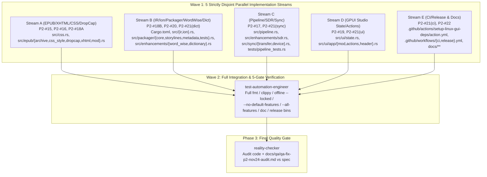

# Technical Specification: Remediation of All 8 `P2 Moderate` Audit Findings (#15–#22) (`kfx-converter`)

- **Document ID:** `docs/specs/spec-fix-p2-nov24-audit.md`
- **Target Crate / Workspace:** `kfx-converter` (`Cargo.toml` — Rust `edition = "2024"`, `[profile.release] panic = "abort"`, binaries `kfx-conv` [`cli`] and `kfx-studio` [`gui`])
- **Baseline Commit:** `d97a01d` (`main`, post-P0 `98fcdcd` and post-P1 `d97a01d` remediation)
- **Source Audit:** [`docs/multi_model_review_report.md`](../multi_model_review_report.md) (`P2 Moderate` items `#15`–`#22`, dated 2026-11-24)
- **Related Specifications:** [`docs/specs/spec-fix-p1-nov24-audit.md`](spec-fix-p1-nov24-audit.md), [`docs/specs/spec-epub-kfx-links-stage3.md`](spec-epub-kfx-links-stage3.md)
- **Status:** Phase 1 Specification (Pending Approval)

---

## 1. Executive Summary & Cross-Cutting Invariants

Following remediation of all `P0 Critical` (`#1`–`#2`, `98fcdcd`) and `P1 Major` (`#3`–`#14`, `d97a01d`) audit items, this specification defines a clean, minimal, reversible, and **strictly conflict-free parallelizable** remediation plan for all **8 `P2 Moderate` audit findings (`#15`–`#22`)**:

| ID | Summary | Primary Files |
| :--- | :--- | :--- |
| **P2-#15** | XHTML parser edge cases (`block_anchor_marks` stack, `` in headings/figures, nested `<table>` & `<td id>` containment, EOF table flush) | `src/epub/xhtml.rs` |
| **P2-#16** | Zero-compressed-size ZIP ratio bypass, bounded XHTML tag stacks, indexed/layered CSS cascade, quote-aware/linear CSS sanitizer, `<link rel="stylesheet">` scoping | `src/epub/archive.rs`, `src/epub/mod.rs`, `src/epub/xhtml.rs`, `src/css.rs`, `src/epub/css_style.rs` |
| **P2-#17** | Skip English Word Wise scan on non-English books, case-insensitive `.kll` target dedup on FAT32/MTP/Windows/macOS, eliminate double `.sdr` deploy & self-copy | `src/pipeline.rs`, `src/enhancements/sdr.rs`, `src/sync/transfer.rs`, `tests/pipeline_tests.rs` |
| **P2-#18** | Trim leading whitespace on automatic drop caps; clamp resolved `$271 image` `yellowjacket_pid_len(true)` to `1` (eliminating duplicate `$550` entries) | `src/epub/dropcap.rs`, `src/epub/mod.rs`, `src/ir.rs`, `src/enhancements/word_wise.rs`, `src/packager/tests.rs` |
| **P2-#19** | GPUI concurrency & state races (`collect_device_kfx_stems` lock/depth/sanitization, cancel preserving `Ok(r)`, rescan guard, drop auto-detect file refresh, tab refresh cooldown) | `src/ui/state.rs`, `src/ui/app/mod.rs`, `src/ui/app/actions.rs`, `src/ui/app/header.rs` |
| **P2-#20** | Lossless `SpanStyles` / `BlockStyle` explicit reset roundtrips; zero-temp-`Vec` `IonWriter`; `has_native_tables` flag skipping `$259` re-decode; in-memory `rusqlite::Connection::serialize` | `src/ir.rs`, `src/ion.rs`, `src/packager/{core,storylines,metadata}.rs`, `Cargo.toml`, `src/enhancements/word_wise.rs` |
| **P2-#21** | Replace silent no-op / live-umount tests; add `WWK1` binary parser negative tests & GPUI controller unit tests; SHA-pin CI/release Actions, composite Linux deps action, `--locked`, GUI release build, coverage gate, `cargo audit` | `src/sync/{device,transfer}.rs`, `src/ui/{state,app/actions}.rs`, `src/enhancements/dictionary.rs`, `.github/actions/setup-linux-gui-deps/action.yml`, `.github/workflows/{ci,release}.yml` |
| **P2-#22** | Align `spec-epub-kfx-links.md`, `spec-epub-kfx-links-stage3.md`, `docs/README.md`, `FORMAT_SPEC.md`, `WORD_WISE.md`, and `qa-epub-kfx-links.md` with `HEAD` | `docs/*.md`, `docs/specs/*.md`, `docs/qa/qa-epub-kfx-links.md` |

### Non-Negotiable Cross-Cutting Invariants

1. **Preserve Acyclic Module Boundaries (`d97a01d`):** Zero new cross-layer cycles. `validator` never imports `packager`; `packager` never imports `epub`; `enhancements` imports only `ir` and `storage`; `sync` depends unidirectionally on `storage` and `enhancements`.
2. **Preserve Stage 3 Structural Compatibility:** Do **not** alter the fields of `TextSpan` (5 fields), `Block::Image` (5 fields), or `Block::Table` (2 fields). All P2-#15 XHTML fixes compose cleanly with future Stage 3A (`cell_spans`) and Stage 3B (`Block::Image.href`) extensions.
3. **Preserve Static Style SIDs (`852..=890`):** `KfxPackager::build_styles` remains untouched; all 39 static styles stay frozen at SIDs `852..=890` (`style_link == 890`).
4. **Zero New Crate Dependencies (`Cargo.lock` Untouched):** Enabling `rusqlite` feature `"serialize"` activates only `modern_sqlite` (already activated by `"bundled"` in `rusqlite 0.33.0`). Zero crates are added or updated; `Cargo.lock` remains byte-identical and `cargo check --offline --locked` succeeds.
5. **Preserve USB Gadget No-Fsync Guardrail:** `test_no_direct_file_sync_in_sync_engine` (`src/sync/transfer.rs:535-575`) MUST continue to pass unmodified. No `.sync_data()` or `.sync_all()` calls may be added to `transfer.rs` or `storage.rs`.
6. **Preserve Existing Public API Signatures:** All public function signatures (`parse_xhtml_*`, `IonWriter::*`, `CssStylesheet::*`, `SdrDeployer::*`, `ConversionPipeline::*`, `SpanStyles.format.bold: bool`, `BlockStyle.alignment: TextAlignment`) remain backward-compatible.
7. **Deterministic, Sleep-Free Tests:** All newly added and refactored tests use isolated `tempfile::tempdir()`, in-memory buffers, or explicit dependency/argument builders. Zero `std::env::set_var` races and zero hard `thread::sleep` synchronization delays.

---

## 2. Detailed Technical Design (P2-#15 through P2-#22)

### 2.1 P2-#15 — XHTML Parser Edge Cases (`src/epub/xhtml.rs`)

#### 2.1.1 Typed Block Anchor Mark Stack (`AnchorScope`)
- **Problem:** `block_anchor_mark: Option<usize>` (`src/epub/xhtml.rs:631`) is a single scalar. Nested blocks such as `<li id="fn1"><p></p></li>` overwrite the `<li>` mark when `<p>` opens and clear it to `None` when `</p>` closes, leaking `"fn1"` past `</li>` onto the next sibling block or list item.
- **Design:**
  - Define a private enum inside `src/epub/xhtml.rs`:
    ```rust
    #[derive(Debug, Clone, Copy, PartialEq, Eq)]
    enum AnchorScope {
        Paragraph,
        Heading,
        ListItem,
    }
    ```
  - Replace `let mut block_anchor_mark: Option<usize> = None;` with:
    ```rust
    let mut block_anchor_marks: Vec<(AnchorScope, usize)> = Vec::new();
    ```
  - **Push rules:**
    - `Event::Start(b"p")` (when `!in_cell`): push `(AnchorScope::Paragraph, pending_anchors.len())` (bounded by `MAX_TAG_STACK_DEPTH`).
    - `Event::Start(b"h1"..=b"h6")` (when `!in_cell`): push `(AnchorScope::Heading, pending_anchors.len())`.
    - `Event::Start(b"li")` (when `!in_cell`): push `(AnchorScope::ListItem, pending_anchors.len())`.
    - Implicit paragraphs (`Event::Text` / `Event::CData` setting `in_p = true` outside `<p>`): do **not** push onto `block_anchor_marks`, preventing premature pop of an enclosing `<li>` mark.
  - **Pop & Drain (`drain_block_anchors_for_scope`):**
    ```rust
    let drain_block_anchors_for_scope =
        |spans: &mut Vec<TextSpan>,
         pending_anchors: &mut VecDeque<String>,
         marks: &mut Vec<(AnchorScope, usize)>,
         expected: AnchorScope| {
            let mark_opt = if marks.last().is_some_and(|(scope, _)| *scope == expected) {
                marks.pop().map(|(_, m)| m)
            } else {
                None
            };
            if let Some(mark) = mark_opt
                && pending_anchors.len() > mark
            {
                let mut rest = pending_anchors.split_off(mark);
                while let Some(pa) = rest.pop_front() {
                    spans.push(TextSpan {
                        text: String::new(),
                        style: None,
                        anchor_id: Some(pa),
                        href: None,
                        ruby: None,
                    });
                }
            }
        };
    ```
  - **Call sites:**
    - `flush_open_paragraph`: drains `AnchorScope::Paragraph`.
    - `flush_open_heading`: drains `AnchorScope::Heading`.
    - `Event::End(b"li")`: first calls `flush_open_paragraph` and `flush_open_heading` (flushing any unclosed `<p>`/`<h*>` inside `<li>` and popping their inner `Paragraph`/`Heading` marks cleanly), then flushes inline spans and drains `AnchorScope::ListItem`.
  - **Trace verification (`<li id="fn1"><p></p></li><li>Next</li>`):**
    1. `<li>` pushes `(ListItem, 0)`, then pushes `"fn1"` (`pending_anchors = ["fn1"]`).
    2. `<p>` pushes `(Paragraph, 1)`.
    3. `</p>` pops `(Paragraph, 1)`; `pending_anchors.len() == 1` is not `> 1`, so `"fn1"` stays pending for `<li>`.
    4. `</li>` pops `(ListItem, 0)`; `pending_anchors.len() == 1 > 0`, draining `"fn1"` as an empty anchor span inside `li_1`'s `current_list_item_blocks`. `"fn1"` never leaks onto `<li>Next</li>`.

#### 2.1.2 `` / `<image>` Splitting Headings, `` & `<figure id>` Anchors
- **Problem:** At `src/epub/xhtml.rs:1045-1081`, encountering ``/`<image>` while `in_heading == true` flushes preceding heading spans as `Block::Paragraph` with `p_style` (dropping `heading_level` and `heading_style`). Additionally, `parse_image_block` (`L826-878`) ignores `` and does not consume `pending_anchors` from enclosing `<figure id="fig1"></figure>`, shifting `#fig1` onto the following paragraph.
- **Design (preserving `Block::Image`'s 5 fields cleanly for Stage 3B):**
  1. **In-cell guard:** When `table_in_cell` is `true` on `b"img" | b"image"`, do **not** emit a standalone `Block::Image` that breaks out of the table. Instead, extract `alt` (if non-empty, append to the active cell's `current_cell` with a separating space if needed) and capture `extract_id_attr(e)` into `pending_anchors` (contained by the table's `anchor_mark`).
  2. **Preceding inline flush (when `!table_in_cell`):**
     - If `in_heading`:
       - Call `flush_current_span(...)` (which consumes any `pending_anchors` belonging to the preceding heading text).
       - If `!current_spans.is_empty()`: emit `Block::Heading { id: format!("h_{}", blocks.len() + 1), level: heading_level, spans: std::mem::take(&mut current_spans), style: heading_style.clone() }` into `current_list_item_blocks` (if `in_li`) or `blocks`. Keep `in_heading = true` and `heading_style` intact so any trailing text after `` inside the same `<h1>......</h1>` also emits as `Block::Heading` with the same `heading_level` and `heading_style`!
     - Else if `in_p || in_li`:
       - Call `flush_current_span(...)`; if `!current_spans.is_empty()`, call `finish_paragraph_spans` and emit `Block::Paragraph` as before, clearing `p_has_dropcap` and `p_dropcap_l2`.
  3. **Exact `` and `<figure id>` / `pending_anchors` attachment rule:**
     - Update `parse_image_block` to accept an optional resolved `explicit_id: Option<String>` (or return `(Block, Option<String>)` / extract `img_own_id = extract_id_attr(e)`):
       - Let `img_own_id = extract_id_attr(e);`.
       - When `parse_image_block` succeeds (non-empty `src`):
         - Choose `Block::Image.id`:
           1. If `img_own_id.is_some()` -> use `img_own_id`.
           2. Else if `!pending_anchors.is_empty()` -> `pending_anchors.pop_back()` (e.g., `<figure id="fig1"></figure>` binds `"fig1"` directly to `Block::Image.id` with zero extra blocks, and `storylines.rs:792-800` registers `Block::Image.id` at `(img_eid, img_start_pid, 0)`!).
           3. Else -> `format!("img_{}", blocks.len() + 1)`.
         - If `pending_anchors` is **still** non-empty after selecting `Block::Image.id` (e.g. `<figure id="fig1"></figure>` or `<section id="s1"><figure id="fig1"></figure></section>`):
           - Drain all remaining `pending_anchors` into a single preceding anchor-marker `Block::Paragraph` (empty-text spans with `anchor_id: Some(pa)`) pushed right before `img_block` (into `current_list_item_blocks` if `in_li`, else `blocks`). This guarantees every anchor (`#s1`, `#fig1`, `#photo1`) resolves at the image's position and never leaks onto post-figure paragraphs.
       - When `parse_image_block` returns `None` (e.g. missing/empty `src` on ``): push `img_own_id` into `pending_anchors`.

#### 2.1.3 Depth-Bounded Nested `<table>` Stack, List Routing, Anchor Containment & EOF Flush
- **Problem:** At `src/epub/xhtml.rs:1716-1740, 2104-2121`, `<table>` fails to flush `in_heading` or inline `in_li` spans, wipes outer `table_rows` on nested `<table>`, pushes `Block::Table` directly to top-level `blocks` even when `in_li == true`, leaks `<td id>`/`<th id>` anchors out of the table onto post-table paragraphs, and silently drops unclosed tables at EOF.
- **Design (keeping 2-field `Block::Table { id, rows }` compatible with Stage 3A):**
  - Add `pub const MAX_TABLE_DEPTH: usize = 32;` and private frame struct:
    ```rust
    struct TableFrame {
        id: Option<String>,
        anchor_mark: usize,
        rows: Vec<Vec<String>>,
        current_row: Vec<String>,
        current_cell: String,
        in_cell: bool,
    }
    ```
  - Replace flat `table_rows`, `current_row`, `current_cell`, `in_cell` with:
    ```rust
    let mut table_stack: Vec<TableFrame> = Vec::new();
    let mut table_overflow_depth: usize = 0;
    ```
    Helper predicate: `let in_table_cell = |stack: &[TableFrame]| stack.last().is_some_and(|f| f.in_cell);`
  - Add `b"table"` and `b"tr"` to `is_anchor_target_tag` (`src/epub/xhtml.rs:50-74`).
  - **Table lifecycle handlers:**
    1. **`Event::Start(b"table")`:**
       - If `table_stack.is_empty()`:
         - Flush `flush_open_paragraph` and `flush_open_heading`.
         - If `in_li`: call `flush_current_span(...)`; if `current_spans` has any non-whitespace text or anchor, push `Block::Paragraph` (`id: format!("li_{}", blocks.len() + 1)`) into `current_list_item_blocks`, else clear `current_spans` (matching `b"ul" | b"ol"` at `xhtml.rs:1772-1788`).
       - If `table_stack.len() >= MAX_TABLE_DEPTH`: increment `table_overflow_depth += 1;`
       - Else: push `TableFrame { id: element_anchor_id, anchor_mark: pending_anchors.len(), rows: Vec::new(), current_row: Vec::new(), current_cell: String::new(), in_cell: false }`.
    2. **`Event::Start(b"tr")`:** when `table_overflow_depth == 0` and `let Some(top) = table_stack.last_mut()`:
       - If `top.in_cell`: finalize open cell (`top.current_row.push(top.current_cell.trim().to_string()); top.current_cell.clear(); top.in_cell = false;`).
       - If `!top.current_row.is_empty()`: `top.rows.push(std::mem::take(&mut top.current_row));`.
       - Push `element_anchor_id` into `pending_anchors` (contained inside `top.anchor_mark`).
    3. **`Event::Start(b"th" | b"td")`:** when `table_overflow_depth == 0` and `let Some(top) = table_stack.last_mut()`:
       - If `top.in_cell`: finalize open cell into `top.current_row`.
       - Push `element_anchor_id` into `pending_anchors` (contained inside `top.anchor_mark`).
       - `top.in_cell = true; top.current_cell.clear();`
    4. **`Event::Empty(b"td" | b"th")`:** when `table_overflow_depth == 0` and `let Some(top) = table_stack.last_mut()`:
       - If `top.in_cell`: finalize open cell first.
       - Push `String::new()` into `top.current_row` (keeping cell column alignment intact, without leaking `extract_id_attr(e)` past `anchor_mark`).
    5. **Block tags inside `<td>`/`<th>` (`in_table_cell(&table_stack) == true`):**
       - When `in_table_cell(&table_stack)` is `true`, `<p>`, `<h1>..<h6>`, `<div>`, `<section>`, `<article>`, `<main>`, `<aside>`, `<figure>`, `<figcaption>`, `<blockquote>`, `<center>`, `<ul>`, `<ol>`, `<li>`, `<hr>` MUST NOT mutate `in_p`, `in_heading`, `blockquote_stack`, `center_stack`, `list_stack`, `in_li`, `block_anchor_marks`, or push external blocks.
       - On `Event::Empty(b"br")` while `in_table_cell`: append `'\n'` to `top.current_cell` (instead of `current_span_text`).
       - On `Event::End(b"p" | b"div" | b"li" | b"h1"..=b"h6")` while `in_table_cell`: if `!top.current_cell.is_empty() && !top.current_cell.ends_with(char::is_whitespace)`, push `' '` so `<td><p>A</p><p>B</p></td>` renders cleanly as `"A B"`.
    6. **`Event::End(b"th" | b"td")`:** when `table_overflow_depth == 0` and `let Some(top) = table_stack.last_mut()` and `top.in_cell`:
       - `top.in_cell = false; top.current_row.push(top.current_cell.trim().to_string()); top.current_cell.clear();`
    7. **`Event::End(b"tr")`:** when `table_overflow_depth == 0` and `let Some(top) = table_stack.last_mut()`:
       - Close open cell if `top.in_cell`; if `!top.current_row.is_empty()`, push `top.current_row` into `top.rows`.
    8. **`finalize_table_frame` & `Event::End(b"table")`:**
       - If `table_overflow_depth > 0`: decrement `table_overflow_depth -= 1;`.
       - Else if `let Some(mut frame) = table_stack.pop()`:
         - Close unclosed `frame.in_cell` and flush non-empty `frame.current_row` into `frame.rows`.
         - **Anchor containment:** `pending_anchors.truncate(frame.anchor_mark.min(pending_anchors.len()));` — guarantees `<td id>`, `<th id>`, `<tr id>`, and inner element IDs NEVER leak onto post-table paragraphs! (While `frame.id` from `<table id="...">` is preserved directly on `Block::Table.id`!)
         - If `let Some(parent) = table_stack.last_mut()` (nested table closing inside outer table):
           - If `parent.in_cell`: flatten `frame.rows` into text (non-empty cells joined by `" "`, rows joined by `"\n"`) and append to `parent.current_cell` (with a separating space if `parent.current_cell` is non-empty and does not end with whitespace). Outer `parent.rows`, `parent.current_row`, and `parent.current_cell` remain completely intact!
           - Else: `parent.rows.extend(frame.rows);`.
         - Else if `!frame.rows.is_empty()` (top-level table closing):
           - Build `let tbl = Block::Table { id: frame.id.unwrap_or_else(|| format!("table_{}", blocks.len() + 1)), rows: frame.rows };`.
           - Route `if in_li { current_list_item_blocks.push(tbl); } else { blocks.push(tbl); }`!
    9. **EOF Finalization (`Ok(Event::Eof) | Err(_)`):**
       - Immediately **before** `pending_anchors` drain (`L2214`) and `list_stack` unwind (`L2236`), reset `table_overflow_depth = 0;` and loop `while !table_stack.is_empty() { finalize_table_frame(...); }`. Unclosed tables at EOF are cleanly flushed (and routed into `current_list_item_blocks` if `in_li`, or `blocks` otherwise) with all `<td id>` anchors contained.
  - Also deduplicate the identical `Event::Text` and `Event::CData` text-handling bodies (`src/epub/xhtml.rs:1835-1911`) into a single `handle_text_chunk` closure/block while routing `in_table_cell(&table_stack)` directly to `table_stack.last_mut().unwrap().current_cell`.

---

### 2.2 P2-#16 — ZIP 0-Byte Ratio Bypass, Bounded XHTML Tag Stacks & Indexed/Layered CSS Cascade

#### 2.2.1 Close Zero-Compressed-Size ZIP Ratio Bypass (`src/epub/archive.rs`, `src/epub/mod.rs`)
- In `src/epub/archive.rs`:
  - Add `pub const MAX_ZERO_COMPRESSED_ENTRY_BYTES: u64 = 1024 * 1024; // 1 MiB`.
  - In `read_entry_bytes` (`L80-88`):
    ```rust
    if entry_read > MAX_ZERO_COMPRESSED_ENTRY_BYTES {
        if compressed == 0 {
            return Err(EpubError::Security(format!(
                "Member '{}' exceeds {} byte limit with zero compressed size",
                entry_name, MAX_ZERO_COMPRESSED_ENTRY_BYTES
            )));
        }
        let ratio = (entry_read as f64) / (compressed as f64);
        if ratio > MAX_COMPRESSION_RATIO {
            return Err(EpubError::Security(format!(
                "Member '{}' actual compression ratio {:.1}:1 exceeds limit",
                entry_name, ratio
            )));
        }
    }
    ```
- In `src/epub/mod.rs` (`read_from_archive_with_budget` pre-scan, `L462-471`):
  - Apply the symmetric guard on header-declared `(size, compressed)`:
    ```rust
    if size > archive::MAX_ZERO_COMPRESSED_ENTRY_BYTES {
        if compressed == 0 {
            return Err(EpubError::Security(format!(
                "Member '{}' declares {} bytes with zero compressed size",
                entry.name(),
                size
            )));
        }
        let ratio = (size as f64) / (compressed as f64);
        if ratio > MAX_COMPRESSION_RATIO {
            return Err(EpubError::Security(format!(
                "Member '{}' has compression ratio {:.1}:1 exceeding limit",
                entry.name(),
                ratio
            )));
        }
    }
    ```
- Entries `<= 1 MiB` (including empty directories or tiny synthetic fixtures with `compressed == 0`) remain unaffected; any entry `> 1 MiB` with `compressed == 0` is rejected in both pre-scan and streaming read.

#### 2.2.2 Bounded XHTML Tag Stacks (`src/epub/xhtml.rs`)
- Define `pub const MAX_TAG_STACK_DEPTH: usize = 256;`.
- Add a private helper `BoundedTagStack<T>` enforcing `items.len() <= MAX_TAG_STACK_DEPTH`:
  ```rust
  struct BoundedTagStack<T> {
      items: Vec<T>,
      overflow_depth: usize,
  }
  ```
  - `is_empty(&self) -> bool { self.items.is_empty() }`
  - `push(&mut self, item: T)`: if `self.items.len() < MAX_TAG_STACK_DEPTH && self.overflow_depth == 0`, push `item`; else `self.overflow_depth += 1;`.
  - `pop_matching(&mut self, pred: impl Fn(&T) -> bool) -> bool`:
    - If `self.overflow_depth > 0`:
      - If `self.items.first().is_some_and(&pred)` (outermost sentinel tag closed despite unclosed deep children, e.g., `<head><div>*300</head>` or `<aside epub:type="footnote"><div>*300</aside>`): `self.items.clear(); self.overflow_depth = 0; return true;`.
      - Else: `self.overflow_depth -= 1; return false;`.
    - Else: find `self.items.iter().rposition(&pred)`; if `Some(pos)`, `self.items.truncate(pos); true` else `false`.
  - `clear(&mut self)`: clears `items` and sets `overflow_depth = 0`.
  - `as_slice(&self) -> &[T]`: `&self.items`.
- Apply `BoundedTagStack` to 6 of the 7 unbounded stacks:
  1. `ignore_stack: BoundedTagStack<Vec<u8>>`
  2. `footnote_stack: BoundedTagStack<Vec<u8>>`
  3. `footnote_wrapper_stack: BoundedTagStack<Vec<u8>>`
  4. `backlink_stack: BoundedTagStack<Vec<u8>>`
  5. `blockquote_stack: BoundedTagStack<(Vec<u8>, Vec<String>)>`
  6. `center_stack: BoundedTagStack<Vec<u8>>`
- Bound the 7th stack, `style_stack: Vec<StyleFrameKind>`, with an explicit `style_overflow_depth: usize`:
  - Helper `push_style_frame`: if `style_stack.len() < MAX_TAG_STACK_DEPTH && style_overflow_depth == 0`, push; else `style_overflow_depth += 1;`.
  - On inline `Event::End(b"b" | ... | b"span" | b"a")`: if `style_overflow_depth > 0`, decrement `style_overflow_depth -= 1` without scanning/truncating; otherwise perform existing `match_pos` lookup/flush/truncate.
  - Inside `pop_block_boundary`: whenever a `StyleFrameKind::BlockBoundary` is matched and truncated (e.g. `</p>`, `</div>`, `</h1..6>`, `</li>`), reset `style_overflow_depth = 0;` so unclosed deeply nested inline tags inside one block can never permanently stick overflow state across subsequent blocks.
  - Result: `resolve_active_span_attrs(&style_stack)` is strictly bounded to $\le 256$ frames ($O(1)$ per flush even on 20 MiB adversarial nesting).

#### 2.2.3 Indexed, Memory-Bounded, Layered CSS Engine & Sanitizer (`src/css.rs`, `src/epub/css_style.rs`, `src/epub/xhtml.rs`, `src/epub/mod.rs`)
1. **Single-Pass Comment Stripping (`src/css.rs`):**
   - In `CssStylesheet::add_css(&mut self, css: &str)`:
     - Run `let css = css.trim_start_matches('\u{FEFF}'); let cleaned = strip_comments(css);` **once** at entry.
     - Delegate to `self.add_cleaned_css_with_depth(&cleaned, 0);` so nested `@media` and `@supports` blocks recurse directly on `&cleaned[body_start..body_end]` without re-scanning comments up to 32 levels deep.
2. **Shared `Arc` Declarations & Total Declaration Budget (`src/css.rs`):**
   - Add `pub const MAX_CSS_TOTAL_DECLARATIONS: usize = 200_000;`.
   - Change `CssRule.decls` from `Vec<(Cow<'static, str>, String)>` to `std::sync::Arc<[(Cow<'static, str>, String)]>`.
   - Track `total_parsed_decls: usize` on `CssStylesheet`.
   - When parsing a rule block `{ body }`:
     - Compute `let remaining = MAX_CSS_TOTAL_DECLARATIONS.saturating_sub(self.total_parsed_decls);`.
     - If `remaining == 0`, `break` out of the rule loop.
     - Parse at most `MAX_DECLARATIONS_PER_RULE.min(remaining)` declarations, wrap once in `let decls: Arc<[(Cow<'static, str>, String)]> = Arc::from(parsed);`, increment `self.total_parsed_decls += decls.len();` once per rule block, and `Arc::clone(&decls)` for each comma-separated selector.
   - **Invariant & Test Compatibility:** `test_css_comma_selector_bomb_respects_max_rules` (`src/css.rs:1019-1052`) continues passing **unmodified** (`sheet.rules.len() == MAX_CSS_RULES` and every `r.decls.len() == MAX_DECLARATIONS_PER_RULE`) while consuming $O(256)$ declaration memory instead of $12.8\text{M}$ pairs, AND separate-rule bombs (50,000 distinct blocks × 256 decls) are hard-capped at `200,000` total parsed declarations.
3. **Secondary Tag / Class / Universal Bucket Index (`src/css.rs`):**
   - Add three private index fields to `CssStylesheet`:
     ```rust
     by_class: HashMap<String, Vec<usize>>,
     by_tag: HashMap<String, Vec<usize>>,
     universal: Vec<usize>,
     ```
   - On inserting rule at index `idx = self.rules.len()`:
     - If `!classes.is_empty()`: `self.by_class.entry(classes[0].clone()).or_default().push(idx);` (since ALL classes in `rule.classes` must be present on a matching element, indexing by `classes[0]` is a lossless superset filter!).
     - Else if `let Some(ref tag_name) = tag`: `self.by_tag.entry(tag_name.clone()).or_default().push(idx);`.
     - Else (`*`): `self.universal.push(idx);`.
   - Private helper `collect_matching_rules<'a>(&'a self, tag: &str, class_slice: &[&str], first_letter: bool, tier: u8, out: &mut Vec<((usize, usize), u8, usize, &'a CssRule)>)`:
     - Fast-path return if `self.rules.is_empty() || (first_letter && !self.has_first_letter)`.
     - Candidate buckets: `self.universal`, `self.by_tag.get(tag_lc)` (avoiding allocation when `tag` has no ASCII uppercase bytes via `Cow::Borrowed`), and `self.by_class.get(cls_lc)` for each class in `class_slice` (skipping duplicate lowercased class tokens on the element).
     - Test each candidate rule with the exact existing predicate (`r.is_first_letter == first_letter`, tag match, all `r.classes` present) and push `(r.specificity(), tier, r.order, r)`.
     - Complexity drops from $O(50{,}000)$ per cache miss to $O(\text{matching bucket size})$.
4. **Zero-Clone Layered Stylesheet Cascade (`CssCascade<'a>` in `src/css.rs`):**
   - Add:
     ```rust
     pub struct CssCascade<'a> {
         base: &'a CssStylesheet,
         overlay: Option<&'a CssStylesheet>,
     }
     ```
     with `new(base: &'a CssStylesheet, overlay: Option<&'a CssStylesheet>)`, `declarations_for(&self, tag, class_attr) -> String`, and `first_letter_declarations_for(&self, tag, class_attr) -> String`.
   - `resolve_layered` calls `base.collect_matching_rules(..., tier = 0, &mut matched)` and (if `Some(ov)`) `ov.collect_matching_rules(..., tier = 1, &mut matched)`, sorts `matched` by `(specificity, tier, order)`, deduplicates by `(tier, order)`, and formats `p:v;` identically to `CssStylesheet::resolve_declarations`.
   - **Zero `book_css.clone()`** in `src/epub/xhtml.rs:548-556`! When a chapter has inline `<style>`, parse only the small `inline_css` into `inline_sheet` and wrap `CssCascade::new(book_css, Some(&inline_sheet))`.
5. **Reuse `ElementStyleCache` & Cache Sheet Declarations Before Inline `style="..."` (`src/css.rs`, `src/epub/xhtml.rs`):**
   - Add `decl_cache: RefCell<HashMap<OwnedStyleKey, String>>` to `ElementStyleCache` with:
     ```rust
     pub fn get_or_resolve_declarations<F>(&self, tag: &str, class_attr: Option<&str>, resolve: F) -> String
     where
         F: FnOnce(&str, Option<&str>) -> String,
     ```
     (also cleared in `ElementStyleCache::clear()`).
   - In `src/epub/xhtml.rs:571-578`, when an element has `style="..."`:
     - Fetch `decls` through `style_cache.get_or_resolve_declarations(&tag_str, class_attr.as_deref(), |t, c| css.declarations_for(t, c))` instead of calling `css.declarations_for(...)` uncached on every element!
   - Add `pub(crate) fn parse_xhtml_with_css_context_and_cache(..., shared_cache: Option<&ElementStyleCache>)` so `EpubReader::read_from_archive_with_budget` reuses a shared `ElementStyleCache` across all chapters that share the same stylesheet and have no inline `<style>`, while keeping `parse_xhtml_with_css_and_context` public signature unchanged.
6. **Quote-Aware Sanitizer, `! important` Stripping & $O(N)$ Property Merge (`src/css.rs`, `src/epub/css_style.rs`):**
   - Expose `pub(crate) fn split_declarations_quote_aware(body: &str) -> Vec<&str>` in `src/css.rs`.
   - Add `pub(crate) fn strip_css_important(val: &str) -> &str` in `src/css.rs`:
     ```rust
     pub(crate) fn strip_css_important(val: &str) -> &str {
         let trimmed = val.trim();
         let bytes = trimmed.as_bytes();
         if bytes.len() >= 9 && bytes[bytes.len() - 9..].eq_ignore_ascii_case(b"important") {
             let before_imp = trimmed[..bytes.len() - 9].trim_end();
             if let Some(before_bang) = before_imp.strip_suffix('!') {
                 return before_bang.trim();
             }
         }
         trimmed
     }
     ```
   - Use `strip_css_important` in **both** `src/css.rs:parse_declarations` (`L717`) and `src/epub/css_style.rs:sanitize_css_style` (`L26-30`).
   - In `src/epub/css_style.rs:sanitize_css_style`:
     - Replace `style_str.split(';')` (`L14`) with `crate::css::split_declarations_quote_aware(style_str)`.
     - Replace $O(N^2)$ `merged.iter_mut().find(|(k, _)| *k == p)` (`L31-35`) with `prop_indices: HashMap<Cow<'static, str>, usize>` mapping property -> index in `merged: Vec<(Cow<'static, str>, String)>` (preserving exact first-seen order and last-wins overwrite in $O(N)$ time).
7. **Skip HTML `<!-- ... -->` Comments in `extract_inline_style_blocks` (`src/css.rs:778-806`):**
   - Scan byte-by-byte for `'<'`:
     - If `bytes[idx..].starts_with(b"<!--")`: skip past `"-->"` (or `bytes.len()` if unclosed) and continue without allocating.
     - Else if `bytes[idx..]` matches ASCII case-insensitive `<style` with valid tag boundary (`>`, whitespace, or `/`): extract body until `</style` (skipping self-closing `<style/>`).
     - Else advance `pos = idx + 1`.
   - Preserves `empty.capacity() == 0` when no active `<style>` tags exist (tested at `src/css.rs:1131-1139`).
8. **Per-Chapter `<link rel="stylesheet">` Scoping with Manifest Fallback (`src/css.rs`, `src/epub/mod.rs`):**
   - Add `pub fn extract_linked_stylesheets(xhtml: &str) -> Vec<String>` in `src/css.rs` using `quick_xml::Reader::from_str(xhtml)` (automatically skipping HTML `<!-- ... -->` comments and unescaping XML attributes), stopping immediately at `Event::Start(b"body")` or `Event::End(b"head")`, collecting `href` on `<link>` elements whose `rel` attribute contains the ASCII case-insensitive whitespace-delimited token `"stylesheet"`.
   - In `src/epub/mod.rs` (Steps 3b & 5b):
     - Load each manifest CSS entry once into `css_raw_by_path: HashMap<String, String>` (keyed by resolved `full_path` and `full_path.to_lowercase()`) and compile `fallback_book_css: CssStylesheet` + `fallback_cache: ElementStyleCache` in deterministic `manifest_items` order.
     - Maintain a chapter stylesheet cache `linked_css_cache: HashMap<Vec<String>, (CssStylesheet, ElementStyleCache)>` keyed by the ordered resolved CSS paths for a chapter.
     - For each spine chapter:
       - Extract `linked = crate::css::extract_linked_stylesheets(&xhtml)`.
       - Resolve each `href` relative to `chapter_dir` via `resolve_zip_path(&chapter_dir, &decode_percent(&href))` (with exact and lowercase lookup into `css_raw_by_path`, preserving `<link>` order and deduplicating repeated identical paths).
       - If at least one linked stylesheet resolves in `css_raw_by_path`: look up or compile `(sheet, cache)` in `linked_css_cache` and pass `(&sheet, Some(&cache))` to `parse_xhtml_with_css_context_and_cache`.
       - Otherwise (no `<link rel="stylesheet">` tags or none resolved): fall back to `(&fallback_book_css, Some(&fallback_cache))` — **100% preserving** `test_epub_and_kfx_packaging_deterministic_across_manifest_order` (`epub/mod.rs:2802`) and `test_epub_reader_tolerant_zip_lookup_and_root_relative_paths` (`epub/mod.rs:2610`).

---

### 2.3 P2-#17 — Non-English Word Wise, Case-Aliased `.kll` Writes & Double `.sdr` / Self-Copy

#### 2.3.1 Skip 52k English Dictionary Scan for Non-English Books (`src/pipeline.rs`, `tests/pipeline_tests.rs`)
- Add `pub(crate) fn is_english_language_tag(lang: &str) -> bool` in `src/pipeline.rs`:
  ```rust
  pub(crate) fn is_english_language_tag(lang: &str) -> bool {
      let trimmed = lang.trim();
      if trimmed.is_empty() {
          return true;
      }
      let primary = trimmed
          .split(['-', '_'])
          .next()
          .unwrap_or("")
          .to_ascii_lowercase();
      matches!(primary.as_str(), "en" | "eng")
  }
  ```
- In `ConversionPipeline::run_with_log_path` (`src/pipeline.rs:440-482`):
  - When `options.word_wise` is `true`:
    - If `!is_english_language_tag(&ir.metadata.language)`:
      - Skip instantiating `WordWiseBuilder` and scanning the 52k English dictionary completely.
      - Set `word_wise_glosses = Some(0);` (preserving `ConversionReport.word_wise_glosses == Some(0)` and `word_wise_error == None` at `tests/pipeline_tests.rs:219-224`).
      - Log: `"INFO Word Wise skipped for non-English book (asin={}, lang=\"{}\"); skipping .kll sidecar emission"`.
    - Else: run `WordWiseBuilder` as before (retaining the `"WARN Word Wise enabled but 0 glosses matched"` log when an English book matches 0 vocabulary words).
- **Test alignment (`tests/pipeline_tests.rs`):**
  - Update `test_pipeline_non_english_word_wise_produces_zero_glosses_without_kll` (`L247-251`) to assert `log_text.contains("INFO Word Wise skipped for non-English book")`.
  - Add a new test confirming an English book containing only simple stopwords (`"The cat sat on the mat."`) still scans the dictionary and logs `"WARN Word Wise enabled but 0 glosses matched"`.

#### 2.3.2 Case-Insensitive `.kll` Deduplication on Case-Insensitive / MTP Targets (`src/enhancements/sdr.rs`)
- **Problem:** `SdrSidecarFiles.seen_paths` (`src/enhancements/sdr.rs:22`) is case-sensitive. For `en-US`, `collect_language_tags` returns `["en", "EN", "en-US", "EN-US", "en-us"]` × 2 stems = **10 writes**, overwriting the exact same FAT32/VFAT/Windows/macOS file repeatedly and spawning 10 sequential `gio copy` subprocesses over Linux MTP.
- **Design:**
  - Change `SdrSidecarFiles` to store `seen_keys: HashSet<String>` and `case_insensitive: bool`:
    ```rust
    impl<'a> SdrSidecarFiles<'a> {
        fn new(case_insensitive: bool) -> Self { ... }
        fn push(&mut self, path: PathBuf, bytes: &'a [u8]) {
            let key = if self.case_insensitive {
                path.to_string_lossy().to_ascii_lowercase()
            } else {
                path.to_string_lossy().into_owned()
            };
            if self.seen_keys.insert(key) {
                self.targets.push(SdrSidecarTarget { path, bytes });
            }
        }
    }
    ```
  - Add `fn is_case_insensitive_target(dir: &Path) -> bool`:
    - Return `true` immediately when `cfg!(any(target_os = "windows", target_os = "macos")) || crate::storage::is_mtp_path(dir)`.
    - On `#[cfg(target_os = "linux")]`: walk `dir` up to its nearest existing ancestor and probe `libc::statfs`; return `true` when `stat.f_type` matches `MSDOS_SUPER_MAGIC (0x4d44)`, `EXFAT_SUPER_MAGIC (0x2011_bab0)`, `NTFS_SB_MAGIC (0x5346_544e)`, or `FUSE_SUPER_MAGIC (0x6573_5546)` (GVFS/FUSE MTP). Otherwise return `false` (case-sensitive Linux ext4/tmpfs).
  - Extract testable `fn plan_sidecar_targets<'a>(..., case_insensitive: bool) -> Vec<SdrSidecarTarget<'a>>` invoked by `deploy_inner`.
  - **Verification:**
    - On case-insensitive/MTP targets: `en-US` emits strictly 2 distinct tags (`en`, `en-US`) × 2 stems = 4 writes instead of 10; `en` emits 1 tag × 2 stems = 2 writes instead of 4.
    - On case-sensitive Linux local tmpfs/ext4: `test_sdr_deployer_unified` (`sdr.rs:218-292`) passes completely unmodified (both `en` and `EN-CA` remain distinct even under `case_insensitive = true`, and case-variant aliases on local Linux ext4 remain intact).

#### 2.3.3 Eliminate Double `.sdr` Deployment & Self-Copy (`src/pipeline.rs`, `src/sync/transfer.rs`)
- **In `src/sync/transfer.rs` (`sync_to_device`, `L77-176`):**
  - Add helper `fn is_same_file_path(a: &Path, b: &Path) -> bool` (placed above `fn copy_file(` so `test_no_direct_file_sync_in_sync_engine`'s scanned slices are completely unaffected):
    1. If `a == b`, return `true`.
    2. If `let (Ok(ca), Ok(cb)) = (std::fs::canonicalize(a), std::fs::canonicalize(b))` and `ca == cb`, return `true`.
    3. On `#[cfg(unix)]`: if `let (Ok(ma), Ok(mb)) = (std::fs::metadata(a), std::fs::metadata(b))`, compare `(ma.dev(), ma.ino()) == (mb.dev(), mb.ino())`.
  - **Subfolder in-place handling:** Before defaulting `dest_kfx_path = docs_dir.join(&kfx_filename)`, check whether `kfx_source` is already a `.kfx` file residing inside `docs_dir` (comparing canonicalized `kfx_source` against canonicalized `docs_dir`, ensuring no symlink ancestors under `device_root` via `reject_symlink_ancestors_under`).
    - If `kfx_source` is already inside `docs_dir` (e.g. `documents/Book.kfx` via relative path OR `documents/Author/Book.kfx`): keep `dest_kfx_path = canonical_src` (skipping redundant self-copy / duplicate root copy!) and set `sdr_dir = dest_kfx_path.with_extension("sdr")` (deploying `.sdr` right beside the in-place `.kfx` inside `documents/Author/`).
    - Otherwise: use `dest_kfx_path = docs_dir.join(&kfx_filename)` and `sdr_dir = docs_dir.join(format!("{}.sdr", safe_title))`, and only call `copy_file_unlocked(kfx_source, &dest_kfx_path)` when `!is_same_file_path(kfx_source, &dest_kfx_path)`.
- **In `src/pipeline.rs` (`run_with_log_path`, `L484-577`):**
  - Resolve `target_root` **before** Step 4b (`SdrDeployer::deploy`).
  - Determine whether Step 5 (`KindleSync::sync_to_device`) will deploy to the exact same `.sdr` destination as Step 4b's `sdr_path = output_path.with_extension("sdr")`:
    - Helper `fn paths_match_target_dir(a: &Path, b: &Path) -> bool`: compares canonicalized parent directory + leaf file name (ASCII case-insensitive on Windows/macOS/MTP, exact on Unix).
    - Compute Step 5's expected `device_sdr` using the exact same rule as `sync_to_device` (in-place `output_path.with_extension("sdr")` if `output_path` is already inside `device_root/documents`, else `device_root/documents/{safe_title}.sdr`).
  - When `target_root.is_some()` and `paths_match_target_dir(&sdr_path, &device_sdr)`: **skip Step 4b**, letting Step 5 (`KindleSync::sync_to_device`) perform the single `.sdr` deployment under `DEVICE_SYNC_LOCK` (along with thumbnail sync and stale `.sdr` cleanup).

---

### 2.4 P2-#18 — Automatic Drop-Cap Leading Whitespace & Long Image `alt` Duplicate `$550` Locations

#### 2.4.1 Trim Leading Collapsible Whitespace on Drop-Cap Spans (`src/epub/dropcap.rs`, `src/epub/mod.rs`)
- **Trade-Off Analysis:**
  - *Option 1 (Selected — Trim leading collapsible whitespace):* In CSS `white-space: normal`, leading spaces/newlines inside `<p class="has-dropcap">\n  Once upon a time</p>` collapse before `::first-letter`. In Yellowjacket KFX, `$125 dropcap_lines` / `$126 dropcap_chars` MUST begin at **offset 0** of the paragraph to engage drop-cap floating. Omitting `leading_ws` keeps offset 0 cleanly on `first_ch` while preserving `spans[first_idx].anchor_id` at offset 0.
  - *Option 2 (Split `leading_ws` into a preceding unstyled `TextSpan`):* Places literal `"\n  "` at offset 0 in `$145` content and pushes the drop-cap style event to offset `> 0`, visually indenting or breaking Kindle drop-cap rendering. Rejected.
- **Changes:**
  - `src/epub/dropcap.rs` Case B (`L108-124`): drop `leading_ws` prefix — set `spans[first_idx].text = drop_chars;` directly (never `format!("{}{}", leading_ws, drop_chars)`).
  - `src/epub/dropcap.rs` Case A (`L21-49`): also trim leading whitespace on explicit `<span class="dropcap">  “</span>` (`let trimmed = spans[dc_idx].text.trim_start().to_string(); spans[dc_idx].text = trimmed;`) before checking/appending the borrowed second character so both explicit and automatic drop caps guarantee `offset 0` starts strictly on the drop-cap glyph.
  - `src/epub/mod.rs` (`test_epub_dropcap_cjk_and_multibyte_quotes_no_panic`, `L2576-2580`): update `assert_eq!(spans[0].text, "   “I");` -> `assert_eq!(spans[0].text, "“I");` (and add a newline-indented `<p class="has-dropcap">\n  Once upon a time</p>` case proving `spans[0].text == "O"` and `spans[1].text == "nce upon a time"`).

#### 2.4.2 Long Image `alt` Duplicate `$550` Locations — Trade-Off & Resolution (`src/ir.rs`, `src/packager/locators.rs`, `src/enhancements/word_wise.rs`, `src/packager/tests.rs`)
- **Critical Trade-Off Analysis:**

  | Criterion | Option A: Deduplicate `(p_eid, 0)` in `locators.rs` (keep `pid_len = alt.utf16_len.max(1)`) | **Option B (SELECTED): Clamp resolved `Block::Image` `yellowjacket_pid_len(true) = 1` in `src/ir.rs`** |
  | :--- | :--- | :--- |
  | **Amazon Kindle Hardware Fidelity** | **Inaccurate.** Real Yellowjacket `$271 image` elements occupy **1 PID** (`$584 alt_text` is metadata, never flow text). Multi-char `alt` (even `"Cover"` = 5) drifts Word Wise `.kll` PIDs on device. | **Exact match** to real Amazon KFXGen / Kindle Previewer `$271 image` PID semantics (`1` PID for resolved `$271`; UTF-16 text length for unresolved `$269` text fallback). |
  | **`$550` / `$621` Parallelism & Uniformity** | Dropping duplicate `(p_eid, 0)` entries either breaks `len($550) == len($621)` or creates >350-PID holes (e.g., `350 -> 1050`) in `$621`, AND still breaks `raw_pids == [0, 350, 700]` in `packager/tests.rs:2266`. | **Mathematically guarantees** `while next_loc_pid < running_pid + 1` fires at most once per resolved image (strictly zero duplicate `(p_eid, 0)` entries, strict 350-PID intervals, `len($550) == len($621)`). |
  | **Single Source of Truth** | Leaves PID inflation in `ir.rs` and patches symptom in `locators.rs`. | One-line change in `Block::yellowjacket_pid_len(true)` (`src/ir.rs:481-482`) automatically keeps `KfxPackager`, `$265`, `$550`, `$621`, and `WordWiseBuilder` 100% synchronized. |

- **Design (Option B Selected):**
  - In `src/ir.rs:478-489`:
    ```rust
    pub fn yellowjacket_pid_len(&self, has_resolved_resource: bool) -> usize {
        match self {
            Block::Image { alt, .. } => {
                if has_resolved_resource {
                    // Resolved `$271 image` elements occupy 1 PID in Yellowjacket (`$584 alt_text` is metadata).
                    1
                } else {
                    // Unresolved images emit a `$269 text` fallback whose PID length equals its UTF-16 text length.
                    str_utf16_len(Self::image_fallback_text(alt.as_deref())).max(1)
                }
            }
            _ => str_utf16_len(&self.plain_text()).max(1),
        }
    }
    ```
  - Retain the defense-in-depth `if is_image { 0 } else { raw_off }` clamp in `src/packager/locators.rs:141`.
  - **Exact updates to the 5 affected tests (all verified against current `HEAD d97a01d`):**
    1. `src/enhancements/word_wise.rs:739` (`test_word_wise_pid_matches_cover_section_offset`): cover section is `1 (root) + 1 (cover img) = 2` PIDs -> `"abstruse"` at PID `2 + 1 + 4 = 7` (updated from `11`).
    2. `src/enhancements/word_wise.rs:1018` (`test_word_wise_skips_image_alt_glosses_while_advancing_pid`): cover section is `2` PIDs; add a resolved image with a 400-char `alt` (1 PID) alongside the existing unresolved images (`34` and `7` PIDs) and verify exact 1:1 parity with `KfxPackager`'s `$265 position_id_map`.
    3. `src/enhancements/word_wise.rs:1159` (`test_word_wise_non_bmp_utf16_and_list_image_pid_parity`): cover = `2`, `sec1` root = `3`, `"abstruse"` = `3 + 7 = 10`, list image (`fig.jpg` resolved) = `1` PID (`34 -> 35`), `"elucidate"` = `35 + 3 = 38`, `sec1_len = 1 + 24 + 7 + 1 + 13 = 46` (exact parity with `$265`).
    4. `src/packager/tests.rs:2082` (`test_packager_nested_toc_anchors_and_continuous_350_pid_calibration`): set `p1` to `"X".repeat(349)` so `img_fig` (with 400-char `alt`, `1` PID) lands squarely at PID `350..351`, followed by `p1_after` (`"Y".repeat(360)`) spanning `351..711`. Preserves `raw_pids == vec![0, 350, 700]` AND asserts `img_fig` appears **exactly once** in `$550` with `offset == 0` (zero duplicates!).
    5. `src/packager/tests.rs:2290` (`test_packager_index_and_cover_landmarks_and_non_vacuous_image_pid_zero_offset`): set `p1` to `"Y".repeat(347)` (cover `2` + `chap1` root `1` + `347` = `350`) so `img_fig` (`alt: "Z".repeat(400)`) lands at PID `350..351`, asserting `saw_image_loc_entry == true`, `off == 0`, AND `image_loc_count == 1` (non-vacuously proving zero duplicate `(img_eid, 0)` entries).

---

### 2.5 P2-#19 — GPUI State & Concurrency Races (`src/ui/state.rs`, `src/ui/app/{mod,actions,header}.rs`)

1. **Locked, Recursive, Sanitized Device Stem Discovery (`src/ui/state.rs`):**
   - Rewrite `collect_device_kfx_stems(doc_dir: &Path)` (`L203-224`) to delegate to `kfx_converter::KindleSync::scan_device_files(doc_dir)`:
     - Automatically acquires `DEVICE_SYNC_LOCK`, rejects symlinks, skips `.` / `.sdr` dirs, and recurses into author subfolders up to depth 3.
     - Filters `f.format.eq_ignore_ascii_case("KFX")` and extracts lowercase `file_stem`.
   - In `scan_local_epub_directory_with_progress` (`L987-999`): compute `sanitized_stem_lower = kfx_converter::KindleSync::sanitize_filename(&raw_stem).to_lowercase()` alongside `raw_stem_lower` and `sanitized_title_lower` so EPUBs whose filenames are sanitized by `sync_to_device` (e.g. `:`, `?`, `..`, >128 bytes) are accurately recognized as `LocalEpubStatus::OnDevice`.

2. **Preserve Completed In-Flight `Ok(r)` on Batch Cancel (`src/ui/app/actions.rs`):**
   - Extract pure helper:
     ```rust
     pub(super) fn resolve_batch_worker_outcome(
         cancelled: bool,
         res: Result<ConversionResult, String>,
     ) -> ConversionOutcome {
         match res {
             Ok(r) => ConversionOutcome::Finished(r),
             Err(_) if cancelled => ConversionOutcome::Cancelled,
             Err(err) => ConversionOutcome::Failed(err),
         }
     }
     ```
   - Use `resolve_batch_worker_outcome(cancel_check.load(Ordering::SeqCst), res)` at `actions.rs:818-825`. Queued/unstarted jobs still abort cleanly before conversion starts (`actions.rs:753`), while any job that already wrote/synced `.kfx` retains its `Finished(r)` status, `files` entry, and `OnDevice` / `ConvertedLocal` badge.

3. **Guard `rescan_folder` Against Active Batch / Conversions (`src/ui/app/actions.rs`):**
   - Add pure helpers:
     ```rust
     pub(super) fn has_active_folder_conversions(&self) -> bool {
         self.folder_state.items.iter().any(|i| {
             matches!(
                 i.status,
                 LocalEpubStatus::InQueue | LocalEpubStatus::Processing { .. }
             )
         })
     }

     pub(super) fn can_start_folder_rescan(&self) -> Result<(), String> {
         if self.is_batch_active() || self.has_active_folder_conversions() {
             return Err("Cannot refresh folder while conversion is in progress.".into());
         }
         Ok(())
     }
     ```
   - Call `can_start_folder_rescan()` at the top of `rescan_folder` (setting `self.status_message = Some((msg, true)); cx.notify(); return;` on `Err`).
   - Also check `if this.is_batch_active() || this.has_active_folder_conversions()` right before assigning `this.folder_state.items = items` on scan completion (`actions.rs:481`) so an already-in-flight scan completing after a conversion starts cannot clobber `InQueue`/`Processing` items.

4. **Drop-Worker Newly Connected Device Refreshes `this.files` (`src/ui/app/actions.rs`):**
   - Extract pure helper:
     ```rust
     pub(super) fn should_apply_drop_detected_device(
         &self,
         detected: &DeviceStatus,
         refresh_gen: u64,
     ) -> bool {
         detected.connected
             && !self.eject_in_progress
             && self.device_refresh_generation == refresh_gen
             && !self.device.connected
     }
     ```
   - At `actions.rs:1122-1135`: when `should_apply_drop_detected_device(&dev, refresh_gen)` is `true`, set `this.device = dev;`, apply `apply_conversion_outcome(...)`, AND trigger `this.refresh_device_internal(false, cx)` so all pre-existing books on the newly connected Kindle populate `this.files` (preserving the conversion `status_message` because `clear_status == false`).

5. **Tab-Switch Refresh Coalescing & Cooldown (`src/ui/app/mod.rs`, `src/ui/app/actions.rs`, `src/ui/app/header.rs`):**
   - Add two fields to `KindleStudio` (`src/ui/app/mod.rs`):
     - `pub(super) device_refresh_in_flight: bool` (init `false`)
     - `pub(super) last_device_refresh_at: Option<std::time::Instant>` (init `None`)
   - Define `const TAB_REFRESH_COOLDOWN: Duration = Duration::from_secs(3);` in `src/ui/app/actions.rs`.
   - Extract pure helper:
     ```rust
     pub(super) fn decide_tab_switch_refresh(
         &mut self,
         target_tab: StudioTab,
         now: std::time::Instant,
     ) -> bool {
         if self.tab == target_tab {
             return false;
         }
         self.tab = target_tab;
         if self.eject_in_progress || self.device_refresh_in_flight || self.has_active_tasks() {
             return false;
         }
         if self
             .last_device_refresh_at
             .is_some_and(|last| now.saturating_duration_since(last) < TAB_REFRESH_COOLDOWN)
         {
             return false;
         }
         true
     }
     ```
   - Add `pub(super) fn switch_tab(&mut self, target_tab: StudioTab, cx: &mut Context<Self>)`: calls `decide_tab_switch_refresh`, always calls `cx.notify()`, and calls `self.refresh_device_internal(false, cx)` only when `true`.
   - In `refresh_device_internal`: if `!clear_status && self.device_refresh_in_flight { return; }`; set `self.device_refresh_in_flight = true;` before spawning; in `apply_device_refresh_result` (and whenever the spawned callback exits on stale generation/eject), clear `self.device_refresh_in_flight = false;` and update `self.last_device_refresh_at = Some(std::time::Instant::now());` when applied.
   - In `src/ui/app/header.rs`: replace all 4 inline tab `.on_click` closures (`L209-287`) with `this.switch_tab(StudioTab::..., cx);`.

---

### 2.6 P2-#20 — Lossless `SpanStyles`/`BlockStyle` Roundtrips & Hot-Path Allocation Elimination

1. **Lossless `SpanStyles` & `BlockStyle` Explicit Override Flags (`src/ir.rs`):**
   - On `SpanStyles` (`src/ir.rs:96-102`): add `pub explicit_normal_weight: bool` and `pub explicit_normal_style: bool` (both `false` in `Default`, keeping existing `format.bold: bool` and `format.italic: bool` types unchanged).
     - `from_tokens`:
       - `"bold"` => `format.bold = true; explicit_normal_weight = false;`
       - `"font_weight_normal"` => `format.bold = false; explicit_normal_weight = true;`
       - `"italic"` => `format.italic = true; explicit_normal_style = false;`
       - `"font_style_normal"` => `format.italic = false; explicit_normal_style = true;`
     - `to_tokens`:
       - Emit `"bold"` if `format.bold`, else `"font_weight_normal"` if `explicit_normal_weight`.
       - Emit `"italic"` if `format.italic`, else `"font_style_normal"` if `explicit_normal_style`.
   - On `BlockStyle` (`src/ir.rs:211-219`): add `pub explicit_align_left: bool` (`false` in `Default`, keeping `alignment: TextAlignment` unchanged).
     - `from_tokens`: `"align_left"` sets `alignment = TextAlignment::Left; explicit_align_left = true;`; `"align_center"`/`"align_right"`/`"align_justify"` clear `explicit_align_left = false;`.
     - `to_tokens`: `TextAlignment::Left if self.explicit_align_left => tokens.push("align_left"),`.
   - Zero existing struct literals break (verified via repo-wide search: zero external `SpanStyles {` or `BlockStyle {` literals exist).

2. **Eliminate Nested Temporary `Vec<u8>` Allocations in `IonWriter` (`src/ion.rs`):**
   - Add private helper `write_container_in_place<F>(&mut self, type_nibble: u8, write_body: F)` where `F: FnOnce(&mut Self)`:
     1. Record `let header_start = self.buf.len(); self.buf.push(0); let payload_start = header_start + 1;`.
     2. Invoke `write_body(self)` directly into `self.buf` (nested containers share the single growing buffer with zero temporary `Vec` allocations).
     3. Compute `let payload_len = self.buf.len() - payload_start;`.
     4. If `payload_len < 14`: `self.buf[header_start] = type_nibble | (payload_len as u8);` (zero shift, zero allocation!).
     5. Else: encode `(len_bytes, len_count) = encode_varuint_buf(payload_len as u64)`, write `self.buf[header_start] = type_nibble | 0x0E;`, resize `self.buf` by `+len_count`, `copy_within(payload_start..old_end, payload_start + len_count)`, and copy `&len_bytes[..len_count]` into `payload_start..payload_start + len_count`.
   - Rewrite `write_list` (`0xB0`), `write_struct` (`0xD0`), and `write_annotated_value` (`0xE0`) to use `write_container_in_place`.
   - In `write_annotated_value`: encode annotation SIDs into a `[u8; 32]` stack buffer for common 1–4 annotation sequences (falling back to `Vec` only if needed) before writing `ann_len` + `ann_bytes` + `val` inside `write_container_in_place(0xE0, ...)`.
   - In `write_decimal` (`L269-297`): replace `let mut payload = Vec::new()` with a fixed stack buffer `[u8; 19]` (`10` max VarInt exponent bytes + `9` max sign-magnitude mantissa bytes = `19` bytes max).
   - Output bytes are **100% bit-for-bit identical** across all Ion types (`test_ion_decimal_checked_scaling`, `i64::MIN`, and KFX determinism tests).

3. **Track `has_native_tables: bool` to Skip `$259` Ion Re-Decode (`src/packager/{core,storylines,metadata}.rs`):**
   - Add `pub(crate) has_native_tables: bool` to `KfxPackager` (`src/packager/core.rs:15-32`, initialized `false` in `new()` and reset to `false` in `package()`).
   - In `src/packager/metadata.rs:195-214` (`build_content_features`):
     - When `!section_data.is_empty()` (every real `package()` run): compute `has_native_tables` from `self.has_native_tables || self.entities.iter().any(|e| e.chunk_type == sym_table || e.chunk_type == sym_table_row)` — **zero `$259` Ion decoding**.
     - When `section_data.is_empty()` (standalone unit-test path): preserve the existing `IonReader::new(&e.data).decode_all()` + `storyline_contains_native_table` fallback, keeping `test_packager_native_table_storyline_emits_yj_table_content_features` (`src/packager/tests.rs:3896`) passing unmodified.

4. **In-Memory SQLite Serialization in `WordWiseBuilder::to_bytes` (`Cargo.toml`, `src/enhancements/word_wise.rs`):**
   - **Offline Verification Result:** Verified directly against cached `rusqlite-0.33.0/Cargo.toml`:
     - `bundled = ["libsqlite3-sys/bundled", "modern_sqlite"]`
     - `serialize = ["modern_sqlite"]`
     - Enabling `rusqlite = { version = "0.33", features = ["bundled", "serialize"] }` pulls **zero new crates** and leaves `Cargo.lock` completely unchanged.
   - Update `Cargo.toml:31`:
     ```toml
     rusqlite = { version = "0.33", features = ["bundled", "serialize"] }
     ```
   - Update `WordWiseBuilder::to_bytes` (`src/enhancements/word_wise.rs:459-468`):
     ```rust
     pub fn to_bytes(&self) -> SqlResult<Vec<u8>> {
         let mut conn = Connection::open_in_memory()?;
         self.populate_connection(&mut conn)?;
         let data = conn.serialize(rusqlite::DatabaseName::Main)?;
         Ok(data.to_vec())
     }
     ```
   - Eliminates temp-file creation, disk flush, and read-back in `to_bytes()` while producing a valid SQLite 3 database (`b"SQLite format 3\0"`) verified by unit test.

---

### 2.7 P2-#21 — Test Coverage & CI/Release Supply-Chain Hardening

#### 2.7.1 Deterministic Test Replacements & New Unit Test Coverage
1. **`src/sync/device.rs`:**
   - Replace silent no-op `test_detect_device_info_structure` (`L1048-1057`) with a deterministic `TempDir` fake Kindle (`documents/`, `system/`, `system/version.txt`) passed to `detect_device_info_with_override(Some(root))`, asserting `info.is_some()`, `info.root`, `info.model_name`, `info.total_gb > 0.0`, and `info.used_gb >= 0.0` unconditionally.
   - Extract `fn flush_device_root_syncfs(root: &Path) -> Result<(), SyncError>` and `fn build_linux_gio_unmount_command(target: &Path) -> Command` / `fn build_linux_umount_command(root: &Path) -> Command` inside `src/sync/device.rs`, and replace live host-unmounting `test_eject_device_targeted_syncfs` (`L1070-1083`) with deterministic tests of `flush_device_root_syncfs(temp.path())` (asserting `Ok(())`, zero host `gio`/`umount` invocations!) plus command-argument assertions (`"--"` separator presence on Linux `gio`/`udisksctl`/`umount`, absence on macOS `diskutil`).
2. **`src/sync/transfer.rs`:**
   - Strengthen `test_gio_copy_error_reporting` (`L489-504`) and add deterministic unit tests exercising `crate::storage::run_command_with_timeout` for both non-zero stderr capture and bounded timeout termination (`"timed out"` error) on Unix (`sh -c`).
   - Add unit test verifying `is_same_file_path` and in-place `sync_to_device` for both relative paths inside `documents/` and subfolder paths (`documents/Author/Book.kfx`).
3. **`src/ui/state.rs`:**
   - Replace silent no-op `test_detect_kindle_device_and_load_files` (`L1042-1054`) with a deterministic `TempDir` fake Kindle containing top-level `.kfx`, nested `Author/SubBook.kfx`, and companion `.sdr` files, testing `load_device_files`, `collect_device_kfx_stems` (including depth-3 subfolder recursion and symlink skipping), and `scan_local_epub_directory_with_progress` with sanitized filename stems (e.g. `"Book: Part 1.epub"` matching `"Book_ Part 1.kfx"` on Kindle).
4. **`src/enhancements/dictionary.rs`:**
   - Extract `fn parse_wwk1_entries_from_bytes<'a>(bytes: &'a [u8]) -> HashMap<&'a str, (u8, u32)>` (with `parse_wwk1_entries()` delegating to `parse_wwk1_entries_from_bytes(WORDWISE_DICT_BYTES)`).
   - Add unit tests covering: empty buffer, short header (`< 8` bytes), wrong magic (`b"WWK2"`), declared `count` exceeding payload length (mid-entry truncation), invalid UTF-8 lemma entry skipped while subsequent valid entry parses cleanly, duplicate lemma first-wins (`or_insert`), and valid multi-entry roundtrip.
5. **`src/ui/app/actions.rs`:**
   - Add pure state-machine unit tests via `KindleStudio::new_for_test()` covering all P2-#19 guards:
     - `test_batch_cancel_preserves_completed_inflight_outcome`
     - `test_rescan_folder_guard_blocks_during_active_batch_and_processing`
     - `test_tab_switch_coalescing_and_cooldown`
     - `test_drop_worker_auto_detect_triggers_device_file_refresh`

#### 2.7.2 CI / Release Supply-Chain Hardening (`.github/`)
1. **New Local Composite Action — `.github/actions/setup-linux-gui-deps/action.yml`:**
   - Eliminates all 6 duplicated Ubuntu `apt-get` blocks across `ci.yml` (4×) and `release.yml` (2×):
     ```yaml
     name: Setup Linux GUI Dependencies
     description: Installs Ubuntu development libraries required to compile GPUI (kfx-studio).
     runs:
       using: composite
       steps:
         - name: Install Linux system dependencies (required for GPUI compilation)
           shell: bash
           run: |
             sudo apt-get update
             sudo apt-get install -y --no-install-recommends \
               pkg-config \
               libasound2-dev \
               libxkbcommon-dev \
               libxkbcommon-x11-dev \
               libvulkan-dev \
               libwayland-dev \
               libfontconfig1-dev
     ```
2. **Pin All GitHub Actions to Live-Verified Commit SHAs (`.github/workflows/ci.yml` & `.github/workflows/release.yml`):**
   - `actions/checkout@11d5960a326750d5838078e36cf38b85af677262 # v4`
   - `dtolnay/rust-toolchain@39008827e6b4319a349e9a42dfc90579dd25f1ca # stable`
   - `Swatinem/rust-cache@d1527c8f67ef9af357290475d4af4b0fab8f12e0 # v2`
   - `taiki-e/install-action@fe3acb53a98b62c772db35de75ce0e4595e7ca8c # v2` (with `tool: cargo-llvm-cov` / `tool: cargo-audit`)
   - `actions/upload-artifact@ea165f8d65b6e75b540449e92b4886f43607fa02 # v4`
   - `actions/download-artifact@d3f86a106a0bac45b974a628896c90dbdf5c8093 # v4`
   - `softprops/action-gh-release@3bb12739c298aeb8a4eeaf626c5b8d85266b0e65 # v2`
3. **Enforce `--locked` on All Cargo Invocations (`ci.yml` & `release.yml`):**
   - `cargo clippy --locked --workspace --all-targets --all-features -- -D warnings`
   - `cargo test --locked --all-features --verbose`
   - `cargo test --locked --lib --no-default-features --verbose`
   - `cargo llvm-cov --locked --no-report --all-features --workspace`
   - `cargo build --locked --release --all-features --bins` (in `ci.yml`, verifying **both** `kfx-conv` and `kfx-studio` release LTO + `panic = "abort"` builds!)
   - `cargo doc --locked --no-deps --all-features`
   - `cargo build --locked --release --all-features --bins --target ${{ matrix.target }}` (in `release.yml`)
4. **Single-Pass Coverage & Minimum Coverage Gate (`ci.yml`):**
   - Replace the duplicate `cargo llvm-cov` runs (`ci.yml:134-137`) with:
     ```yaml
     cargo llvm-cov --locked --no-report --all-features --workspace
     cargo llvm-cov report --lcov --output-path lcov.info
     echo "### Test Coverage Summary" >> $GITHUB_STEP_SUMMARY
     echo '```' >> $GITHUB_STEP_SUMMARY
     cargo llvm-cov report --summary-only --fail-under-lines 60 >> $GITHUB_STEP_SUMMARY
     echo '```' >> $GITHUB_STEP_SUMMARY
     ```
   - *Rationale for `60%` floor:* GPUI view rendering files (`src/ui/app/{components,converter,dual_pane,folder_browser,header,kindle_explorer}.rs`) require an interactive GPU windowing context and are excluded from headless unit test execution; a `60%` workspace line-coverage floor reliably blocks regressions without false positives on headless CI runners.
5. **Add `security-audit` Job (`ci.yml`):**
   - Runs `cargo audit` on `ubuntu-24.04` using SHA-pinned `actions/checkout` and `taiki-e/install-action` (`tool: cargo-audit`).

---

### 2.8 P2-#22 — Documentation & Specification Alignment

1. **`docs/specs/spec-epub-kfx-links.md`:**
   - Update header `Status` to `Stages 1 & 2 Implemented in c91e114 (Stage 3 tracked in spec-epub-kfx-links-stage3.md)` and scope tags (`[Implemented in c91e114]` / `[Deferred to spec-epub-kfx-links-stage3.md]`).
   - Add a brief callout note at the top of Section 1 noting that pre-`c91e114` gap descriptions reflect the original baseline and Stages 1 & 2 are shipped and verified in `docs/qa/qa-epub-kfx-links.md`.
2. **`docs/specs/spec-epub-kfx-links-stage3.md`:**
   - Update Cross-Cutting Invariant #4 (`L28`) to reflect P2-#18B (`Block::Image` resolved `$271` PID advance = `1`, unresolved `$269` fallback = UTF-16 length of `image_fallback_text`).
3. **`docs/README.md`:**
   - Register `spec-epub-kfx-links-stage3.md` in Section 3 (`Yellowjacket Structural Integrity & Navigation`).
   - Register the Nov 24 audit remediation entries (`spec-fix-p0-nov24-audit.md`, `spec-fix-p1-nov24-audit.md`, `spec-fix-p2-nov24-audit.md` and corresponding `qa-*` reports) in Section 8 (`Prioritized Defect Remediation & Audits`).
   - Add all missing `specs/` and `qa/` filenames in alphabetical order to the File Directory tree.
4. **`docs/FORMAT_SPEC.md`:**
   - Section 9.1 (`L264-274`, `style_dropcap`):
     - Replace `$4 /* name */: $style_dropcap` with `$173 /* style_name */: $style_dropcap`.
     - Replace quoted string `$307` values (`"3.0"`, `"0.9"`, `"0.15"`) with Ion Decimal literals (`3.0d0`, `0.9d0`, `0.15d0`).
     - Remove `$13 /* font_weight */: $361 /* bold */` (`style_dropcap` intentionally uses regular weight in `src/packager/styles.rs:300-308`).
   - Section 10.2 (`L306-323`, `$597 auxiliary_data` / `$617 yj.note`):
     - Update `$598 /* kfx_id */: $c_sec_1-ad` -> `$c_section_1-ad` (`c_{id}-ad`).
     - Update `$155 /* id */: $note-fn1` -> `$note_1` (`allocate_unique_symbol(symbols, "note", &mut note_idx)`).
5. **`docs/WORD_WISE.md`:**
   - Section 4 (`L102`): replace `/documents/{Author}/{Title}.sdr/` with flat `/documents/{safe_title}.sdr/`.
   - Section 4.1 (`L106-119`): add `CREATE INDEX IF NOT EXISTS idx_glosses_diff_start ON glosses (difficulty, start);`.
   - Section 6 (`L181-205`): specify UTF-16 code-unit indexing (`encode_utf16().count()` / `ch.len_utf16()`) and note that resolved `$271 image` blocks occupy `1` PID.
   - Section 8 Mermaid diagram (`L247`): unify `20,666 Ground Truth Lemmas` -> `52,000+ Ground Truth Lemmas`.
   - Section 8.3 (`L266-271`): document `max_difficulty_level: 3`.
6. **`docs/qa/qa-epub-kfx-links.md`:**
   - Replace all hardcoded `file:///home/drew/github/hwanjongyu/kfx_converter/...` links with portable repo-relative links (`../specs/...`, `../../src/...`, `../../tests/...`).
   - Update drifted line references (e.g., `tests/pipeline_tests.rs:359`, `src/epub/mod.rs:2681`, `src/sync/device.rs:1195`, `src/ir.rs:2083`, `src/epub/xhtml.rs:2528, 2653`) and prefer symbol/function anchors so links remain resilient.

---

## 3. Strictly Disjoint Parallel Implementation Wave Plan

All 5 implementation streams in **Wave 1** operate on **100% file-disjoint** file sets with **zero cross-stream API dependencies**, enabling full parallel execution with zero merge conflicts.



### Disjoint File Ownership Matrix (Zero Overlap Verified)

| Stream | Owned Files (Exclusive Write Lock) | P2 Items Covered |
| :--- | :--- | :--- |
| **Stream A** | `src/css.rs`, `src/epub/archive.rs`, `src/epub/css_style.rs`, `src/epub/dropcap.rs`, `src/epub/xhtml.rs`, `src/epub/mod.rs` | `#15`, `#16`, `#18` (dropcap) |
| **Stream B** | `Cargo.toml`, `src/ir.rs`, `src/ion.rs`, `src/packager/core.rs`, `src/packager/storylines.rs`, `src/packager/metadata.rs`, `src/packager/tests.rs`, `src/enhancements/word_wise.rs`, `src/enhancements/dictionary.rs` | `#18` (`$550`/PID), `#20`, `#21` (`WWK1`) |
| **Stream C** | `src/pipeline.rs`, `src/enhancements/sdr.rs`, `src/sync/transfer.rs`, `src/sync/device.rs`, `tests/pipeline_tests.rs` | `#17`, `#21` (`device`/`transfer`) |
| **Stream D** | `src/ui/state.rs`, `src/ui/app/mod.rs`, `src/ui/app/actions.rs`, `src/ui/app/header.rs` | `#19`, `#21` (`ui`) |
| **Stream E** | `.github/actions/setup-linux-gui-deps/action.yml`, `.github/workflows/ci.yml`, `.github/workflows/release.yml`, `docs/README.md`, `docs/FORMAT_SPEC.md`, `docs/WORD_WISE.md`, `docs/specs/spec-epub-kfx-links.md`, `docs/specs/spec-epub-kfx-links-stage3.md`, `docs/qa/qa-epub-kfx-links.md` | `#21` (CI/Release), `#22` |

> [!NOTE]
> Only **Stream B** touches `Cargo.toml` (adding `"serialize"` to `rusqlite` with zero `Cargo.lock` changes). If streams run `cargo check` concurrently during Wave 1, Cargo serializes `target/` access automatically; Wave 2 performs final unified verification across all 5 streams after merge.

---

## 4. Verification & Acceptance Criteria

### 4.1 Targeted Regression Test Matrix

| Item | Required Automated Tests |
| :--- | :--- |
| **P2-#15** | `<li id="fn1"><p></p></li><li>Next</li>` contains `fn1` inside `li_1`; `<h1>Head  Tail</h1>` preserves `Block::Heading` level & style on both halves; `<figure id="fig1"></figure><p>After</p>` attaches `fig1` to `Block::Image.id` without leaking; `<figure id="fig1"></figure>` retains both anchors before/on image; nested `<table>` inside `<td>` preserves outer rows/cells; `<table>` inside `<li>` routes into `Block::List`; `<td id="c1">` does not leak onto post-table `<p>`; unclosed `<table>` at EOF flushes cleanly. |
| **P2-#16** | Zero-compressed-size ZIP entry `> 1 MiB` rejected in both pre-scan and streaming `read_entry_bytes`; 1,000 nested `<span>`/`<b>`/`<div>` inside `<head>`/`<p>`/`<aside>` stays bounded (`<= 256`) and exits cleanly on closing sentinel tag; `test_css_comma_selector_bomb_respects_max_rules` passes verbatim + separate-rule bomb hits `MAX_CSS_TOTAL_DECLARATIONS`; layered `CssCascade` matches cloned cascade specificity/order; `sanitize_css_style` preserves semicolons in quoted `font-family: "A; color: red"` and strips `! IMPORTANT` / `! important`; `extract_inline_style_blocks` skips `<!-- <style>...</style> -->` with `capacity() == 0`; per-chapter `<link rel="stylesheet">` scopes `cover.css` vs `body.css` while preserving manifest fallback when `<link>` is absent. |
| **P2-#17** | Non-English book (`lang = "ko"`) skips dictionary scan, sets `word_wise_glosses = Some(0)`, logs `INFO Word Wise skipped for non-English book`; English book with 0 difficult words still logs `WARN Word Wise enabled but 0 glosses matched`; `plan_sidecar_targets(..., true)` deduplicates case-aliased `.kll` targets (4 writes for `en-US` across 2 stems, 2 for `en`) while `test_sdr_deployer_unified` stays green; `sync_to_device` skips self-copy on relative/canonical identical path and keeps `documents/Author/Book.kfx` in-place; pipeline targeting `documents/book.kfx` deploys `.sdr` once; `test_no_direct_file_sync_in_sync_engine` stays green. |
| **P2-#18** | `<p class="has-dropcap">\n  Once upon a time</p>` and `"   “It was..."` emit dropcap span starting strictly at `"O"` / `"“I"` with zero leading whitespace; `Block::Image` with 400-char `alt` has `yellowjacket_pid_len(true) == 1` and emits at most 1 `{ id: img_eid, offset: 0 }` entry in `$550` with exact 350-PID `$621` calibration and 1:1 `WordWiseBuilder` PID parity across all 5 updated tests. |
| **P2-#19** | `collect_device_kfx_stems` recurses author subfolders (depth 3) under `DEVICE_SYNC_LOCK` and skips symlinks; `scan_local_epub_directory_with_progress` matches `sanitize_filename(raw_stem)`; `resolve_batch_worker_outcome(true, Ok(r))` returns `Finished(r)`; `can_start_folder_rescan()` blocks during active batch/processing; `decide_tab_switch_refresh` enforces same-tab no-op, active-task/in-flight/eject suppression, and 3s cooldown; `should_apply_drop_detected_device` triggers file list refresh only on fresh disconnect->connect transition. |
| **P2-#20** | `SpanStyles::from_tokens("bold font_weight_normal italic font_style_normal").to_tokens()` roundtrips `"font_weight_normal font_style_normal"` losslessly; `BlockStyle::from_tokens("align_center align_left").to_tokens()` roundtrips `"align_left"` losslessly; `IonWriter` roundtrips nested structs/lists/annotations/decimals bit-for-bit identically (`test_ion_decimal_checked_scaling`, `i64::MIN`); `build_content_features` skips `$259` Ion re-decode on real books while preserving `test_packager_native_table_storyline_emits_yj_table_content_features`; `WordWiseBuilder::to_bytes()` returns valid in-memory SQLite 3 bytes with exact `metadata`/`glosses`/`idx_glosses_diff_start` without creating any temp file. |
| **P2-#21** | Deterministic `detect_device_info_with_override`, `flush_device_root_syncfs`, eject command-builder, `run_command_with_timeout` timeout/error, `WWK1` negative binary parser, and GPUI controller state-machine tests all pass; YAML syntax valid on `.github/actions/setup-linux-gui-deps/action.yml`, `ci.yml`, `release.yml`; all third-party actions pinned to the 7 verified 40-char commit SHAs; `--locked` on all `cargo` commands; `Cargo.lock` unmodified (`git diff Cargo.lock` empty). |
| **P2-#22** | Zero `/home/drew/` absolute paths in `docs/qa/qa-epub-kfx-links.md`; all updated doc links resolve cleanly; `FORMAT_SPEC.md`, `WORD_WISE.md`, `docs/README.md`, `spec-epub-kfx-links.md`, and `spec-epub-kfx-links-stage3.md` match implementation 1:1. |

### 4.2 Mandatory Verification Gates (Wave 2)
All 6 gates MUST pass with zero warnings and zero failures:
1. `cargo fmt -- --check`
2. `cargo clippy --locked --workspace --all-targets --all-features -- -D warnings`
3. `cargo test --locked --lib --no-default-features`
4. `cargo test --locked --all-features`
5. `RUSTDOCFLAGS="-D warnings" cargo doc --locked --no-deps --all-features`
6. `cargo build --locked --release --all-features --bins` *(and `git diff Cargo.lock` must be empty)*
