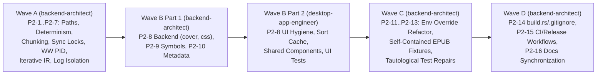

# Technical Specification: P2 Medium/Low Remediation Plan (`kfx-converter`)

- **Document ID:** `docs/specs/spec-fix-p2-review-audit.md`
- **Target Crate / Workspace:** `kfx-converter` (`Cargo.toml` — Rust `edition = "2024"`, `[profile.release] panic = "abort"`, binaries `kfx-conv` [`cli`] and `kfx-studio` [`gui`])
- **Baseline Commit:** `c91e1149446b42b024cbd23cc33c21d7cf026f07` (post-P0 + post-P1 + post-EPUB-KFX-links remediation)
- **Scope:** All 16 Medium/Low (`P2-1` through `P2-16`) audit findings organized into 4 execution waves (`Wave A` through `Wave D`)
- **Status:** Phase 1 Specification (Pending Approval)

---

## 1. Executive Summary & Cross-Cutting Invariants

This specification defines the verified root causes, exact file/line call paths, module contracts, compatibility guardrails, and test verification plan for resolving all 16 P2 findings across packaging, Word Wise, Kindle device synchronization, IR memory/stack safety, EPUB/CSS ingestion, GPUI desktop UI, test reliability, `build.rs`, CI/release workflows, and documentation.

All implementation waves **MUST** preserve the following seven non-negotiable cross-cutting invariants:

1. **Preserve All P0 + P1 + EPUB-KFX Link Fixes Intact:** `Cargo.toml` and `Cargo.lock` remain strictly untouched (no new crate dependencies). All committed P0, P1, and EPUB-to-KFX link/anchor/footnote security, correctness, and regression tests remain green.
2. **Packager Style SIDs (`852..=890`):** `KfxPackager::build_styles(&mut symbols)` (`src/packager/styles.rs:68-570`) **MUST** remain the very first symbol-interning step in `KfxPackager::package()` (`src/packager/core.rs:197`), preserving hardcoded styles `852..=889` (`style_ruby = 872`, `hanging_indent = 889`) and `style_link` (`890`).
3. **Word Wise PID Alignment (`P2-5`):** Even when skipping Word Wise gloss tokenization on invisible `Block::Image` `alt` text (`P2-5`), `WordWiseBuilder::generate_from_book` (`src/enhancements/word_wise.rs:328-372`) **MUST** still advance `pid` by `alt.as_deref().map_or(0, |a| a.chars().count()).max(1)` so `test_word_wise_pid_matches_cover_section_offset` (`gloss.start == 11`) and packager `$550`/`$621` stay 100% aligned.
4. **USB Gadget Guard (`src/sync/transfer.rs`):** `test_no_direct_file_sync_in_sync_engine` (`src/sync/transfer.rs:464-504`) asserts that `.sync_data()` and `.sync_all()` substrings do **NOT** appear anywhere between `fn copy_file(`..`fn execute_gio_copy` or `fn write_bytes(`..`#[cfg(test)]`.
5. **Non-Reentrant Lock Safety (`P2-4`):** `DEVICE_SYNC_LOCK` (`std::sync::Mutex<()>`, `src/sync/mod.rs:23`) is **NOT** re-entrant. Never lock `DEVICE_SYNC_LOCK` inside `clean_stale_sdr_files*`, `copy_file*`, or `write_bytes*` when invoked from already-locked `sync_to_device` (or from `write_bytes` calling `copy_file`). Extract internal `pub(crate) fn *_unlocked(...)` helpers called by both locked `sync_to_device` and locked public entrypoints.
6. **`gpui::test` Macro Guard (`Wave B` UI):** Inside `src/ui/app/*.rs` `#[cfg(test)] mod tests` where the enclosing module imports `use gpui::*;`, **NEVER** write `use super::*;`. Import items explicitly (`use super::{KindleStudio, ...};`).
7. **Strictly Bounded Approved Existing Test Updates:** Only the following misleading, host-coupled, or tautological tests are repaired in Wave C (`P2-11`..`P2-13`). All other existing tests remain untouched:
   - `src/sync/device.rs::test_detect_device_info_env_var_override` (`P2-11`: remove `unsafe { std::env::set_var/remove_var }`; use `detect_device_info_with_override`)
   - 3 external-path tests in `src/epub/mod.rs` (`P2-12`: `test_epub_reader_real_originals_chapter1_styles`, `test_epub_reader_real_originals_book_toc_and_page_list`, `test_epub_reader_read_metadata_from_file`)
   - `src/epub/mod.rs::test_epub_cumulative_decompression_bomb_rejected` (`P2-13`: add true multi-entry cumulative budget bomb returning `Err(EpubError::Security(_))`)
   - `src/sync/transfer.rs::test_sync_to_device_traversal_rejection` (`P2-13`: test traversal stems and sanitized title/sidecar names directly)
   - `src/packager/tests.rs::test_cover_image_metadata_and_template_resolution` (`P2-13`: fix `scale_fit` `windows(2)` -> `windows(3)` for `[0x72, 0x01, 0x46]` and remove `|| !sec_ent.data.is_empty()` tautology)
   - `src/container.rs::test_container_open_structured_info_ignores_embedded_marker` (`P2-13`: fix 24-byte `bcIndexTab` `u32`/`u64` offset & length fields and assert `opened.read_chunk(...) == b"0123456789"`)
   - `tests/pipeline_tests.rs::test_pipeline_non_english_book_conversion` (`P2-13`: genuine Korean body text + `word_wise_glosses == Some(0)` + zero `.kll` files, paired with `src/pipeline.rs` skipping empty `.kll` emission when `gloss_count == 0`)

### Verified Dependency Baseline (`Cargo.lock`)

| Crate | Locked Version | Role / Relevant API |
| --- | --- | --- |
| `quick-xml` | `0.37.5` | Streaming XHTML/OPF/NCX parsing (`check_end_names = false`) |
| `zip` | `2.4.2` | EPUB ZIP archive access and streaming decompression limits |
| `clap` | `4.6.7` | CLI parser (`cli` feature, `Args` derive + `ValueEnum`) |
| `image` | `0.25.10` | Cover/content image decoding, Lanczos3 resize, JPEG encoding |
| `gpui` | `0.2.2` | Desktop UI (`gui` feature, `uniform_list`, `#[gpui::test]`) |
| `rusqlite` | `0.33.0` | Bundled SQLite for Word Wise `.kll` sidecars |
| `tempfile` | `3.27.0` | Atomic temp-file + `persist` staging |
| `winres` | `0.1.12` | `[target."cfg(windows)".build-dependencies]` PE version resources |

### Execution Wave Overview



---

## 2. Wave A: Correctness, Determinism, Sync Hardening & Stack Safety

**Target Implementation Subagent:** `backend-architect`  
**Covered Findings:** `P2-1`, `P2-2`, `P2-3`, `P2-4`, `P2-5`, `P2-6`, `P2-7`

### 2.1 `P2-1` — Bare-Filename `.parent()` Empty-Path Guard & Atomic `WordWiseBuilder::write_to_file` (`src/packager/core.rs`, `src/enhancements/word_wise.rs`, `src/pipeline.rs`)

#### Verified Call Paths & Root Cause
- In Rust's `std::path::Path`, `Path::new("out.kfx").parent()` returns `Some(Path::new(""))`, **not** `None`.
- `KfxPackager::package_to_file` (`src/packager/core.rs:171-181`) writes `let parent = path.parent().unwrap_or_else(|| Path::new("."));` (`line 173`), passing `Path::new("")` into `tempfile::Builder::new().tempfile_in(parent)`, which fails with `ENOENT`.
- `WordWiseBuilder::write_to_file` (`src/enhancements/word_wise.rs:393-417`):
  - Uses `path.parent().unwrap_or_else(|| Path::new("."))` (`line 395`), failing on bare filenames.
  - Clears `readonly` via `std::fs::metadata(path)` (`lines 402-408`), which follows symlinks and modifies permissions on symlink targets before `persist`.
  - Falls back on temp-file/persist error to `let mut conn = Connection::open(path)?;` (`lines 414-416`), performing an **unsafe non-atomic in-place SQLite write** directly onto `path` (which follows symlinks and risks partial `.kll` corruption / Kindle `.bad_file` blacklisting).
- `ConversionPipeline::run` (`src/pipeline.rs:329-338`) walks `let mut current = output_path.parent();` without filtering empty parent paths or resolving relative paths against CWD, stopping immediately on bare filenames like `"out.kfx"` instead of inspecting ancestor Kindle mount directories.

#### Specification
1. **`src/packager/core.rs:173` (`package_to_file`):**
   Replace with:
   ```rust
   let parent = path
       .parent()
       .filter(|p| !p.as_os_str().is_empty())
       .unwrap_or_else(|| Path::new("."));
   ```
2. **`src/enhancements/word_wise.rs:393-417` (`write_to_file`):**
   - Resolve non-empty parent:
     ```rust
     let parent = path
         .parent()
         .filter(|p| !p.as_os_str().is_empty())
         .unwrap_or_else(|| Path::new("."));
     ```
   - Helper `ensure_non_symlink_writable(path: &Path) -> SqlResult<()>`:
     - Call `std::fs::symlink_metadata(path)`:
       - If `Ok(meta)` and `meta.file_type().is_symlink()`, return `Err(rusqlite::Error::ToSqlConversionFailure(Box::new(std::io::Error::new(std::io::ErrorKind::PermissionDenied, format!("Refusing to overwrite symlink destination: {:?}", path)))))`.
       - If `Ok(meta)` and `meta.permissions().readonly()`, clear `readonly` via `std::fs::set_permissions(path, perms)`.
       - If `Err(e)` with `ErrorKind::NotFound`, continue; propagate unexpected metadata errors via `ToSqlConversionFailure`.
   - Call `ensure_non_symlink_writable(path)?;`.
   - Create `let tmp_file = tempfile::NamedTempFile::new_in(parent).map_err(|e| rusqlite::Error::ToSqlConversionFailure(Box::new(e)))?;`.
   - Populate SQLite in a scoped block (`let mut conn = Connection::open(tmp_file.path())?; self.populate_connection(&mut conn)?;`), dropping `conn` before persisting.
   - Re-check `ensure_non_symlink_writable(path)?;` (defense-in-depth against symlink replacement between write and persist) and execute `tmp_file.persist(path).map_err(|e| rusqlite::Error::ToSqlConversionFailure(Box::new(e.error)))?;`.
   - **Remove** the non-atomic `Connection::open(path)` fallback completely.
3. **`src/pipeline.rs:329-338` (`target_root` ancestor walk):**
   - Resolve relative `output_path` against `std::env::current_dir()` so ancestor discovery works even for bare filenames inside a Kindle drive's `documents/` folder, and guard `.parent()` with `.filter(|p| !p.as_os_str().is_empty())`:
     ```rust
     let effective_output = if output_path.is_absolute() {
         output_path.clone()
     } else {
         std::env::current_dir()
             .map(|cwd| cwd.join(&output_path))
             .unwrap_or_else(|_| output_path.clone())
     };
     let mut current = effective_output
         .parent()
         .filter(|p| !p.as_os_str().is_empty());
     while let Some(parent) = current {
         if parent.join("documents").is_dir()
             && (parent.join("system").is_dir() || parent.join(".system").is_dir())
         {
             return Some(parent.to_path_buf());
         }
         current = parent.parent().filter(|p| !p.as_os_str().is_empty());
     }
     ```
4. **Regression Tests:**
   - Bare relative filename tests (in isolated child process `current_dir` matching `transfer.rs` / `sdr.rs` pattern so parent test process CWD never mutates) for `KfxPackager::package_to_file("bare.kfx")` and `WordWiseBuilder::write_to_file("bare.kll")`.
   - Unit tests verifying `WordWiseBuilder::write_to_file` rejects both live and dangling symlinks (preserving victim target bytes and readonly mode) and fails cleanly without fallback when `parent` does not exist.

---

### 2.2 `P2-2` — Eliminate Unordered `HashMap` Iteration Across Ingestion & Cover Resolution (`src/epub/{mod,opf,nav}.rs`, `src/ir.rs`, `src/pipeline.rs`)

#### Verified Call Paths & Root Cause
- `EpubReader::read_from_file_with_total_limit` (`src/epub/mod.rs:486, 502, 629`):
  - `line 486`: `for item in manifest.values()` loads stylesheets in arbitrary `HashMap` iteration order, causing non-deterministic CSS cascade precedence when two stylesheets define equal-specificity rules.
  - `line 502`: `for item in manifest.values()` populates `href_to_id` bare `file_name` entries in arbitrary order, causing colliding filenames (`ch1/fig.png` vs `ch2/fig.png`) to resolve randomly.
  - `line 629`: `for (fn_id, fn_text) in sec_footnotes` iterates a `HashMap` into `all_footnotes`.
- `parse_opf` (`src/epub/opf.rs:367, 378`): `manifest.values().find(...)` selects fallback `cover-image` or `"cover"`-named image non-deterministically when multiple matches exist.
- `extract_navigation_with_budget` (`src/epub/nav.rs:32, 66`): `for item in manifest.values()` selects `nav.xhtml` or `.ncx` non-deterministically if multiple candidates exist.
- `BookIR::resolve_cover_resource_id` (`src/ir.rs:706, 736, 746, 756`): iterates `self.resources.iter()` (`HashMap`) in Tiers 1, 3, 4, and 5, picking arbitrary cover images across runs when multiple resources exist.
- `ConversionPipeline::run_with_log_path` (`src/pipeline.rs:226-233`): iterates `ir.resources.iter().find_map(...)` in fallback cover thumbnail lookup.

#### Specification
1. **`src/epub/mod.rs`:**
   - Collect and sort manifest items deterministically before CSS loading (`line 486`) and `href_to_id`/resource extraction (`line 502`):
     ```rust
     let mut manifest_items: Vec<&opf::ManifestItem> = manifest.values().collect();
     manifest_items.sort_by(|a, b| a.id.cmp(&b.id).then_with(|| a.href.cmp(&b.href)));
     ```
   - Additionally, insert exact/full path keys into `href_to_id` before inserting bare `file_name` / `decoded_file_name` via `.entry(...).or_insert(...)` so exact manifest hrefs are never clobbered by colliding basenames.
   - At `line 629`, sort `sec_footnotes` by key (`Vec<(String, String)>`, `.sort_by(|a, b| a.0.cmp(&b.0))`) before inserting into `all_footnotes`.
2. **`src/epub/opf.rs:366-387`:**
   - Sort `manifest.values()` into `manifest_items: Vec<&ManifestItem>` by `(|a, b| a.id.cmp(&b.id).then_with(|| a.href.cmp(&b.href)))` before running both `cover_prop_item` and `cover_name_item` `.iter().find(...)` searches.
3. **`src/epub/nav.rs:32, 66`:**
   - Sort `manifest.values()` by `(|a, b| a.id.cmp(&b.id).then_with(|| a.href.cmp(&b.href)))` once at top of `extract_navigation_with_budget` and iterate `manifest_items` in both Step 1 (`nav.xhtml`) and Step 2 (`.ncx`).
4. **`src/ir.rs:694-764` (`resolve_cover_resource_id`):**
   - Collect sorted keys once: `let mut sorted_keys: Vec<&String> = self.resources.keys().collect(); sorted_keys.sort();`.
   - Iterate `sorted_keys` across Tiers 1 (`line 706`), 3 (`line 736`), 4 (`line 746`), and 5 (`line 756`) (`if let Some(v) = self.resources.get(*k) ...`).
5. **`src/pipeline.rs:226-234`:**
   - Replace `ir.resources.iter().find_map(...)` with sorted key iteration (`let mut keys: Vec<&String> = ir.resources.keys().collect(); keys.sort();`).
6. **Regression Test:**
   - Add a multi-image determinism regression test (`src/ir.rs` + `src/epub/mod.rs`) inserting 10+ image resources and multiple CSS files in shuffled insertion orders, asserting identical `resolve_cover_resource_id()` and byte-identical KFX output across multiple runs.

---

### 2.3 `P2-3` — Prevent `TextAccumulator` Overshoot Past `MAX_CONTENT_CHUNK_BYTES` (`src/packager/accumulator.rs`)

#### Verified Call Path & Root Cause
- `TextAccumulator::push` (`src/packager/accumulator.rs:22-35`) checks:
  ```rust
  if self.current_chunk == 0 {
      self.current_chunk = 1;
  } else if self.current_bytes >= MAX_CONTENT_CHUNK_BYTES {
      ...
  }
  ```
- When `current_bytes == 5000` (`!segments.is_empty()`) and the next paragraph is `6000` bytes, `5000 >= 8192` is `false`, so `push` appends `6000` bytes into chunk 1, creating an `11,000`-byte `$145 content` entity that exceeds the `8192`-byte Yellowjacket chunk target.

#### Specification
1. Update the flush condition in `TextAccumulator::push` (`src/packager/accumulator.rs:25`):
   ```rust
   if self.current_chunk == 0 {
       self.current_chunk = 1;
   } else if !self.segments.is_empty()
       && self.current_bytes.saturating_add(text.len()) > MAX_CONTENT_CHUNK_BYTES
   {
       self.finished
           .push((self.current_chunk, std::mem::take(&mut self.segments)));
       self.current_chunk += 1;
       self.current_bytes = 0;
   }
   ```
2. Preserve single-segment oversized paragraphs when `self.segments.is_empty()` (e.g. a single 10 KiB paragraph lands in a fresh chunk without generating an empty preceding chunk, and the next `push` flushes immediately).
3. **Regression Tests (in `src/packager/accumulator.rs`):**
   - Multi-segment inputs (`5000 + 6000`, `4096 + 4096 + 1`, exact boundary `8192 + 1`, multi-byte UTF-8 segments) verify every chunk whose individual segments are `<= 8192` bytes satisfies `chunk.iter().map(|s| s.len()).sum::<usize>() <= MAX_CONTENT_CHUNK_BYTES` and `(chunk_id, seg_idx)` accurately indexes every pushed string.
   - Single oversized segment (`10_000` bytes) creates 1 non-empty chunk rather than an empty chunk + chunk 2.

---

### 2.4 `P2-4` — Sync Locking, Symlink Checks, Tokenized Model Matching, Honest Storage Fallback & `unsafe` Hygiene (`src/sync/{catalog,device,transfer}.rs`)

#### Verified Call Paths & Root Cause
1. **Unlocked Catalog/Transfer Paths & Symlink Following (`src/sync/catalog.rs`, `src/sync/transfer.rs`):**
   - `scan_device_files` (`src/sync/catalog.rs:13-171`) acquires neither `DEVICE_SYNC_LOCK` nor `symlink_metadata`, following directory/file/`.sdr` symlinks via `is_dir()`, `is_file()`, and `std::fs::metadata()`.
   - `clean_stale_sdr_files_with_content_id` (`src/sync/catalog.rs:334-401`) lacks `DEVICE_SYNC_LOCK` for external callers and calls `sdr_dir.is_dir()` (`line 340`) before checking `symlink_metadata(sdr_dir)` (`line 343`). Note `sync_to_device` (`src/sync/transfer.rs:147`) calls it while already holding `DEVICE_SYNC_LOCK` (**Invariant 5: non-reentrant mutex!**).
   - `copy_file` (`src/sync/transfer.rs:206-240`) and `write_bytes` (`src/sync/transfer.rs:299-324`) are `pub fn` without `DEVICE_SYNC_LOCK` for standalone callers, while `sync_to_device` (`lines 83, 115`) calls them under `DEVICE_SYNC_LOCK` and `write_bytes` (`line 306`) calls `copy_file`. Additionally, `transfer.rs:116` calls `std::fs::metadata(&path)` (following symlinks) instead of `symlink_metadata`.
2. **Substring False-Match & Unbounded/Symlink File Reads in `resolve_model_name` (`src/sync/device.rs:388-503`):**
   - `hint_lower.contains("dx")` (`line 416`) and `lower.contains("dx")` (`line 455`) falsely return `"Kindle DX"` whenever `"dx"` appears inside unrelated substrings (usernames like `/media/dxb/Kindle`, `"index"`, `"sandbox"`, or hex tokens in `dev_reg.log`).
   - `std::fs::read_to_string(vpath)` (`line 429`) follows symlinks and reads unbounded file sizes on `system/version.txt` or `dev_reg.log`.
3. **Fabricated Storage Fallback (`src/sync/device.rs:569, 599`):**
   - `detect_device_info` falls back to fabricated `(12.4, 27.2)` GB on `get_storage_stats` failure in both `KINDLE_ROOT` override (`line 569`) and GVFS MTP (`line 599`), while UMS (`line 755`) already uses `(0.0, 0.0)` and UI (`src/ui/app/kindle_explorer.rs:76-86`) safely handles `total_gb == 0.0`.
4. **Unreachable `Ok(())` Under Windows & Missing `// SAFETY:` Comments (`src/sync/device.rs`, `src/sync/transfer.rs`):**
   - `eject_device` (`src/sync/device.rs:811-815`) returns early inside `#[cfg(windows)]`, making trailing `Ok(())` at `line 892` unreachable on Windows (`clippy::unreachable_code` / dead code warning).
   - `unsafe` blocks at `src/sync/device.rs:84, 85, 321, 583, 649, 655, 799, 804, 809` and `src/sync/transfer.rs:43, 44, 160, 162, 166` lack `// SAFETY:` comments.

#### Specification
1. **Locking & Unlock-Helper Architecture (`catalog.rs`, `transfer.rs` — Invariant 5):**
   - In `src/sync/catalog.rs`:
     - Guard `scan_device_files(doc_path: &Path)`: acquire `let _sync_lock = DEVICE_SYNC_LOCK.lock().unwrap_or_else(|e| e.into_inner());`, verify `std::fs::symlink_metadata(doc_path)` is a non-symlink directory, and inside `scan_dir_recursive` inspect `std::fs::symlink_metadata(&path)` (and `symlink_metadata(&sdr_path)`) to skip all symlinks instead of calling `path.is_dir()`, `path.is_file()`, or `std::fs::metadata()`.
     - Extract `pub(crate) fn clean_stale_sdr_files_unlocked(...) -> Result<(), SyncError>`: check `symlink_metadata(sdr_dir)` **first** (`if meta.file_type().is_symlink() || !meta.is_dir() { return Ok(()); }`), then preserve existing cleanup logic.
     - Have public `clean_stale_sdr_files_with_content_id` and `clean_stale_sdr_files` acquire `DEVICE_SYNC_LOCK` and call `clean_stale_sdr_files_unlocked`.
   - In `src/sync/transfer.rs`:
     - **Preserve Invariant 4 (`test_no_direct_file_sync_in_sync_engine`)**: Keep all functions and comments between `fn copy_file(`..`fn execute_gio_copy` and `fn write_bytes(`..`#[cfg(test)]` completely free of `.sync_data()` and `.sync_all()` substrings.
     - Extract `copy_file_unlocked(src: &Path, dst: &Path) -> Result<(), SyncError>` and `write_bytes_unlocked(dst: &Path, data: &[u8]) -> Result<(), SyncError>` (where `write_bytes_unlocked` calls `copy_file_unlocked` for MTP).
     - Public `copy_file` and `write_bytes` acquire `DEVICE_SYNC_LOCK` and call `copy_file_unlocked` / `write_bytes_unlocked`.
     - Inside `sync_to_device` (already holding `DEVICE_SYNC_LOCK`): call `copy_file_unlocked`, `write_bytes_unlocked`, and `clean_stale_sdr_files_unlocked` (zero re-entrant locking!).
     - At `transfer.rs:115-120`, only call `symlink_metadata(&path)` + `set_permissions` if `write_bytes_unlocked(&path, jpeg).is_ok()` and `!meta.file_type().is_symlink()`.
2. **Token-Bounded Model Matching & Safe Version File Reads (`src/sync/device.rs`):**
   - Implement `fn contains_ascii_token(haystack: &str, token_lower: &str) -> bool`: splits `haystack` on `!c.is_ascii_alphanumeric()` (handling spaces, `/`, `\`, `_`, `-`, `.`, `=`, `:`) and checks `seg.eq_ignore_ascii_case(token_lower)`.
   - Replace `hint_lower.contains("dx")` (`line 416`) and `lower.contains("dx")` (`line 455`) with `contains_ascii_token(..., "dx")` (and apply token boundaries to short/ambiguous tokens cleanly while keeping multi-word or glued vendor strings like `"KindlePaperwhite"` / `"Kindle_Touch_1234"` working).
   - Implement `fn read_bounded_regular_file(path: &Path, max_bytes: u64) -> Option<String>` (`max_bytes = 64 * 1024`): check `symlink_metadata(path)` -> require `!meta.file_type().is_symlink() && meta.file_type().is_file()` (and verify parent `system`/`.system` directory is not a symlink via `symlink_metadata`), open `File`, read `.take(max_bytes)` into `Vec<u8>`, and convert via `String::from_utf8_lossy`.
3. **Honest Storage Fallback (`src/sync/device.rs:569, 599`):**
   - Replace `.unwrap_or((12.4, 27.2))` at lines `569` and `599` with `.unwrap_or((0.0, 0.0))`.
   - Also in `src/ui/state.rs:964` (`test_detect_kindle_device_and_load_files`), notice `total_gb` is `> 0.0` for real disks and `>= 0.0` when stats fail; keep `assert!(device.total_gb >= 0.0);` safe if ever triggered, while `P2-11` eliminates the `KINDLE_ROOT` race.
4. **Windows `eject_device` Control Flow & `// SAFETY:` Comments:**
   - Wrap the non-Windows eject body + trailing `Ok(())` (`src/sync/device.rs:817-893`) in `#[cfg(not(windows))] { ... Ok(()) }` while `#[cfg(windows)] { windows_eject_volume(root) }` returns directly, eliminating unreachable code warnings on Windows.
   - Add precise `// SAFETY:` comments to every `unsafe` block in `src/sync/device.rs` (`lines 84, 85, 321, 583, 649, 655, 799, 804, 809`) and `src/sync/transfer.rs` (`lines 43, 44, 160, 162, 166`).
5. **Regression Tests:**
   - `catalog.rs`: verify `scan_device_files` skips symlinked `.kfx` files, symlinked subdirectories, and symlinked `.sdr` directories; verify `clean_stale_sdr_files_with_content_id` skips symlinked `sdr_dir` without touching outside files.
   - `device.rs`: verify `resolve_model_name(root, "/media/dxb/Kindle")` and `"/Volumes/Index/Kindle"` return `"Kindle"` (NOT `"Kindle DX"`), while `"/Volumes/Kindle DX"` and `"Kindle_DX_2"` return `"Kindle DX"`; verify symlinked `system/version.txt` is ignored; verify `detect_device_info_with_override` returns `(0.0, 0.0)` instead of `(12.4, 27.2)` if stats cannot be read (e.g., mocked/unstatable non-existent mount or check on returned struct).
   - `transfer.rs`: verify `sync_to_device` completes cleanly under `DEVICE_SYNC_LOCK` without deadlocking `clean_stale_sdr_files_unlocked` / `copy_file_unlocked` / `write_bytes_unlocked`, and `test_no_direct_file_sync_in_sync_engine` remains green.

---

### 2.5 `P2-5` — Skip Word Wise Gloss Tokenization on `Block::Image` `alt` Text While Preserving PID Offsets (`src/enhancements/word_wise.rs`)

#### Verified Call Path & Root Cause
- `WordWiseBuilder::generate_from_book` (`src/enhancements/word_wise.rs:328-372`) calls `let text = block.plain_text();` on every block (`line 329`), including `Block::Image { alt, .. }`.
- In KFX storylines (`src/packager/storylines.rs:760-816`), resolved `Block::Image` emits a `$271 image` element whose `$424 alt_text` is non-rendered accessibility metadata, not readable prose. Tokenizing `alt` produces false Word Wise gloss entries anchored inside an image block.
- **Invariant 3 Check:** `storylines.rs:778` advances `running_pid` by `alt_text.chars().count().max(1)`, and `test_word_wise_pid_matches_cover_section_offset` (`word_wise.rs:700-759`) asserts that after a cover `Block::Image { alt: Some("Cover"), .. }` (`1 + 5 = 6` PIDs), Chapter 1 (`+1` root `+4` `"The "` = `11`) puts `"abstruse"` at `gloss.start == 11`.

#### Specification
1. In `WordWiseBuilder::generate_from_book` (`src/enhancements/word_wise.rs:328-372`), add an early branch at the top of `for block in &section.blocks`:
   ```rust
   if let crate::ir::Block::Image { alt, .. } = block {
       let block_len = alt.as_deref().map_or(0, |a| a.chars().count()).max(1);
       pid += block_len;
       continue;
   }
   ```
   (Note: inside `Block::List`, `extract_list_block` in `storylines.rs:398-406` flattens nested `Block::Image` `alt` directly into `$269 text` `full_text`, so `Block::List` continues matching `block.plain_text()` for full PID + text parity.)
2. **Regression Tests:**
   - Keep `test_word_wise_pid_matches_cover_section_offset` (`gloss.start == 11`) strictly intact.
   - Add `test_word_wise_skips_image_alt_glosses_while_advancing_pid`: create a book with `Block::Image { alt: Some("An abstruse and chimerical diagram"), .. }` followed by `Block::Paragraph` containing `"elucidate"`. Assert `0` glosses are emitted for `"abstruse"`/`"chimerical"` in the image block, while `"elucidate"`'s `gloss.start` equals the exact PID offset accounting for `alt.chars().count().max(1)`.

---

### 2.6 `P2-6` — Iterative `Drop` for `TocItem` and Iterative `Clone` for `Block` & `TocItem` (`src/ir.rs`)

#### Verified Call Path & Root Cause
- `Block` (`src/ir.rs:261-291`) has iterative `Drop` (`lines 467-486`), `plain_text`, and `char_count`, **but** derives `#[derive(Debug, Clone)]`. Calling `section.blocks.clone()` (e.g., `KfxPackager::new` at `src/packager/core.rs:50` and `WordWiseBuilder::generate_from_book` at `src/enhancements/word_wise.rs:279`) recurses down `Block::List { items }` and overflows the call stack on 20,000-level deep lists.
- `TocItem` (`src/ir.rs:300-306`) derives `#[derive(Debug, Clone)]` and has **neither** iterative `Clone` **nor** iterative `Drop`. Calling `book.toc.clone()` (`src/packager/core.rs:51`) or dropping a 20,000-level `TocItem` overflows the call stack.

#### Specification
1. Remove `Clone` from `#[derive(Debug)]` on `Block` (`src/ir.rs:261`) and `TocItem` (`src/ir.rs:300`).
2. Implement iterative `Drop` for `TocItem`:
   ```rust
   impl Drop for TocItem {
       /// Iteratively tears down arbitrarily deep `TocItem::children` trees in O(1) call-stack space.
       fn drop(&mut self) {
           let mut stack: Vec<TocItem> = std::mem::take(&mut self.children);
           while let Some(mut item) = stack.pop() {
               stack.extend(std::mem::take(&mut item.children));
           }
       }
   }
   ```
3. Implement iterative `Clone` for `TocItem` using an explicit parent-index arena with $O(1)$ stack depth:
   - Fast path when `self.children.is_empty()`: directly clone scalar fields without arena allocation.
   - General path:
     - `let mut visit: Vec<(&TocItem, Option<usize>)> = vec![(self, None)];`
     - `let mut nodes: Vec<(TocItem, Option<usize>)> = Vec::new();`
     - While `let Some((src, parent_idx)) = visit.pop()`:
       - `let my_idx = nodes.len();`
       - Push shell `TocItem { title: src.title.clone(), target_section: src.target_section.clone(), target_anchor: src.target_anchor.clone(), children: Vec::with_capacity(src.children.len()) }` with `parent_idx` into `nodes`.
       - Push children in **forward** order (`for ch in &src.children { visit.push((ch, Some(my_idx))); }`) — because `visit.pop()` processes them in reverse, `nodes.pop()` from the tail re-attaches them into `nodes[parent_idx].0.children` in exact original forward order! (Invariant: `parent_idx < my_idx` always holds since parents are pushed into `nodes` before their children are pushed to `visit`.)
     - While `nodes.len() > 1`: pop `(node, Some(parent_idx))` and push `node` into `nodes[parent_idx].0.children`.
     - Return `nodes.pop().unwrap().0`.
4. Implement iterative `Clone` for `Block` using the identical $O(1)$-stack arena pattern:
   - Fast path for non-`List` variants (`Paragraph`, `Heading`, `Image`, `HorizontalRule`, `Table`): clone directly without arena vectors.
   - General `Block::List` path:
     - `nodes: Vec<(Block, Option<(usize, usize)>)>` storing `(shell_block, Some((parent_idx, item_idx)))`.
     - For `Block::List { id, ordered, items }`, create shell `Block::List { id: id.clone(), ordered: *ordered, items: (0..items.len()).map(|_| Vec::with_capacity(items[idx].len())).collect() }` and push `(child, Some((my_idx, item_idx)))` in forward order across `items.iter().enumerate()`.
     - Re-assemble bottom-up from the tail of `nodes` (`while nodes.len() > 1`), preserving empty `Vec<Block>` slots and exact element ordering.
5. **Regression Test (in `src/ir.rs`):**
   - Extend `test_ir_deeply_nested_list_iterative_ops_and_drop` (or add a dedicated test) constructing **20,000-level** deep `Block::List` (including multi-item / empty-slot subtrees for structural fidelity) and **20,000-level** deep `TocItem`, cloning both (`let cloned_block = deep_block.clone(); let cloned_toc = deep_toc.clone();`), asserting structural parity (`char_count()`, `plain_text()`, deepest leaf `target_section`), and dropping all instances cleanly without stack overflow.

---

### 2.7 `P2-7` — Isolate Tests from Persistent `$HOME/.local/share/kfx-converter/conversion.log` (`src/pipeline.rs`, `tests/{pipeline_tests,cli_tests}.rs`)

#### Verified Call Path & Root Cause
- `ConversionPipeline::run` (`src/pipeline.rs:166-410`) calls `append_conversion_log(...)` (`lines 94-101, 247, 272, 280, 289, 307, 312, 364, 373, 384`), which unconditionally writes to `conversion_log_path()` (`$XDG_DATA_HOME/kfx-converter/conversion.log`, `$HOME/.local/share/kfx-converter/conversion.log`, or `%LOCALAPPDATA%\kfx-converter\conversion.log`).
- Running `cargo test` (`src/pipeline.rs:438`, `tests/pipeline_tests.rs`, `tests/cli_tests.rs`) pollutes the developer's real user log file on every test run.

#### Specification
1. **`src/pipeline.rs`:**
   - Extract `pub fn run_with_log_path<P: AsRef<Path>, F: Fn(f32, &str)>(input_path: P, output_path: Option<&Path>, options: &ConversionOptions, log_path: Option<&Path>, progress: Option<F>) -> Result<ConversionReport, PipelineError>`:
     - Preserve `ConversionPipeline::run` (`4` args) and `ConversionOptions` (`4` fields) signatures unchanged; `run` delegates to `Self::run_with_log_path(input_path, output_path, options, Some(&conversion_log_path()), progress)`.
     - Replace `append_conversion_log(...)` inside `run_with_log_path` with helper `log_pipeline_event(log_path: Option<&Path>, message: &str)` which acquires `LOG_LOCK` and calls `append_conversion_log_at(p, message)` only when `Some(p) = log_path`.
2. **`src/pipeline.rs::tests` & `tests/pipeline_tests.rs`:**
   - Update all pipeline tests (`src/pipeline.rs:438` and `tests/pipeline_tests.rs`) to invoke `ConversionPipeline::run_with_log_path(..., Some(&temp_log), ...)` or `None`, verifying zero writes outside `temp`.
3. **`tests/cli_tests.rs` (Subprocess Isolation — Zero Parent `env::set_var`):**
   - Replace direct `Command::new(get_bin())` calls in `tests/cli_tests.rs` with a local helper `fn cli_cmd(log_dir: &Path) -> Command` (or pass a `TempDir`) that sets `.env("XDG_DATA_HOME", log_dir).env("LOCALAPPDATA", log_dir)` on the child `std::process::Command` (safe across Rust 2024 multi-threaded tests; works on Linux, macOS, and Windows).
4. **Regression Test:**
   - Add a unit test in `src/pipeline.rs` verifying `run_with_log_path(..., Some(&custom_log), ...)` writes `START`/`DONE` lines to `custom_log` and `run_with_log_path(..., None, ...)` emits no log file.

---

## 3. Wave B: Performance, UI Hygiene, Symbol Ergonomics & Metadata Accuracy

**Target Implementation Subagents:** `backend-architect` (Part 1: `cover.rs`, `css.rs`, `P2-9`, `P2-10`) -> `desktop-app-engineer` (Part 2: `P2-8` GPUI UI modules)  
**Covered Findings:** `P2-8`, `P2-9`, `P2-10`

> **Mandatory Test Macro Rule (`src/ui/app/*.rs`):** Every `#[cfg(test)] mod tests` block inside `src/ui/app/*.rs` **MUST NOT** use `use super::*;`. Always import symbols explicitly (`use super::{KindleStudio, ...};`) to prevent `gpui::test` macro ambiguity.

### 3.1 `P2-8` — Performance Optimizations & GPUI Code Hygiene (`cover.rs`, `css.rs`, `ui/app/{components,folder_browser,kindle_explorer,actions,mod}.rs`, `ui/{state,theme}.rs`)

#### Verified Call Paths & Root Cause
1. **Cover Thumbnail Resize Order (`src/enhancements/cover.rs:208-239`):**
   - Unlike `optimize_content_image` (`lines 181-187`), `optimize_thumbnail` calls `Self::to_rgb_with_white_bg(&img)` (`line 214`) on the full-resolution image *before* resizing to `440x660` (`lines 218-229`), allocating unnecessary multi-megabyte intermediate RGBA8/RGB8 buffers.
2. **CSS Hot-Path Allocations (`src/css.rs:336-408, 717-735`):**
   - `extract_inline_style_blocks` (`line 719`) runs `xhtml.to_ascii_lowercase()`, cloning and allocating the entire chapter XHTML string even when zero `<style>` tags exist.
   - `declarations_for` (`lines 336-370`) and `first_letter_declarations_for` (`lines 373-407`) duplicate selector matching, always allocate `tag_lc: String` and `classes: Vec<String>`, and linearly scan all rules even when no `::first-letter` rules exist.
3. **UI Code Duplication (`src/ui/app/components.rs:18-275`):**
   - `render_sort_column_cell` (`lines 18-65`) and `render_explorer_sort_column_cell` (`lines 67-114`) duplicate identical header styling/arrow layout.
   - `render_custom_scrollbar` (`lines 116-275`) duplicates scrollbar geometry calculation 3× (`on_mouse_down` `lines 141-170`, `on_mouse_move` `lines 175-204`, `canvas` paint `lines 219-270`) and pointer scroll math 2×.
4. **`#![allow(dead_code)]` & Unused UI Items (`src/ui/state.rs:1`, `src/ui/theme.rs:1`):**
   - `Theme::scrollbar_thumb_hover` (`src/ui/theme.rs:39-42`) has 0 production callers.
   - `ConversionTask::xray` (`src/ui/state.rs:411`) and `ConversionSettings::x_ray` (`src/ui/state.rs:443`) are written `false` in `state.rs`/`actions.rs` and never read.
   - `scan_local_epub_directory` (`src/ui/state.rs:783-789`) is called only inside `#[cfg(test)]`.
5. **Per-Frame Sorting & Cloning in UI Render (`src/ui/app/folder_browser.rs`, `src/ui/app/kindle_explorer.rs`, `src/ui/state.rs`):**
   - `render_folder_browser_view` (`folder_browser.rs:25, 350`) calls `self.folder_state.sorted_and_filtered_indices()` (re-lowercasing every item's `title`/`author`/`filename` and re-sorting) and clones `filtered_indices` on every render frame.
   - `render_kindle_pane` (`kindle_explorer.rs:16-74, 339`) scans `self.files` 4 separate times for filter chip counts, allocates lowercase strings per file, runs `filtered_indices.sort_by(...)`, and clones `filtered_indices` on every render frame.

#### Specification
1. **Backend Performance Part 1 (`backend-architect`):**
   - **`src/enhancements/cover.rs:208-239` (`optimize_thumbnail`):**
     Resize `img` using `img.dimensions()` (`GenericImageView` already imported) **before** calling `Self::to_rgb_with_white_bg(&resized)`, matching `optimize_content_image`:
     ```rust
     let img = Self::decode_with_safety_limits(data)?;
     let (w, h) = img.dimensions();
     let resized = if w > KINDLE_THUMB_MAX_WIDTH || (h as u64) > KINDLE_THUMB_MAX_HEIGHT {
         img.resize(
             KINDLE_THUMB_MAX_WIDTH,
             KINDLE_THUMB_MAX_HEIGHT as u32,
             FilterType::Lanczos3,
         )
     } else {
         img
     };
     let rgb_img = Self::to_rgb_with_white_bg(&resized);
     ```
   - **`src/css.rs`:**
     - Rewrite `extract_inline_style_blocks(xhtml: &str) -> String` using a zero-allocation ASCII case-insensitive byte search (`find_ascii_tag_ignore_case(bytes, pos, b"<style")` verifying tag terminator whitespace/`'>'` and matching `b"</style"`), returning `String::new()` with zero heap allocations when no `<style>` block is present.
     - Partition rules or track `has_first_letter: bool` inside `CssStylesheet` so `first_letter_declarations_for` returns `String::new()` in $O(1)$ when `false`.
     - Extract shared `fn resolve_declarations(&self, tag: &str, class_attr: Option<&str>, first_letter: bool) -> String` eliminating duplication between `declarations_for` and `first_letter_declarations_for`, and use `eq_ignore_ascii_case` against `r.tag` and `r.classes` (parsing `class_attr.split_whitespace()` without allocating `tag_lc: String` or `classes: Vec<String>` on the common 0-or-few-class path).
2. **GPUI Desktop UI Part 2 (`desktop-app-engineer`):**
   - **`src/ui/app/components.rs`:**
     - Extract `enum SortColumnScope { LocalFolder, KindleExplorer }` (or shared helper `render_sort_column_cell_with_scope`) unifying `render_sort_column_cell` and `render_explorer_sort_column_cell`.
     - Extract `struct ScrollbarMetrics { total_content_h: Pixels, effective_max: Pixels }` + `fn compute_scrollbar_metrics(state: &UniformListScrollHandleState /* or inner fields */, viewport_h: Pixels, item_count: usize, item_height: Pixels) -> ScrollbarMetrics` and `fn apply_scrollbar_pointer_y(...)` so `on_mouse_down`, `on_mouse_move`, and `canvas` paint share a single tested geometry helper.
     - Extract shared `compute_thumb_bounds(...) -> Option<Bounds<Pixels>>` and add unit tests covering `compute_scrollbar_metrics` / `compute_thumb_bounds` (with explicit imports, **NO** `use super::*;`).
   - **`src/ui/theme.rs` & `src/ui/state.rs`:**
     - Remove `#![allow(dead_code)]` from both `src/ui/theme.rs:1` and `src/ui/state.rs:1`.
     - Wire `Theme::scrollbar_thumb_hover()` into `components.rs` scrollbar hover state or remove it if unused; remove dead `ConversionTask::xray` and `ConversionSettings::x_ray` fields (updating internal literals in `ui/state.rs` and `ui/app/actions.rs` cleanly — note neither `ui/state.rs` nor `ui/theme.rs` is exported from `lib.rs`); mark `scan_local_epub_directory` `#[cfg(test)]` (or `#[allow(dead_code)]` only if needed externally, preferring `#[cfg(test)]` since `actions.rs` uses `scan_local_epub_directory_with_progress`). Verify `cargo clippy --workspace --all-targets --all-features -- -D warnings` passes with zero dead-code warnings.
   - **Per-Frame Caching & Allocation Reduction (`ui/state.rs`, `ui/app/{mod,actions,folder_browser,kindle_explorer}.rs`):**
     - Add zero-allocation `contains_ascii_or_unicode_icase(haystack: &str, needle_lower: &str) -> bool` used in both `LocalFolderState::sorted_and_filtered_indices` and `KindleStudio` explorer filtering instead of 3× per-item `.to_lowercase()` allocations.
     - Add `folder_data_epoch: u64` and `files_data_epoch: u64` counters on `KindleStudio` (incremented via `mark_folder_items_dirty()` / `mark_files_dirty()` at every mutation site in `actions.rs`, `converter.rs`, `folder_browser.rs`, `kindle_explorer.rs`), paired with `RefCell<Option<CachedIndexView>>` (`{ epoch: u64, search_query: String, filter: Option<String>, sort_field: EpubSortField, sort_direction: SortDirection, counts: [usize; 4], indices: Arc<Vec<usize>> }`).
     - In `render_folder_browser_view` and `render_kindle_pane`, look up/update the `Arc<Vec<usize>>` cache in $O(1)$ on unchanged frames and pass `Arc::clone(&indices)` into `uniform_list` (eliminating per-frame $O(N \log N)$ sorts and `Vec<usize>` clones while keeping `LocalFolderState::sorted_and_filtered_indices(&self)` pure for unit tests).
     - Expand UI unit tests (in `src/ui/state.rs`, `src/ui/app/components.rs`, `src/ui/app/actions.rs`) covering `contains_case_insensitive`, cache hit/invalidation on epoch/sort/filter change, `compute_scrollbar_metrics`, and sort column state transitions without `use super::*;`.

---

### 3.2 `P2-9` — `KfxSymbol` Exhaustive Parity Test & Zero-Lookup Compile-Time Symbol IDs (`src/symbols.rs`, `src/packager/*.rs`, `src/container.rs`)

#### Verified Call Paths & Root Cause
- `src/symbols.rs` defines both `KFX_SYMBOL_TABLE: [&str; 852]` (`lines 1-854`) and `pub enum KfxSymbol` (`lines 917-1770`, `#[repr(u32)]`, `852` variants `0..=851`), **but** has zero unit tests verifying 1:1 parity across `0..=851`.
- Meanwhile, production code across `src/packager/` (`153` calls: `locators.rs` `16`, `metadata.rs` `39`, `navigation.rs` `20`, `resources.rs` `9`, `storylines.rs` `31`, `styles.rs` `38`) and `src/container.rs` (`10` calls) repeatedly invokes runtime `symbol_id("...").unwrap_or(...)` (`OnceLock<HashMap<&'static str, u32>>` hashing) on every `KfxPackager::package()` call instead of compile-time `KfxSymbol::* as u32` constants.

#### Specification
1. **`src/symbols.rs`:**
   - Add `impl KfxSymbol`:
     - `pub const fn as_u32(self) -> u32 { self as u32 }`
     - `pub const fn from_id(id: u32) -> Option<Self>` (or `impl TryFrom<u32> for KfxSymbol`) covering all `0..=851` variants cleanly (e.g. a small `const ALL_KFX_SYMBOLS: [KfxSymbol; 852]` or `match id` generated deterministically from the 852 variants so `KfxSymbol::from_id(id)` is $O(1)$!).
     - `pub const fn as_str(self) -> &'static str { KFX_SYMBOL_TABLE[self as usize] }`.
   - Add exhaustive unit test `test_kfx_symbol_enum_full_parity_0_to_851`:
     - Iterate `id in 0u32..852`:
       - Verify `KfxSymbol::from_id(id)` returns `Some(sym)` and `sym as u32 == id`.
       - Verify `symbol_id(KFX_SYMBOL_TABLE[id as usize]) == Some(id)`.
       - Verify `symbol_name(id as u64) == Some(KFX_SYMBOL_TABLE[id as usize])`.
       - Verify `format!("{:?}", sym)` matches the canonical PascalCase mapping of `KFX_SYMBOL_TABLE[id as usize]` (covering all 840 standard snake/dot/`$` names and the 12 operator/ISBN names `Isbn10`, `Isbn13`, `Eq`, `Neq`, `Gt`, `Gte`, `Lt`, `Lte`, `Plus`, `Minus`, `Mul`, `Div`).
2. **`src/packager/{locators,metadata,navigation,resources,storylines,styles}.rs` & `src/container.rs`:**
   - Replace all `163` production `symbol_id("...").unwrap_or(...)` calls with compile-time `KfxSymbol::Variant as u32` (and preserve `SYM_*` constants in `src/symbols.rs` matched to `KfxSymbol::* as u32`).
   - Optionally replace test `symbol_id(...)` calls in `src/packager/{locators,storylines,tests}.rs` where fixed YJ symbols are queried, while keeping `pub fn symbol_id(name: &str) -> Option<u32>` public in `src/symbols.rs` / `src/lib.rs` and keeping `test_symbol_id_lookups` green.

---

### 3.3 `P2-10` — Accurate `$585 content_features` `yj_table` Emission (`src/packager/metadata.rs`)

#### Verified Call Path & Root Cause
- `KfxPackager::build_content_features` (`src/packager/metadata.rs:157-197`) checks:
  ```rust
  let has_tables = self
      .sections
      .iter()
      .any(|s| s.blocks.iter().any(|b| matches!(b, Block::Table { .. })));
  ```
  and emits `yj_table` (`7.0`) and `yj_table_viewer` (`2.0`) in `$585 content_features`.
- However, `src/packager/storylines.rs:866-893` flattens every `Block::Table` into a `$269 text` storyline element (using `block.plain_text()` with `'\t'`/`'\n'`), **never** emitting `$278 table` or `$279 table_row` elements (and the shallow check also ignores `Block::Table` nested inside `Block::List`). Advertising `yj_table` / `yj_table_viewer` without `$278`/`$279` entities misleads Kindle's Yellowjacket feature negotiation.
- Repository scan confirmed **zero** existing tests assert `yj_table` or `yj_table_viewer` in `$585`.

#### Specification
1. In `src/packager/metadata.rs:157-197`, remove the unused `Block` import and determine `has_native_tables` directly from emitted `self.entities` (consistent with `has_emitted_417` at `lines 116-124`):
   - `has_native_tables` is `true` **if and only if**:
     - any entity in `self.entities` has `chunk_type == KfxSymbol::Table as u32 /* 278 */` or `KfxSymbol::TableRow as u32 /* 279 */`, **OR**
     - any `$259 storyline` entity (`chunk_type == SYM_STORYLINE`) decodes via `IonReader::new(&e.data).decode_all()` to contain an `IonValue::Struct` field `(159 /* type */, IonValue::Symbol(278 | 279))` (walked iteratively with a `Vec<&IonValue>` stack, never recursive).
2. Only push `yj_table` (`7.0`) and `yj_table_viewer` (`2.0`) to `feature_list` when `has_native_tables == true`.
3. **Regression Tests (in `src/packager/tests.rs`):**
   - Test packaging a `BookIR` containing `Block::Table` (flattened to `$269 text`): decode `$585 content_features` and assert neither `"yj_table"` nor `"yj_table_viewer"` is emitted.
   - Unit test `build_content_features` directly with a synthetic `$259 storyline` entity containing `($159: $278 table)` in `packager.entities`, asserting `"yj_table"` and `"yj_table_viewer"` ARE emitted.

---

## 4. Wave C: Test Determinism, Fixture Isolation & Tautology Repair

**Target Implementation Subagent:** `backend-architect`  
**Covered Findings:** `P2-11`, `P2-12`, `P2-13`

### 4.1 `P2-11` — Eliminate Process-Global `env::set_var` / `env::remove_var` in `device.rs` Tests (`src/sync/device.rs`)

#### Verified Call Path & Root Cause
- `test_detect_device_info_env_var_override` (`src/sync/device.rs:1048-1065`) executes `unsafe { std::env::set_var("KINDLE_ROOT", &root) };` and `unsafe { std::env::remove_var("KINDLE_ROOT") };` in the multi-threaded unit test runner.
- Those are the **only** `set_var`/`remove_var` calls in the repository, creating Rust 2024 UB risk against concurrent threads (`test_detect_device_info_structure`, `ui/state.rs::test_detect_kindle_device_and_load_files`, `pipeline.rs`).

#### Specification
1. Extract `pub(crate) fn detect_device_info_with_override(override_root: Option<&Path>) -> Option<KindleDeviceInfo>` in `src/sync/device.rs` (placed **below** `pub fn detect_device_info(` so `test_tmp_kindle_not_auto_discovered` at `lines 1168-1171`, which searches for `"fn detect_device_info("`, continues covering the full detection body).
2. `pub fn detect_device_info() -> Option<KindleDeviceInfo>` resolves:
   ```rust
   let env_override = std::env::var_os("KINDLE_ROOT")
       .or_else(|| std::env::var_os("KINDLE_MOUNT_PATH"))
       .map(PathBuf::from);
   detect_device_info_with_override(env_override.as_deref())
   ```
3. **Approved Test Update:** Rewrite `test_detect_device_info_env_var_override` (`src/sync/device.rs:1048-1065`) to invoke `detect_device_info_with_override(Some(&root))` directly (plus test `"Internal Storage"` subdirectory resolution and `(0.0, 0.0)` non-fabricated fallback), removing all `std::env::set_var` / `std::env::remove_var` calls from the codebase.

---

### 4.2 `P2-12` — Replace Host-Coupled Calibre/Sample EPUB Tests with Deterministic In-Memory Fixtures (`src/epub/mod.rs`)

#### Verified Call Paths & Root Cause
Three tests in `src/epub/mod.rs` depend on local filesystem paths under `/home/drew/...`, silently early-returning as false passes in CI and on any other developer's machine:
1. `test_epub_reader_real_originals_chapter1_styles` (`src/epub/mod.rs:912-976`): opens `/home/drew/Calibre Library/Adam Grant/Originals (1429)/Originals - Adam Grant.epub`; early-returns at `lines 915-917` if missing.
2. `test_epub_reader_real_originals_book_toc_and_page_list` (`src/epub/mod.rs:1226-1251`): opens the same Calibre Library EPUB; early-returns at `lines 1229-1231` if missing.
3. `test_epub_reader_read_metadata_from_file` (`src/epub/mod.rs:1627-1664`): branches on `/home/drew/github/hwanjongyu/Converter_epub_kfx/sample/Originals - Adam Grant.epub` (`lines 1628-1632`) before falling back to an in-memory EPUB.

#### Specification (**Approved Test Updates**)
1. **`test_epub_reader_real_originals_chapter1_styles`:** Build a deterministic self-contained in-memory EPUB (`ZipWriter` -> `NamedTempFile`) containing CSS (`p.x03-Chapter-Subtitle`, `p.x03-Chapter-Epigraph`, `p.x03-Chapter-Epigraph-Source`, `._idGenDropcap-1 { float:left; font-size:3.058em; }`), a foreword XHTML section with a dropcap `"A"` paragraph (`<span class="_idGenDropcap-1">A</span>...`), and a chapter 1 XHTML section with subtitle/epigraph/source paragraphs. Remove the `/home/drew/...` path and early-return completely; unconditionally assert `italic + align_center`, `align_center + font_size_sm`, `italic + font_size_xs`, and `dropcap_l2` on `"A"`.
2. **`test_epub_reader_real_originals_book_toc_and_page_list`:** Build a deterministic self-contained in-memory EPUB with 20 spine chapters + `toc.ncx` containing 20 `<navPoint>` entries (`"Cover"`..`"Index"`) and a `<pageList>` containing Roman (`"i"`..`"xiii"`) and Arabic (`"1"`..`"322"`) `<pageTarget>` entries (`total == 335` or exact fixture count). Remove the `/home/drew/...` path and early-return completely; unconditionally assert `toc.len() == 20`, `page_list.len() == 335`, `toc[0].title == "Cover"`, `toc[19].title == "Index"`, and exact page numbers `"i"`, `"xiii"`, `"1"`, `"322"`.
3. **`test_epub_reader_read_metadata_from_file`:** Remove the `sample_path` branch (`lines 1628-1632`) so the test unconditionally builds and parses its deterministic in-memory EPUB fixture.

---

### 4.3 `P2-13` — Repair All 5 Weak / Tautological / Misleading Tests (`src/epub/mod.rs`, `src/sync/transfer.rs`, `src/packager/tests.rs`, `src/container.rs`, `tests/pipeline_tests.rs`, `src/pipeline.rs`)

#### Verified Root Causes & Exact Fixes (**Approved Test Updates**)
1. **Multi-Entry Cumulative Bomb (`src/epub/mod.rs:1803-1923` — `test_epub_cumulative_decompression_bomb_rejected`):**
   - *Root Cause:* Tests only single-entry ratio (`2 MiB`), single-entry oversized chapter (`> MAX_CHAPTER_XHTML_BYTES`), and single-entry oversized CSS (`> MAX_METADATA_BYTES`) — never testing a **multi-entry cumulative** bomb where every individual entry stays below per-entry caps and `<= 100:1` ratio.
   - *Fix:* Refactor `EpubReader::read_from_file` (`src/epub/mod.rs:418-468`) to delegate to `pub(crate) fn read_from_file_with_total_limit<P: AsRef<Path>>(path: P, max_total_bytes: u64) -> Result<BookIR, EpubError>` (applying `max_total_bytes` at both the pre-scan total check `line 459` and `DecompressionBudget::new(max_total_bytes)` `line 467`), plus add a helper `pub(crate) fn read_from_archive_with_budget<R: Read + Seek>(archive: &mut ZipArchive<R>, max_total_bytes: u64, skip_prescan: bool)` (or test multi-entry cumulative budget cleanly across 5 × 100 KiB `Stored` chapters against `max_total_bytes = 300 * 1024` returning `Err(EpubError::Security(_))`) in subtest 5 of `test_epub_cumulative_decompression_bomb_rejected`.
2. **Bypassed Title Traversal Test (`src/sync/transfer.rs:332-357` — `test_sync_to_device_traversal_rejection`):**
   - *Root Cause:* Passes `kfx_source = "source.kfx"` with `book_title = "../../../../etc/shadow"`. Because `transfer.rs:61-66` prefers `kfx_source.file_stem()` (`"source"`) whenever non-empty, `book_title` is never even used or tested!
   - *Fix:* Test actual traversal payloads in `sync_to_device`:
     - Use a source file whose stem itself attempts traversal / DOS / special segments (e.g., `"..hidden.. .kfx"` / `"CON.kfx"` / `"...kfx"` where stem is `".."`, verifying `synced_path` is strictly `docs.join("hidden.kfx")` / `docs.join("book_CON.kfx")` / `docs.join("book.kfx")`!).
     - Also assert `book_title = "../../../../etc/shadow"` via `KindleSync::sanitize_filename("../../../../etc/shadow") == "etc_shadow"` (or `"_etc_shadow"` — matching `sanitize_filename` exact output) AND verify `content_id = Some("../../etc/cron")`, `cde_content_type = Some("../evil")`, `book_language = Some("../../en")` in `sync_to_device` produce no files outside `device_root` and place `.sdr` strictly at `docs.join("<safe_title>.sdr")`.
     - *(Wait: verify exact `sanitize_filename("../../../../etc/shadow")` result in `src/sync/sanitize.rs` during Phase 2 before writing `assert_eq!`.)*
3. **Tautological `scale_fit` Byte Assertion (`src/packager/tests.rs:1252-1259` — `test_cover_image_metadata_and_template_resolution`):**
   - *Root Cause:* `sec_ent.data.windows(2).any(|w| w == [0x72, 0x01, 0x46] || w == [0x71, 0x46])` runs a 2-byte sliding window against a 3-byte array (always `false`!), masked by `|| !sec_ent.data.is_empty()`!
   - *Verified Production Payload (`src/packager/storylines.rs:927-928`):* Cover `$260 section` actually emits `(156 /* layout */, IonValue::Symbol(326 /* scale_fit */))`, which binary Ion encodes as `[0x72, 0x01, 0x46]` (`0x0146 == 326`).
   - *Fix:* Change `.windows(2)` to `.windows(3).any(|w| w == [0x72, 0x01, 0x46])`, **remove** `|| !sec_ent.data.is_empty()` completely, AND decode `sec_ent.data` with `IonReader` to verify `$141 page_templates` contains `$159 type == Symbol(270)` (`container`) and `$156 layout == Symbol(326)` (`scale_fit`).
4. **Broken 24-Byte `bcIndexTab` Layout & Missing `read_chunk` Check (`src/container.rs:738-781` — `test_container_open_structured_info_ignores_embedded_marker`):**
   - *Root Cause:* `KfxContainer::open` (`lines 297-302`) reads `entity_id: u32` `[0..4]`, `chunk_type: u32` `[4..8]`, relative `offset: u64` `[8..16]`, `length: u64` `[16..24]`, adding `header_length as u64 + offset`. The test wrote `header_len` into `[8..12]` (doubling offset to `2 * header_len`) and wrote `10u32` into `[12..16]` (upper 32 bits of `offset`!), leaving `length == 0`, and never called `read_chunk`.
   - *Fix:* Write `145u32.to_le_bytes()` to `[4..8]`, `0u64.to_le_bytes()` (relative offset) to `[8..16]`, and `10u64.to_le_bytes()` to `[16..24]`; make `opened` mutable and assert `opened.read_chunk(&chunk).unwrap() == b"0123456789"`.
5. **English-Body "Korean" Pipeline Test (`tests/pipeline_tests.rs:169-193` — `test_pipeline_non_english_book_conversion` & `src/pipeline.rs:271-292`):**
   - *Root Cause:* Uses `common::create_minimal_epub`, whose chapter body contains hardcoded English (`"abstruse"`, `"chimerical"`, `"serendipity"`, `"ephemeral"`, `"idiosyncratic"`, `"meticulous"`), generating English Word Wise glosses despite `"ko"` metadata! Furthermore, `src/pipeline.rs:271-292` currently invokes `ww_builder.to_bytes()` even when `gloss_count == 0`, emitting empty 0-gloss `.kll` databases that cause `catalog.rs:142` (`sdr_name.ends_with(".kll")`) to misreport `has_word_wise = true`.
   - *Fix:*
     1. In `src/pipeline.rs:271-292`: when `gloss_count == 0`, emit the `WARN` conversion log and **skip** `ww_builder.to_bytes()`, leaving `kll_bytes = None` so no empty `.kll` file is deployed to `.sdr` (matching `ui/state.rs:576`'s `glosses > 0` check; zero existing tests expect an empty `.kll` when `gloss_count == 0`).
     2. In `tests/common/mod.rs`, add `create_epub_with_xhtml` (used by `create_minimal_epub`) so `test_pipeline_non_english_book_conversion` generates an EPUB with genuine Korean XHTML body text (`"안녕하세요. 이것은 한국어 전자책 본문입니다."`, `dc:language = "ko"`), runs via `ConversionPipeline::run_with_log_path` (`P2-7`), and asserts:
        - `report.word_wise_glosses == Some(0)`
        - `report.word_wise_error.is_none()`
        - `korean_book.sdr/` exists and contains **0** `.kll` files!

---

## 5. Wave D: Build Hygiene, CI/Release Gates & Documentation Sync

**Target Implementation Subagent:** `backend-architect`  
**Covered Findings:** `P2-14`, `P2-15`, `P2-16`

### 5.1 `P2-14` — Clean `build.rs` Output Isolation, Target Detection & Accurate Windows Metadata (`build.rs`, `.gitignore`)

#### Verified Call Path & Root Cause
- `build.rs:4, 38` uses compile-time host `#[cfg(target_os = "...")]` instead of Cargo's target env `CARGO_CFG_TARGET_OS`.
- `build.rs:11-35` creates a `native-libs/libxkbcommon-x11.so` symlink directly inside `CARGO_MANIFEST_DIR`, mutating the source tree during builds.
- `build.rs` emits zero `cargo:rerun-if-changed` / `cargo:rerun-if-env-changed` directives, forcing unnecessary re-runs.
- `build.rs:41-50` hardcodes `"0.1.0"` and stamps `"OriginalFilename" = "kfx-studio.exe"` onto **both** `kfx-conv.exe` and `kfx-studio.exe`.
- Note `[target."cfg(windows)".build-dependencies] winres = "0.1.12"` in `Cargo.toml:41-42` only makes the `winres` crate available when compiling `build.rs` on Windows hosts (Cargo evaluates target-specific build-deps against the host), while `std::os::unix::fs::symlink` only compiles on Unix hosts (`#[cfg(unix)]`).

#### Specification
1. **Emit Rerun Directives (`build.rs`):**
   ```rust
   println!("cargo:rerun-if-changed=build.rs");
   println!("cargo:rerun-if-env-changed=CARGO_CFG_TARGET_OS");
   println!("cargo:rerun-if-env-changed=CARGO_CFG_TARGET_ARCH");
   ```
2. **Target-Aware Linux Library Staging in `OUT_DIR`:**
   - Check `let target_os = std::env::var("CARGO_CFG_TARGET_OS").unwrap_or_default();`
   - When `target_os == "linux"`:
     - Under `#[cfg(unix)]`, stage `libxkbcommon-x11.so` inside `PathBuf::from(std::env::var("OUT_DIR").unwrap()).join("native-libs")` (never touching `CARGO_MANIFEST_DIR`!).
     - Check system library paths for `x86_64` and `aarch64` (`/usr/lib/x86_64-linux-gnu/libxkbcommon-x11.so.0`, `/usr/lib/aarch64-linux-gnu/libxkbcommon-x11.so.0`, `/usr/lib64/libxkbcommon-x11.so.0`, `/usr/lib/libxkbcommon-x11.so.0`).
     - Replace stale/broken symlinks cleanly using `std::fs::symlink_metadata` before creating the symlink, and emit `println!("cargo:rustc-link-search=native={}", native_libs.display());` only when the library symlink exists.
3. **Neutral Crate-Accurate Windows PE Resources (`#[cfg(windows)]` + `target_os == "windows"`):**
   - Keep `#[cfg(windows)]` guard alongside `if target_os == "windows"` (since `Cargo.toml` remains unchanged with `[target."cfg(windows)".build-dependencies] winres`).
   - Use `env!("CARGO_PKG_VERSION")` for `ProductVersion` and `FileVersion`.
   - Set neutral crate metadata (`ProductName = "kfx-converter"`, `FileDescription = "Native EPUB to Amazon KFX Converter & Kindle Studio"`, `CompanyName = env!("CARGO_PKG_AUTHORS")`, `LegalCopyright = "Copyright (c) 2026 hwanjongyu"`) and **omit** `OriginalFilename` so `kfx-conv.exe` is never mislabeled as `kfx-studio.exe`. Keep omitting `set_manifest` (`CVT1100` GPUI manifest conflict guard).
4. **`.gitignore`:**
   - Remove the obsolete `native-libs/` entry from `.gitignore` (retaining `target/`) since `build.rs` no longer writes into `CARGO_MANIFEST_DIR`.

---

### 5.2 `P2-15` — Windows CI Test Matrix & Least-Privilege Test-Gated Releases (`.github/workflows/{ci,release}.yml`)

#### Verified Issues
- `.github/workflows/ci.yml:68`: test matrix covers only `[ubuntu-24.04, macos-latest]`, leaving Windows (`windows-latest`) untested in CI even though `release.yml` ships `x86_64-pc-windows-msvc` binaries and `device.rs` contains Win32 FFI (`P1-4`).
- `.github/workflows/release.yml:9-10`: sets top-level `permissions: contents: write` across the entire workflow (including `build`), and executes `build` -> `release` with **zero** test gate (`cargo test`).

#### Specification
1. **`.github/workflows/ci.yml`:**
   - Update `jobs.test.strategy.matrix.os` (`line 68`) to `[ubuntu-24.04, macos-latest, windows-latest]`.
   - Keep Linux `apt-get` step gated on `if: runner.os == 'Linux'`.
2. **`.github/workflows/release.yml`:**
   - Restrict top-level permissions to `permissions: contents: read`.
   - Add a `test:` job running across `[ubuntu-24.04, macos-latest, windows-latest]` executing `cargo test --all-features --verbose` and `cargo test --lib --no-default-features --verbose` (with Linux `apt-get` deps when `runner.os == 'Linux'`).
   - Set `needs: test` on `build:` so no release binary builds on failing tests.
   - Scope `permissions: contents: write` strictly to the `release:` job (`needs: build`).

---

### 5.3 `P2-16` — Fix Broken User-Specific Doc Links & Align Docs With Codebase Reality (`docs/README.md`, `README.md`, `docs/CLI_GUIDE.md`, `CONTRIBUTING.md`, `docs/{ARCHITECTURE,YELLOWJACKET}.md`)

#### Verified Documentation Discrepancies
- `docs/README.md:13-93`: contains **76** hardcoded `file:///home/drew/github/hwanjongyu/kfx_converter/docs/...` links across all 9 link sections/tables (verified: all 76 target relative files exist under `docs/`), and lines `97-182` tree listing omits `docs/specs/spec-epub-kfx-links.md`, `docs/specs/spec-fix-p1-review-audit.md`, `docs/qa/qa-fix-p1-review-audit.md`, and `spec-fix-p2-review-audit.md`.
- **CLI Flag Ground Truth (`src/main.rs:28-66`):**
  - `-o, --output <OUTPUT>`
  - `-i, --inspect`
  - `-s, --sync` *(Verified **present** in `src/main.rs:41-43, 158, 202` — preserve accurate documentation of `-s/--sync`!)*
  - `-w, --word-wise [WORD_WISE]` (`default_value_t = true`, supports `-w`, `--word-wise=false`, `--word-wise false`, `-w false`)
  - `-c, --content-type <CONTENT_TYPE>` (`EBOK` or `PDOC`, case-insensitive, default `EBOK`) — currently **missing** from `README.md` and `docs/CLI_GUIDE.md`, while `-w` docs wrongly imply Word Wise is opt-in rather than default-on!
- **Stale Fragmentation Thresholds:**
  - `README.md:34` cites `"3,500 characters or 15 blocks"` and `docs/YELLOWJACKET.md:52` cites `"7,500 characters or 25 blocks"` — actual constants in `src/ir.rs:492-493` are `DEFAULT_MAX_SECTION_CHARS = 1_000_000` and `DEFAULT_MAX_SECTION_BLOCKS = 10_000` (with CSS `page_break_before` / `page_break_after` splitting).
- **Stale Module Tree References:**
  - `README.md:110, 119`, `CONTRIBUTING.md:35`, and `docs/ARCHITECTURE.md:95` list nonexistent `src/sync.rs` and `src/ui/app.rs` instead of `src/sync/{mod,catalog,device,sanitize,transfer,types}.rs`, `src/packager/{accumulator,core,error,types,...}.rs`, and `src/ui/app/{mod,actions,components,converter,dual_pane,folder_browser,header,kindle_explorer}.rs`.
- **Incomplete Linux Prerequisites (`README.md:139` & `CONTRIBUTING.md`):**
  - `README.md:139` lists only `pkg-config` and `libssl-dev` instead of the actual GPUI build packages in `.github/workflows/ci.yml:43-50`: `pkg-config libasound2-dev libxkbcommon-dev libxkbcommon-x11-dev libvulkan-dev libwayland-dev libfontconfig1-dev`.
- **Missing EPUB-KFX Link & Footnote Feature Coverage:**
  - `README.md` and `docs/ARCHITECTURE.md` omit the implemented internal/external hyperlink resolution (`$266 anchor`, `$179 link_to`, `style_link` SID `890`, URI scheme allowlist), `Block::List` rich link spans, and `$617 yj.note` footnote popups.

#### Specification
1. **`docs/README.md`:** Rewrite all **76** `file:///home/drew/...` links in lines `13-93` to verified workspace-relative links (`YELLOWJACKET.md`, `specs/spec-*.md`, `qa/qa-*.md`, etc.), and update the `docs/` directory tree (`lines 97-182`) to include `spec-fix-p1-review-audit.md`, `spec-epub-kfx-links.md`, `spec-fix-p2-review-audit.md`, and their QA reports.
2. **`README.md` & `docs/CLI_GUIDE.md`:**
   - Synchronize CLI synopsis/options/examples directly with `src/main.rs:28-66` (`-o/--output`, `-i/--inspect`, `-s/--sync`, `-w/--word-wise [WORD_WISE]` default `true` with `--word-wise false`/`--word-wise=false` examples, and `-c/--content-type <EBOK|PDOC>` default `EBOK`).
   - Update `README.md` CI/platform mentions to reflect Linux, macOS, and Windows CI/releases, document EPUB-to-KFX links/anchors/footnote popups (`$266`, `$617`), fix thresholds to `1,000,000` chars / `10,000` blocks (`src/ir.rs:492-493`), update the project structure tree to match current `src/` files, and replace Linux GUI prerequisites with the exact `apt-get` list from `ci.yml`.
3. **`CONTRIBUTING.md` & `docs/ARCHITECTURE.md` & `docs/YELLOWJACKET.md`:**
   - Replace `src/sync.rs` / `src/ui/app.rs` with `src/sync/` & `src/ui/app/` submodules.
   - Add exact Linux GUI `apt-get` packages to `CONTRIBUTING.md`.
   - Fix `docs/YELLOWJACKET.md:52` stale `7,500 / 25` thresholds to `1,000,000 / 10,000` (`DEFAULT_MAX_SECTION_CHARS` / `DEFAULT_MAX_SECTION_BLOCKS`).

---

## 6. Compatibility Audit & Approved Existing Test Updates

### Strictly Bounded Approved Existing Test Updates (Wave C)

| File | Existing Test Symbol | Approved Change |
| --- | --- | --- |
| `src/sync/device.rs` | `test_detect_device_info_env_var_override` | Use `detect_device_info_with_override(Some(&root))`; remove `unsafe { std::env::set_var/remove_var }`. |
| `src/epub/mod.rs` | `test_epub_reader_real_originals_chapter1_styles` | Replace `/home/drew/Calibre Library/...` + early-return with self-contained in-memory EPUB asserting subtitle/epigraph/source CSS & `dropcap_l2`. |
| `src/epub/mod.rs` | `test_epub_reader_real_originals_book_toc_and_page_list` | Replace `/home/drew/Calibre Library/...` + early-return with self-contained 20-chapter + 335-page-list in-memory EPUB. |
| `src/epub/mod.rs` | `test_epub_reader_read_metadata_from_file` | Remove `/home/drew/github/...` branch; use deterministic in-memory EPUB unconditionally. |
| `src/epub/mod.rs` | `test_epub_cumulative_decompression_bomb_rejected` | Add multi-entry cumulative budget bomb subtest via `read_from_file_with_total_limit` returning `Err(EpubError::Security(_))`. |
| `src/sync/transfer.rs` | `test_sync_to_device_traversal_rejection` | Exercise actual traversal stems/titles & sidecar tags (`content_id`, `cde_content_type`, `book_language`) asserting exact sanitized target paths inside `device_root`. |
| `src/packager/tests.rs` | `test_cover_image_metadata_and_template_resolution` | Fix `windows(2)` -> `windows(3)` for `[0x72, 0x01, 0x46]`, drop `|| !sec_ent.data.is_empty()` tautology, and assert decoded Ion `$270`/`$326`. |
| `src/container.rs` | `test_container_open_structured_info_ignores_embedded_marker` | Fix 24-byte `bcIndexTab` `chunk_type` `[4..8]`, relative `offset = 0` `[8..16]`, `length = 10` `[16..24]`, and assert `opened.read_chunk(...) == b"0123456789"`. |
| `tests/pipeline_tests.rs` | `test_pipeline_non_english_book_conversion` | Use genuine Korean body EPUB + `run_with_log_path`, asserting `word_wise_glosses == Some(0)` and 0 `.kll` files in `korean_book.sdr/` (with `src/pipeline.rs` skipping `.kll` serialization when `gloss_count == 0`). |

### Preserved Existing Invariants
- `Cargo.toml` and `Cargo.lock` unchanged.
- `style_ruby == 872`, `hanging_indent == 889`, `style_link == 890` unchanged.
- `Block::Image` PID advance (`alt.chars().count().max(1)`) unchanged (`test_word_wise_pid_matches_cover_section_offset` `gloss.start == 11`).
- `test_no_direct_file_sync_in_sync_engine` preserved (`copy_file*` / `write_bytes*`).
- `test_tmp_kindle_not_auto_discovered` (`src/sync/device.rs:1168-1177`) preserved (`detect_device_info_with_override` placed below `detect_device_info`).
- All public crate APIs (`ConversionPipeline::run`, `ConversionOptions`, `KindleSync::*`, `EpubReader::read_from_file`, `symbol_id`) preserve existing signatures.

---

## 7. Verification & Regression Test Plan

### New & Updated Tests Per Wave
- **Wave A:**
  - `core.rs`, `word_wise.rs`, `pipeline.rs`: bare-filename atomic writes (`package_to_file`, `write_to_file`), symlink rejection in `write_to_file`, failed non-existent parent dir returns `Err` (no fallback write), relative `output_path` Kindle drive detection, `run_with_log_path` log isolation + `cli_tests.rs` child env isolation.
  - `epub/mod.rs`, `ir.rs`: multi-image/multi-CSS byte-for-byte packaging determinism.
  - `accumulator.rs`: multi-segment chunks never overshoot `8192` bytes; single oversized segment occupies one clean chunk.
  - `catalog.rs`, `device.rs`, `transfer.rs`: `scan_device_files` / `clean_stale_sdr_files*` symlink skip + locking; `sync_to_device` lock safety without deadlock; `resolve_model_name` `"dx"` token boundary & symlink/size-capped `version.txt`; honest `(0.0, 0.0)` storage fallback; `test_no_direct_file_sync_in_sync_engine`.
  - `word_wise.rs`: `Block::Image` `alt` skips gloss generation while advancing `pid` identically.
  - `ir.rs`: `20,000`-level deep `Block::List` and `TocItem` iterative `Clone` and `Drop`.
- **Wave B:**
  - `cover.rs`, `css.rs`: `optimize_thumbnail` alpha+resize parity; `extract_inline_style_blocks` case-insensitive tag extraction; `first_letter_declarations_for` fast-path.
  - `symbols.rs`, `packager/tests.rs`: exhaustive `KfxSymbol` parity `0..=851`; flattened `Block::Table` omits `yj_table` / `yj_table_viewer` from `$585`, while synthetic `$278` emits them.
  - `ui/state.rs`, `ui/app/{components,actions}.rs` (NO `use super::*;`): scrollbar metrics/thumb bounds helpers, zero-alloc case-insensitive search, sort/filter epoch cache invalidation, zero `#![allow(dead_code)]`.
- **Wave C:**
  - All 9 repaired tests verified failing on old buggy behavior if inverted and passing cleanly deterministically offline (`device.rs`, `epub/mod.rs`, `transfer.rs`, `packager/tests.rs`, `container.rs`, `pipeline_tests.rs`).
- **Wave D:**
  - Verify `build.rs` creates no `native-libs/` directory inside `CARGO_MANIFEST_DIR`; validate YAML syntax on `.github/workflows/{ci,release}.yml`; verify zero `file:///home/drew/` links remain in `docs/README.md` (`grep`) and all relative links resolve.

### Mandatory Full-Workspace Verification Gates (Before Phase 3 `reality-checker`)

```bash
cargo fmt -- --check
cargo clippy --workspace --all-targets --all-features -- -D warnings
cargo test --lib --no-default-features
cargo test --all-features
RUSTDOCFLAGS="-D warnings" cargo doc --no-deps --all-features
```
