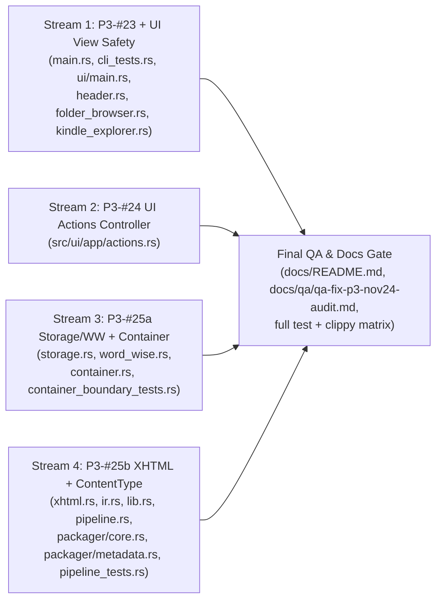

# Technical Specification: Remediation of All 3 `P3 Minor` Audit Groups (#23–#25) + P1 `WordWiseBuilder` Symlink Note (`kfx-converter`)

- **Document ID:** `docs/specs/spec-fix-p3-nov24-audit.md`
- **Target Crate / Workspace:** `kfx-converter` (`Cargo.toml` — Rust `edition = "2024"`, `[profile.release] panic = "abort"`, binaries `kfx-conv` [`cli`] and `kfx-studio` [`gui`])
- **Baseline Commit:** `781e0af` (`main`, post-P0 `98fcdcd`, post-P1 `d97a01d`, and post-P2 `781e0af` remediation)
- **Source Audit:** [`docs/multi_model_review_report.md`](../multi_model_review_report.md) (`P3 Minor` groups `#23`, `#24`, `#25`, dated 2026-11-24) + P1 `reality-checker` follow-up note on `WordWiseBuilder::ensure_non_symlink_writable`
- **Related Specifications:** [`docs/specs/spec-fix-p1-nov24-audit.md`](spec-fix-p1-nov24-audit.md), [`docs/specs/spec-fix-p2-nov24-audit.md`](spec-fix-p2-nov24-audit.md)
- **Status:** Phase 1 Specification (Pending Approval)

---

## 1. Executive Summary & Cross-Cutting Invariants

Following remediation of `P0 Critical` (`#1`–`#2`, `98fcdcd`), `P1 Major` (`#3`–`#14`, `d97a01d`), and `P2 Moderate` (`#15`–`#22`, `781e0af`), this specification defines a clean, minimal, reversible, backward-compatible, and **strictly conflict-free parallelizable** remediation plan for all **3 `P3 Minor` groups (`#23`–`#25`)** plus the P1 `reality-checker` symlink-hardening follow-up:

| ID | Summary | Primary Files |
| :--- | :--- | :--- |
| **P3-#23** | Derive CLI/GUI version strings from `CARGO_PKG_VERSION`; fix `--inspect` format string `"Type: {} ($)"` → `"Type: {} (${})"` passing `c.chunk_type` | `src/main.rs`, `tests/cli_tests.rs`, `src/ui/app/header.rs` |
| **P3-#24** | Replace `.unwrap()` in `src/ui/main.rs`; `.get()` bounds safety in `uniform_list`; defense-in-depth `spawn_file_manager` + unit-testable argv builder; real conversion progress callbacks in batch & drop workers; `rescan_folder` drop-exit cancellation; bounded `self.tasks` history (`MAX_TASK_HISTORY = 200`) | `src/ui/main.rs`, `src/ui/app/folder_browser.rs`, `src/ui/app/kindle_explorer.rs`, `src/ui/app/actions.rs` |
| **P3-#25 + P1 Note** | `saturating_add` in `word_wise.rs`; remove duplicated `ensure_non_symlink_writable` and delegate to `crate::storage` (`O_NOFOLLOW` + parent check); peek-before-allocate ENTY `read_chunk` & relative `end_pos - start_pos` in `container.rs`; drop raw unstyled `<span>` class token push & emit XHTML parse diagnostics (`parse_xhtml_with_warnings`) in `xhtml.rs`; typed `ContentType` enum with additive backwards-compatible API ergonomics | `src/storage.rs`, `src/enhancements/word_wise.rs`, `src/container.rs`, `tests/container_boundary_tests.rs`, `src/epub/xhtml.rs`, `src/ir.rs`, `src/lib.rs`, `src/pipeline.rs`, `src/packager/core.rs`, `src/packager/metadata.rs`, `tests/pipeline_tests.rs` |
| **Docs Index** | Register `spec-fix-p3-nov24-audit.md` and `qa-fix-p3-nov24-audit.md` in the Documentation Hub | `docs/README.md`, `docs/qa/qa-fix-p3-nov24-audit.md` |

### Non-Negotiable Cross-Cutting Invariants

1. **Zero New Crate Dependencies (`Cargo.toml` & `Cargo.lock` Untouched):** All fixes use Rust `std` and existing crate dependencies. `cargo check --offline --locked` must pass unchanged.
2. **Preserve Acyclic Module Layering:**
   - `storage` (Level 0) remains independent of `ir`, `epub`, `packager`, `enhancements`, and `sync`.
   - `ir` (Level 0/1) remains independent of `clap`, `gpui`, `storage`, `packager`, and `pipeline`.
   - `enhancements` depends unidirectionally on `ir` and `storage`.
   - `packager` depends unidirectionally on `ir`, `container`, `ion`, `symbols`, `storage`, `util`, and `validator`.
3. **100% Public API Backwards Compatibility:** Existing public signatures (`KfxPackager::new`, `ConversionOptions` struct literal fields, `parse_xhtml_*`, `KfxContainer::{open, read_chunk, write_to, write_to_with_symbols}`, `apply_conversion_outcome_to_state`) remain source- and behavior-compatible for valid inputs.
4. **Preserve Contract Error Strings:** `KfxContainer::read_chunk` MUST preserve the exact error substring `"ENTY chunk header length ({}) exceeds chunk buffer length ({})"` asserted by [`tests/container_boundary_tests.rs#L259`](../../tests/container_boundary_tests.rs#L259).
5. **Preserve USB Gadget No-Fsync Guardrail:** Zero `.sync_data()` / `.sync_all()` calls added to `src/storage.rs` or `src/sync/transfer.rs`.
6. **Zero Hard Sleeps in Tests:** All new unit and integration tests must be deterministic and sleep-free (testing extracted pure helpers, state transitions, and in-memory/tempdir fixtures directly).

---

## 2. Detailed File-by-File Technical Design

### 2.1 P3-#23 — CLI Output & Hardcoded Versions

#### 2.1.1 [`src/main.rs`](../../src/main.rs)
- **Line 26 (`#[command(version = "0.1.0")]`):**
  - Replace with `#[command(version)]` so Clap automatically reads `CARGO_PKG_VERSION` from `Cargo.toml`.
- **Line 117 (`println!("=== Rust KFX Converter v0.1.0 ===");`):**
  - Replace with:
    ```rust
    println!("=== Rust KFX Converter v{} ===", env!("CARGO_PKG_VERSION"));
    ```
- **Lines 138–141 (`--inspect` chunk dump):**
  - **Defect:** Format string `"    [{}] ID: {}, Type: {} ($), Offset: {}, Length: {} bytes"` omits the `{}` placeholder and `c.chunk_type` argument, printing a literal `($)` instead of `($409)` / `($260)`.
  - **Fix:**
    ```rust
    println!(
        "    [{}] ID: {}, Type: {} (${}), Offset: {}, Length: {} bytes",
        i, c.entity_id, type_name, c.chunk_type, c.offset, c.length
    );
    ```

#### 2.1.2 [`tests/cli_tests.rs`](../../tests/cli_tests.rs)
- **`test_cli_version_flag` (L71–81):**
  - Replace hardcoded `assert!(stdout.contains("0.1.0"));` with `assert!(stdout.contains(env!("CARGO_PKG_VERSION")));`.
- **`test_cli_inspect_valid_kfx` (L84–105):**
  - Keep existing assertions and add explicit regression checks:
    ```rust
    assert!(stdout.contains(concat!(
        "=== Rust KFX Converter v",
        env!("CARGO_PKG_VERSION"),
        " ==="
    )));
    assert!(stdout.contains("Type: bcContId ($409)"));
    assert!(stdout.contains("Type: section ($260)"));
    assert!(
        !stdout.contains("($)"),
        "Inspect output must include numeric symbol ID inside ($...): {stdout}"
    );
    ```

#### 2.1.3 [`src/ui/app/header.rs`](../../src/ui/app/header.rs)
- **Line 50 (`.child("Native GPUI v0.1")`):**
  - Replace with compile-time concatenated static string (zero runtime allocation):
    ```rust
    .child(concat!("Native GPUI v", env!("CARGO_PKG_VERSION")))
    ```

---

### 2.2 P3-#24 — UI Runtime Polish & Safety

#### 2.2.1 Graceful Window-Open Failure ([`src/ui/main.rs#L15-L26`](../../src/ui/main.rs#L15-L26))
- **Problem:** Under `[profile.release] panic = "abort"`, `cx.open_window(...).unwrap()` terminates `kfx-studio` with `SIGABRT` on headless/displayless environments or GPU surface creation failure.
- **Fix:**
  ```rust
  if let Err(err) = cx.open_window(
      WindowOptions {
          window_bounds: Some(WindowBounds::Windowed(bounds)),
          titlebar: Some(TitlebarOptions {
              title: Some("Kindle Studio (GPUI Native)".into()),
              ..Default::default()
          }),
          ..Default::default()
      },
      |_window, cx| cx.new(KindleStudio::new),
  ) {
      eprintln!("Failed to open Kindle Studio window: {err}");
      cx.quit();
  }
  ```

#### 2.2.2 Bounds-Safe `uniform_list` Callbacks ([`src/ui/app/folder_browser.rs#L357-L365`](../../src/ui/app/folder_browser.rs#L357-L365), [`src/ui/app/kindle_explorer.rs#L317-L331`](../../src/ui/app/kindle_explorer.rs#L317-L331))
- **Problem:** `uniform_list` captures `indices = Arc::clone(&filtered_indices)` during `render()`, whereas its range closure executes during GPUI layout/prepaint. If `this.folder_state.items` or `this.files` shrinks between render and layout (e.g., async rescan or device disconnect), direct `indices[r_idx]` or `items[item_idx]` / `files[file_idx]` indexing panics and aborts the process.
- **Fix in `src/ui/app/folder_browser.rs`:**
  ```rust
  range
      .filter_map(|r_idx| {
          let &item_idx = indices.get(r_idx)?;
          let item = this.folder_state.items.get(item_idx)?;
          Some(Self::render_epub_card(item, &view, actions_disabled))
      })
      .collect()
  ```
- **Fix in `src/ui/app/kindle_explorer.rs`:**
  ```rust
  range
      .filter_map(|r_idx| {
          let &file_idx = indices.get(r_idx)?;
          let file = this.files.get(file_idx)?;
          let is_confirming = this.confirm_delete_file.as_deref()
              == Some(file.full_path.as_path());
          Some(Self::render_kindle_file_row(
              file,
              &view,
              is_confirming,
          ))
      })
      .collect()
  ```

#### 2.2.3 Defense-in-Depth File Manager Launch & Unit-Testable Command Builder ([`src/ui/app/actions.rs#L48-L71`](../../src/ui/app/actions.rs#L48-L71))
- **Problem:** `spawn_file_manager(dir)` trusts its caller (`resolve_output_folder_target`) to have already rejected empty or `'-'`-prefixed paths, and tightly couples `Command` assembly with `.spawn()` so argv construction cannot be unit-tested without launching a real desktop file manager.
- **Note on Linux `xdg-open`:** Unlike macOS `open -- <dir>`, POSIX `xdg-open` implementations vary across distros and many shell-script versions treat `--` as a literal target URI/file. Therefore, rejecting `'-'`-prefixed paths (plus empty paths and embedded NUL bytes) inside `build_file_manager_command` is the portable, cross-platform defense-in-depth invariant.
- **Design:**
  ```rust
  pub(super) fn build_file_manager_command(dir: &Path) -> Result<std::process::Command, String> {
      if dir.as_os_str().is_empty() {
          return Err("Refusing to open empty folder path.".to_string());
      }
      let lossy = dir.to_string_lossy();
      if lossy.starts_with('-') {
          return Err("Refusing to open folder path starting with '-'.".to_string());
      }
      if lossy.contains('\0') {
          return Err("Refusing to open folder path containing NUL byte.".to_string());
      }

      #[cfg(target_os = "macos")]
      let cmd = {
          let mut c = std::process::Command::new("open");
          c.arg("--").arg(dir);
          c
      };
      #[cfg(target_os = "windows")]
      let cmd = {
          let mut c = std::process::Command::new("explorer");
          c.arg(dir);
          c
      };
      #[cfg(all(unix, not(target_os = "macos")))]
      let cmd = {
          let mut c = std::process::Command::new("xdg-open");
          c.arg(dir);
          c
      };

      Ok(cmd)
  }

  fn spawn_file_manager(dir: &Path) -> Result<(), String> {
      if !dir.is_dir() {
          return Err(format!(
              "Refusing to open non-directory path '{}'.",
              dir.display()
          ));
      }
      let mut cmd = build_file_manager_command(dir)?;
      cmd.spawn()
          .map(|_| ())
          .map_err(|e| format!("Failed to open output folder '{}': {}", dir.display(), e))
  }
  ```
- **Unit Tests (`src/ui/app/actions.rs`):**
  - Reject empty path (`""`), flag-like paths (`"-rf"`, `"--help"`), and NUL-containing path (`"/tmp/a\0b"`).
  - Verify `cmd.get_program()` and `cmd.get_args()` match the current platform (`xdg-open [dir]` on Linux, `open ["--", dir]` on macOS, `explorer [dir]` on Windows).
  - Verify `spawn_file_manager` rejects a non-existent path without spawning any external process.

#### 2.2.4 Real Conversion Progress Callbacks ([`src/ui/app/actions.rs#L857-L905`](../../src/ui/app/actions.rs#L857-L905), [`L1180-L1212`](../../src/ui/app/actions.rs#L1180-L1212))
- **Problem:** Both `convert_selected_epubs` (L899) and `spawn_drop_workers` (L1202–1207) pass `None::<fn(f32, &str)>` to `convert_epub_file`, leaving tasks stuck at hardcoded `0.3` / `0.5` until completion and never transitioning `TaskStatus::Converting` → `TaskStatus::Syncing`.
- **Pipeline Progress Milestones (`src/pipeline.rs`):**
  - `0.10` — `"Reading and validating EPUB archive..."`
  - `0.30` — `"Serializing Yellowjacket KFX container..."`
  - `0.60` — `"Normalizing baseline cover image..."`
  - `0.75` — `"Generating Word Wise lemma sidecar database..."`
  - `0.90` — `"Synchronizing to Kindle storage..."` *(only when `target_root.is_some()`)*
  - `1.00` — `"Conversion completed successfully."` *(always emitted right before return)*
- **Design (Coalescing Latest-Value Bridge + Pure State Applier — Zero New Dependencies):**
  1. Define a compact, poison-tolerant, coalescing bridge in `src/ui/app/actions.rs`:
     ```rust
     #[derive(Debug, Clone, PartialEq)]
     pub(super) struct ConversionProgressUpdate {
         pub progress: f32,
         pub stage: String,
     }

     #[derive(Clone)]
     pub(super) struct SharedConversionProgress {
         latest: Arc<Mutex<Option<ConversionProgressUpdate>>>,
         dirty: Arc<AtomicBool>,
         done: Arc<AtomicBool>,
     }
     ```
     - `record(&self, pct: f32, stage: &str)`: sanitizes `pct` (`if pct.is_finite() { pct.clamp(0.0, 1.0) } else { 0.0 }`), writes `Some(ConversionProgressUpdate { progress, stage: stage.to_string() })` into `self.latest` (recovering from mutex poison via `into_inner()`), and sets `self.dirty.store(true, Ordering::Release)`.
     - `take_if_dirty(&self) -> Option<ConversionProgressUpdate>`: fast atomic check `if !self.dirty.swap(false, Ordering::AcqRel) { return None; }`, then takes `self.latest`.
     - `mark_done(&self)` / `is_done(&self) -> bool`: `Release` / `Acquire`.
     - A small RAII guard `struct ProgressDoneGuard(SharedConversionProgress); impl Drop for ProgressDoneGuard { fn drop(&mut self) { self.0.mark_done(); } }` guarantees `done` is always set when the background closure exits.
  2. Define a compact badge formatter + pure state transition method on `KindleStudio`:
     ```rust
     pub(super) fn format_conversion_stage(progress: f32, raw_stage: &str) -> String {
         let lower = raw_stage.to_ascii_lowercase();
         if lower.contains("sync") {
             "Syncing to Kindle".to_string()
         } else if lower.contains("word wise") {
             "Word Wise".to_string()
         } else if lower.contains("cover") {
             "Optimizing Cover".to_string()
         } else if lower.contains("serializing") || lower.contains("kfx") {
             "Packaging KFX".to_string()
         } else if lower.contains("reading") || lower.contains("epub") {
             "Reading EPUB".to_string()
         } else if !raw_stage.trim().is_empty() {
             raw_stage.trim().to_string()
         } else if progress >= 0.9 {
             "Syncing to Kindle".to_string()
         } else {
             "Converting".to_string()
         }
     }

     pub(super) fn apply_conversion_progress(
         &mut self,
         task_id: u64,
         target_path: &Path,
         batch_generation: Option<u64>,
         progress: f32,
         stage: &str,
     ) -> bool
     ```
     **Exact Transition Rules inside `apply_conversion_progress`:**
     - `let pct = if progress.is_finite() { progress.clamp(0.0, 1.0) } else { 0.0 };`
     - `let pct_u8 = (pct * 100.0).round() as u8;`
     - `let display_stage = Self::format_conversion_stage(pct, stage);`
     - **Task update (`self.tasks.iter_mut().find(|t| t.id == task_id)`):**
       - Guard against late callbacks overwriting terminal states: proceed ONLY if `matches!(t.status, TaskStatus::Queued | TaskStatus::Converting | TaskStatus::Syncing)`.
       - Advance progress monotonically: `let next_progress = pct.max(t.progress);`
       - Compute next status:
         ```rust
         let is_sync_stage = stage.to_ascii_lowercase().contains("sync");
         let next_status = if pct >= 0.9 && (pct < 1.0 || is_sync_stage) {
             TaskStatus::Syncing
         } else if t.status == TaskStatus::Queued {
             TaskStatus::Converting
         } else {
             t.status.clone()
         };
         ```
         *Edge-case justification:* `ConversionPipeline` emits `0.9` only when syncing to Kindle, and emits `1.0` (`"Conversion completed successfully."`) for BOTH local-only and synced conversions. Requiring `pct < 1.0 || is_sync_stage` guarantees a local-only conversion never falsely flashes `TaskStatus::Syncing` at `1.0`, while synced conversions transition `Converting` → `Syncing` at `0.9` and remain `Syncing` until `apply_conversion_outcome` sets `Completed` / `SyncFailed`.
     - **Folder item update (`self.folder_state.items.iter_mut().find(|i| i.path == target_path)`):**
       - Guard: update ONLY if `matches!(item.status, LocalEpubStatus::InQueue | LocalEpubStatus::Processing { .. })`.
       - Keep percentage monotonic (`let next_pct = match &item.status { LocalEpubStatus::Processing { progress: prev, .. } => pct_u8.max(*prev), _ => pct_u8 };`).
       - Set `item.status = LocalEpubStatus::Processing { stage: display_stage.clone(), progress: next_pct };` and call `self.mark_folder_items_dirty();` when changed.
     - **Batch progress update:**
       - When `batch_generation == Some(self.batch_generation)`, update `bp.current_stage = display_stage;` if `bp.current_stage != display_stage`.
     - Return `changed: bool` so GPUI callers only invoke `cx.notify()` when visible state actually changed.
  3. **Initial progress values:**
     - Lower hardcoded initial active progress in `convert_selected_epubs` (L859 / L882), `try_prepare_single_convert` (L971), and `spawn_drop_workers` (L1183) from `0.3`/`0.5`/`30` to `0.05` / `5` (`"Starting..."`) so pipeline milestones (`10% → 30% → 60% → 75% → 90% → 100%`) advance smoothly and visibly from the beginning.
  4. **Foreground poller lifecycle (both `convert_selected_epubs` and `spawn_drop_workers`):**
     - Before `.await`ing `cx.background_executor().spawn(...)`, create `let shared_progress = SharedConversionProgress::new();` and spawn a **scoped** (non-detached!) foreground poller task:
       ```rust
       let progress_poller = cx.spawn(async move |this, cx| {
           while !progress_for_poll.is_done() {
               cx.background_executor()
                   .timer(Duration::from_millis(60))
                   .await;
               if let Some(update) = progress_for_poll.take_if_dirty() {
                   if this
                       .update(cx, |this, cx| {
                           if this.apply_conversion_progress(
                               task_id,
                               &poll_path,
                               batch_gen_opt,
                               update.progress,
                               &update.stage,
                           ) {
                               cx.notify();
                           }
                       })
                       .is_err()
                   {
                       break;
                   }
               }
           }
       });
       ```
     - Inside the background task, instantiate `let _done_guard = ProgressDoneGuard(progress_for_bg.clone());` and pass `Some(move |pct: f32, msg: &str| { progress_for_bg.record(pct, msg); })` to `convert_epub_file(...)`.
     - Immediately after the background task `.await`s, call `drop(progress_poller);` (cancelling any pending 60ms timer instantaneously!) and proceed to `apply_conversion_outcome`.
     - If the `KindleStudio` view/entity is dropped mid-conversion, `this.update(...)` returns `Err(_)` and `progress_poller` immediately `break`s with zero leaked tasks.

#### 2.2.5 `rescan_folder` Drop-Exit & Polling Trade-Off ([`src/ui/app/actions.rs#L533-L582`](../../src/ui/app/actions.rs#L533-L582))
- **Problem:** At L549–557, `this.update(cx, ...).ok()` silently discards `Err(_)` when the `KindleStudio` entity is dropped (e.g., window closed), leaving `still_active == true`. Consequently:
  1. `cancel_token` is never set to `true`, so the background EPUB metadata scanner keeps scanning the filesystem for a dead UI.
  2. The foreground poller loops every 80ms until the entire scan finishes.
  3. Even while active, every 80ms tick unconditionally calls `cx.notify()` even when `ScanProgressState` has not changed.
- **Polling vs. Async Channel Evaluation:**
  - *Option A (Rejected — Add `async-channel`/`futures` dependency):* Adds a new direct dependency to `Cargo.toml`/`Cargo.lock` and still requires a coalescing timer because scanning thousands of EPUBs emits thousands of per-file progress notifications per second.
  - *Option B (Selected — Coalescing Snapshot + 80ms Timer + Strict Drop-Exit + Dirty Diff):* Zero new dependencies, built-in 12.5 Hz UI backpressure, skips `cx.notify()` when `last_snapshot.as_ref() == Some(&snapshot)`, and immediately cancels the background scan when the entity is dropped or generation advances.
- **Design:**
  - Extract a pure, unit-testable helper:
    ```rust
    pub(super) fn should_continue_scan_poll(
        update_ok: bool,
        generation_matches: bool,
        cancel_token: &AtomicBool,
    ) -> bool {
        if !update_ok || !generation_matches {
            cancel_token.store(true, Ordering::Release);
            false
        } else {
            true
        }
    }
    ```
  - Update the loop in `rescan_folder` (L533–562):
    ```rust
    let mut last_snapshot: Option<ScanProgressState> = None;
    while !done.load(Ordering::Acquire) {
        cx.background_executor()
            .timer(Duration::from_millis(80))
            .await;

        if cancel_token.load(Ordering::Acquire) {
            return;
        }

        let snapshot = match shared_progress.lock() {
            Ok(g) => g.clone(),
            Err(p) => p.into_inner().clone(),
        };

        let changed = last_snapshot.as_ref() != Some(&snapshot);
        let mut generation_matches = true;
        let update_ok = this
            .update(cx, |this, cx| {
                if this.folder_state.scan_generation != generation {
                    generation_matches = false;
                    return;
                }
                if changed {
                    this.folder_state.scan_progress = Some(snapshot.clone());
                    cx.notify();
                }
            })
            .is_ok();

        if !should_continue_scan_poll(update_ok, generation_matches, &cancel_token) {
            return;
        }
        if changed {
            last_snapshot = Some(snapshot);
        }
    }
    ```
  - Note: Even when `changed == false`, calling `this.update(...)` still detects entity drop (`update_ok == false`) and generation supersession within 80ms without triggering `cx.notify()`.

#### 2.2.6 Bounded Task History (`MAX_TASK_HISTORY = 200`, [`src/ui/app/actions.rs`](../../src/ui/app/actions.rs))
- **Problem:** `self.tasks` grows without bound across long desktop sessions when the user does not click `Clear`.
- **Container Choice (`VecDeque<ConversionTask>` vs. Bounded `Vec<ConversionTask>`):**
  - *Option A (`VecDeque<ConversionTask>`):* Requires changing `KindleStudio.tasks` (`src/ui/app/mod.rs`), changing `apply_conversion_outcome_to_state(&mut [ConversionTask])` (`src/ui/state.rs:527`) or calling `make_contiguous()` at every call site, and rewriting `.push(...)` across existing tests in `actions.rs`.
  - *Option B (Selected — Bounded `Vec<ConversionTask>`):* Keeps `self.tasks: Vec<ConversionTask>` and `apply_conversion_outcome_to_state(&mut [ConversionTask])` 100% untouched (zero cross-file blast radius!). With `MAX_TASK_HISTORY = 200`, prepending at index `0` shifts at most ~200 small structs (< 2 µs per enqueued book — imperceptible).
- **Design (`src/ui/app/actions.rs`):**
  ```rust
  pub(super) const MAX_TASK_HISTORY: usize = 200;
  ```
  Add helpers on `KindleStudio`:
  ```rust
  pub(super) fn push_task_bounded(&mut self, task: ConversionTask) {
      self.tasks.insert(0, task);
      self.trim_task_history();
  }

  /// Retains all active tasks (`Queued`, `Converting`, `Syncing`) and at most
  /// `MAX_TASK_HISTORY` newest completed/failed historical tasks.
  pub(super) fn trim_task_history(&mut self) {
      let mut historical_seen = 0usize;
      self.tasks.retain(|t| {
          if matches!(
              t.status,
              TaskStatus::Queued | TaskStatus::Converting | TaskStatus::Syncing
          ) {
              true
          } else {
              historical_seen += 1;
              historical_seen <= MAX_TASK_HISTORY
          }
      });
  }
  ```
  - Replace `self.tasks.insert(0, ConversionTask { ... })` at L762 (`try_prepare_batch_run`) and L1066 (`enqueue_drop_jobs_state`) with `self.push_task_bounded(ConversionTask { ... })`.
  - Call `self.trim_task_history();` at the end of `apply_conversion_outcome` (right after `apply_conversion_outcome_to_state(...)`) so active tasks transitioning to `Completed`/`ConvertedLocalOnly`/`SyncFailed`/`Failed` also respect the 200-item history ceiling immediately.

---

### 2.3 P3-#25 — Defensive Cleanup, API Ergonomics & P1 Symlink Follow-Up

#### 2.3.1 `WordWiseBuilder`: Overflow-Safe Pacing & Unified `O_NOFOLLOW` Atomic Writes ([`src/storage.rs`](../../src/storage.rs), [`src/enhancements/word_wise.rs`](../../src/enhancements/word_wise.rs))

1. **Sliding-window overflow guard (`src/enhancements/word_wise.rs:227`):**
   - Replace:
     ```rust
     let window_end = start + pacing.window_size;
     ```
     with:
     ```rust
     let window_end = start.saturating_add(pacing.window_size);
     ```
   - Prevents integer overflow panic (debug) and `BTreeMap::range(window_start..=window_end)` panic (`start > end` after wrap in release).

2. **Delete duplicated `ensure_non_symlink_writable` & close `set_permissions` TOCTOU window (`src/storage.rs`, `src/enhancements/word_wise.rs:408-456`):**
   - **Problem (P1 `reality-checker` note):** `WordWiseBuilder::ensure_non_symlink_writable` (`word_wise.rs:408-430`) performs path-based `symlink_metadata(path)` followed by path-based `std::fs::set_permissions(path, perms)`, leaving a Unix symlink TOCTOU race window, and never validates `parent` for symlinks. Meanwhile `crate::storage` already implements `prepare_writable_non_symlink` (Unix `O_NOFOLLOW` + fd-based `fchmod`) and `reject_symlink_path`.
   - **macOS `/tmp`/`/var` Compatibility Detail:** `src/storage.rs:149` already defines `is_os_root_symlink(path)` so macOS system symlinks (`/tmp` → `/private/tmp`, `/var` → `/private/var`) are not falsely rejected as malicious parent symlinks.
   - **Fix in `src/storage.rs`:**
     - Add a shared Level-0 helper right next to `reject_symlink_path` and call it from `write_bytes_local_safe` (L413–415):
       ```rust
       /// Rejects `parent` if it is a symbolic link, permitting OS root symlinks on macOS
       /// (`/tmp`, `/var`, `/etc`, `std::env::temp_dir()`) and `"."`.
       #[allow(dead_code)]
       pub(crate) fn reject_symlink_parent(parent: &Path) -> io::Result<()> {
           if parent != Path::new(".") && !is_os_root_symlink(parent) {
               reject_symlink_path(parent)?;
           }
           Ok(())
       }
       ```
   - **Fix in `src/enhancements/word_wise.rs`:**
     - Delete `WordWiseBuilder::ensure_non_symlink_writable` (L406–430).
     - Refactor `WordWiseBuilder::write_to_file` (L435–456):
       ```rust
       pub fn write_to_file<P: AsRef<Path>>(&self, path: P) -> SqlResult<()> {
           let path = path.as_ref();
           let parent = path
               .parent()
               .filter(|p| !p.as_os_str().is_empty())
               .unwrap_or_else(|| Path::new("."));

           let map_io = |e: std::io::Error| rusqlite::Error::ToSqlConversionFailure(Box::new(e));
           crate::storage::reject_symlink_parent(parent).map_err(map_io)?;
           crate::storage::reject_symlink_path(path).map_err(map_io)?;

           let tmp_file = tempfile::Builder::new()
               .prefix(".kfx_tmp.")
               .suffix(".kll.part")
               .tempfile_in(parent)
               .map_err(map_io)?;
           {
               let mut conn = Connection::open(tmp_file.path())?;
               self.populate_connection(&mut conn)?;
           }

           crate::storage::prepare_writable_non_symlink(path).map_err(map_io)?;
           crate::storage::reject_symlink_path(path).map_err(map_io)?;
           tmp_file.persist(path).map_err(|e| map_io(e.error))?;
           Ok(())
       }
       ```
     - Result: Exact security parity with `write_bytes_local_safe`, zero duplicated symlink/read-only code, closed Unix `fchmod` TOCTOU window, and macOS `/tmp` safe.

#### 2.3.2 `KfxContainer`: Peek-Before-Allocate `read_chunk` & Relative `write_to_with_symbols` ([`src/container.rs`](../../src/container.rs), [`tests/container_boundary_tests.rs`](../../tests/container_boundary_tests.rs))

1. **`read_chunk` (`src/container.rs:325-409`):**
   - **Problem:** Currently allocates `vec![0u8; chunk.length as usize]` (up to 500 MiB) and reads the entire chunk BEFORE checking the 10-byte `ENTY` prefix/header length or `$410`/`$411` DRM/compression fields, and then performs an $O(N)$ `buf.drain(..header_len)` memmove on every valid ENTY chunk.
   - **Design:**
     ```rust
     pub fn read_chunk(&mut self, chunk: &ChunkEntry) -> Result<Vec<u8>, ContainerError> {
         let file_len = self.reader.metadata()?.len();
         if chunk
             .offset
             .checked_add(chunk.length)
             .is_none_or(|end| end > file_len)
         {
             return Err(ContainerError::CorruptedHeader(format!(
                 "Chunk offset ({}) + length ({}) exceeds file size ({})",
                 chunk.offset, chunk.length, file_len
             )));
         }
         if chunk.length > 500 * 1024 * 1024 {
             return Err(ContainerError::CorruptedHeader(format!(
                 "Chunk length ({}) exceeds 500MB safety limit",
                 chunk.length
             )));
         }

         let chunk_len = chunk.length as usize;
         if chunk_len == 0 {
             return Ok(Vec::new());
         }

         self.reader.seek(SeekFrom::Start(chunk.offset))?;
         let peek_len = chunk_len.min(10);
         let mut prefix = [0u8; 10];
         self.reader.read_exact(&mut prefix[..peek_len])?;

         // If enveloped by ENTY header, validate header_len and Ion metadata BEFORE allocating payload
         if peek_len >= 4 && &prefix[0..4] == KFX_ENTITY_MAGIC {
             if peek_len < 10 {
                 return Err(ContainerError::InvalidChunkHeader);
             }
             let header_len = usize::try_from((&prefix[6..10]).read_u32::<LittleEndian>()?)
                 .map_err(|_| ContainerError::InvalidChunkHeader)?;
             if header_len < 10 {
                 return Err(ContainerError::CorruptedHeader(format!(
                     "ENTY chunk header length ({}) must be >= 10",
                     header_len
                 )));
             }
             if header_len > chunk_len {
                 return Err(ContainerError::CorruptedHeader(format!(
                     "ENTY chunk header length ({}) exceeds chunk buffer length ({})",
                     header_len, chunk_len
                 )));
             }
             if header_len > 10 {
                 let mut hdr_buf = vec![0u8; header_len - 10];
                 self.reader.read_exact(&mut hdr_buf)?;
                 let mut reader = crate::ion::IonReader::new(&hdr_buf);
                 let hdr_val = reader.decode_value().map_err(|e| {
                     ContainerError::CorruptedHeader(format!("Malformed ENTY Ion header: {}", e))
                 })?;
                 let fields = match hdr_val {
                     IonValue::Struct(fields) => fields,
                     IonValue::Annotated(_, inner) => match *inner {
                         IonValue::Struct(fields) => fields,
                         _ => {
                             return Err(ContainerError::CorruptedHeader(
                                 "ENTY header Ion payload must be a struct".into(),
                             ));
                         }
                     },
                     _ => {
                         return Err(ContainerError::CorruptedHeader(
                             "ENTY header Ion payload must be a struct".into(),
                         ));
                     }
                 };
                 for (sid, val) in fields {
                     match sid {
                         410 if val != IonValue::Int(0) => {
                             return Err(ContainerError::CorruptedHeader(format!(
                                 "Unsupported ENTY compression type: {:?}",
                                 val
                             )));
                         }
                         411 if val != IonValue::Int(0) => {
                             return Err(ContainerError::DrmProtected);
                         }
                         _ => {}
                     }
                 }
             }
             let payload_len = chunk_len - header_len;
             let mut payload = vec![0u8; payload_len];
             self.reader.read_exact(&mut payload)?;
             return Ok(payload);
         }

         let mut buf = vec![0u8; chunk_len];
         buf[..peek_len].copy_from_slice(&prefix[..peek_len]);
         if chunk_len > peek_len {
             self.reader.read_exact(&mut buf[peek_len..])?;
         }
         Ok(buf)
     }
     ```
   - **Verified Invariants:**
     - Exact error string `"ENTY chunk header length ({}) exceeds chunk buffer length ({})"` preserved for `tests/container_boundary_tests.rs:259`.
     - Zero heap allocation on corrupt `header_len < 10` or `header_len > chunk_len`.
     - Only `header_len - 10` bytes allocated (typically 11 bytes) before rejecting `$410 != 0` compression or `$411 != 0` DRM on multi-hundred-MiB sparse chunks.
     - Zero `buf.drain(..header_len)` memmove on valid ENTY chunks.
     - Non-ENTY raw chunks of length `0`, `1..9`, `10`, and `> 10` return identical byte slices with a single allocation and zero extra seeks.

2. **`write_to_with_symbols` (`src/container.rs:422-577`):**
   - Record `let start_pos = writer.stream_position()?;` immediately before writing the 18-byte `CONT` header (L540).
   - Replace L575–576:
     ```rust
     let end_pos = writer.stream_position()?;
     Ok(end_pos.saturating_sub(start_pos))
     ```
   - Returns exact bytes written even when `writer` begins at a non-zero stream offset.

#### 2.3.3 XHTML Parser: Stop Unstyled Class Token Leakage & Emit Parse Diagnostics ([`src/epub/xhtml.rs`](../../src/epub/xhtml.rs))

1. **Remove Raw Unknown Class Push (`src/epub/xhtml.rs:2126-2187`):**
   - **Problem:** When a `<span>`, `<abbr>`, or `<acronym>` has no recognized semantic drop-cap/small-caps/uppercase class (`!has_known`), L2178–2185 pushes every raw class token verbatim into `span_tokens`. Consequently, unstyled classes such as `<span class="sub">`, `<span class="sup">`, `<span class="code">`, `<span class="bold">`, `<span class="italic">`, `<span class="underline">`, `<span class="strike">`, or `<span class="noteref">` are interpreted by `SpanStyles::from_tokens` as active KFX inline formatting!
   - **Verification on Baseline `781e0af`:** Audited all `<span class=...>` occurrences across `src/` and `tests/`. Zero existing tests depend on unstyled raw class token leakage (`span.accent` in `test_p1_11_nested_inline_styles_and_css_overrides` is styled by CSS via `element_style_tokens`, and `<span class="underline">` in `ORIGINALS_CH1_XHTML` is not asserted as underlined).
   - **Fix:** Remove `let mut has_known = false;`, all `has_known = true;` assignments, and the `if !has_known { ... }` loop (L2178–2185). Retain ONLY the explicit semantic class allowlist (`small-caps`/`smallcaps`, drop-cap variants, `uppercase`/`all-caps`/`allcaps`/`caps`) followed by `element_style_tokens(local_bytes, e)` which resolves all real CSS stylesheet and inline style declarations.

2. **Split `Ok(Event::Eof)` from `Err(err)` & Expose Additive Warning API (`src/epub/xhtml.rs:619-628`, `L2727`):**
   - **Trade-Off Evaluation:**
     - *Option A (Change `parse_xhtml_*` return type to `Result` or 3-tuple):* Breaking change across library callers and dozens of tests.
     - *Option B (Unconditional `eprintln!` only):* Hard to assert deterministically in unit tests without stderr capture races.
     - *Option C (Selected — Additive `XhtmlParseResult` + `parse_xhtml_with_warnings` + Non-Breaking Core Delegate):*
       - Define an additive public result struct and entry point in `src/epub/xhtml.rs`:
         ```rust
         /// Output of XHTML parsing including any non-fatal XML syntax warnings encountered.
         #[derive(Debug, Clone, Default)]
         pub struct XhtmlParseResult {
             pub blocks: Vec<Block>,
             pub footnotes: HashMap<String, String>,
             pub warnings: Vec<String>,
         }

         /// Parses XHTML like [`parse_xhtml_with_css_and_context`], additionally returning
         /// any non-fatal XML parse diagnostics instead of logging them to stderr.
         pub fn parse_xhtml_with_warnings(
             xhtml: &str,
             href_to_id: &HashMap<String, String>,
             book_css: &CssStylesheet,
             link_ctx: Option<&XhtmlLinkContext<'_>>,
         ) -> XhtmlParseResult {
             let mut warnings = Vec::new();
             let (blocks, footnotes) = parse_xhtml_core(
                 xhtml,
                 href_to_id,
                 book_css,
                 link_ctx,
                 None,
                 Some(&mut warnings),
             );
             XhtmlParseResult {
                 blocks,
                 footnotes,
                 warnings,
             }
         }
         ```
       - Keep `parse_xhtml_with_css_context_and_cache` (and all existing `pub fn parse_xhtml_*` wrappers) with **100% unchanged signatures**, delegating to `parse_xhtml_core(..., None)`.
       - Inside `parse_xhtml_core`, split L2727:
         ```rust
         event @ (Ok(Event::Eof) | Err(_)) => {
             if let Err(err) = event {
                 let warning = format!(
                     "XHTML parse error at byte offset {}: {}",
                     xml_reader.error_position(),
                     err
                 );
                 if let Some(collector) = warnings.as_deref_mut() {
                     collector.push(warning);
                 } else {
                     eprintln!("[WARN] {}", warning);
                 }
             }
             // ... existing graceful flush of paragraph/heading/table/pending_anchors/list/footnote ...
             break;
         }
         ```
       - **Benefits:**
         - Well-formed EPUBs produce zero stderr noise (all CLI tests remain clean).
         - Malformed XHTML chapters preserve partial parsed blocks AND emit an actionable byte-offset diagnostic instead of silently masquerading as EOF.
         - Unit tests assert exact `result.warnings` deterministically via `parse_xhtml_with_warnings`.
         - Strictly self-contained in `src/epub/xhtml.rs` (zero conflict with other streams).

#### 2.3.4 Typed `ContentType` Enum & Backwards-Compatible Ergonomics ([`src/ir.rs`](../../src/ir.rs), [`src/lib.rs`](../../src/lib.rs), [`src/pipeline.rs`](../../src/pipeline.rs), [`src/packager/core.rs`](../../src/packager/core.rs), [`src/packager/metadata.rs`](../../src/packager/metadata.rs))

1. **Trade-Off Analysis (`ConversionOptions` & `KfxPackager::new` Compatibility):**
   - *Option A (Hard Breaking Type Change):* Changing `ConversionOptions.content_type: String` → `ContentType` and `KfxPackager::new(&BookIR, ContentType)` breaks 58+ call sites across `src/packager/tests.rs` (45+), `tests/pipeline_tests.rs` (8), `src/enhancements/word_wise.rs`, `src/main.rs`, `src/ui/state.rs`, and any external crate consumers — creating wide cross-stream file collisions for zero extra runtime safety.
   - *Option B (Selected — Additive Typed Enum + Internal Normalization + Ergonomic Builders):*
     - Introduce `pub enum ContentType { Ebok, Pdoc }` in `src/ir.rs` and re-export at crate root `src/lib.rs`.
     - Keep `ConversionOptions.content_type: String` and `KfxPackager::new(&'a BookIR, &str)` 100% backwards-compatible, while **storing `pub(crate) content_type: ContentType` internally on `KfxPackager`** and sanitizing via `ContentType::from_lossy` at both `KfxPackager::new` and `ConversionPipeline::run_with_log_path` boundaries!
     - Provide first-class typed entry points (`ConversionOptions::with_content_type(ContentType)`, `ConversionOptions::resolved_content_type() -> ContentType`, `KfxPackager::new_with_content_type(&'a BookIR, ContentType)`, `KfxPackager::content_type(&self) -> ContentType`).
     - Eliminates arbitrary invalid strings reaching `$490 book_metadata` (`cde_content_type`) or `.sdr`/sync logs while touching zero existing call sites!

2. **Type Definition (`src/ir.rs`) & Re-Export (`src/lib.rs`):**
   ```rust
   /// Amazon Kindle Content Definition Environment (CDE) content type.
   #[derive(Debug, Clone, Copy, PartialEq, Eq, Hash, Default)]
   pub enum ContentType {
       /// Commercial e-book (`"EBOK"`): enables lockscreen cover art and full book metadata.
       #[default]
       Ebok,
       /// Personal document (`"PDOC"`).
       Pdoc,
   }

   impl ContentType {
       /// Returns the canonical uppercase Kindle CDE string (`"EBOK"` or `"PDOC"`).
       pub const fn as_str(self) -> &'static str {
           match self {
               Self::Ebok => "EBOK",
               Self::Pdoc => "PDOC",
           }
       }

       /// Parses `raw` ASCII case-insensitively (trimmed), defaulting unrecognized input to `Ebok`.
       pub fn from_lossy(raw: &str) -> Self {
           if raw.trim().eq_ignore_ascii_case("PDOC") {
               Self::Pdoc
           } else {
               Self::Ebok
           }
       }

       /// Strictly parses `"EBOK"` or `"PDOC"` (ASCII case-insensitive, trimmed).
       pub fn parse_strict(raw: &str) -> Result<Self, String> {
           let trimmed = raw.trim();
           if trimmed.eq_ignore_ascii_case("EBOK") {
               Ok(Self::Ebok)
           } else if trimmed.eq_ignore_ascii_case("PDOC") {
               Ok(Self::Pdoc)
           } else {
               Err(format!(
                   "Invalid KFX content type {:?}: expected \"EBOK\" or \"PDOC\"",
                   raw
               ))
           }
       }
   }

   impl std::fmt::Display for ContentType {
       fn fmt(&self, f: &mut std::fmt::Formatter<'_>) -> std::fmt::Result {
           f.write_str(self.as_str())
       }
   }

   impl std::str::FromStr for ContentType {
       type Err = String;

       fn from_str(s: &str) -> Result<Self, Self::Err> {
           Self::parse_strict(s)
       }
   }

   impl AsRef<str> for ContentType {
       fn as_ref(&self) -> &str {
           self.as_str()
       }
   }

   impl From<ContentType> for String {
       fn from(value: ContentType) -> Self {
           value.as_str().to_string()
       }
   }
   ```
   - In `src/lib.rs:24-26`: export `ContentType` alongside `BlockStyle, BookIR, ...`.

3. **Packager Integration (`src/packager/core.rs`, `src/packager/metadata.rs`):**
   - Change `KfxPackager.content_type` field from `&'a str` to `crate::ir::ContentType`.
   - `KfxPackager::new(book: &'a BookIR, content_type: &str) -> Self`: delegates to `Self::new_with_content_type(book, crate::ir::ContentType::from_lossy(content_type))`. *(Relaxing `content_type: &'a str` → `&str` is strictly more permissive and 100% source-compatible!)*
   - Add `pub fn new_with_content_type(book: &'a BookIR, content_type: crate::ir::ContentType) -> Self`.
   - Add `pub fn content_type(&self) -> crate::ir::ContentType { self.content_type }`.
   - In `src/packager/metadata.rs:398`: emit `IonValue::String(self.content_type.as_str().to_string())`.

4. **Pipeline Integration (`src/pipeline.rs`):**
   - Keep `ConversionOptions.content_type: String` (`Default` uses `crate::ir::ContentType::default().as_str().to_string()`).
   - Add methods on `ConversionOptions`:
     ```rust
     impl ConversionOptions {
         pub fn with_content_type(mut self, content_type: crate::ir::ContentType) -> Self {
             self.content_type = content_type.as_str().to_string();
             self
         }

         pub fn resolved_content_type(&self) -> crate::ir::ContentType {
             crate::ir::ContentType::from_lossy(&self.content_type)
         }
     }
     ```
   - Inside `ConversionPipeline::run_with_log_path`:
     - Compute `let resolved_content_type = options.resolved_content_type();` once.
     - Instantiate `KfxPackager::new_with_content_type(&ir, resolved_content_type)` (L438).
     - Log `resolved_content_type` in the `START` log line (L488).
     - Pass `Some(resolved_content_type.as_str())` to `SdrDeployer::deploy` (L606) and `KindleSync::sync_to_device` (L640).

---

## 3. Strictly Disjoint Parallel Implementation Plan

All implementation work partitions into **4 completely disjoint parallel streams** with **zero file overlap** and **zero cross-stream compile dependencies**, followed by a final QA & Docs Registration pass:



| Stream | Exclusive Write Set (Zero Overlap) | Key Deliverables |
| :--- | :--- | :--- |
| **Stream 1** | `src/main.rs`<br/>`tests/cli_tests.rs`<br/>`src/ui/main.rs`<br/>`src/ui/app/header.rs`<br/>`src/ui/app/folder_browser.rs`<br/>`src/ui/app/kindle_explorer.rs` | `#[command(version)]`, `CARGO_PKG_VERSION` banner & GPUI header badge, `--inspect` `(${})` fix + `($409)`/`($260)` CLI assertions, graceful `open_window` error exit, `.filter_map(... .get(...))` in both `uniform_list` callbacks |
| **Stream 2** | `src/ui/app/actions.rs` | `build_file_manager_command` + defense-in-depth `spawn_file_manager`, `SharedConversionProgress` + `apply_conversion_progress` wired into `convert_selected_epubs` & `spawn_drop_workers`, `rescan_folder` drop-exit cancellation + dirty-diff skip (`should_continue_scan_poll`), `MAX_TASK_HISTORY = 200` + `push_task_bounded` / `trim_task_history` |
| **Stream 3** | `src/storage.rs`<br/>`src/enhancements/word_wise.rs`<br/>`src/container.rs`<br/>`tests/container_boundary_tests.rs` | `storage::reject_symlink_parent`, `word_wise.rs` `saturating_add` + remove `ensure_non_symlink_writable` delegating to `storage::{reject_symlink_parent, reject_symlink_path, prepare_writable_non_symlink}`, `container.rs` peek-before-alloc `read_chunk` + relative `end_pos.saturating_sub(start_pos)` in `write_to_with_symbols` |
| **Stream 4** | `src/epub/xhtml.rs`<br/>`src/ir.rs`<br/>`src/lib.rs`<br/>`src/pipeline.rs`<br/>`src/packager/core.rs`<br/>`src/packager/metadata.rs`<br/>`tests/pipeline_tests.rs` | Remove raw unknown `<span>` class token push, split `Err(err)` parse diagnostics + `XhtmlParseResult` / `parse_xhtml_with_warnings`, `ContentType` enum + crate-root re-export + internal normalization & typed builder methods across `pipeline` and `packager` |
| **Post-Merge QA & Docs** | `docs/README.md`<br/>`docs/qa/qa-fix-p3-nov24-audit.md` | Register `spec-fix-p3-nov24-audit.md` and `qa-fix-p3-nov24-audit.md` in `docs/README.md` (Section 8 table + Alphabetical File Directory tree); run full feature-matrix test & Clippy verification |

**Disjointness Proof:** Every pairwise intersection $S_i \cap S_j = \emptyset$ for $i \neq j \in \{1, 2, 3, 4\}$, and no stream references any symbol introduced by another stream.

---

## 4. Deterministic Verification & Acceptance Criteria

All new tests must be **100% deterministic with zero hard sleeps**.

### 4.1 Per-Stream Required New / Updated Tests

1. **Stream 1 (`tests/cli_tests.rs`):**
   - `test_cli_version_flag`: asserts `env!("CARGO_PKG_VERSION")`.
   - `test_cli_inspect_valid_kfx`: asserts `Type: bcContId ($409)`, `Type: section ($260)`, startup banner version, and `!stdout.contains("($)")`.
2. **Stream 2 (`src/ui/app/actions.rs` inline `#[cfg(test)]`):**
   - `test_build_file_manager_command_validation_and_argv`: rejects `""`, `"-rf"`, `"--help"`, `"/tmp/a\0b"`; asserts platform binary and argv slice for a valid directory path; verifies `spawn_file_manager` rejects a non-existent path.
   - `test_shared_conversion_progress_coalescing_and_transitions`: tests `SharedConversionProgress` record/coalesce/take/NaN clamping + `KindleStudio::apply_conversion_progress` advancing `Queued` → `Converting` (0.1 → 0.75) → `Syncing` (0.9) → terminal guard (late callback after `Completed` ignored) AND verifies local-only `1.0` (`"Conversion completed successfully."`) does NOT falsely transition `Converting` to `Syncing`; verifies `LocalEpubStatus::Processing { stage, progress }` and `BatchProgressState.current_stage` update monotonically.
   - `test_should_continue_scan_poll_cancels_on_entity_drop_or_stale_generation`: asserts `update_ok == false` sets `cancel_token == true` and returns `false`; `generation_matches == false` sets `cancel_token == true` and returns `false`; both `true` returns `true` leaving `cancel_token == false`.
   - `test_bounded_task_history_preserves_active_and_caps_completed_at_200`: inserts 250 completed/failed tasks plus 5 active (`Queued`/`Converting`/`Syncing`) tasks via `push_task_bounded` / `apply_conversion_outcome`; asserts total tasks == `205`, all 5 active tasks preserved, newest 200 completed tasks preserved, and oldest 50 completed tasks evicted.
3. **Stream 3 (`src/enhancements/word_wise.rs`, `tests/container_boundary_tests.rs`):**
   - `word_wise.rs`: `test_priority_pacing_saturating_add_near_usize_max` (`start = usize::MAX - 5`, `window_size = 100` does not panic).
   - `word_wise.rs` (`#[cfg(unix)]`): `test_write_to_file_rejects_symlinks_and_overwrites_readonly` — verifies symlink destination rejected (victim untouched), symlink parent directory rejected, and real read-only `.kll` file atomically overwritten via `O_NOFOLLOW`.
   - `tests/container_boundary_tests.rs`:
     - `test_container_read_chunk_enty_header_validated_before_payload_alloc`: sparse 400 MiB chunk with ENTY header containing `$411 = 1` (DRM) and another with `$410 = 1` (unsupported compression) and another with `header_len = 500_000_000` all fail rapidly with expected `ContainerError` variants without allocating 400 MiB.
     - `test_container_read_chunk_valid_enty_and_raw_edge_lengths`: verifies ENTY payload unwrap and raw non-ENTY chunks of length `0`, `5`, `10`, and `32`.
     - `test_container_write_to_with_symbols_nonzero_start_offset`: seeks `Cursor` to byte `64`, writes container, asserts returned byte count equals `buf.len() as u64 - 64` and `&buf[64..68] == b"CONT"`.
4. **Stream 4 (`src/epub/xhtml.rs`, `src/ir.rs`, `tests/pipeline_tests.rs`):**
   - `xhtml.rs`: `test_span_unstyled_unknown_classes_do_not_leak_as_kfx_styles` — verifies `<span class="sub">`, `<span class="sup">`, `<span class="code">`, `<span class="bold">`, `<span class="noteref">` produce default unformatted `SpanStyles`, while CSS-backed `.sub { font-weight: bold; }` still applies `bold` and semantic classes (`small-caps`, `dropcap`, `all-caps`) continue working.
   - `xhtml.rs`: `test_parse_xhtml_with_warnings_reports_malformed_xml_and_preserves_prefix` — verifies malformed XML triggers a warning containing `"XHTML parse error at byte offset"` while returning valid blocks parsed prior to the error, and well-formed XHTML produces `warnings.is_empty()`.
   - `ir.rs`: `test_content_type_enum_parsing_and_formatting` — tests `Default`, `as_str`, `Display`, `FromStr`, `parse_strict`, `from_lossy`, `AsRef<str>`, and `From<ContentType> for String` (case-insensitive, trimmed, invalid fallback vs strict error).
   - `tests/pipeline_tests.rs`: `test_pipeline_content_type_typed_builder_and_lossy_sanitization` — verifies `ConversionOptions::default().with_content_type(ContentType::Pdoc)` emits `"PDOC"` in `$490 book_metadata` and invalid `content_type: "../../evil".into()` sanitizes cleanly to `"EBOK"` in both `$490 book_metadata` and conversion logs.

### 4.2 Full Verification Gate Commands

```bash
cargo test --lib --no-default-features --locked
cargo test --locked
cargo test --all-features --locked
cargo clippy --all-targets --all-features --locked -- -D warnings
cargo fmt --check
```

### 4.3 Documentation Hub Registration Checklist (`docs/README.md`)

Upon Phase 2 completion, update [`docs/README.md`](../README.md):
1. **Section 8 (`Prioritized Defect Remediation & Audits`)**: Add row for **Nov 24 P3 Minor Audit Remediation** linking `[spec-fix-p3-nov24-audit.md](specs/spec-fix-p3-nov24-audit.md)` and `[qa-fix-p3-nov24-audit.md](qa/qa-fix-p3-nov24-audit.md)`.
2. **Alphabetical File Directory**: Register `spec-fix-p3-nov24-audit.md` under `docs/specs/` and `qa-fix-p3-nov24-audit.md` under `docs/qa/`.

---

## 5. Rollback & Reversibility Notes

Every change in this specification is strictly additive or localized bug-fix cleanup with zero schema, binary-format, or dependency changes:
- Reverting any individual stream (`git revert` or targeted file checkout) leaves all other streams intact and compiling.
- No on-disk KFX format changes, no `.kll` schema changes, and no `Cargo.lock` modifications are introduced.
